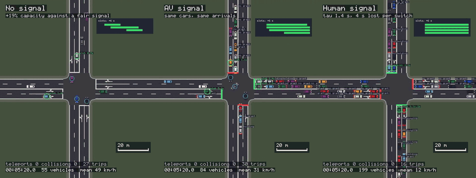
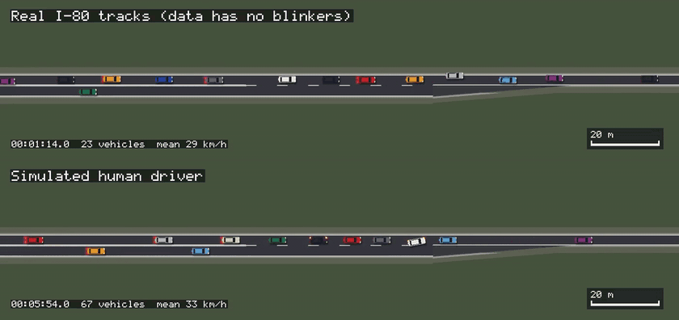
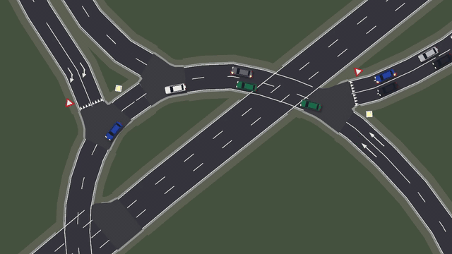
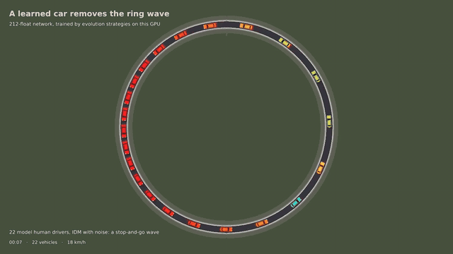

# cars

A traffic simulator where every car is simulated on the GPU, written in Rust and WGSL compute shaders.


https://github.com/user-attachments/assets/82271383-58a7-4f1e-b812-a85a18b32885


*Berlin at 07:45, zooming from the whole city to Ernst-Reuter-Platz. The demand is the BeST scenario, 2.25 million car trips a day, and every car keeps driving while the camera zooms.*

This is completely vibe coded, with coding agents in [T3 Code](https://t3.codes). It's me continuing to experiment after my bachelor thesis, where we used SUMO to study how self-driving cars affect traffic flow ([thesis and code](https://github.com/ErikFrankling/bachelor)). It started as a rewrite of SUMO on the GPU and still reads SUMO's network and demand files. The goal now is drivers that behave like real people and cities that match real traffic data, checked against recordings of real traffic. After that I want to put self-driving cars in and see what they change.



*Self-driving cars crossing with no traffic light (left), the same cars with a signal (middle), and human drivers with a signal (right).*



*Top: real cars from the NGSIM I-80 recording. Bottom: the simulated human driver at the same merge.*

<table>
<tr>
<td width="50%"></td>
<td width="50%"></td>
</tr>
<tr>
<td><em>A roundabout in Stockholm at the morning peak, with estimated demand.</em></td>
<td><em>22 simulated drivers on a ring road make a stop-and-go wave, until the teal car switches to a small neural network.</em></td>
</tr>
</table>

## Status

None of this matches reality yet. Single drivers are fitted to and tested against recordings of real cars, but whole areas are still far off: replaying a drone recording of central Athens, the simulation moves about a third of the real traffic. Notes, measurements and results are in [research/truth](research/truth), and [STATUS.md](research/truth/STATUS.md) says where each part stands.

## Running

Needs Nix and a GPU with Vulkan.

```sh
nix develop --command cargo build --release
target/release/cars run --net city.net.xml --routes city.rou.gz --end 3600 --summary-csv summary.csv
target/release/cars record --net city.net.xml --routes city.rou.gz --end 3600 --fit --out city.mp4
```

## Licence

The code is under the [EPL-2.0](LICENSE), SUMO's licence, since this started as a rewrite of SUMO. Files derived from recorded traffic data keep their own licences, listed in [DATA-LICENSES.md](DATA-LICENSES.md).

Maps © OpenStreetMap contributors. Berlin demand from the BeST scenario (DCAITI, TU Berlin). I-80 recording from NGSIM (US DOT, CC BY-SA 3.0), so that animation is CC BY-SA 3.0 too.
