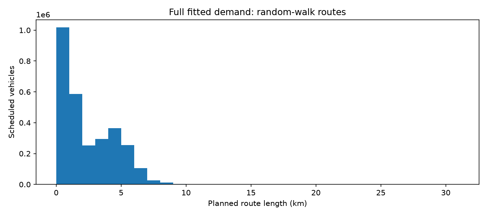
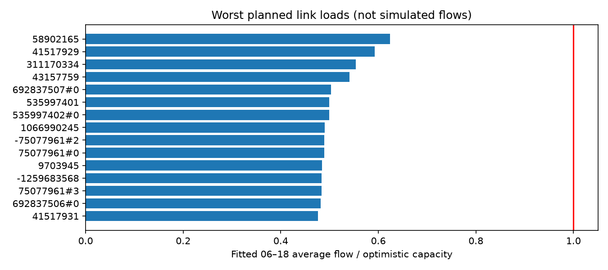

# Why the Stockholm scenario overloads, and what would make it credible

Research audit, 2026-10-31. **The evidence does not establish that Stockholm has too much real traffic for its roads. It establishes that our constructed trips, observations and controls do not yet describe the same system.** The strongest specific defect is routing: 46.5% of scheduled trips contain an immediate reversal onto the opposite directed edge. The count source is entirely labelled estimated traffic. Conversely, a deliberately optimistic link-capacity screen finds no daytime-average demand above capacity. Reducing every trip weight cannot resolve those identification and routing problems. [Local calculation and inputs](stockholm-audit.json), [route generator](file:///home/erikf/.t3/projects/cars/scripts/stockholm/demand.py).

## Evidence conventions and reproducibility

**Measured** means an observation, or a direct census of an input/output file; “measured in a simulation file” does **not** mean measured on the road. **Modelled** means inferred demand, estimated traffic or a calculation under stated assumptions. **Opinion** means a proposed decision or hypothesis. Local sources use `file:` URLs because they are the primary evidence for our scenario; web sources are linked at the claim. All cited primary sources were opened in this session. The regional RVU was readable through the web tool's extracted document, but its direct download and screenshot returned 404; that limitation matters and is not hidden.

The file census covers both complete demand files, every count feature, every non-internal passenger edge and every row in the existing three cars CSV files. It is not a sample. Raw outputs are modelled traffic; calculations are recorded in [audit JSON](stockholm-audit.json), [network detail JSON](stockholm-detail.json) and [per-link capacity CSV](stockholm-link-capacity.csv). Exact source sizes, modification times and SHA-256 digests are in [input manifest](stockholm-input-manifest.json). These outputs differ slightly from the task brief: the CSV snapshot audited here has **50,971** peak running and **294,409** teleports. Do not silently combine it with the brief's 51,214/302,180 run. [Primary summary](file:///home/erikf/projects/personal/cars-data/stockholm/cars.summary.csv), [primary trip output](file:///home/erikf/projects/personal/cars-data/stockholm/cars.trips.csv).

Reproduce from the repository root, sequentially, with no GPU:

```sh
OPENBLAS_NUM_THREADS=1 OMP_NUM_THREADS=1 nix develop --command python3 -I research/truth/scripts/stockholm_audit.py
OPENBLAS_NUM_THREADS=1 OMP_NUM_THREADS=1 nix develop --command python3 -I research/truth/scripts/stockholm_detail.py
nix develop --command python3 -I research/truth/scripts/stockholm_fetch.py
nix develop --command python3 -I research/truth/scripts/stockholm_supplement.py
```

The fetch scripts create new empty timestamped directories under `/home/erikf/projects/personal/cars-data/truth/stockholm/`, with a 25 MiB per-response limit. Their small fixed URL lists cannot approach the 5 GB task cap. They never execute downloaded content. The two batches downloaded **13,013,014 bytes**. Download results, including failures and hashes, are in [first fetch manifest](stockholm-fetch-manifest.json) and [supplement manifest](stockholm-supplement-manifest.json). The regional RVU and historical Sampers validation PDFs returned direct-download 404s despite being readable as extracted documents through the web tool; those are not successful raw-document acquisitions. No simulator experiments were run; therefore no causal percentage of gridlock reduction is claimed.

# Part 1 — Forensics

## 1. Demand totals are not yet comparable with reality

| Quantity | Full fit | 60% retimed file | Grade and interpretation |
|---|---:|---:|---|
| Scheduled vehicles | 2,919,242 | 1,751,306 | Measured file census; synthetic trips |
| Planned vehicle-km | 7,091,095 | 4,254,200 | Modelled: sum of external edge lengths along planned routes |
| Mean / median planned length | 2.429 / 1.695 km | 2.429 / 1.695 km | Measured properties of synthetic demand |
| 5th / 95th percentile length | 0.257 / 6.005 km | 0.257 / 6.005 km | Same |
| Actually inserted by midnight | Not remeasured here | 1,637,124 | Existing simulation snapshot |
| Completed by midnight | Not remeasured here | 1,615,297 | Existing simulation snapshot |
| Scheduled but not inserted | — | 114,182 (6.52%) | Derived from scheduled minus inserted |

Source for the complete table: [audit calculation](stockholm-audit.json), [full demand](file:///home/erikf/projects/personal/cars-data/stockholm/stockholm.rou.gz), [60% demand](file:///home/erikf/projects/personal/cars-data/stockholm/stockholm60.rou.gz), [summary](file:///home/erikf/projects/personal/cars-data/stockholm/cars.summary.csv). Planned lengths omit internal junction distances; these are not completed-trip odometer totals.

**Official scale check, modelled:** Stockholm city's climate follow-up puts 2024 territorial road traffic work at roughly **3.3 billion vehicle-km/year**, read approximately from figure 8, or **9.0 million vehicle-km per calendar day** using 366 days. It includes all road vehicles inside the municipality; this is an official aggregate estimate, not a survey of unique trips. Exact underlying numeric data and a weekday conversion were not verified. [Stockholms stad, 2025 report, p.15](https://meetingspublic.stockholm.se/welcome-sv/namnder-styrelser/miljo-och-halsoskyddsnamnden/mote-2025-06-10/agenda/13-2025-10981-bilaga-1-uppfoljning-av-stockholms-stads-klimatmal-2023-och-2024pdf?downloadMode=open).


**Inference:** our 7.09 million planned vehicle-km is not evidence of excessive total distance relative to that city reference. The clip includes neighbouring municipalities but also cuts territory; the annual average includes weekends while our source targets weekdays. A precise over/under-demand ratio would be misleading until both are integrated over the same polygon, vehicle classes and day type. Three million 2.4 km fragments and one million 7.1 km journeys can have the same total distance and very different junction demands. [Local route census](stockholm-audit.json).

**Measured survey estimates:** Region Stockholm's 2024 RVU reports **0.4 car-category person trips/person/weekday for city residents**, versus **0.7 countywide**. “Car” includes drivers, passengers and MC. Its weighted survey has **11,985 respondents aged 15–95; 21% response rate**, and a five-trip diary limit. These are resident person trips. An official daily **vehicle-trip total for this polygon** was not verified. [RVU 2024, pp.3, 16, 38–40](https://www.regionstockholm.se/49e914/contentassets/d6c4da12e11843c0ab8249c297dfd8fe/resvaneundersokning_for_stockholmsregionen_2024.pdf?_rsc=qypt9).

## 2. Why the fit returns 2.9 million trips

**Measured code behaviour:** the generator seeds four random walks per matched edge, keeps **79,013 route candidates**, then applies 300 multiplicative updates separately for three bands. It averages repeated observations per directed edge. The resulting **19,953 unique constrained edges** have targets totalling **35,213,201 counted edge passages/day**. They are not 35 million journeys, nor independent screenline crossings. The fitted 2,919,242 trips therefore traverse approximately **12.06 constrained edges per trip**. [Generator](file:///home/erikf/.t3/projects/cars/scripts/stockholm/demand.py), [fit report](file:///home/erikf/projects/personal/cars-data/stockholm/demand_fit.json), [count match census](stockholm-audit.json).

For incidence matrix A, target y, route weights w and d_j = sum_i A_ij, the update is:

`w'_j = w_j * sum_i[A_ij * y_i/(Aw)_i] / d_j`.

Consequently, with positive supported predictions, `sum_i(Aw')_i = sum_i y_i`. **Matching the aggregate total is built into the update**, even if the route pattern is implausible. The fit report's exact equality of aggregate target and fitted passages is therefore not independent evidence of a good OD matrix. Different route pools and different numbers of counted links per journey produce different trip totals. Shorter coverage can inflate the number of unique trips required. This algebra proves non-identification; it does not quantify how many Stockholm trips are excessive. [Implemented update and report](file:///home/erikf/.t3/projects/cars/scripts/stockholm/demand.py), [fit output](file:///home/erikf/projects/personal/cars-data/stockholm/demand_fit.json).

**Measured route defect:** **60,032 / 79,013 candidates (75.98%)** contain at least one consecutive pair `edge, -edge`. After fitting, **1,356,108 / 2,919,242 vehicles (46.45%)** use such a route. The generator excludes previously visited *directed edge IDs*, which permits returning along the other direction of the same road. These are exact reverse-ID pairs, a conservative detector; it misses reversals across differently split IDs. Legality in the converted network does not establish plausibility as a commute. [Audit detector](scripts/stockholm_audit.py), [full demand](file:///home/erikf/projects/personal/cars-data/stockholm/stockholm.rou.gz).



**Reality comparison is incomplete:** half of RVU work journeys across modes are 5–20 km (4,294 responses). Its distance-by-mode table reports mode share conditional on distance; it cannot supply the car-driver length distribution. The local 1.695 km median and 6.005 km p95 warrant scrutiny, but no observed car median or inflation factor was verified. [RVU 2024, pp.17–19](https://www.regionstockholm.se/49e914/contentassets/d6c4da12e11843c0ab8249c297dfd8fe/resvaneundersokning_for_stockholmsregionen_2024.pdf?_rsc=qypt9), [local lengths](stockholm-audit.json).

## 3. The count source is estimated and old; hourly demand is invented

**Measured metadata census:** all **16,698 features** have method `Skattad trafik`; **16,623 (99.55%)** have update year 2016, 57 have 2020 and 18 have 2021. Update date is not necessarily the date of the underlying measurement. The field definition is **ÅMVD**, annual mean over non-holiday Monday–Friday traffic, all directions. This is a derived street-flow product, not 16,698 independent contemporary detector measurements. The live three-feature WFS test returned HTTP 200 and the same metadata structure. [Local GeoJSON](file:///home/erikf/projects/personal/cars-data/stockholm/trafikflode_motorfordon.geojson), [live primary sample URL](https://openstreetgs.stockholm.se/geoservice/api/wfs?service=WFS&version=1.1.0&request=GetFeature&typeName=od_gis:Trafikflode_Motorfordon&maxFeatures=3&outputFormat=application/json&srsName=EPSG:4326), [city's ÅMVD explanation](https://openstreetws.stockholm.se/Home/Visualisering/AMVD).

**Measured mapping assumptions:** 31,654 directional rows map onto 19,953 edges. **856 features** have only one matched direction and receive the entire two-way value there; for an actually balanced two-way road this can double a directional target. On two matched directions the split is assumed 50/50. The net effect is unknown without direction-labelled counts; matches on ramps/parallel carriageways need a geometric audit. [Matching implementation](file:///home/erikf/.t3/projects/cars/scripts/stockholm/map_counts.py), [match census](stockholm-audit.json).


**Measured synthetic profile:** full demand jumps from **25,900 departures at 05–06 to 183,716 at 06–07, a factor 7.09**; daytime is nearly flat. Retiming still jumps from **12,470 to 79,166, a factor 6.35**, peaks at **165,534 at 16–17** and assigns **138,153 at 18–19**. The retimer changes departures within each original band rather than learning a spatially varying arrival profile. A count band describes *passage time*; treating it as a *departure band* additionally shifts downstream observations by travel time. [Census](stockholm-audit.json), [retimer](file:///home/erikf/.t3/projects/cars/scripts/stockholm/retime.py).

**Historical measured benchmark:** the Trafikverket Stockholm Sampers validation report describes Essingeleden's morning maximum hour as **6–7% of daily flow**, versus approximately **12% at E18 Bålsta**. One universal peak curve is therefore unjustified. These are historical examples, not a 2026 hourly target for every road. [Trafikverket/Sweco report, 2018, pp.55–56](https://bransch.trafikverket.se/contentassets/d7cf7d727fb2488aab9fa9d24387c7c8/externa-rapporter/2018/validering_o_kansl_analys_sampers_stockholm_ver1p1_180410.pdf).

## 4. Capacity, lanes, speeds, signals, tunnels and the clip

**Modelled screen for every link:** `C = passenger_lanes × min(2400, 3600/(1 + 7/v)) veh/hour`, v in m/s. The 1 s reaction/headway and 7 m vehicle-plus-gap come from the scenario; the 2,400 ceiling is an **opinion**, deliberately optimistic for triage, not an empirically calibrated capacity law. Lanes and speed alone cannot establish intersection capacity: turning allocation, green share, pedestrians, merging and spillback also matter. Use this to test the claim of manifestly impossible demand, not to certify capacity. [Vehicle type](file:///home/erikf/projects/personal/cars-data/stockholm/stockholm.rou.gz), [screen implementation](scripts/stockholm_audit.py).

**Result:** **zero links** exceed that optimistic screen using full fitted 06–18 passages divided by 12; zero constrained target averages exceed it either. The largest fitted ratio is **0.624**, Johanneshovsmotet edge `58902165`: 1,378 veh/h on one 40 km/h lane. At a hypothetical 1,800 veh/h saturation and 30% effective green, capacity becomes 540 veh/h and this same flow is 2.55 times capacity. That is a sensitivity illustration, not proof of its actual green allocation. Actual hourly passage maxima and movement-level capacities were not measured here. [All-link output](stockholm-link-capacity.csv).



**Measured network census:** 76,609 external passenger edges; 72,112 have one passenger lane, 3,439 two, 778 three, 238 four, 42 five or more. Maximum lane speeds are 30 km/h on 48,109 edges, 40 on 9,264 and 50 on 11,016. There are **1,922 signal programs** and **335.39 directed km** of motorway/motorway-link edges. Counts by edge depend on segmentation, so these cannot be compared directly with an official road-km inventory. Of 1,570 OSM motorway or ramp ways, **135 lack `lanes` (8.60%)** and **23 lack `maxspeed` (1.46%)**. Defaults are therefore material for some ways. [Network census](stockholm-audit.json), [OSM census](stockholm-detail.json), [conversion flags](file:///home/erikf/.t3/projects/cars/scripts/stockholm/build_net.sh).

**Signal correction:** the initial broad motorway screen finds 35 signal approaches, but **all 35 are ramps, zero are through `highway.motorway` edges**. Do not report invented traffic lights on the motorway carriageway. Conversion explicitly enables signal guessing and junction joining; a real signal inventory, timings and detector logic were not obtained. [Detailed classification](stockholm-detail.json), [converter](file:///home/erikf/.t3/projects/cars/scripts/stockholm/build_net.sh).

| Name search | Edges / directed length | Passenger lanes; speeds | What it does and does not establish |
|---|---|---|---|
| Norra länken | 25 / 4.214 km | 1–4; 40, 50, 70 km/h | Name-labelled subset only |
| Södra länken | 9 / 1.464 km | 1–3; 70 km/h | Tunnel-specific names require a corridor trace |
| Essingeleden | 25 / 9.463 km | 2–5; 70 km/h | Includes varying ramp/merge geometry |
| Slussen | 0 | No literal edge-name match | Absence of a district name is not absence of roads |

Source: [local network corridor census](stockholm-audit.json). OSM tunnel ways also use names such as Hammarbytunneln, Gärdestunneln and Norrtullstunneln; counting only “länken” undercounts corridors. [OSM name census](stockholm-detail.json). **Unverified:** present-day lane-by-lane geometry, speed signs, every ramp connection and vertical separation at these four sites. A strongly connected graph does not validate any of those.

**An official example of why this matters:** a 2018 Stockholm validation documents a ramp to Södra länken incorrectly represented with two lanes throughout rather than an initial one-lane section, and road capacity including reserved tram lanes. It reports Essingeleden historical daily counts around 150,000–155,000. Those are useful historical cross-checks, not proof that our current lane coding is wrong or a target for 2026. [Trafikverket/Sweco validation, pp.14 and 35](https://bransch.trafikverket.se/contentassets/d7cf7d727fb2488aab9fa9d24387c7c8/externa-rapporter/2018/validering_o_kansl_analys_sampers_stockholm_ver1p1_180410.pdf).

**Measured boundary:** the converted rectangle is about **34.38 × 30.51 km** in projected coordinates; its southwest/northeast corners transform approximately to **17.661 E, 59.197 N / 18.288 E, 59.457 N**. The XML's `origBoundary` describes a much broader original extract and is not the surviving simulation footprint. The graph has 50 source edges and 48 sink edges with no incoming/outgoing connection respectively; not all are external portals. [Location and graph census](stockholm-audit.json), [projection calculation](stockholm-detail.json).

**Inference:** outer journeys cannot be reconstructed simply by growing short random walks around central counts. Current trips may start/end on arbitrary interior edges, with no requirement to enter at a measured portal or preserve an external OD path. A boundary cut can remove alternatives even while the retained graph remains connected. No count of wrongly assigned external journeys can be established without external OD or a parent regional assignment. The official Dynameq Stockholm model extends north of Arlanda and south of Handen, providing a much larger candidate parent domain. [Generator](file:///home/erikf/.t3/projects/cars/scripts/stockholm/demand.py), [Trafikverket model coverage](https://bransch.trafikverket.se/for-dig-i-branschen/Planera-och-utreda/Samhallsekonomisk-analys-och-trafikanalys/trafikprognoser-och-trafikanalyser/trafikanalyser-och-vagkapacitetsanalyser/).

## 5. Where trouble starts; fixed routes and apparent completion


**Measured simulation output:** the first reported teleport is by **00:05**, at only **793 running vehicles**, before the morning loading jump. The first hourly edge interval includes **17 events on Norr Mälarstrand `1259514218#2`** and **16 on internal lane `:9091487480_1`**, adjacent to Nekvägen. This is evidence of local failures under light total loading. It does not prove that these are the first gridlock locations: the edge output aggregates an hour and teleports can have several causes. The present logs cannot locate or explain the very first failure at second resolution. [Summary and first-interval census](stockholm-audit.json), [edge locations](stockholm-detail.json), [raw edge output](file:///home/erikf/projects/personal/cars-data/stockholm/cars.edges.csv).

By 07:00 the snapshot has 6,502 running / 1,113 cumulative teleports; 09:00 has 20,344 / 14,574; 19:00 has 50,937 / 180,335. At midnight 21,833 remain. Worst individual edges over the day include Roslagsvägen `804574487` (**929** teleports), Årstabergsvägen `121443995#0` (**860**) and Roslagsvägen `804574485#0` (**792**). These are distributed bottlenecks rather than evidence of one tunnel closing the city. Event attribution can be downstream of the original queue. [Hourly census and locations](stockholm-detail.json), [event totals](stockholm-audit.json).

The completed-trip sample (**1,615,297**, censored at midnight) has mean duration **983.14 s**, mean waiting **637.56 s**, mean time loss **771.49 s**; median duration is **273 s**, p95 **5,142 s**. Waiting accounts for **64.85% of mean duration**. The severe tail, uninserted vehicles and unfinished trips matter more than one mean. [Trip census](stockholm-audit.json), [trip CSV](file:///home/erikf/projects/personal/cars-data/stockholm/cars.trips.csv).

**Measured implementation:** routes are fixed edge sequences. Teleport advances the route index and moves the vehicle into a dummy lane; it does not choose a new route around congestion. Thus arrivals can include teleport-assisted progress and are not an ordinary-road completion rate. No congestion-feedback route assignment appears in the inspected demand generator and step implementation. The causal benefit of rerouting is unknown without reruns holding OD and departures fixed. [Route generation](file:///home/erikf/.t3/projects/cars/scripts/stockholm/demand.py), [teleport implementation, `teleport`/`teleporting_step`](file:///home/erikf/.t3/projects/cars/crates/cars-core/src/shaders/step.wgsl).

## 6. Root-cause priority, with quantified evidence rather than invented attribution

A percentage decomposition of gridlock is **not identifiable from these artifacts**. No matched ablation runs exist, and routing, controls and spillback interact. The following is an **opinion ranking for repair**, based on measured exposure and falsifiable tests, not a claim that each item explains a specified share of delay. [Audit evidence](stockholm-audit.json).

| Priority | Mechanism | Quantified evidence | Test needed to measure its contribution |
|---|---|---|---|
| 1 | Unphysical route pool and missing OD | 1,356,108 trips with immediate U-turn; 2.429 km mean | Preserve endpoints/departures, replace walks with feasible cost-based alternatives; compare waiting and teleports |
| 2 | Uncalibrated junction/turn operations and engine behaviour | 1,922 programs; failures by 00:05 with 793 running | Replay earliest failures with second-level lane/turn/signal traces; isolate in cars and SUMO |
| 3 | Weak and stale observation constraints | 100% estimated metadata; 99.55% updated in 2016; 856 one-direction fallbacks | Refit on contemporary directional detectors and independent screenlines |
| 4 | Time and boundary construction | 7.09× original 06:00 departure jump; 34×31 km clip; no external OD constraints | Portal demand from parent assignment; directional time profiles, warmup, same-day data |
| 5 | Demand magnitude / no route response | 40% scheduling reduction still leaves 294,409 events in audited 60% output; no average link-screen exceedance | Fixed-OD demand ladder with identical profiles, then dynamic assignment; report marginal changes |

The full-vs-60% historical runs change profile and potentially engine revision as well as volume, so they are not an ablation proving volume's contribution. “Too many cars” is currently an incomplete explanation. “The map is wrong” is also unproven until its lane/turn/control details are compared with independent records. [Scenario history](file:///home/erikf/.t3/projects/cars/research/stockholm.md), [current census](stockholm-audit.json).

# Part 2 — Real data and a replacement plan

## 7. Data acquisition ledger

“Fetched” below means an HTTP response was actually obtained, not that a complete usable detector archive was acquired. Exact bytes, hashes and failures are in the two fetch manifests. No accounts, forms or external communications were used.

| Dataset; grade; producer / period / sample | Verified access and test | Role, flaws and remaining work |
|---|---|---|
| **Congestion tax passages — measured administrative counts; Transportstyrelsen, 2024; 12 monthly rows** | [Official monthly table](https://www.transportstyrelsen.se/sv/om-oss/statistik-och-analys/statistik-inom-vagtrafik/trangselskatt-statistik/stockholm/statistik-2024/), HTTP 200 saved | September: **8,420,500 / 21 charge days ≈ 400,976 passages/day**. These are station passages during the registration window, not unique trips. Public page did **not** provide station × direction × hour. Erik would need to request anonymised aggregated 15/60-minute station counts, exemptions included, registration coverage, missingness and station changes. Availability of that extract was not verified. |
| **Trafikinfo API — measured/administrative real-time information; Trafikverket; coverage not enumerated** | [Official API introduction](https://www.trafikverket.se/e-tjanster/trafikverkets-oppna-api-for-trafikinformation/), portal and data-model shell fetched | Official onboarding requires registration, licence acceptance and email verification. No account created; no authenticated TrafficFlow fetch performed. Erik must obtain access. Verify station coordinates, direction, lane, vehicle class, flow-rate units, time interval and retention before use. A realtime API is not proof of historical MCS coverage. |
| **TMS / road flow and speed surveys — measured observations plus ÅDT estimates; Trafikverket; station/year varies** | [Official description](https://bransch.trafikverket.se/tjanster/trafiktjanster/Vagtrafik--och-hastighetsdata/fordonsfloden-och-hastigheter/); map URL test recorded in supplement | Useful for motorway/external screenlines and speed distributions. ÅDT is annual daily traffic, unlike city ÅMVD. A map landing response is not a station-series export; no Stockholm station time series was downloaded. Verify survey year, uncertainty and expansion factors. |
| **MCS — measured per-lane radar speed/flow; Trafikverket, demonstrated by VTI 2018 study at two E4 locations** | [VTI report 969](https://trafikverket.diva-portal.org/smash/get/diva2%3A1699487/FULLTEXT01.pdf), PDF fetched | Report documents minute counts and mean speeds, and non-negligible missingness. Best data for capacity, breakdown and queue propagation. No current raw MCS feed/archive acquired. Erik would request a dated corridor/lane/station inventory plus several normal weekdays and missing-data flags; do not assume Trafikinfo exposes the whole archive. |
| **City Trafikflöde Motorfordon — modelled estimates; Stockholm stad; 16,698 local features** | [WFS sample](https://openstreetgs.stockholm.se/geoservice/api/wfs?service=WFS&version=1.1.0&request=GetFeature&typeName=od_gis:Trafikflode_Motorfordon&maxFeatures=3&outputFormat=application/json&srsName=EPSG:4326), 3 features fetched; [service specification](https://openstreetgs.stockholm.se/Home/Gs) | Retain year/method/source geometry; downgrade as soft prior. Existing feature metadata is all estimated, mostly updated 2016. Do not treat it as independent validation after fitting it. Source says annual mean non-holiday weekdays and all directions, with three passage bands. |
| **Regional RVU — measured weighted survey estimates; Region Stockholm, 2024; n=11,985** | [Primary report](https://www.regionstockholm.se/49e914/contentassets/d6c4da12e11843c0ab8249c297dfd8fe/resvaneundersokning_for_stockholmsregionen_2024.pdf?_rsc=qypt9) opened as extracted text; direct PDF 404 | Demand mode/participation/purpose constraints. Need driver-only OD, departure and distance cross-tabs with weights, uncertainty and geographic filters. Report groups drivers/passengers/MC. No microdata access verified. Compare 2019 cautiously because collection/diary conventions differ. |
| **National RVU — measured survey estimates; Trafikanalys, 2024; residents 6–84, sample n not verified here** | [Primary report](https://www.trafa.se/globalassets/statistik/resvanor/2025/resvanor-i-sverige-2024.pdf), fetch in supplement | Cross-check trip definitions and driver travel, not a Stockholm OD matrix. Official documentation explicitly warns that smaller subgroups have larger uncertainty. Obtain regional weighted tables with confidence intervals; avoid national-average substitution. |
| **Commuting and DeSO — measured register statistics; SCB; annual table/vintage dependent** | [SCB API labour-market catalogue](https://api.scb.se/OV0104/v1/doris/sv/ssd/AM), JSON fetched; [DeSO documentation](https://www.scb.se/hitta-statistik/regional-statistik-och-kartor/regionala-indelningar/demografiska-statistikomraden-deso/deso-tabellerna-i-ssd--information-och-instruktioner/), fetched | Establish residential and job marginals, zone population, worker OD prior. No commuting matrix or population values extracted in this session. Employment links are not daily commutes or mode choices. Match DeSO vintage; SCB documents a revised geography and discontinued old tables. |
| **Fine-area work OD — measured registers; SCB AMPAK** | [BEF301/302 description](https://www.scb.se/vara-tjanster/bestall-data-och-statistik/regionala-statistikprodukter/statistikpaket/ampak--delomradesniva/), opened | Documents residence/workplace-area commuting products, ordered through OSDB; pricing is linked. Exact fine-area availability, confidentiality and cost unverified. Erik can order an aggregate matrix if public municipality tables are inadequate. |
| **Vehicle-km — modelled official statistics; Trafikanalys, annual** | [Territorial national traffic work](https://www.trafa.se/vagtrafik/trafikarbete/) and [inspection-based odometers](https://www.trafa.se/vagtrafik/korstrackor/), fetched | National territorial model cannot be broken down regionally. Registered-vehicle odometers do not identify where vehicles drove. Neither is a direct clip calibration target. Use the city territorial inventory with a polygon-consistent network integration instead. |
| **NVDB — administrative road inventory; Trafikverket; current version** | [Official access page](https://www.nvdb.se/sv/kund/hamta-aktuella-data/), fetched | Lists `AntalKörfält2`, speed limits, forbidden direction, road class/number and network among current datasets. Viewing catalogue is open; downloading needs registration; historical data via Lastkajen. Obtain actual vector extract, lane permissions and connection restrictions. Signals, turn bans and signal plans were **not** verified as included in these 12 open layers; obtain complementary records rather than assuming availability. |
| **Sampers — modelled demand; Trafikverket; version/base-year dependent** | [Official model/access page](https://bransch.trafikverket.se/tjanster/system-och-verktyg/Prognos--och-analysverktyg/Sampers/), fetched | Best candidate regional purpose/mode/OD prior; not observed truth. Access to tool and baseline is through the management contact form. Erik must request the relevant base-year matrices, zoning, external traffic and reuse conditions; no form submitted. |
| **Dynameq Storstockholm — modelled regional network/assignment; Trafikverket** | [Official coverage](https://bransch.trafikverket.se/for-dig-i-branschen/Planera-och-utreda/Samhallsekonomisk-analys-och-trafikanalys/trafikprognoser-och-trafikanalyser/trafikanalyser-och-vagkapacitetsanalyser/) and [manual](https://bransch.trafikverket.se/contentassets/38911a0f4c0e4ee9a507272aba8d640c/dynameq-storstockholm-anvandarhandledning.pdf), manual test in supplement | Request subarea extraction with time-dependent portal demand. Manual is evidence of a maintained candidate parent model, not evidence that the model files are freely downloadable or validated against our target year. |
| **TomTom Traffic Index — measured probe-derived estimates; TomTom, 2025; Stockholm sample n undisclosed** | [Stockholm report](https://www.tomtom.com/traffic-index/city/stockholm/), HTTP 200 saved | Public city view reports **22m49s/10 km morning**, **30m09s evening**, **42.8% mean congestion**. Geographic/road weighting and device selection differ from our trips. Use as a broad sanity check only. No link-level historical API data or licence obtained; do not apply the city averages as Essingeleden travel times. |

## 8. What previous Stockholm modelling actually validates

**Measured/modelled study evidence:** Albania Nissan's **KTH 2010** dissertation models an E4 segment with VISSIM and compares/evaluates speeds, flows and travel times using motorway sensors; it discusses gantry data in five-minute intervals and variable-speed-limit compliance. It is corridor evidence, not a whole-city OD validation, and no universal error threshold or full observation count was extracted here. [Primary dissertation](https://kth.diva-portal.org/smash/get/diva2%3A321836/FULLTEXT01.pdf).

**Modelled study evidence:** the **2018 Trafikverket/Sweco Stockholm Sampers validation** compares screenline traffic, road speeds and coding, and discusses Contram use. Its examples show that matching totals can coexist with bad lane coding and time shares. Its historical base-year evidence must not be relabelled current observations. [Primary report](https://bransch.trafikverket.se/contentassets/d7cf7d727fb2488aab9fa9d24387c7c8/externa-rapporter/2018/validering_o_kansl_analys_sampers_stockholm_ver1p1_180410.pdf).

**Research-team statement, not a verified error table:** KTH's POST project describes Stockholm validation against **MCS, GPS and travel-time-camera data**, and NVDB-based network development. It supplies a credible pattern of independent observations, but the project page does not expose sample sizes, error distributions or a complete downloadable scenario. [KTH primary project page](https://www.byv.kth.se/en/avd/transportvetenskap/forskning-urban-mobi/prediktions-och-scenariobaserad-trafikledning-post-1.876335).

**Unverified leads:** searches found Stockholm MATSim student work, MITSIMLab/Brunnsviken and CONTRAM references, but did not yield opened primary full texts with sufficiently verified methods/results here. A MATSim book chapter DOI returned 403; journal pages for related Stockholm studies also returned 403. A purported hybrid MATSim/SUMO paper returned 429 and its applicability to Stockholm was not established. I did **not** verify a public, contemporary, whole-Stockholm SUMO scenario with independent flow/speed/travel-time validation, or an Aimsun Stockholm vehicle-traffic study with open validation data. These are gaps, not claims that no such work exists. Do not cite search snippets as validated evidence. The directly verified alternatives are the [KTH dissertation](https://kth.diva-portal.org/smash/get/diva2%3A321836/FULLTEXT01.pdf), [official regional model documentation](https://bransch.trafikverket.se/contentassets/38911a0f4c0e4ee9a507272aba8d640c/dynameq-storstockholm-anvandarhandledning.pdf) and [POST project](https://www.byv.kth.se/en/avd/transportvetenskap/forskning-urban-mobi/prediktions-och-scenariobaserad-trafikledning-post-1.876335).

## 9. Concrete replacement and acceptance plan

Everything below is **opinion: proposed experimental design**, not a claim that these thresholds are an official Swedish standard.

1. **Fix the target domain/day first.** Pick one dry, incident-free Tuesday–Thursday in a specified autumn year; freeze geometry, roadworks and school/holiday status. Keep a regional parent model so external–internal and external–external trips enter at legitimate portals. Store a municipal polygon separately for territorial vehicle-km comparisons. Make a dated source/version ledger before combining datasets.
2. **Determine demand from OD and activities.** Start with base-year Sampers/parent Dynameq OD, purpose and external trips; condition worker OD on SCB, participation/mode/time/length on driver-specific RVU. Add freight/service/taxi/bus classes separately. Fit only a selected subset of current directional counts, with confidence weights and a penalty for departing from the OD prior. Generate feasible cost-based route alternatives; reject immediate U-turns unless the trip purpose explicitly needs them. Preserve each OD pair while iterating travel costs and route choice. Do not manufacture new trips to fix every local count discrepancy.
3. **Determine capacity independently.** Join NVDB lane and speed data to OSM geometry; audit permissions and turn connectivity. Trace both carriageways and every ramp for Norra/Södra länken, Essingeleden and Slussen, including tunnel-specific names and layers. Obtain actual signal inventory/plans and effective greens. Estimate lane/movement capacity and discharge behaviour from MCS/TMS/turn counts; fit free-flow, breakdown and queue discharge separately. Model incident/tunnel-closure days separately.
4. **Hold observations out.** Freeze entire detector sites and complete days before fitting, not random rows of the same estimated street features. Reserve tax-station directional time series and MCS speed/flow sequences for validation; retain additional independent journey-time camera/probe routes. Use different days for calibration and validation, with common geometry and seasonal conditions. Never tune to a reported validation score.
5. **Expected scale:** use **roughly 0.5–2 million vehicle journeys/day only as a provisional engineering envelope for a city/subarea rebuild**, not as an observed Stockholm total. The defensible numeric scale currently available is approximately **9 million territorial vehicle-km/calendar day for the municipality**; if the *in-domain distance per vehicle journey* were 5–10 km, that would imply **0.9–1.8 million journey-equivalents/day** by division. The 5–10 km assumption is unverified, and boundary-crossing trips complicate it. Replace the envelope with summed driver OD plus commercial/external demand before calibration. Our current 2.9M at 2.43 km cannot establish the correct number. [Official territorial reference](https://meetingspublic.stockholm.se/welcome-sv/namnder-styrelser/miljo-och-halsoskyddsnamnden/mote-2025-06-10/agenda/13-2025-10981-bilaga-1-uppfoljning-av-stockholms-stads-klimatmal-2023-och-2024pdf?downloadMode=open), [local planned lengths](stockholm-audit.json).
6. **Acceptance targets, preregistered:** on held-out sites require screenline totals within ±10%, at least 85% of sufficiently busy hourly count observations with GEH<5, directional 15-minute profile error reported separately, and corridor travel-time median within ±15% and p90 within ±20% of observation. Report sensor missingness, sample size and uncertainty; no success based on GEH alone. For Essingeleden require observed morning **and** evening speed breakdown, queue extent and recovery timing reproduced within 15 minutes at successive stations; speed MAE ≤10 km/h is an initial target. Exact speed, flow and travel-time reference curves must come from the acquired same-year data. The historical 6–7% morning-hour fraction is only a check, not a replacement for those curves. [Historical measured profile](https://bransch.trafikverket.se/contentassets/d7cf7d727fb2488aab9fa9d24387c7c8/externa-rapporter/2018/validering_o_kansl_analys_sampers_stockholm_ver1p1_180410.pdf).
7. **Quality gates and attribution:** no collisions in deterministic controlled checks; ordinary normal-day flow should not need teleportation. Use a provisional teleport gate below 0.1% of inserted trips, explicitly counting events and unique affected vehicles separately. Require ≥99% of scheduled trips to insert during the simulated day plus a documented drain period. Record all pending/unfinished trips and survivor bias. Start with the 00:05 failures and isolated junctions before scaling; retain one GPU job at a time in subsequent implementation work.
8. **Measure contributions with controlled runs:** freeze engine/network/profile and compare original routes, U-turn-free routes with identical OD, dynamic route assignment, measured signals and corrected geometry in factorial or paired ablations. Separately vary OD magnitude (25/50/75/100%) under a common profile. Outputs: waiting vehicle-hours, pending insertions, travel-time quantiles, hourly speeds, flows, queue length and teleport/collision reasons. Use paired seeds and include interactions. Only then rank causes by recovered throughput or saved delay, with uncertainty.

## 10. What Erik alone would have to unlock

- Register/verify Trafikverket API and NVDB/Datautbytesportal access; export the needed regional road layers and inspect actual TrafficFlow coverage. [Official API onboarding](https://www.trafikverket.se/e-tjanster/trafikverkets-oppna-api-for-trafikinformation/), [NVDB access](https://www.nvdb.se/sv/kund/hamta-aktuella-data/).
- Request aggregated station × direction × 15/60-minute tax passages and historical lane-level MCS/turn/signal records. Their public bulk availability was not established by this session; no one was contacted. [Tax statistics actually available](https://www.transportstyrelsen.se/sv/om-oss/statistik-och-analys/statistik-inom-vagtrafik/trangselskatt-statistik/stockholm/statistik-2024/), [MCS data documented by VTI](https://trafikverket.diva-portal.org/smash/get/diva2%3A1699487/FULLTEXT01.pdf).
- Request the relevant Sampers/Dynameq baseline matrices and reuse terms; if necessary order confidentially safe fine-area SCB commuting aggregates and driver-only RVU tables. No account, purchase or request has been submitted. [Sampers access](https://bransch.trafikverket.se/tjanster/system-och-verktyg/Prognos--och-analysverktyg/Sampers/), [SCB products](https://www.scb.se/vara-tjanster/bestall-data-och-statistik/regionala-statistikprodukter/statistikpaket/ampak--delomradesniva/).

The immediate next engineering action is to inspect the first low-load failures and replace the random-walk pool while keeping OD/departures fixed for comparison. The research does not justify another arbitrary citywide demand multiplier.
