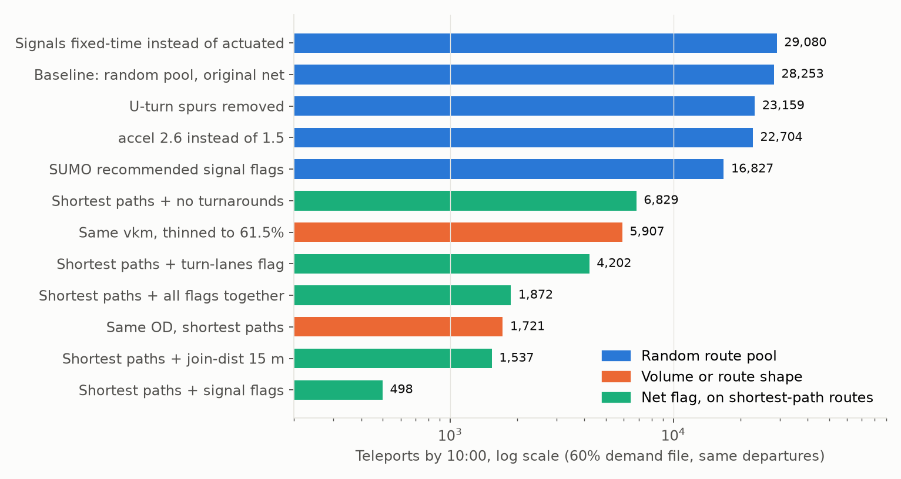
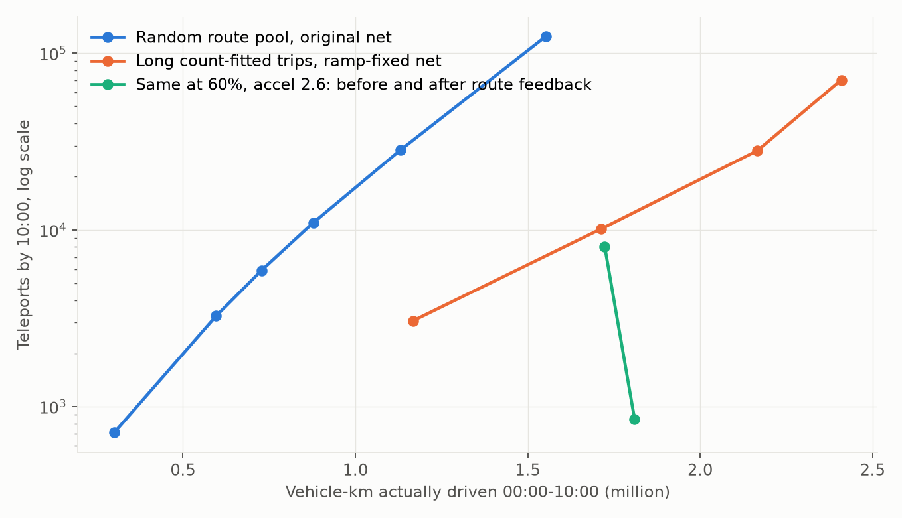
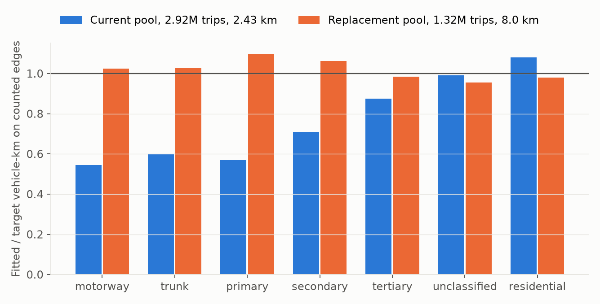
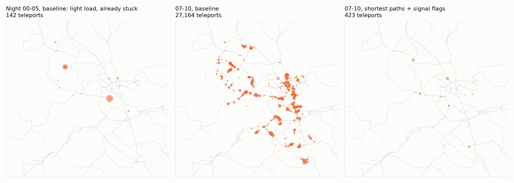
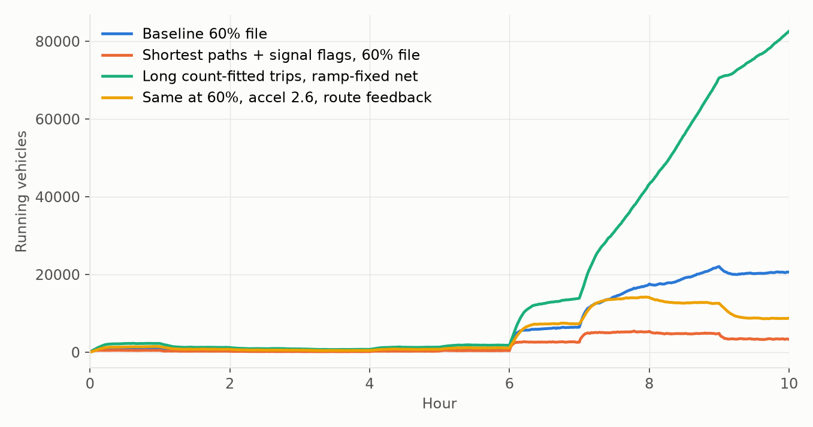
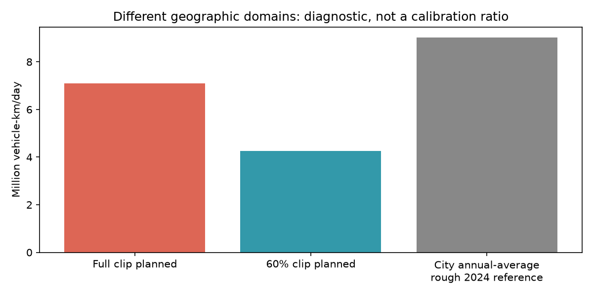
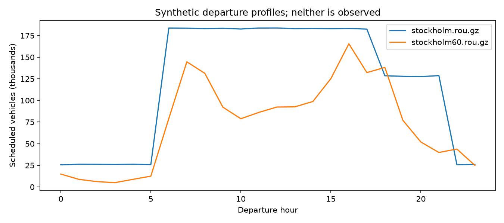
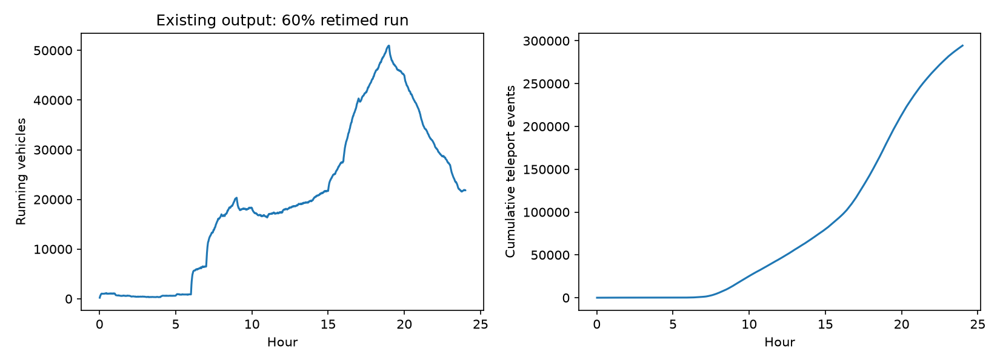

# Why the Stockholm scenario overloads, and what would make it credible

First draft by another model, 2026-10-31. Checked, corrected and extended with experiments by Opus, 2026-11-01. What changed is in [Reviewed by Opus](#reviewed-by-opus).

## Short answer

**It is not too many cars. It is the wrong trips on a badly converted map.** Real Stockholm carries more traffic than our gridlocked scenario: 400,976 congestion-tax passages per charged day in September 2024 against about 158,000 equivalent crossings in the 60% file, and about 9 million vehicle-km per calendar day in the municipality alone against 4.25 million planned in the whole, larger clip. Our scenario still locks up because its 1.75 million trips are 2.4 km fragments that wander through side streets on fixed routes.

**Is the map the problem? Partly.** The raw OSM is mostly fine. The conversion is not: it cuts real junctions into chains of independent signals and links shorter than a car, and it makes many on-ramps yield. These are where traffic first gets stuck, at night with under 1,000 cars running, in both `cars` and SUMO. But the same map survives far more traffic once the trips are right, so demand comes first. Fixing the map alone does not stop the lock-up, and turning on the flags a report might suggest first (`--osm.turn-lanes`, no turnarounds) makes it worse.

**A Stockholm that does not lock up now exists**, at a stated cost: 60% of the count-fitted demand. Over a full day it inserts 790,966 trips, 788,725 arrive, 2,235 are still driving at midnight and mean speed is 43 km/h, against 290,352 teleports and 18,491 stranded in the current scenario. It still has 2,449 teleports, 0.3% of trips, and it is 60% of the real cordon traffic. At 100% it still locks up, and I can show why only in part. [The recipe](#recipe-for-a-stockholm-that-does-not-lock-up).



## Ranked causes, measured

Every row is a controlled run of the real simulator, binary sha256 `a937031f`, with the city flags, 00:00–10:00 unless stated. Teleports are counted by 10:00. The same config with another seed differed by 2–8%, so differences under about 10% are noise. Effects interact and do not add up. All runs are in [stockholm-factorial.csv](stockholm-factorial.csv), raw output under `cars-data/truth/stockholm/factorial/`.

Baseline A is today's scenario: 60% file, original net: 28,253 teleports, mean time loss 185 s, 19.5 km/h, 20,656 running at 10:00. Baseline B is the replacement demand at full scale on the ramp-fixed net: 70,595 teleports, 663 s, 14.0 km/h, 82,601 running.

| # | Cause | Change tested | Teleports by 10:00 | Other effects |
|---|---|---|---:|---|
| 1 | **Wandering route pool** | A with same origins, destinations and departures, shortest paths | 28,253 → 1,721 (−94%) | Time loss 185 → 34 s, 41.5 km/h, 3,664 running, planned vkm −39%. Thinning to the same vkm instead gives only 5,907, so volume is −79% and route shape a further −71% |
| 2 | **No route response** | 60% of B, three rounds of congestion feedback, same OD | 8,062 → 849 (−89%) | Time loss 215 → 114 s, 31.8 → 42.6 km/h, 15,720 → 8,709 running. Measured in a jam it does not help: at 100%, before the route-legality fix, four rounds raised teleports from 72,120 to 97,204–117,148 |
| 3 | **Demand above what this net carries** | B scaled 100 / 80 / 60 / 40% | 70,595 / 28,078 / 10,131 / 3,058 | A scaled 100 / 60 / 45 / 37 / 30 / 15%: 124,345 / 28,253 / 10,980 / 5,907 / 3,256 / 712. Never reaches zero, because of cause 4 |
| 4 | **Fragmented signals, sub-vehicle links** | `--tls.discard-simple --tls.join` on A; on shortest paths | 28,253 → 16,827 (−40%); 1,721 → 498 (−71%) | First teleport 240 → 2,940 s. Part of this gain is capacity that does not exist, because the flags delete real signals; see below. `--tls.join` alone is 5× worse: 8,572 |
| 5 | **On-ramps forced to yield** | `--ramps.min-highway-speed 16.6`, on B | 81,880 → 70,595 (−14%) | Yielding ramps 34 → 9 of 148 |
| 6 | **Slow drivers** | `accel` 2.6 instead of 1.5 | A −20% (22,704); B −8% (65,280) | Scenario has accel 1.5; SUMO's default is 2.6 |
| 7 | **U-turn spurs** | A with spurs removed, ends kept | 28,253 → 23,159 (−18%) | The headline of the first draft, and well down the list |
| 8 | **Assumed peak** | Flat departures inside each band, before the route-legality fix | 72,120 → 59,003 (−18%) | Only indicative. The rerun with legal routes was killed by the desktop guard, and a second try timed out waiting for the GPU |
| 9 | Junction join distance | `--junctions.join-dist 15`, shortest paths | 1,721 → 1,537 (−11%) | At the noise limit |
| 10 | Actuated versus fixed-time | `--static-tls` on A | 28,253 → 29,080 (+3%) | No effect. "All signals are 90 s" does not explain anything |
| — | Engine | Same input in SUMO, see below | `cars` 35–64% more teleports | Running and inserted within 2%. Not a cause of the lock-up |

**Changes that made it worse**, on the 1,721 shortest-path run:

| Change | Teleports | Why |
|---|---:|---|
| `--osm.turn-lanes` | 4,202 (second seed 3,860) | Only 1,161 of 435,105 ways have the tag, and [SUMO reads unmarked lanes as through lanes](https://sumo.dlr.de/docs/Networks/Import/OpenStreetMap.html) |
| `--no-turnarounds.except-deadend` | 6,829 | Trips that start the wrong way go round the block: mean trip 1,572 → 1,926 m |
| All flags together | 1,872 | The two above cancel the gains |
| Register-based net from [report 07](07-maps-and-intersections.md), `v5_inventory` | 13,444 | See [below](#the-register-based-net-locks-up-harder) |



The chart is the key result. At the same vehicle-km the replacement trips cause about a tenth of the teleports of the random pool. Route feedback is the near-vertical drop: same distance driven, 89% fewer teleports.

## Why the current demand is wrong, with numbers

| | Full fit | Current 60% | Replacement, same counts |
|---|---:|---:|---:|
| Trips | 2,919,242 | 1,751,306 | 1,318,869 |
| Mean / median trip | 2.43 / 1.70 km | same | 8.04 / 6.86 km |
| Planned vehicle-km | 7.09 M | 4.25 M | 10.60 M |
| Routes used of pool | 16,332 of 79,013 | 15,079 | 9,734 of 62,089 |
| **Tax cordon + Essingeleden crossings, 06:00–18:30** | 258,268 | 158,447 | 390,604 |
| **Share of real 400,976** | 64% | 40% | **97%** |

The cordon row is an independent test: tax passages are not used in any fit. The real figure is [8,420,500 passages over 21 charged days, September 2024, registered 06:00–18:29](https://www.transportstyrelsen.se/sv/om-oss/statistik-och-analys/statistik-inom-vagtrafik/trangselskatt-statistik/stockholm/statistik-2024/). Limits: Transportstyrelsen [names the stations](https://www.transportstyrelsen.se/sv/vagtrafik/fordon/skatter-och-avgifter/trangselskatt/trangselskatt-i-stockholm/betalstationer-i-stockholm/) but keeps the coordinates in Lastkajen, which needs an account, so I drew the polygon by hand around them and added an Essingeleden screenline. 139 edges cross it, including some minor streets, and rules for who is charged differ. Read it as "about right", not as 97.4%. Other kernel widths give 92–106%. The same check on the other candidate pools: [cordon JSON](stockholm-cordon.json), [replacement](stockholm-cordon-recipe.json).

**The counts did not need 2.9 million trips.** Fitting the same counts, with the same algorithm, on real paths between ends 6 km apart in the kernel gives 1.32 million, and 1.21–1.37 million across kernels of 3–12 km. The inflated total came from short fragments. [Pool generator and fit](scripts/sthlm_pool.py).

**The fit starved the main roads.** The first draft noted that equal totals are built into the update. It went unchecked by road class:



Each pool is measured against its own targets: the current pool against the original matching, the replacement against the cleaned one.

Motorways got 55% of target vehicle-km and GEH<5 on 11% of edges; residential streets got 108% and 69%. [Class census](stockholm-classfit.json). So the scenario has too much on side streets and too little on Essingeleden: the full fit has 47,564 vehicles per day across an edge pair the source gives as 153,500.

**Count matching also damaged the targets.** 4,117 of 31,654 matches join a feature to an edge with a different street name, including 541 of 1,095 on motorways, although motorway names vary legitimately. Averaging then mixes them: Essingeleden edge `300183415` averages a 76,750 feature with a 100-vehicle side street. On 39% of motorway edges with several features they differ by more than 5×. Strict name matching alone would remove 29% of the motorway target and 12% of the total; the fit here keeps same-name features, plus the top-valued features on major roads. [Audit](scripts/sthlm_matchaudit.py).

**Trips concentrate.** Only 15,079 of 79,013 routes carry anyone in the 60% file and 1,000 routes carry 60.5% of all trips. The busiest route has 6,511 vehicles, all starting from one street. The replacement still does this, with 4,000 distinct origins, and that is untested.

**Link capacity was never the issue.** The first draft's screen reproduces exactly: maximum ratio 0.624 on `58902165`, zero links over. Using the peak hour and nominal green instead of the daily average, the 99th percentile load is still only 0.25 in the 60% file. With the replacement demand about 60 edges exceed that stricter limit at the peak, 27 of them motorway. That looks like a real city: bottlenecks on main roads, not everywhere. [Screen](stockholm-capscreen.json).

## Where traffic first gets stuck

The first teleport is at 00:05 with 793 cars running in `cars`, and at 00:06:44 in SUMO, **on the same edge**. Traffic this light cannot be overloaded, so I looked at what the cars do there. Of the teleports between 00:00 and 06:00, 148 of 157 (94%) are at a junction touching an edge shorter than 7.5 m, which only 17% of junctions do. Over the whole day it is 47%. The net has 5,136 edges shorter than a 7 m car-plus-gap, and 1,571 shorter than 0.5 m. [Net census](stockholm-net-artefacts.json).



| Site | Night teleports | What the net does there |
|---|---:|---|
| Norr Mälarstrand `1259514218#2`, at Rålambshovsleden | 57 of 142 in `cars`, 12 of 17 in SUMO's first hour | Three independent signals in a row, 6.1 m and 0.7 m apart. A car does not fit between them. Its left lane leads into a lane whose only connection is a U-turn. Heads wait on green with nowhere to go |
| Bromstensvägen/Nekvägen `:9091487480` | about 50 | Two links of 2.5 m joining two junctions, right-before-left at one end. Cars inside one junction wait for the next, and those wait back |
| Södermannagatan × Ringvägen `42975456` | a few | Ringvägen's two carriageways are separate junctions joined by a 0.2 m link. Both directions interlock. Random-walk routes also U-turn on it |
| Glavagatan `-1279809776` | a few | 2.5 m link with three minor movements |

The same pattern scales up: at 07:00 there are 116 stuck lane heads, at 08:00 681, at 16:00 1,444. The largest groups are cars already on a junction waiting to leave, and cars with priority (`M`) waiting to enter, so queues block the junctions behind them. Signal state is not the main reason: red explains 5 of 116 at 07:00.

**Queue heads by hour**, edges slow while the next edge is not, ranked by excess vehicle-hours ([tool](scripts/sthlm_heads.py)):

| Run, hour | Heads | Largest |
|---|---:|---|
| Baseline, 07–08 | 600 | Lidingövägen, Fredhällspåfarten (ramp, 198 veh/h at 1.8 km/h), Olaus Magnus väg, ramp onto Roslagsvägen |
| Replacement, full scale, 07–08 | 740 | Motorway ramps: onto Uppsalavägen, Bagartunneln, onto Södertäljevägen, Hjorthagskopplet, Fredhällspåfarten |
| Recipe before the last feedback round, 16–18 | 481 | Svartlösakopplet, Ulvsundavägen ramp, Avestagatan, Sollentunavägen, Nybroplan |

Ramps explain why: `--ramps.guess` only treats a road as a motorway above [`ramps.min-highway-speed`, default 79 km/h](https://github.com/eclipse-sumo/sumo/blob/v1_28_0/src/netbuild/NBFrame.cpp). Essingeleden and Södra länken are 70. So 34 of 148 on-ramps get no added lane and must find a gap as a minor road, and with the replacement demand on the original net, before the route-legality fix, 49 of 120 ramps ran below 15 km/h, median 255 veh/h. [Ramp census](scripts/sthlm_ramps.py).

**Most signals have nothing to control.** 1,284 of 1,922 controllers (66.8%) have no conflicting road movement: 937 with one approach, 347 straight through on two. Report 07 shows from the city's register that they are mostly real installations cut into pieces, so their partner is elsewhere. Cars stop at them on a generated program with no reason to.

## Cars or SUMO?

Same input, same flags, SUMO 1.28, 08:00 not always reached because I capped each run at 9.5 minutes.

| Scenario, time | | Running | Inserted | Teleports | Collisions |
|---|---|---:|---:|---:|---:|
| Baseline, 07:30 | SUMO | 14,001 | 204,597 | 1,991 | 40 |
| | `cars` | 14,316 | 204,111 | 2,689 | not in summary |
| Recipe before the last round, 07:43 | SUMO | 13,964 | 108,393 | 143 | 24 |
| | `cars` | 14,001 | 108,371 | 235 | not in summary |
| Night, first hour | SUMO | 1,046 | 14,913 | 17 | 0 |
| | `cars` | 1,065 | 14,913 | 61 | not in summary |

**The lock-up is the input, not the engine.** Both reach the same state. `cars` teleports somewhat more, which belongs in the fidelity work, and its collisions at high load are far above SUMO's and should be looked at: 13,690 by 10:00 in baseline B. SUMO also found a defect in my own first replacement routes: 1,209 of its first 1,464 teleports were wrong-lane because routes used connections marked `allow="bicycle"` and similar. **`cars` reads permissions only from lanes (`crates/cars-core/src/net.rs`), so it silently lets cars through these turn bans.** 48 connections in the net have an `allow`, 224 a `disallow`. All results here use the corrected routes.

## The register-based net locks up harder

Report 07 built a net whose signals come from the city's register: 492 controllers in the municipality against 519 installations, bus lanes closed to cars, turn lanes on. On the facts it is the most realistic net. Under traffic it is much the worst:

| Same pipeline | Original-flag net + ramps + `tls.discard-simple` | Register net `v5_inventory` | Register net + ramp fix |
|---|---:|---:|---:|
| Shortest paths, 60% file | 498 (without ramp fix) | 13,444 | 13,414 |
| Full-scale replacement | 70,595 | 150,956 | 148,411 |
| 60%, feedback round 0 | 8,062 | 52,249 | 54,216 |
| 60%, feedback round 3 | 849 | 25,119 | 33,412 |
| Full day | 9,558 | 631,888 | 693,103 |

These runs do not say the register net is wrong. They say that with generated programs, real signal positions lose more capacity than the guesses did. At 07:00, 51 of its 103 stuck lane heads wait on red, against 5 of 116 in the baseline: netconvert builds one program per installation, with no real phases, offsets or detectors. One change at a time on the 1,721 shortest-path run: closing bus lanes (`--osm.lane-access`) gives 2,692, `--tls.join` alone 8,572, and all of stage 1 (with turn lanes) 12,172, before the register patch brings 13,444. So most of the damage comes from joining signals under a generated program, not from the bus lanes. [Report 07](07-maps-and-intersections.md) separately finds `--tls.join` alone makes cycles up to 374 s. The honest reading is that the low-teleport nets partly gain capacity by not having signals that exist, and closed bus lanes remove lanes that the fit still loads. **Realistic signal positions need realistic signal plans**, which only the city has.

## Recipe for a Stockholm that does not lock up

Exact commands in [sthlm_recipe.sh](scripts/sthlm_recipe.sh). I ran this sequence; route files and outputs are at `cars-data/truth/stockholm/factorial/` as `n7_ramps.net.xml`, `v2_c4.rou.gz` and `v2_day2/`.

1. **Net.** `build_net.sh` flags plus `--tls.discard-simple --tls.join --junctions.join-dist 15 --ramps.min-highway-speed 16.6 --ramps.ramp-length 200`. No `--osm.turn-lanes`, no `--no-turnarounds`. Caveat: this deletes some real signals; see above.
2. **Demand.** Candidate paths between road-length-weighted ends with a 6 km distance kernel plus boundary portals, 62,089 paths, cost free-flow time plus junction penalties and connection permissions respected. Fit by `demand.py`'s update to counts cleaned by street name.
3. **Drivers.** `accel` 2.6.
4. **Scale** to 60%, keeping the assumed hourly profile of `retime.py`.
5. **Route feedback.** Three rounds moving 1/2, 1/3, 1/4 of vehicles to the current best path using 06:00–10:00 edge times, then a full day, then one round moving 1/4 using 06:00–21:00 times. Start from an unjammed state: feedback from a jam only moves the jam.
6. **Run** with the city flags. The whole sequence takes about 30 minutes of CPU and GPU when the GPU is free.

| Full day | Current 60% scenario | Recipe | |
|---|---:|---:|---|
| Inserted / arrived | 1,635,345 / 1,616,859 | 790,966 / 788,725 | |
| Not inserted by midnight | 115,961 | 1 | |
| Still running at midnight | 18,491 | 2,235 | |
| Peak running | 49,154 | 16,409 | |
| Teleports | 290,352 | 2,449 | 177 → 3.1 per 1,000 |
| Collisions | 35,342 | 51 | |
| Mean speed | 8.9 km/h | 42.8 km/h | |
| Mean time loss | 760 s | 114 s | |
| Vehicle-km driven | 3.90 M | 6.44 M | Edge output, whole clip |
| Real cordon traffic | 40% planned | 60% planned | |



| Hour | 00 | 06 | 07 | 08 | 09 | 12 | 16 | 17 | 18 | 19 | 20 | 22 |
|---|---:|---:|---:|---:|---:|---:|---:|---:|---:|---:|---:|---:|
| Baseline km/h | 38 | 36 | 28 | 18 | 13 | 12 | 10 | 7 | 6 | 4 | 4 | 5 |
| Recipe km/h | 44 | 44 | 43 | 42 | 43 | 44 | 42 | 42 | 42 | 43 | 44 | 44 |
| Baseline teleports | 61 | 566 | 3,301 | 8,610 | 14,580 | 14,061 | 25,672 | 20,413 | 40,065 | 24,415 | 33,628 | 16,296 |
| Recipe teleports | 6 | 40 | 141 | 334 | 147 | 80 | 226 | 452 | 266 | 136 | 88 | 23 |

The last round matters. With morning times only the day had 9,558 teleports, peaking at 2,387 in the 19:00 hour at 26 km/h; one round with full-day times gives 2,449, with no hour above 1% of its departures. Teleports that remain concentrate on short motorway diverges such as Bergshamravägen `804598780` and Uppsalavägen `804669067`, where lanes must be chosen on 36–48 m edges, and 55% of all teleports are wrong-lane. Further flow: at 80% scale with feedback I measured 10,832 by 10:00 and at 100% 41,914, both before the route-legality fix and with fewer rounds, so treat them as rough. Steps in the running curve at whole hours come from `retime.py`, which assigns a share per hour.

**Bus lanes.** The recipe leaves them open to cars, as the original build does, which is wrong: report 07 shows `--osm.lane-access` honours 293 of 295 tagged edges. Adding it costs 849 → 1,934 by 10:00 at the same feedback, and on the day before the last round 8,411 against 9,558. I did not get the matching last round: the job waited 45 minutes for the GPU lock and I stopped there. So the recipe's 2,449 is with bus lanes open, and closing them should be expected to add teleports.

**This is not validated Stockholm.** GEH<5 against counts is 19% daily over 17,385 edges, because it is 60% scale, against 32% for the baseline; r² is 0.78 against 0.75. Both baseline and recipe sit well below target on main roads: motorway vehicle-km is 32% of target in the recipe, 24% in the baseline. It answers "does a run lock up", not "is this the real traffic". Peak shape, OD and every signal plan are still assumed.

## Evidence conventions and reproducibility

**Measured** means an observation, or a direct census of an input/output file; “measured in a simulation file” does **not** mean measured on the road. **Modelled** means inferred demand, estimated traffic or a calculation under stated assumptions. **Opinion** means a proposed decision or hypothesis. Local sources use `file:` URLs because they are the primary evidence for our scenario; web sources are linked at the claim. Primary sources were opened by the first author unless noted; the review reopened those it relies on. The regional RVU was readable through the web tool's extracted document, but its direct download and screenshot returned 404; that limitation matters and is not hidden.

The file census covers both complete demand files, every count feature, every non-internal passenger edge and every row in the existing three cars CSV files. It is not a sample. Raw outputs are modelled traffic; calculations are recorded in [audit JSON](stockholm-audit.json), [network detail JSON](stockholm-detail.json) and [per-link capacity CSV](stockholm-link-capacity.csv). Exact source sizes, modification times and SHA-256 digests are in [input manifest](stockholm-input-manifest.json). These outputs differ slightly from the task brief: the CSV snapshot audited here has **50,971** peak running and **294,409** teleports. Do not silently combine it with the brief's 51,214/302,180 run. [Primary summary](file:///home/erikf/projects/personal/cars-data/stockholm/cars.summary.csv), [primary trip output](file:///home/erikf/projects/personal/cars-data/stockholm/cars.trips.csv).

Reproduce from the repository root, sequentially, with no GPU:

```sh
OPENBLAS_NUM_THREADS=1 OMP_NUM_THREADS=1 nix develop --command python3 -I research/truth/scripts/stockholm_audit.py
OPENBLAS_NUM_THREADS=1 OMP_NUM_THREADS=1 nix develop --command python3 -I research/truth/scripts/stockholm_detail.py
nix develop --command python3 -I research/truth/scripts/stockholm_fetch.py
nix develop --command python3 -I research/truth/scripts/stockholm_supplement.py
```

The fetch scripts create new empty timestamped directories under `/home/erikf/projects/personal/cars-data/truth/stockholm/`, with a 25 MiB per-response limit. Their small fixed URL lists cannot approach the 5 GB task cap. They never execute downloaded content. The two batches downloaded **13,013,014 bytes**. Download results, including failures and hashes, are in [first fetch manifest](stockholm-fetch-manifest.json) and [supplement manifest](stockholm-supplement-manifest.json). The regional RVU and historical Sampers validation PDFs returned direct-download 404s despite being readable as extracted documents through the web tool; those are not successful raw-document acquisitions, and in the review both still returned 404 to me, so claims from them below are the first draft's and I could not recheck them. Experiment scripts are `research/truth/scripts/sthlm_*`.

# Part 1 — Forensics

## 1. Demand totals are not yet comparable with reality

| Quantity | Full fit | 60% retimed file | Grade and interpretation |
|---|---:|---:|---|
| Scheduled vehicles | 2,919,242 | 1,751,306 | Measured file census; synthetic trips |
| Planned vehicle-km | 7,091,095 | 4,254,200 | Modelled: sum of external edge lengths along planned routes |
| Mean / median planned length | 2.429 / 1.695 km | 2.429 / 1.695 km | Measured properties of synthetic demand |
| 5th / 95th percentile length | 0.257 / 6.005 km | 0.257 / 6.005 km | Same |
| Actually inserted by midnight | Not remeasured here | 1,637,124 | Existing simulation snapshot |
| Completed by midnight | Not remeasured here | 1,615,297 | Existing simulation snapshot |
| Scheduled but not inserted | — | 114,182 (6.52%) | Derived from scheduled minus inserted |

Source for the complete table: [audit calculation](stockholm-audit.json), [full demand](file:///home/erikf/projects/personal/cars-data/stockholm/stockholm.rou.gz), [60% demand](file:///home/erikf/projects/personal/cars-data/stockholm/stockholm60.rou.gz), [summary](file:///home/erikf/projects/personal/cars-data/stockholm/cars.summary.csv). Planned lengths omit internal junction distances; these are not completed-trip odometer totals.

**Official scale check, modelled:** Stockholm city's climate follow-up puts 2024 territorial road traffic work at roughly **3.3 billion vehicle-km/year**, read approximately from figure 8, or **9.0 million vehicle-km per calendar day** using 366 days. It includes all road vehicles inside the municipality; this is an official aggregate estimate, not a survey of unique trips. Exact underlying numeric data and a weekday conversion were not verified. [Stockholms stad, 2025 report, p.15](https://meetingspublic.stockholm.se/welcome-sv/namnder-styrelser/miljo-och-halsoskyddsnamnden/mote-2025-06-10/agenda/13-2025-10981-bilaga-1-uppfoljning-av-stockholms-stads-klimatmal-2023-och-2024pdf?downloadMode=open).



**Inference:** our 7.09 million planned vehicle-km is not evidence of excessive total distance relative to that city reference. The clip includes neighbouring municipalities but also cuts territory; the annual average includes weekends while our source targets weekdays. A precise over/under-demand ratio would be misleading until both are integrated over the same polygon, vehicle classes and day type. Three million 2.4 km fragments and one million 7.1 km journeys can have the same total distance and very different junction demands. [Local route census](stockholm-audit.json).

**Measured survey estimates:** Region Stockholm's 2024 RVU reports **0.4 car-category person trips/person/weekday for city residents**, versus **0.7 countywide**. “Car” includes drivers, passengers and MC. Its weighted survey has **11,985 respondents aged 15–95; 21% response rate**, and a five-trip diary limit. These are resident person trips. An official daily **vehicle-trip total for this polygon** was not verified. [RVU 2024, pp.3, 16, 38–40](https://www.regionstockholm.se/49e914/contentassets/d6c4da12e11843c0ab8249c297dfd8fe/resvaneundersokning_for_stockholmsregionen_2024.pdf?_rsc=qypt9).

## 2. Why the fit returns 2.9 million trips

**Measured code behaviour:** the generator seeds four random walks per matched edge, keeps **79,013 route candidates**, then applies 300 multiplicative updates separately for three bands. It averages repeated observations per directed edge. The resulting **19,953 unique constrained edges** have targets totalling **35,213,201 counted edge passages/day**. They are not 35 million journeys, nor independent screenline crossings. The fitted 2,919,242 trips therefore traverse approximately **12.06 constrained edges per trip**. [Generator](file:///home/erikf/.t3/projects/cars/scripts/stockholm/demand.py), [fit report](file:///home/erikf/projects/personal/cars-data/stockholm/demand_fit.json), [count match census](stockholm-audit.json).

For incidence matrix A, target y, route weights w and d_j = sum_i A_ij, the update is:

`w'_j = w_j * sum_i[A_ij * y_i/(Aw)_i] / d_j`.

Consequently, with positive supported predictions, `sum_i(Aw')_i = sum_i y_i`. **Matching the aggregate total is built into the update**, even if the route pattern is implausible. The fit report's exact equality of aggregate target and fitted passages is therefore not independent evidence of a good OD matrix. Different route pools and different numbers of counted links per journey produce different trip totals. Shorter coverage can inflate the number of unique trips required. This algebra proves non-identification; it does not quantify how many Stockholm trips are excessive. [Implemented update and report](file:///home/erikf/.t3/projects/cars/scripts/stockholm/demand.py), [fit output](file:///home/erikf/projects/personal/cars-data/stockholm/demand_fit.json).

**Measured route defect:** **60,032 / 79,013 candidates (75.98%)** contain at least one consecutive pair `edge, -edge`. After fitting, **1,356,108 / 2,919,242 vehicles (46.45%)** use such a route. The generator excludes previously visited *directed edge IDs*, which permits returning along the other direction of the same road. These are exact reverse-ID pairs, a conservative detector; it misses reversals across differently split IDs. Legality in the converted network does not establish plausibility as a commute. **Review:** the count is exact but removing these spurs reduces teleports by only 18%; wandering in general is what matters, since shortest paths between the same ends are 39% shorter in total. [Audit detector](scripts/stockholm_audit.py), [full demand](file:///home/erikf/projects/personal/cars-data/stockholm/stockholm.rou.gz).


**Reality comparison is incomplete:** half of RVU work journeys across modes are 5–20 km (4,294 responses). Its distance-by-mode table reports mode share conditional on distance; it cannot supply the car-driver length distribution. The local 1.695 km median and 6.005 km p95 warrant scrutiny, but no observed car median or inflation factor was verified. [RVU 2024, pp.17–19](https://www.regionstockholm.se/49e914/contentassets/d6c4da12e11843c0ab8249c297dfd8fe/resvaneundersokning_for_stockholmsregionen_2024.pdf?_rsc=qypt9), [local lengths](stockholm-audit.json).

## 3. The count source is estimated and old; hourly demand is invented

**Measured metadata census:** all **16,698 features** have method `Skattad trafik`; **16,623 (99.55%)** have update year 2016, 57 have 2020 and 18 have 2021. Update date is not necessarily the date of the underlying measurement. The field definition is **ÅMVD**, annual mean over non-holiday Monday–Friday traffic, all directions. The sample record is dated 2016-05-31 in `giltig_från`. This is a derived street-flow product, not 16,698 independent contemporary detector measurements. The live three-feature WFS test returned HTTP 200 and the same metadata structure. [Local GeoJSON](file:///home/erikf/projects/personal/cars-data/stockholm/trafikflode_motorfordon.geojson), [live primary sample URL](https://openstreetgs.stockholm.se/geoservice/api/wfs?service=WFS&version=1.1.0&request=GetFeature&typeName=od_gis:Trafikflode_Motorfordon&maxFeatures=3&outputFormat=application/json&srsName=EPSG:4326), [city's ÅMVD explanation](https://openstreetws.stockholm.se/Home/Visualisering/AMVD).

**Measured mapping assumptions:** 31,654 directional rows map onto 19,953 edges. **856 features** have only one matched direction and receive the entire two-way value there; for an actually balanced two-way road this can double a directional target. On two matched directions the split is assumed 50/50. The net effect is unknown without direction-labelled counts; matches on ramps/parallel carriageways need a geometric audit. [Matching implementation](file:///home/erikf/.t3/projects/cars/scripts/stockholm/map_counts.py), [match census](stockholm-audit.json).



**Measured synthetic profile:** full demand jumps from **25,900 departures at 05–06 to 183,716 at 06–07, a factor 7.09**; daytime is nearly flat. Retiming still jumps from **12,470 to 79,166, a factor 6.35**, peaks at **165,534 at 16–17** and assigns **138,153 at 18–19**. The retimer changes departures within each original band rather than learning a spatially varying arrival profile. A count band describes *passage time*; treating it as a *departure band* additionally shifts downstream observations by travel time. [Census](stockholm-audit.json), [retimer](file:///home/erikf/.t3/projects/cars/scripts/stockholm/retime.py).

**Historical measured benchmark:** the Trafikverket Stockholm Sampers validation report describes Essingeleden's morning maximum hour as **6–7% of daily flow**, versus approximately **12% at E18 Bålsta**. One universal peak curve is therefore unjustified. These are historical examples, not a 2026 hourly target for every road. [Trafikverket/Sweco report, 2018, pp.55–56](https://bransch.trafikverket.se/contentassets/d7cf7d727fb2488aab9fa9d24387c7c8/externa-rapporter/2018/validering_o_kansl_analys_sampers_stockholm_ver1p1_180410.pdf).

## 4. Capacity, lanes, speeds, signals, tunnels and the clip

**Modelled screen for every link:** `C = passenger_lanes × min(2400, 3600/(1 + 7/v)) veh/hour`, v in m/s. The 1 s reaction/headway and 7 m vehicle-plus-gap come from the scenario; the 2,400 ceiling is an **opinion**, deliberately optimistic for triage, not an empirically calibrated capacity law. Lanes and speed alone cannot establish intersection capacity: turning allocation, green share, pedestrians, merging and spillback also matter. Use this to test the claim of manifestly impossible demand, not to certify capacity. [Vehicle type](file:///home/erikf/projects/personal/cars-data/stockholm/stockholm.rou.gz), [screen implementation](scripts/stockholm_audit.py).

**Result, recomputed and confirmed:** **zero links** exceed that optimistic screen using full fitted 06–18 passages divided by 12; zero constrained target averages exceed it either. The largest fitted ratio is **0.624**, Johanneshovsmotet edge `58902165`: 1,378 veh/h on one 40 km/h lane. At a hypothetical 1,800 veh/h saturation and 30% effective green, capacity becomes 540 veh/h and this same flow is 2.55 times capacity. That is a sensitivity illustration, not proof of its actual green allocation. Actual hourly passage maxima and movement-level capacities were not measured here. [All-link output](stockholm-link-capacity.csv).


**Measured network census:** 76,609 external passenger edges; 72,112 have one passenger lane, 3,439 two, 778 three, 238 four, 42 five or more. Maximum lane speeds are 30 km/h on 48,109 edges, 40 on 9,264 and 50 on 11,016. There are **1,922 signal programs**, 1,284 of them with no conflicting road movement, and **335.39 directed km** of motorway/motorway-link edges. Counts by edge depend on segmentation, so these cannot be compared directly with an official road-km inventory. Of 1,570 OSM motorway or ramp ways, **135 lack `lanes` (8.60%)** and **23 lack `maxspeed` (1.46%)**. Defaults are therefore material for some ways. [Network census](stockholm-audit.json), [OSM census](stockholm-detail.json), [conversion flags](file:///home/erikf/.t3/projects/cars/scripts/stockholm/build_net.sh).

**Signal correction:** the initial broad motorway screen finds 35 signal approaches, but **all 35 are ramps, zero are through `highway.motorway` edges**. Do not report invented traffic lights on the motorway carriageway. Conversion explicitly enables signal guessing and junction joining; a real signal inventory, timings and detector logic were not obtained. [Detailed classification](stockholm-detail.json), [converter](file:///home/erikf/.t3/projects/cars/scripts/stockholm/build_net.sh).

| Name search | Edges / directed length | Passenger lanes; speeds | What it does and does not establish |
|---|---|---|---|
| Norra länken | 25 / 4.214 km | 1–4; 40, 50, 70 km/h | Name-labelled subset only |
| Södra länken | 9 / 1.464 km | 1–3; 70 km/h | Tunnel-specific names require a corridor trace |
| Essingeleden | 25 / 9.463 km | 2–5; 70 km/h | Includes varying ramp/merge geometry |
| Slussen | 0 | No literal edge-name match | Absence of a district name is not absence of roads |

Source: [local network corridor census](stockholm-audit.json). OSM tunnel ways also use names such as Hammarbytunneln, Gärdestunneln and Norrtullstunneln; counting only “länken” undercounts corridors. [OSM name census](stockholm-detail.json). **Unverified:** present-day lane-by-lane geometry, speed signs, every ramp connection and vertical separation at these four sites. A strongly connected graph does not validate any of those.

**An official example of why this matters:** a 2018 Stockholm validation documents a ramp to Södra länken incorrectly represented with two lanes throughout rather than an initial one-lane section, and road capacity including reserved tram lanes. It reports Essingeleden historical daily counts around 150,000–155,000. Those are useful historical cross-checks, not proof that our current lane coding is wrong or a target for 2026. [Trafikverket/Sweco validation, pp.14 and 35](https://bransch.trafikverket.se/contentassets/d7cf7d727fb2488aab9fa9d24387c7c8/externa-rapporter/2018/validering_o_kansl_analys_sampers_stockholm_ver1p1_180410.pdf).

**Measured boundary:** the converted rectangle is about **34.38 × 30.51 km** in projected coordinates; its southwest/northeast corners transform approximately to **17.661 E, 59.197 N / 18.288 E, 59.457 N**. The XML's `origBoundary` describes a much broader original extract and is not the surviving simulation footprint. The graph has 50 source edges and 48 sink edges with no incoming/outgoing connection respectively; not all are external portals. [Location and graph census](stockholm-audit.json), [projection calculation](stockholm-detail.json).

**Inference:** outer journeys cannot be reconstructed simply by growing short random walks around central counts. Current trips may start/end on arbitrary interior edges, with no requirement to enter at a measured portal or preserve an external OD path. A boundary cut can remove alternatives even while the retained graph remains connected. No count of wrongly assigned external journeys can be established without external OD or a parent regional assignment. The official Dynameq Stockholm model extends north of Arlanda and south of Handen, providing a much larger candidate parent domain. [Generator](file:///home/erikf/.t3/projects/cars/scripts/stockholm/demand.py), [Trafikverket model coverage](https://bransch.trafikverket.se/for-dig-i-branschen/Planera-och-utreda/Samhallsekonomisk-analys-och-trafikanalys/trafikprognoser-och-trafikanalyser/trafikanalyser-och-vagkapacitetsanalyser/).

## 5. Where trouble starts; fixed routes and apparent completion



**Measured simulation output:** the first reported teleport is by **00:05**, at only **793 running vehicles**, before the morning loading jump. The first hourly edge interval includes **17 events on Norr Mälarstrand `1259514218#2`** and **16 on internal lane `:9091487480_1`**, adjacent to Nekvägen. This is evidence of local failures under light total loading. **Review:** a rerun with 60 s edge output and stuck-head diagnostics locates them; see [Where traffic first gets stuck](#where-traffic-first-gets-stuck). [Summary and first-interval census](stockholm-audit.json), [edge locations](stockholm-detail.json), [raw edge output](file:///home/erikf/projects/personal/cars-data/stockholm/cars.edges.csv).

By 07:00 the snapshot has 6,502 running / 1,113 cumulative teleports; 09:00 has 20,344 / 14,574; 19:00 has 50,937 / 180,335. At midnight 21,833 remain. Worst individual edges over the day include Roslagsvägen `804574487` (**929** teleports), Årstabergsvägen `121443995#0` (**860**) and Roslagsvägen `804574485#0` (**792**). These are distributed bottlenecks rather than evidence of one tunnel closing the city. Event attribution can be downstream of the original queue. [Hourly census and locations](stockholm-detail.json), [event totals](stockholm-audit.json).

The completed-trip sample (**1,615,297**, censored at midnight) has mean duration **983.14 s**, mean waiting **637.56 s**, mean time loss **771.49 s**; median duration is **273 s**, p95 **5,142 s**. Waiting accounts for **64.85% of mean duration**. The severe tail, uninserted vehicles and unfinished trips matter more than one mean. [Trip census](stockholm-audit.json), [trip CSV](file:///home/erikf/projects/personal/cars-data/stockholm/cars.trips.csv).

**Measured implementation:** routes are fixed edge sequences. Teleport advances the route index and moves the vehicle into a dummy lane; it does not choose a new route around congestion. Thus arrivals can include teleport-assisted progress and are not an ordinary-road completion rate. No congestion-feedback route assignment appears in the inspected demand generator and step implementation. **Review:** the benefit is now measured, 89% fewer teleports at 60% scale. [Route generation](file:///home/erikf/.t3/projects/cars/scripts/stockholm/demand.py), [teleport implementation, `teleport`/`teleporting_step`](file:///home/erikf/.t3/projects/cars/crates/cars-core/src/shaders/step.wgsl).

## 6. Root-cause priority

The first draft's opinion ranking is replaced by the [measured ranking](#ranked-causes-measured). It had U-turns first, which measured seventh, and junction calibration second, which is right about the location of first failures but unquantified. "Too many cars" and "the map is wrong" are each part of the answer, with the numbers above.

# Part 2 — Real data and a replacement plan

## 7. Data acquisition ledger

“Fetched” below means an HTTP response was actually obtained, not that a complete usable detector archive was acquired. Exact bytes, hashes and failures are in the two fetch manifests. No accounts, forms or external communications were used.

| Dataset; grade; producer / period / sample | Verified access and test | Role, flaws and remaining work |
|---|---|---|
| **Congestion tax passages — measured administrative counts; Transportstyrelsen, 2024; 12 monthly rows** | [Official monthly table](https://www.transportstyrelsen.se/sv/om-oss/statistik-och-analys/statistik-inom-vagtrafik/trangselskatt-statistik/stockholm/statistik-2024/), HTTP 200 saved | September: **8,420,500 / 21 charge days ≈ 400,976 passages/day**. These are station passages during the registration window, not unique trips. Public page did **not** provide station × direction × hour. Erik would need to request anonymised aggregated 15/60-minute station counts, exemptions included, registration coverage, missingness and station changes. Availability of that extract was not verified. |
| **Trafikinfo API — measured/administrative real-time information; Trafikverket; coverage not enumerated** | [Official API introduction](https://www.trafikverket.se/e-tjanster/trafikverkets-oppna-api-for-trafikinformation/), portal and data-model shell fetched | Official onboarding requires registration, licence acceptance and email verification. No account created; no authenticated TrafficFlow fetch performed. Erik must obtain access. Verify station coordinates, direction, lane, vehicle class, flow-rate units, time interval and retention before use. A realtime API is not proof of historical MCS coverage. |
| **TMS / road flow and speed surveys — measured observations plus ÅDT estimates; Trafikverket; station/year varies** | [Official description](https://bransch.trafikverket.se/tjanster/trafiktjanster/Vagtrafik--och-hastighetsdata/fordonsfloden-och-hastigheter/); map URL test recorded in supplement | Useful for motorway/external screenlines and speed distributions. ÅDT is annual daily traffic, unlike city ÅMVD. A map landing response is not a station-series export; no Stockholm station time series was downloaded. Verify survey year, uncertainty and expansion factors. |
| **MCS — measured per-lane radar speed/flow; Trafikverket, demonstrated by VTI 2018 study at two E4 locations** | [VTI report 969](https://trafikverket.diva-portal.org/smash/get/diva2%3A1699487/FULLTEXT01.pdf), PDF fetched | Report documents minute counts and mean speeds, and non-negligible missingness. Best data for capacity, breakdown and queue propagation. No current raw MCS feed/archive acquired. Erik would request a dated corridor/lane/station inventory plus several normal weekdays and missing-data flags; do not assume Trafikinfo exposes the whole archive. |
| **City Trafikflöde Motorfordon — modelled estimates; Stockholm stad; 16,698 local features** | [WFS sample](https://openstreetgs.stockholm.se/geoservice/api/wfs?service=WFS&version=1.1.0&request=GetFeature&typeName=od_gis:Trafikflode_Motorfordon&maxFeatures=3&outputFormat=application/json&srsName=EPSG:4326), 3 features fetched; [service specification](https://openstreetgs.stockholm.se/Home/Gs) | Retain year/method/source geometry; downgrade as soft prior. Existing feature metadata is all estimated, mostly updated 2016. Do not treat it as independent validation after fitting it. Source says annual mean non-holiday weekdays and all directions, with three passage bands. |
| **Regional RVU — measured weighted survey estimates; Region Stockholm, 2024; n=11,985** | [Primary report](https://www.regionstockholm.se/49e914/contentassets/d6c4da12e11843c0ab8249c297dfd8fe/resvaneundersokning_for_stockholmsregionen_2024.pdf?_rsc=qypt9) opened as extracted text; direct PDF 404 | Demand mode/participation/purpose constraints. Need driver-only OD, departure and distance cross-tabs with weights, uncertainty and geographic filters. Report groups drivers/passengers/MC. No microdata access verified. Compare 2019 cautiously because collection/diary conventions differ. |
| **National RVU — measured survey estimates; Trafikanalys, 2024; residents 6–84, sample n not verified here** | [Primary report](https://www.trafa.se/globalassets/statistik/resvanor/2025/resvanor-i-sverige-2024.pdf), fetch in supplement | Cross-check trip definitions and driver travel, not a Stockholm OD matrix. Official documentation explicitly warns that smaller subgroups have larger uncertainty. Obtain regional weighted tables with confidence intervals; avoid national-average substitution. |
| **Commuting and DeSO — measured register statistics; SCB; annual table/vintage dependent** | [SCB API labour-market catalogue](https://api.scb.se/OV0104/v1/doris/sv/ssd/AM), JSON fetched; [DeSO documentation](https://www.scb.se/hitta-statistik/regional-statistik-och-kartor/regionala-indelningar/demografiska-statistikomraden-deso/deso-tabellerna-i-ssd--information-och-instruktioner/), fetched | Establish residential and job marginals, zone population, worker OD prior. No commuting matrix or population values extracted in this session. Employment links are not daily commutes or mode choices. Match DeSO vintage; SCB documents a revised geography and discontinued old tables. |
| **Fine-area work OD — measured registers; SCB AMPAK** | [BEF301/302 description](https://www.scb.se/vara-tjanster/bestall-data-och-statistik/regionala-statistikprodukter/statistikpaket/ampak--delomradesniva/), opened | Documents residence/workplace-area commuting products, ordered through OSDB; pricing is linked. Exact fine-area availability, confidentiality and cost unverified. Erik can order an aggregate matrix if public municipality tables are inadequate. |
| **Vehicle-km — modelled official statistics; Trafikanalys, annual** | [Territorial national traffic work](https://www.trafa.se/vagtrafik/trafikarbete/) and [inspection-based odometers](https://www.trafa.se/vagtrafik/korstrackor/), fetched | National territorial model cannot be broken down regionally. Registered-vehicle odometers do not identify where vehicles drove. Neither is a direct clip calibration target. Use the city territorial inventory with a polygon-consistent network integration instead. |
| **NVDB — administrative road inventory; Trafikverket; current version** | [Official access page](https://www.nvdb.se/sv/kund/hamta-aktuella-data/), fetched | Lists `AntalKörfält2`, speed limits, forbidden direction, road class/number and network among current datasets. Viewing catalogue is open; downloading needs registration; historical data via Lastkajen. Obtain actual vector extract, lane permissions and connection restrictions. Signals, turn bans and signal plans were **not** verified as included in these 12 open layers; obtain complementary records rather than assuming availability. |
| **Sampers — modelled demand; Trafikverket; version/base-year dependent** | [Official model/access page](https://bransch.trafikverket.se/tjanster/system-och-verktyg/Prognos--och-analysverktyg/Sampers/), fetched | Best candidate regional purpose/mode/OD prior; not observed truth. Access to tool and baseline is through the management contact form. Erik must request the relevant base-year matrices, zoning, external traffic and reuse conditions; no form submitted. |
| **Dynameq Storstockholm — modelled regional network/assignment; Trafikverket** | [Official coverage](https://bransch.trafikverket.se/for-dig-i-branschen/Planera-och-utreda/Samhallsekonomisk-analys-och-trafikanalys/trafikprognoser-och-trafikanalyser/trafikanalyser-och-vagkapacitetsanalyser/) and [manual](https://bransch.trafikverket.se/contentassets/38911a0f4c0e4ee9a507272aba8d640c/dynameq-storstockholm-anvandarhandledning.pdf), manual test in supplement | Request subarea extraction with time-dependent portal demand. Manual is evidence of a maintained candidate parent model, not evidence that the model files are freely downloadable or validated against our target year. |
| **TomTom Traffic Index — measured probe-derived estimates; TomTom, 2025; Stockholm sample n undisclosed** | [Stockholm report](https://www.tomtom.com/traffic-index/city/stockholm/), HTTP 200 saved | Public city view reports **22m49s/10 km morning**, **30m09s evening**, **42.8% mean congestion**. Geographic/road weighting and device selection differ from our trips. Use as a broad sanity check only. No link-level historical API data or licence obtained; do not apply the city averages as Essingeleden travel times. |

## 8. What previous Stockholm modelling actually validates

**Measured/modelled study evidence:** Albania Nissan's **KTH 2010** dissertation models an E4 segment with VISSIM and compares/evaluates speeds, flows and travel times using motorway sensors; it discusses gantry data in five-minute intervals and variable-speed-limit compliance. It is corridor evidence, not a whole-city OD validation, and no universal error threshold or full observation count was extracted here. [Primary dissertation](https://kth.diva-portal.org/smash/get/diva2%3A321836/FULLTEXT01.pdf).

**Modelled study evidence:** the **2018 Trafikverket/Sweco Stockholm Sampers validation** compares screenline traffic, road speeds and coding, and discusses Contram use. Its examples show that matching totals can coexist with bad lane coding and time shares. Its historical base-year evidence must not be relabelled current observations. [Primary report](https://bransch.trafikverket.se/contentassets/d7cf7d727fb2488aab9fa9d24387c7c8/externa-rapporter/2018/validering_o_kansl_analys_sampers_stockholm_ver1p1_180410.pdf).

**Research-team statement, not a verified error table:** KTH's POST project describes Stockholm validation against **MCS, GPS and travel-time-camera data**, and NVDB-based network development. It supplies a credible pattern of independent observations, but the project page does not expose sample sizes, error distributions or a complete downloadable scenario. [KTH primary project page](https://www.byv.kth.se/en/avd/transportvetenskap/forskning-urban-mobi/prediktions-och-scenariobaserad-trafikledning-post-1.876335).

**Unverified leads:** searches found Stockholm MATSim student work, MITSIMLab/Brunnsviken and CONTRAM references, but did not yield opened primary full texts with sufficiently verified methods/results here. A MATSim book chapter DOI returned 403; journal pages for related Stockholm studies also returned 403. A purported hybrid MATSim/SUMO paper returned 429 and its applicability to Stockholm was not established. I did **not** verify a public, contemporary, whole-Stockholm SUMO scenario with independent flow/speed/travel-time validation, or an Aimsun Stockholm vehicle-traffic study with open validation data. These are gaps, not claims that no such work exists. Do not cite search snippets as validated evidence. The directly verified alternatives are the [KTH dissertation](https://kth.diva-portal.org/smash/get/diva2%3A321836/FULLTEXT01.pdf), [official regional model documentation](https://bransch.trafikverket.se/contentassets/38911a0f4c0e4ee9a507272aba8d640c/dynameq-storstockholm-anvandarhandledning.pdf) and [POST project](https://www.byv.kth.se/en/avd/transportvetenskap/forskning-urban-mobi/prediktions-och-scenariobaserad-trafikledning-post-1.876335).

## 9. Concrete replacement and acceptance plan

Everything below is **opinion: proposed experimental design**, not a claim that these thresholds are an official Swedish standard.

1. **Fix the target domain/day first.** Pick one dry, incident-free Tuesday–Thursday in a specified autumn year; freeze geometry, roadworks and school/holiday status. Keep a regional parent model so external–internal and external–external trips enter at legitimate portals. Store a municipal polygon separately for territorial vehicle-km comparisons. Make a dated source/version ledger before combining datasets.
2. **Determine demand from OD and activities.** Start with base-year Sampers/parent Dynameq OD, purpose and external trips; condition worker OD on SCB, participation/mode/time/length on driver-specific RVU. Add freight/service/taxi/bus classes separately. Fit only a selected subset of current directional counts, with confidence weights and a penalty for departing from the OD prior. Generate feasible cost-based route alternatives; reject immediate U-turns unless the trip purpose explicitly needs them. Preserve each OD pair while iterating travel costs and route choice. Do not manufacture new trips to fix every local count discrepancy.
3. **Determine capacity independently.** Join NVDB lane and speed data to OSM geometry; audit permissions and turn connectivity. Trace both carriageways and every ramp for Norra/Södra länken, Essingeleden and Slussen, including tunnel-specific names and layers. Obtain actual signal inventory/plans and effective greens. Estimate lane/movement capacity and discharge behaviour from MCS/TMS/turn counts; fit free-flow, breakdown and queue discharge separately. Model incident/tunnel-closure days separately.
4. **Hold observations out.** Freeze entire detector sites and complete days before fitting, not random rows of the same estimated street features. Reserve tax-station directional time series and MCS speed/flow sequences for validation; retain additional independent journey-time camera/probe routes. Use different days for calibration and validation, with common geometry and seasonal conditions. Never tune to a reported validation score.
5. **Expected scale:** use **roughly 0.5–2 million vehicle journeys/day only as a provisional engineering envelope for a city/subarea rebuild**, not as an observed Stockholm total. The defensible numeric scale currently available is approximately **9 million territorial vehicle-km/calendar day for the municipality**; if the *in-domain distance per vehicle journey* were 5–10 km, that would imply **0.9–1.8 million journey-equivalents/day** by division. The 5–10 km assumption is unverified, and boundary-crossing trips complicate it. Replace the envelope with summed driver OD plus commercial/external demand before calibration. Our current 2.9M at 2.43 km cannot establish the correct number. **Review:** the same counts on real paths give 1.2–1.4M at 8–9 km, inside this envelope, and pass the cordon test. [Official territorial reference](https://meetingspublic.stockholm.se/welcome-sv/namnder-styrelser/miljo-och-halsoskyddsnamnden/mote-2025-06-10/agenda/13-2025-10981-bilaga-1-uppfoljning-av-stockholms-stads-klimatmal-2023-och-2024pdf?downloadMode=open), [local planned lengths](stockholm-audit.json).
6. **Acceptance targets, preregistered:** on held-out sites require screenline totals within ±10%, at least 85% of sufficiently busy hourly count observations with GEH<5, directional 15-minute profile error reported separately, and corridor travel-time median within ±15% and p90 within ±20% of observation. Report sensor missingness, sample size and uncertainty; no success based on GEH alone. For Essingeleden require observed morning **and** evening speed breakdown, queue extent and recovery timing reproduced within 15 minutes at successive stations; speed MAE ≤10 km/h is an initial target. Exact speed, flow and travel-time reference curves must come from the acquired same-year data. The historical 6–7% morning-hour fraction is only a check, not a replacement for those curves. [Historical measured profile](https://bransch.trafikverket.se/contentassets/d7cf7d727fb2488aab9fa9d24387c7c8/externa-rapporter/2018/validering_o_kansl_analys_sampers_stockholm_ver1p1_180410.pdf).
7. **Quality gates and attribution:** no collisions in deterministic controlled checks; ordinary normal-day flow should not need teleportation. Use a provisional teleport gate below 0.1% of inserted trips, explicitly counting events and unique affected vehicles separately. Require ≥99% of scheduled trips to insert during the simulated day plus a documented drain period. Record all pending/unfinished trips and survivor bias. Retain one GPU job at a time in subsequent implementation work.
8. **Measure contributions with controlled runs:** done, [above](#ranked-causes-measured), except measured signals, which do not exist yet.

## 10. What Erik alone would have to unlock

- Register/verify Trafikverket API and NVDB/Datautbytesportal access; export the needed regional road layers and inspect actual TrafficFlow coverage. [Official API onboarding](https://www.trafikverket.se/e-tjanster/trafikverkets-oppna-api-for-trafikinformation/), [NVDB access](https://www.nvdb.se/sv/kund/hamta-aktuella-data/).
- Request aggregated station × direction × 15/60-minute tax passages and historical lane-level MCS/turn/signal records. Their public bulk availability was not established by this session; no one was contacted. [Tax statistics actually available](https://www.transportstyrelsen.se/sv/om-oss/statistik-och-analys/statistik-inom-vagtrafik/trangselskatt-statistik/stockholm/statistik-2024/), [MCS data documented by VTI](https://trafikverket.diva-portal.org/smash/get/diva2%3A1699487/FULLTEXT01.pdf).
- Request the relevant Sampers/Dynameq baseline matrices and reuse terms; if necessary order confidentially safe fine-area SCB commuting aggregates and driver-only RVU tables. No account, purchase or request has been submitted. [Sampers access](https://bransch.trafikverket.se/tjanster/system-och-verktyg/Prognos--och-analysverktyg/Sampers/), [SCB products](https://www.scb.se/vara-tjanster/bestall-data-och-statistik/regionala-statistikprodukter/statistikpaket/ampak--delomradesniva/).

## Reviewed by Opus

Checked 2026-11-01 by recounting from the files with my own scripts (`research/truth/scripts/sthlm_*`) and about 70 controlled runs. Sources I reopened: Transportstyrelsen passages and stations, SUMO's OSM import page and teleport page, city report p.27 and the climate report's figure 8. I read figure 8 myself: about 3,300 million vehicle-km. The Region Stockholm RVU and the Trafikverket/Sweco PDF returned 404 at the URLs in this report, also without the query string, so their numbers stand unchecked.

### What held

- 46.45% of trips with an exact reverse pair; 75.98% of routes. Exactly as stated.
- All 16,698 count features `Skattad trafik`, 16,623 (99.55%) from 2016.
- No link above the capacity screen, maximum 0.624 on `58902165`. Holds even at peak hour with nominal green, in the 60% file.
- 00:05 first teleport with 793 running, confirmed again and in SUMO on the same edge.
- Built without `--osm.turn-lanes`; every signal nominally 90 s with offset 0, all actuated.
- Equal fit totals are algebra, not evidence. Fixed routes; teleports do not reroute.
- Its caution that causes could not be ranked from the files alone. That was correct, and it did not guess percentages.

### What was wrong or misleading

| First draft | Measured |
|---|---|
| U-turns "the strongest specific defect" | −18% only. Wandering is the defect; shortest paths with the same ends −94% |
| "90 s cycle" read as a program fingerprint | Sum of nominal durations. All actuated, minimum sums 9–46 s. Fixed versus actuated: +3%, nothing |
| Turn lanes as the first repair | Makes it 2.2–2.4× worse |
| "Too many cars is incomplete" with no scale | Real cordon traffic is 2.5× the 60% file. The net is under-used on main roads and over-used on side streets |
| Fit equals target in aggregate, untested by class | Motorways 55% of target, residential 108% |
| Matching problem described as 856 single-direction fallbacks | The worse damage is side streets averaged into motorways |
| Route pool of 79,013 | Only 15,079 carry anyone; 1,000 carry 60.5% |
| Failure sites "cannot be explained" from output | Explained: signal chains, sub-vehicle links, yielding ramps |

I also made and fixed a mistake of my own: my first replacement routes used connections restricted to bicycles and buses. Only SUMO showed it, and `cars` hid it. A pool built on that error gave 793 by 10:00 against 849 corrected, and 5,687 against 9,558 over the day before the last feedback round. Runs named `w_r4*` and `w_c_*` in the data folder are from before the fix and are not used here except where marked.

### What remains unknown

- **Why 100% still locks up.** Likely generated signal programs, junction capacity under load, and concentrated origins. Not separated.
- **Real capacity.** No saturation flow or queue has been compared with observation anywhere in this report. "Does not lock up" is a statement about the simulator.
- **Real hourly profile, OD and trip lengths.** All assumed. Kernel and portal share are my choices, tested only at 3, 6 and 12 km. An unregularised fit is known to worsen OD even as fit improves; [report 06](06-demand-and-route-choice.md) measures this.
- **Whether short links and chained signals exist on the street.** Report 07 looked at 20 sites by aerial image; most signal nodes are real, so the fault is in how they are connected.
- **Route feedback is crude:** all-or-nothing morning times over a share of vehicles, no proper equilibrium and no evening. Another agent is building an assignment tool in `target/release/assign`; I did not use it.
- **`cars` collisions** at high load and its wrong-lane share, both above SUMO. Not investigated.
- The cordon comparison is hand-drawn and approximate until the station file is available.

### What only Erik can do

- **Register at [Trafikverket Lastkajen](https://www.trafikverket.se/lastkajen)** for the [toll station coordinates](https://www.transportstyrelsen.se/sv/vagtrafik/fordon/skatter-och-avgifter/trangselskatt/trangselskatt-i-stockholm/betalstationer-i-stockholm/), making the cordon test exact, and for NVDB lanes.
- **Ask Stockholm's Trafikkontoret for signal plans** at a few junctions and corridors. This is now the most valuable single dataset, because the register net shows positions without plans make things worse. Nobody was contacted.
- **Ask Transportstyrelsen for tax passages per station, direction and 15 minutes,** which would replace the assumed peak.
- **Trafikverket's API key** for real flows and the Sampers or Dynameq baseline, as in [section 10](#10-what-erik-alone-would-have-to-unlock).

### Engine changes this suggests, not made

Read connection `allow` and `disallow` in `net.rs`, so turn bans hold. Look at collisions under load. Nothing in `crates/` was changed.
