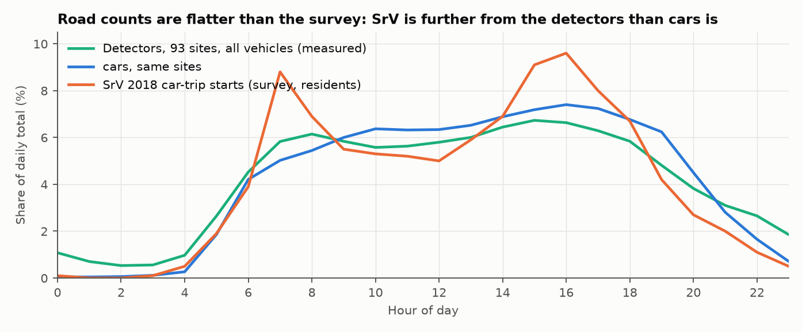
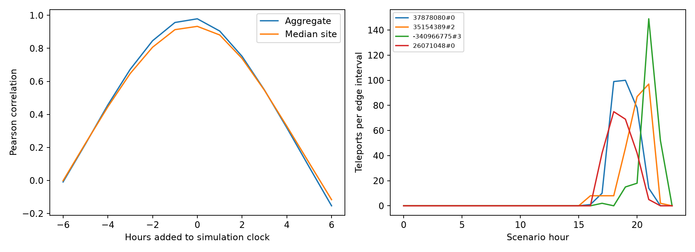
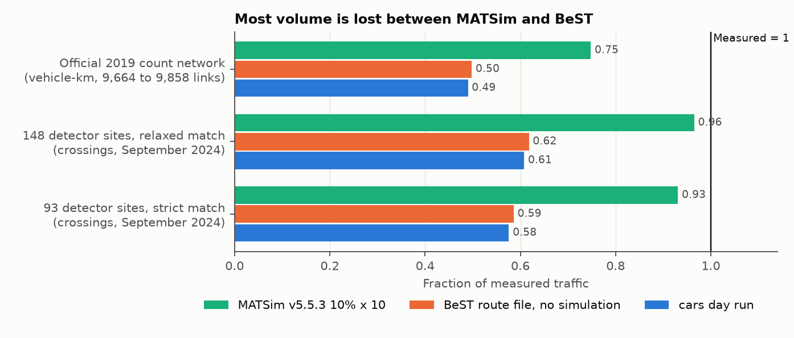
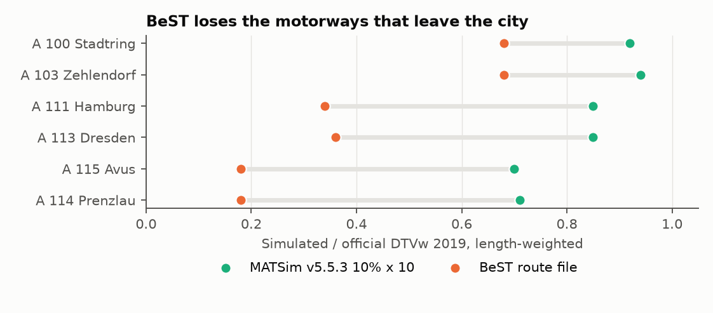
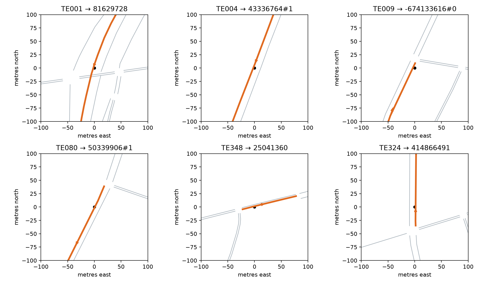
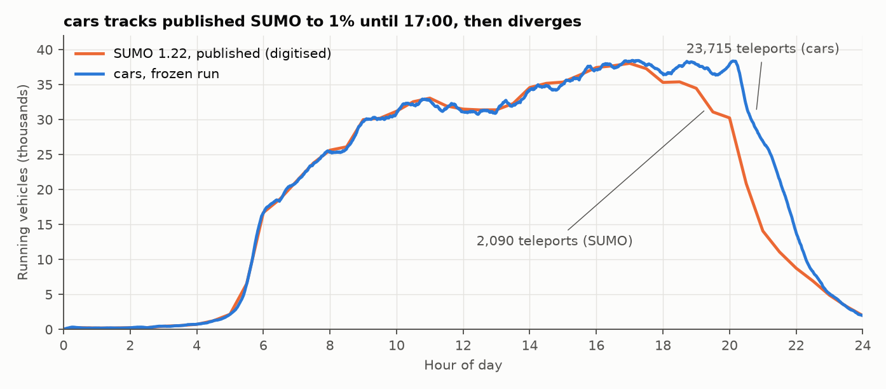
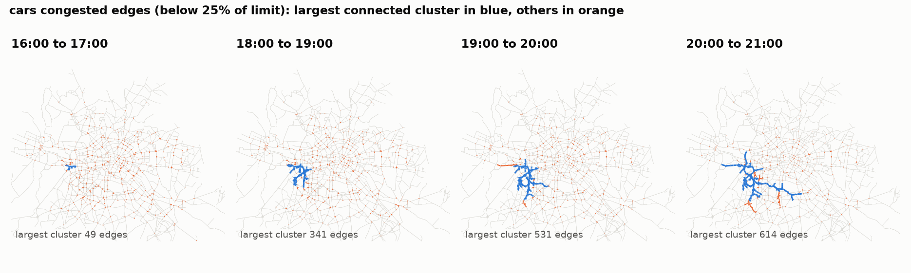

# Berlin forensics: what BeST actually represents

Research audit, 31 October 2026. First written by another model, then checked and corrected by Opus the same day; what changed is listed under [Reviewed by Opus](#reviewed-by-opus).

**Verdict (opinion):** keep Berlin as a reproducible simulator benchmark. Do not call it a true-to-life Berlin. BeST carries about half of the traffic Berlin's official count network shows, and that loss is in the input file, not in any simulator. The evening collapse in the cars run is a separate problem: published SUMO on the same demand does not gridlock, so that one is most likely ours.

Erik's doubt, checked piece by piece against road counts:

| What Erik saw | Finding | Grade |
|---|---|---|
| Weak morning rush | Correct. At 08:00 cars reaches 74% of its daily peak; the detectors reach 91%. | Measured against modelled |
| Builds through the day | Correct. From 08:00 to 10:00 detectors fall 9%; cars rises 17%. The shape comes from MATSim, whose departure histogram BeST copies. | Measured against modelled |
| Then collapses | Two separate effects. MATSim's departures drop 39% in 25 minutes after 20:00, and SUMO shows that cliff too. The gridlock from 17:00 and the 23,715 teleports are specific to the cars run. | Modelled |
| Don't trust SUMO papers | Justified. BeST's "close to reality" rests on four plots. Across 149 detector sites only 14% of sites are within ±20%. | Measured against modelled |

## Evidence standard and reproducibility

**Measured** means detector counts, official traffic counts or surveys, or direct counting of files. **Modelled** means synthetic demand or simulator output, even when extracted exactly. **Opinion** means interpretation or an untested mechanism. Local results cite `file:` URLs because they have no public URL. External claims cite primary documents opened in this review. SVZ values are partly extrapolated by the authority, so "measured" for SVZ means an official count-based estimate.

All analysis uses the frozen run in [berlin-snapshot](file:///home/erikf/.t3/projects/cars/research/truth/berlin-snapshot/manifest.json). When this review ran, its SHA-256 hashes for the three day CSVs still equalled `runs/berlin/`. A job may replace those files, and a newer engine build may change the evening numbers. No GPU job or simulation was run for this report.

Reproduce from the repository root, one thread, in this order:

```sh
export OPENBLAS_NUM_THREADS=1 OMP_NUM_THREADS=1
P="nix develop --command python3 -I research/truth/scripts"
mkdir -p research/truth/berlin-review/cache
$P/berlin_review_routes.py; $P/berlin_review_bus.py          # static edge table; builds the cache, about 5 min, 0.5 GB, delete afterwards
$P/berlin_review_rerun.py berlin_analyse.py berlin_followup.py berlin_snapshot_check.py
$P/berlin_review_detectors.py; $P/berlin_review_matsim.py; $P/berlin_review_od.py; $P/berlin_review_svz.py
$P/berlin_review_matsim_links.py; $P/berlin_review_residents.py; $P/berlin_review_matsim64.py; $P/berlin_review_v64links.py
$P/berlin_review_evening.py; $P/berlin_review_thresholds.py; $P/berlin_review_fix.py; $P/berlin_review_figures.py
```

`berlin_review_evening.py` needs page 11 of the bus paper as `cache/bus11.svg` (`pdftocairo -svg -f 11 -l 11`). Downloads are in `/home/erikf/projects/personal/cars-data/truth/berlin/opus-review-20261031/`, 287 MB; nothing downloaded was executed. Review outputs are in [berlin-review](file:///home/erikf/.t3/projects/cars/research/truth/berlin-review/).

**Rerun result (measured):** the unmodified scripts `berlin_analyse.py`, `berlin_followup.py` and `berlin_snapshot_check.py`, run on an isolated copy, reproduced the log values and ten compared CSVs byte for byte. Rerun logs: [rerun.log](file:///home/erikf/.t3/projects/cars/research/truth/berlin-review/rerun/rerun.log), [rerun2.log](file:///home/erikf/.t3/projects/cars/research/truth/berlin-review/rerun/rerun2.log). `berlin_hotspots.py` and `berlin_osm_audit.py` hard-code paths outside this review's write scope, so instead I fetched the same OSM ways again and compared the tags.

## 1. Demand shape: copied from MATSim, not a clock bug



**Modelled, file count:** the route file holds 2,248,884 vehicles, one vType, `DefaultVehicle`. Departures are 99,883 at 07:00, 129,488 at 08:00, 157,359 at 09:00 and a maximum of 167,936 at 10:00, then 155,979–166,022 through 17:00. Hours 0–2 hold 1,092, 933 and 1,820. [Demand](file:///home/erikf/.t3/projects/cars/research/truth/berlin-snapshot/demand_hourly.csv).

**Modelled, new:** BeST's hourly departures correlate r=0.9992 with MATSim Open Berlin v5.5.3 10% car trips that begin and end in the BeST area, at zero lag (r=0.9977 for all car trips touching the area; 0.96 and 0.94 at ±1 h). The five-minute histograms correlate r=0.992. The kept fraction is near 0.80 from 09:00 to 19:00 and lower early (0.67 at 05:00, 0.77 at 06:00–08:00), so BeST's morning is weaker than even MATSim's. [MATSim output directory](https://svn.vsp.tu-berlin.de/repos/public-svn/matsim/scenarios/countries/de/berlin/berlin-v5.5-10pct/output-berlinv5.5/), [hourly comparison](file:///home/erikf/.t3/projects/cars/research/truth/berlin-review/matsim_vs_best_hourly.csv), [log](file:///home/erikf/.t3/projects/cars/research/truth/berlin-review/matsim.log).

This also resolves the source. The "matsim" series in BeST's own vector plots sums to 8,270, 11,630 and 28,840 vehicles/day at Alt-Moabit, Treskowallee and Siemensdamm. Public v5.5.3 10% link volumes ×10 give 8,410, 11,778 and 29,082, within 1.7%. BeST's README names only the "MATSim Open Berlin Scenario", so **v5.5.x at factor 10 is my inference (opinion, strong), not a published statement**. [BeST repository](https://github.com/mosaic-addons/best-scenario), [plot source](https://raw.githubusercontent.com/mosaic-addons/best-scenario/main/docs/img/counts-siemensdamm-east.svg), [digitised series](file:///home/erikf/.t3/projects/cars/research/truth/berlin-review/best_plot_digitised.csv), [link log](file:///home/erikf/.t3/projects/cars/research/truth/berlin-review/matsim_links.log).

**Measured against modelled:** the balanced panel has 93 cross-sections. Detector crossings peak at 67,405/h at 08:00, fall to 61,153/h at 10:00, and peak again at 73,835/h at 15:00. cars has 34,405/h at 08:00 and its maximum, 46,782/h, at 16:00. Hours 0–4 hold 3.84% of observed crossings and 0.54% of simulated ones: MATSim agents start the day at home, and the 13,960 relevant trips (×10) departing after 24:00 are not wrapped to the small hours. These are crossings at selected sites in September 2024, not unique vehicles. [Hourly evidence](file:///home/erikf/.t3/projects/cars/research/truth/berlin-snapshot/balanced_hourly.csv), [shape shares](file:///home/erikf/.t3/projects/cars/research/truth/berlin-review/shape_shares.csv).

**Measured:** Berlin SrV 2018, Table 8.1, column MIV, gives trip starts of 8.8% at 07:01–08:00, 6.9% at 08:01–09:00, 5.3% at 10:01–11:00 and 9.6% at 16:01–17:00. I checked the column header: shares of each mode's trips, summing to 100. BeST's matching shares are 4.44%, 5.76%, 7.47% and 7.37%. The survey covers residents and counts MIV passengers. [SrV tables](https://www.berlin.de/sen/uvk/_assets/verkehr/verkehrsdaten/zahlen-und-fakten/mobilitaet-in-staedten-srv-2018/berlin_tabellen_berlin_gesamt.pdf).

**Correction:** SrV must not be the target. Against the detectors' hourly shares, cars has a mean absolute error of 0.70 percentage points, and SrV has 1.01. Real roads are flatter than resident trip starts: at 07:00 detectors show 5.83%, cars 5.02% and SrV 8.8%. The earlier advice to roughly double BeST's morning share would overshoot the roads. The measured shape error is smaller and more specific: a morning about 20% too low relative to the afternoon, no mid-morning dip, an evening that is too high and ends too abruptly, and an empty night. [Log](file:///home/erikf/.t3/projects/cars/research/truth/berlin-review/residents.log).

**Measured:** MiD 2017 says the afternoon peak is clearly higher than the morning peak on all weekdays (Figure 45). It covers cars of private households nationally. Berlin's SVZ 2019 report shows morning and afternoon commuter peaks on weekdays (Figure 3). [MiD](https://www.bmv.de/SharedDocs/DE/Anlage/G/mid-ergebnisbericht.pdf?__blob=publicationFile), [SVZ 2019](https://www.berlin.de/sen/uvk/_assets/verkehr/verkehrsmanagement/verkehrserhebungen/ergebnisbericht-2019-teil-a.pdf).

### Clock and hour-label audit

**Measured:** raw rows carry `Datum (Ortszeit)`, `Stunde des Tages (Ortszeit)` and `utc`. Local 2024-09-01 hour 0 maps to 2024-08-31 22:00 UTC, a correct summer offset. The provider readme says hour 8 means 08:00–08:59. [Provider readme](https://mdhopendata.blob.core.windows.net/verkehrsdetektion/ReadMe.txt), [raw row log](file:///home/erikf/.t3/projects/cars/research/truth/berlin-snapshot/analysis.log), [comparison code](file:///home/erikf/.t3/projects/cars/scripts/berlin_detectors.py).

**Calculated, rerun identical:**

| Hours added to simulation | Aggregate Pearson r | Median site r |
|---:|---:|---:|
| −2 | 0.8461 | 0.8069 |
| −1 | 0.9567 | 0.9133 |
| 0 | **0.9790** | **0.9333** |
| +1 | 0.9050 | 0.8811 |
| +2 | 0.7517 | 0.7388 |

Of 93 sites, 48 favour zero, 33 favour −1 h, 11 favour +1 h and one favours −2 h. **Added in review:** fractional shifts give −0.25 h for the whole day and for 03–11 h, but −1.0 h for 14–23 h (r=0.998). A clock error would shift both ends equally, so the mismatch is a change in shape, and part of the evening lag is congestion. **A clock bug is rejected on two independent grounds:** this test, and BeST's zero-lag match to MATSim. The earlier open question about a conversion error in departure times is closed for timing, though not for which trips were kept. [Lags](file:///home/erikf/.t3/projects/cars/research/truth/berlin-snapshot/lags.csv), [site lags](file:///home/erikf/.t3/projects/cars/research/truth/berlin-snapshot/site_lags.csv).



**Calculated:** BeST departures against SrV give r=0.8939 at zero and 0.9019 at −1 h. This small difference cannot diagnose a clock across different populations.

## 2. What the publications validate, and what they do not

**Publication audit, with an access limit:** the original BeST chapter is closed access per OpenAlex, Springer answered with a bot challenge, and the Fraunhofer record holds only the abstract. **I read the abstract, not the chapter.** It states that comparing simulated counts with real data "emphasizes that this scenario can model traffic in Berlin close to reality". Its expansion method, MATSim version and any trip filter remain unpublished as far as I could read. I did not use the third-party book mirror tried earlier (`vista.gov.vn`); its download was not a usable PDF. [OpenAlex record](https://api.openalex.org/works/doi:10.1007/978-3-031-23721-8_24), [Fraunhofer record](https://publica-rest.fraunhofer.de/server/api/discover/search/objects?query=%22Large-Scale%20Traffic%20Scenario%20of%20Berlin%22&size=3).

**Measured against published plots:** the repository shows four count plots. Digitised daily totals follow; "2024 section" sums all lanes of the matching cross-section from the provider archive.

| Plot | Published real | Published SUMO | Published MATSim | 2024 section | This review, route file on matched edge |
|---|---:|---:|---:|---:|---:|
| Alt-Moabit east (TE452) | 4,561 | 4,549 | 8,270 | 8,290 (lanes 4,161 + 4,129) | 4,372 |
| Treskowallee south (TE129) | 9,389 | 9,133 | 11,630 | 12,422 (lanes 10,394 + 2,048) | 10,299 |
| Siemensdamm east (TE106) | 20,706 | 18,633 | 28,840 | 18,830 (three lanes) | 19,346 |
| A100 Friedenau east | 61,875 | 51,900 | 80,790 | no detector in the 2022 metadata | not separately matched |

Two conclusions. First, **the site match holds:** my static route-file count reproduces the authors' own SUMO series within −4%, +4% and +13%, so our matching selects the edges they plotted. Second, **the published "real" at Alt-Moabit is about half the 2024 cross-section and lies within 30 vehicles/h RMSE of a single lane.** Official SVZ 2019 gives 22,000 for both directions there, so about 11,000 per direction if split evenly, not 4,561. Treskowallee behaves similarly: its published total is closest to one lane. Siemensdamm does not. **Opinion:** some published "real" curves may cover part of the cross-section. I cannot prove it: the authors' year and aggregation are unknown and traffic changes. The point stands that the good fit at Alt-Moabit does not survive comparison with the whole road today. [Lane comparison](file:///home/erikf/.t3/projects/cars/research/truth/berlin-review/residents.log).

**Measured against modelled:** across 149 sites the static route count falls within ±20% of observed at 14.1% of sites, is below 80% at 73.2%, below 50% at 35.6% and above 120% at 12.8%. The quartiles are 0.44, 0.58 and 0.82. The four plots do not represent this distribution. [Relaxed site table](file:///home/erikf/.t3/projects/cars/research/truth/berlin-review/detector_relaxed.csv), [log](file:///home/erikf/.t3/projects/cars/research/truth/berlin-review/fix.log).

**Modelled publication evidence:** the 2019 MATSim manuscript uses a 10% population and calibrates location choice with CaDyTS against 346 count stations, 250 of them from Berlin's traffic management centre. Agents may randomly shift departures within two hours. It reports more midday traffic than the survey and names freight as "likely the main reason". **That explanation does not hold for this demand:** in v5.5.3 freight agents make 0.8% of car-like trips touching the BeST area, about 1% of departures in midday hours. This uses release v5.5.3 where the manuscript describes v5.2, so it tests the release BeST used. **Opinion:** the plateau more plausibly comes from synthetic activity timing and the departure-time mutation, since the same plateau appears in car trips alone; I did not isolate the mechanism. [Ziemke et al. 2019](https://svn.vsp.tu-berlin.de/repos/public-svn/publications/vspwp/2019/19-01/ZiemkeEtAl2019OpenBerlinScenarioVSPWP.pdf).

**Modelled publication evidence:** the newer MATSim manuscript reports mode-share mean absolute error below 0.5 points, a check of 1,000 routes against four routing services, and 2018 weekday counts where daily simulated volumes are "generally too low, particularly on motorways". It names weak commercial data and missing outside-region transit and tourists. [Rakow et al.](https://svn.vsp.tu-berlin.de/repos/public-svn/publications/vspwp/2024/24-22/RakowEtAl_MATSimBerlinEWGT.pdf).

**Modelled publication evidence:** the 2025 bus paper runs SUMO 1.22.0 with three seeds and 120 s teleporting. **The earlier version of this report read it but missed its key evidence: Table 3 and Figure 7 are a SUMO baseline for the bus-free demand.** That baseline has 2,090 teleports, 13.24 min mean duration, 7.86 km mean distance and 33.73 km/h mean speed, and shows no gridlock (see section 4). Seven hours is computing time. The paper calls peaks "around 9 a.m. and 5 p.m." a "realistic traffic pattern" without comparing to counts. It says the network dates from OSM of November 2020 and was hand-adjusted where severe jams occurred, including converting yielding connections to non-yielding. The local network header names a teleport hot-spot file (`..._teleports_lanes_20.add.xml`). So **the scenario was tuned against SUMO's own failures.** [Bus paper](https://publica-rest.fraunhofer.de/server/api/core/bitstreams/ec00a2d5-a123-4a5d-90e2-25f3612c37b4/content), [network file](file:///home/erikf/projects/personal/cars-data/best/berlin.net.xml).

### Traffic classes and scaling

**Measured file audit:** the route file has one vehicle type, so trucks and vans cannot be told apart in it. The cars command loads only `berlin.rou.gz`; the shipped SUMO config also loads buses. Buses are 26,143 trips and 277,000 km/day when expanded from the flow definitions, and add 1.0 point to the site ratio (0.586 to 0.596). [Bus route file](file:///home/erikf/projects/personal/cars-data/best/berlin_bus.rou.xml), [SUMO config](file:///home/erikf/projects/personal/cars-data/best/berlin.sumocfg), [cars invocation](file:///home/erikf/.t3/projects/cars/scripts/berlin_day.sh).

**Measured file audit:** the file holds 2,210,192 distinct edge sequences and repeats any single one at most 31 times, because the authors re-assigned routes. The route file header shows DUA iteration 103 of a Gawron assignment with 900 s travel-time dumps, generated by duarouter 1.22.0 on 29 March 2025. The factor-10 clones are therefore not visible as repeats.

**Opinion:** expanding a 10% sample tenfold estimates aggregate demand but does not create independent trips. The earlier report cited a Swiss scaling study here; I could not open it in this review, so the citation is withdrawn.

## 3. Why measured volume is nearly double the simulated



The "57.6%" in earlier notes is the ratio, not the deficit: simulated/observed = 0.576, so the deficit is 42.4% and observed/simulated = 1.74.

**New independent reference (measured, partly extrapolated):** the official SVZ 2019 network has 9,922 links and is public. Summing DTVw × length gives **28.72 million vehicle-km per working day** on the count network. It covers the road classes the detectors barely sample, including 7.05 million km on motorways. [SVZ WFS](https://gdi.berlin.de/services/wfs/verkehrsmengen_2019?service=WFS&request=GetCapabilities), [link table](file:///home/erikf/.t3/projects/cars/research/truth/berlin-review/svz_match.csv), [log](file:///home/erikf/.t3/projects/cars/research/truth/berlin-review/svz.log).

**Correction, the vehicle-km denominator was wrong.** The report divided the SVZ annual 10,461.1 million km by 365 to get 28.66 million/day and found BeST at 56.1%, "consistent with the detector deficit". SVZ Section 4 defines this total as kilometres on all working days of the year, and Table 4 is labelled "JFL 2019, werktags". Dividing Table 4's count-network 7,268.4 million by the 28.72 million above gives **253 working days** (BAB 261, city streets 251). That makes the Berlin working-day total about **41.3 million km**, of which 12.6 million is the authority's estimate for streets it did not count. The 28.66 was close to the count network alone, by coincidence. BeST at 16.07 million external km, or 17.65 million including junction lanes, is **39–43% of Berlin, not 56%**. [SVZ 2019, Tables 3–4](https://www.berlin.de/sen/uvk/_assets/verkehr/verkehrsmanagement/verkehrserhebungen/ergebnisbericht-2019-teil-a.pdf). The Senate cites the same 10.46 billion for 2019. [Written answer S19/22673](https://pardok.parlament-berlin.de/starweb/adis/citat/VT/19/SchrAnfr/S19-22673.pdf). The "27.8 million" figure mentioned earlier remains unsourced and unused.

### Quantified answer

| Suspect | Test | Result | Share of the gap | Grade |
|---|---|---|---|---|
| Simulator loses traffic | Route file counted with no simulator, against cars | 0.586 → 0.576 at sites; 0.498 → 0.490 on SVZ | **About 2%** | Modelled |
| Site matching | Strict 93 vs relaxed 149 sites; within 5 m; authors' SUMO series | 0.586 vs 0.620 (95% CI 0.56–0.68); 0.561; authors' series reproduced within −4 to +13% | **At most 8%**; not a wrong-road problem | Measured/modelled |
| Reference year | City-street vehicle-km 2019 to 2023 | 96% → 94% of 1991 | **About 2 points**; too small to matter | Measured |
| Night and late evening | Hours 22–04 | 15.8% of site gap; observed/cars is 1.63 over 05–20 h, 2.0 at 07–09 h | **16% overlapping** with the items below | Measured/modelled |
| Trucks | Detector Lkw; official trucks over 3.5 t | 8.33% of crossings (8.31% over 149 sites); 4.19% of count-network km, 7.14% motorway, 3.23% city | **Up to 12%** at sites | Measured |
| Buses | Adding expanded bus flows | +1.0 point | **About 2%** | Modelled |
| Route concentration | BeST share on main network, motorway share, cordons | **More concentrated than reality**, see below | **Not the cause**; it can move the ratio at most from 0.50 to 0.61 | Measured/modelled |
| Dropped MATSim trips | Route file against MATSim link volumes ×10 | 0.931 → 0.586 at sites; 0.748 → 0.498 on SVZ | **About 81% at sites, 50% on SVZ** | Modelled |
| MATSim's own shortfall | MATSim ×10 against counts | 1 → 0.931 at sites; 1 → 0.748 on SVZ | **About 16% at sites, 50% on SVZ** | Modelled/measured |

Categories overlap (night, trucks and MATSim's own shortfall in particular), so the shares do not sum to 100. The two ladders in the figure are the additive part. Detector sites were among the kinds of stations MATSim was calibrated on, so 0.93–0.96 there is **in-sample and flattering**; the SVZ value 0.75 is the fairer one. **The honest statement: about half of the shortfall on the whole count network, and more at the detectors, was introduced when BeST was built from MATSim. The remainder is traffic MATSim v5.5.3 never had.**

### Demand, in trips and kilometres

| Layer | Trips per working day | Million km in the BeST area | Grade |
|---|---:|---:|---|
| BeST route file | 2,248,884 | 16.07 external, 17.65 with junction lanes | Measured file |
| SrV residents, car driver, trips inside Berlin | about 2.21 million | about 17.4 | Measured survey arithmetic |
| MATSim v5.5.3 ×10, both ends in the BeST area | 2,849,470 | 21.92 | Modelled |
| … plus crossing the boundary | +575,490 | +6.78 (estimate) | Modelled |
| … plus through trips | +37,030 | +0.31 (estimate) | Modelled |
| MATSim v5.5.3 ×10 in total | 3,461,990 | about 29.0 | Modelled |
| MATSim v6.4 ×10, cars, trucks, freight, commercial | 4,420,890 | about 42.9 (estimate) | Modelled |
| Official Berlin, working day, 2019 | not published | **41.3** (28.7 counted, 12.6 estimated) | Measured/extrapolated |

The in-area share of crossing trips uses the share of the straight line inside the area, so those rows are rough. SrV arithmetic: Table 6.5 gives 0.59 driver trips per person/day inside Berlin (0.56 household car + 0.03 other), Table 7.1 gives 7.8 and 9.3 km per trip, and the register holds 3,748,148 residents. [SrV tables](https://www.berlin.de/sen/uvk/_assets/verkehr/verkehrsdaten/zahlen-und-fakten/mobilitaet-in-staedten-srv-2018/berlin_tabellen_berlin_gesamt.pdf), [population](https://www.statistik-berlin-brandenburg.de/meine-region/berlin-statistik/einwohnerbestand), [v5.5.3 trips](https://svn.vsp.tu-berlin.de/repos/public-svn/matsim/scenarios/countries/de/berlin/berlin-v5.5-10pct/output-berlinv5.5/berlin-v5.5.3-10pct.output_trips.csv.gz), [v6.4 trips](https://svn.vsp.tu-berlin.de/repos/public-svn/matsim/scenarios/countries/de/berlin/berlin-v6.4/output/berlin-v6.4-10pct/berlin-v6.4.output_trips.csv.gz), [area classes](file:///home/erikf/.t3/projects/cars/research/truth/berlin-review/matsim_area_classes.csv), [OD log](file:///home/erikf/.t3/projects/cars/research/truth/berlin-review/od.log), [v6.4 log](file:///home/erikf/.t3/projects/cars/research/truth/berlin-review/v64links.log).

**Measured coincidence, opinion on its meaning:** BeST's size almost exactly equals residents' car-driver trips inside Berlin, 2.25 vs 2.21 million trips and 17.65 vs 17.4 million km. Those residents alone leave no room for inbound commuters, visitors, through traffic, deliveries, services or freight. Yet 58% of Berlin's official kilometres must come from somewhere. BeST is roughly "Berliners driving inside Berlin", and calling it all traffic is the central error.

**Modelled:** BeST appears to drop cross-boundary trips and about 20% of the remaining trips. Evidence: only 0.06% of its trips start on dead-end boundary edges; only 1.5% start on motorways; its trips start at the network fringe no more often than MATSim's inside trips (20.6% vs 22.4%). Its trip lengths match MATSim's inside trips, not crossing trips averaging 28 km. Kept trips are near-uniform across space: the median 1 km-cell ratio is 0.82 with quartiles 0.74–0.88. **Why 20% is missing is unknown.** A residents-only filter fails: MATSim's resident inside trips are 2.60 million and the hourly ratio varies from 0.65 to 0.96. I cannot tell whether it was deliberate without the chapter or the authors.



**Motorways, correcting an earlier inference:** the report used one site (TE001, A115, ratio 0.129) to suggest motorway demand is broadly deficient. Official data show the pattern, and it has a clear cause. Length-weighted static/official ratios on city streets stay flat with distance from the centre: 0.50, 0.51, 0.51, 0.49, 0.50. On motorways they collapse outward: 0.56, 0.62, 0.45, 0.25, 0.06. By motorway: A100 0.68, A103 0.68, A111 0.34, A113 0.36, A114 0.18, A115 0.18, A10 0.02. MATSim on the same links gives 0.92, 0.94, 0.85, 0.85, 0.71, 0.70. **This is the fingerprint of dropped cross-boundary traffic**, and BeST loses it at the point where it enters the city. The A10 is mostly outside the scenario; TE001 is near the city edge and also gets a low MATSim match, so that site alone proves little. [Radial and motorway log](file:///home/erikf/.t3/projects/cars/research/truth/berlin-review/fix.log).

**Route concentration, measured against modelled:** three independent checks rule it out as the main cause.
- BeST puts 88.7% of its external km on the count network, and SVZ estimates 69.5%. Motorways and links carry 21.0% in BeST against 17.6% official. BeST is more concentrated, not less. City-district ratios all sit between 0.41 and 0.59.
- Hard bound: even with every BeST kilometre on the count network, the ratio could not exceed 0.56 (0.61 with junction lanes).
- Across 19 circles and straight cuts through the city, BeST flow on **all** roads against official flow on **counted** roads alone has a median of 0.569, range 0.41–0.74. That comparison favours BeST, and it still never reaches 1. On main roads only the median is about 0.47. Routes can move perhaps a tenth of the flow across a cut, and the rest must be demand. [Cordons](file:///home/erikf/.t3/projects/cars/research/truth/berlin-review/cordons.csv).

Routing does matter for the fit at individual links. Link correlation with official counts is 0.74 for BeST and 0.85 for MATSim, and BeST's median link is off by a factor of 2.0 against 1.5 for MATSim. Binned by observed volume, ratios run 0.67, 0.55, 0.44, 0.38, 0.40, 0.65, but selecting on the observed value inflates that spread.

**Detectors against SVZ:** at 138 sites matched by street name, 2024 detector totals are 0.76 (sum) and 0.84 (median) of half the two-way SVZ 2019 value, using an even split by direction. Year alone explains about 2 points of that, so one of the sources has a further level error. This mostly reconciles the two headline ratios: 0.62 × 0.84 ≈ 0.52 against 0.50. **Opinion:** use 0.50–0.62 as the honest range and report which reference is used.

### Sample site audit

OSM identifiers were fetched again in this review; today's OSM is not historical proof. The sample includes deliberate extremes.

| Site | Metadata road / direction | Matched edge | Distance | cars/observed | Check, current OSM |
|---|---|---|---:|---:|---|
| TE001 | A115, southwest toward AK Zehlendorf | 81629728 | 1.86 m | 0.129 | Motorway, 2 lanes, one-way. |
| TE004 | Clayallee, south | 43336764#1 | 2.25 m | 0.460 | Clayallee, 2 lanes, one-way. |
| TE009 | Großbeerenstraße, northeast | -674133616#0 | 3.23 m | 0.513 | Way now returns 410 Gone; geometry check only. |
| TE080 | Marienfelder Allee, south | 50339906#1 | 0.83 m | 0.061 | B 101, 2 lanes, one-way. |
| TE348 | Tiergartenstraße, east | 25041360 | 1.41 m | 4.171 | Correct street; strong overcount unexplained. |
| TE324 | Grabbeallee, north | 414866491 | 1.66 m | 4.418 | Metadata says second lane from right, OSM says 1 lane; lane coverage suspect. |

Primary checks: [A115](https://api.openstreetmap.org/api/0.6/way/81629728), [Clayallee](https://api.openstreetmap.org/api/0.6/way/43336764), [Marienfelder Allee](https://api.openstreetmap.org/api/0.6/way/50339906), [Tiergartenstraße](https://api.openstreetmap.org/api/0.6/way/25041360), [Grabbeallee](https://api.openstreetmap.org/api/0.6/way/414866491), [Großbeerenstraße](https://api.openstreetmap.org/api/0.6/way/674133616). A relaxed match also produced one residential-road pairing at ratio 0.012, a likely mismatch; it is included in the 149-site totals and does not move the conclusion.



### Is there a cheap fix?

**No validated one exists today.** All numbers below are static: they assign no congestion, and none has been simulated. Hold-out is five-fold by 3 km spatial blocks on SVZ links, on a 10% route sample; detectors are never trained on. [Hold-out table](file:///home/erikf/.t3/projects/cars/research/truth/berlin-review/fix_holdout.csv), [capacity table](file:///home/erikf/.t3/projects/cars/research/truth/berlin-review/capacity_scaling.csv).

| Option | Demand | Held-out R² | Held-out median link error | Detector median error | Assessment |
|---|---|---:|---:|---:|---|
| Current BeST | 2.25 M trips | −0.13 | ×2.0 | ×1.9 | Benchmark as is. |
| Uniform ×2.02 clone | 4.54 M trips | 0.25 | ×1.41 | ×1.44 | Trivial to try. Keeps every shape error, overshoots detectors by 24%. Reject as realism. |
| Route reweighting to SVZ, like SUMO's [routeSampler](https://sumo.dlr.de/docs/Tools/Turns.html) | ×2.5 trips, ×2.03 km | **0.64** | **×1.23** | **×1.26** | Best static fit, no new data needed. Overshoots detectors 31%, some weights hit the cap of 25, and it invents no origins. Keeps the MATSim plateau. |
| Re-extract v5.5.3 including crossing trips | 3.46 M trips | 0.54 on all links; nothing fitted here, but MATSim was calibrated on counts | ×1.54 | ×1.37 (in-sample stations) | Needs routing. Inherits the plateau and 20:00 cliff. |
| Replace with v6.4 ×10 (CC BY 4.0) | 4.42 M trips | not tested | not tested | not tested | **Best candidate:** has trucks, commercial traffic and a matching km total. Departure shape: 8:00/peak 0.85 (BeST 0.77); 10:00/8:00 0.76 (BeST 1.30); detector crossings give 0.91 and 0.91, a different metric. Its link names match BeST edges for 54% of trip ends, so the rest need nearest-edge mapping. Needs routing and iteration; its authors report low counts. |

**Opinion:** none of these is cheap in the sense that matters. Doubling load on a scenario that already gridlocks in the cars evening cannot be judged statically: only 516 of 14,066 busy edges reach static capacity at ×2, yet hourly static checks say nothing about queues. Route choice must also be re-equilibrated at the new load, since routes tuned at half load are no equilibrium at full load. **Decision:** keep BeST unchanged as the benchmark; make any realistic Berlin a separate new scenario, built from v6.4 and ramped up small to big on the GPU under the repo's rules. Do not patch BeST with a multiplier and call it calibrated. [v6.4 licence and readme](https://github.com/matsim-scenarios/matsim-berlin).

## 4. Evening collapse: one growing cluster, specific to the cars run



**Modelled, new:** BeST's bus paper Figure 7 is a vector plot of SUMO running vehicles. Digitised, cars follows it within 1% from 05:00 to 17:00. As a check on the digitising, a local SUMO 1.28 morning run on the same demand gives 16,652, 21,066, 25,424 and 29,750 at 06–09 h, against 16,680, 21,188, 25,602 and 29,970 digitised. Then cars departs: [Table](file:///home/erikf/.t3/projects/cars/research/truth/berlin-review/running_sumo_vs_cars.csv), [Bus paper](https://publica-rest.fraunhofer.de/server/api/core/bitstreams/ec00a2d5-a123-4a5d-90e2-25f3612c37b4/content).

| Time | SUMO 1.22 published | cars | cars / SUMO |
|---:|---:|---:|---:|
| 17:00 | 38,016 | 38,307 | 1.01 |
| 18:00 | 35,291 | 36,498 | 1.03 |
| 19:00 | 34,449 | 37,893 | 1.10 |
| 20:00 | 30,218 | 37,904 | 1.25 |
| 21:00 | 14,050 | 26,861 | 1.91 |
| 22:00 | 8,732 | 13,805 | 1.58 |
| 23:00 | 4,872 | 5,088 | 1.04 |

Teleports total **23,715 in cars against 2,090 in published SUMO, a factor of 11.3**; the earlier comparison to 2,332 used the run with buses. cars averages 14.0 min per trip against 13.24 min, with distance matching, 7.86 km. Vehicle-hours 18–23 h are 28% higher. Up to 10:00 the difference is already visible: 283 teleports in cars against 231 in local SUMO 1.28 for 05–10 h. **This answers "does the scenario itself collapse?" Published SUMO shows the demand cliff but no gridlock. The earlier report's "needs a matched baseline before assigning" understated evidence already in the paper it read.** As a further check, cars' 2,246,929 arrivals are within 3 of the paper's 2,246,926 cars, so the demand is the same. Limits: published SUMO 1.22 (three seeds, and Figure 7 does not say whether it shows a mean) against one cars run on a port of 1.28, and no full-day local SUMO exists. A full-day SUMO 1.28 run takes about seven CPU hours and is the remaining confirmation.

**Modelled, the demand cliff in SUMO:** departures per 5 min fall from 9,569 at 20:00 to 5,840 at 20:25, a drop of 39% in 25 minutes. Over the hour, BeST departures fall from 124,675 to 75,311 (−40%). Detectors fall 20% from 19:00 to 20:00. The published curve's sudden fall after 20:00 is this step. It is inherited from MATSim (195,430 → 110,580 for all relevant trips) and is not realistic road behaviour. This part of Erik's "collapse" is in the input.



**Correction, "distributed" is wrong (modelled).** The earlier report saw top-5 edges with only 5.26% of teleports and called deterioration distributed. Per-edge share misses the structure. Treating edges below 25% of the limit as congested and joining those that share a junction, one cluster grows hour by hour in the same place, around Wilmersdorf and Schmargendorf, on and around the A100:

| Hour | Largest cluster, edges | km | Share of that hour's teleports | Centre |
|---:|---:|---:|---:|---|
| 15 | 17 | 1.2 | 8% | 52.504 N, 13.280 E |
| 16 | 49 | 4.3 | 43% | 52.506 N, 13.284 E |
| 17 | 139 | 11.9 | 60% | 52.503 N, 13.292 E |
| 18 | 341 | 34.3 | 88% | 52.496 N, 13.295 E |
| 19 | 531 | 56.5 | 84% | 52.487 N, 13.301 E |
| 20 | 614 | 73.4 | 75% | 52.484 N, 13.307 E |
| 21 | 382 | 41.9 | 68% | 52.488 N, 13.292 E |

Over the day, 1,317 of 71,651 external edges hold all external-edge teleports and the top 100 hold 42.5%. Elsewhere, isolated slow edges stay small: the second-largest cluster never exceeds 62 edges. **The share depends on the threshold:** at 40% of the limit the cluster holds 92%, 88% and 77% of teleports at 18–20 h, and at a strict 10% it holds 53%, 41% and 32% with up to 222 edges. The location and growth are stable; the exact percentage is not. [Percolation table](file:///home/erikf/.t3/projects/cars/research/truth/berlin-review/evening_percolation.csv), [cluster log](file:///home/erikf/.t3/projects/cars/research/truth/berlin-review/figures.log), [threshold sensitivity](file:///home/erikf/.t3/projects/cars/research/truth/berlin-review/evening_thresholds.log). **Opinion, next step:** debug here first, comparing cars and SUMO on that cluster's junctions from 15:00, particularly where the authors changed yields, because the first cluster appears hours before the failure. Hourly data cannot name a root junction or support "bistable".

**Modelled, rerun identical:** network mean speed is 40.0 km/h at 06–07 h, 36.2 at 10–11, 35.0 at 16–17, 32.8 at 18–19 and 22.7 at 20–21. Teleports per hour are 560, 1,424, 3,279, 5,745 and 6,973 for hours 16–20. Mean waiting for completed trips departing at 19 and 20 h is 338 and 380 s against 66–70 s at midday. Running vehicles peak at 38,439 at 17:05. Individual slow edges include `855402073#0` (B 1, 52.4547 N, 13.3197 E) at 0.98 m/s at 06–07 h, `4444437` (Brandenburgische Straße) at 0.32 m/s at 17–18 h, `334005620` (motorway, 52.4801 N, 13.3067 E, unnamed in OSM; Schmargendorf is inferred from position) at 0.081 m/s at 18–19 h, and `138614363` at 0.106 m/s at 19–20 h. Today's OSM marks that last way as a construction site with no access, so the 2020 network may not describe the present road. [Edge metrics](file:///home/erikf/.t3/projects/cars/research/truth/berlin-snapshot/edge_hourly.csv), [trip metrics](file:///home/erikf/.t3/projects/cars/research/truth/berlin-snapshot/trip_hourly.csv), [way 138614363](https://api.openstreetmap.org/api/0.6/way/138614363), [way 4444437](https://api.openstreetmap.org/api/0.6/way/4444437), [way 334005620](https://api.openstreetmap.org/api/0.6/way/334005620), [way 855402073](https://api.openstreetmap.org/api/0.6/way/855402073).

**Measured file audit, rerun identical:** the network has 2,344 actuated `tlLogic` programs, programID 0, and 2,246 (95.8%) have phase sums of 90 s. That sum is nominal, because actuated phases vary between `minDur` and `maxDur`. This looks generated, and I found no sign of real controller data. Do not call them measured Berlin signal programs. [Program inventory](file:///home/erikf/.t3/projects/cars/research/truth/berlin-snapshot/tls.csv), [SUMO traffic lights](https://sumo.dlr.de/docs/Simulation/Traffic_Lights.html).

**Measured, config:** the local command uses a 120 s teleport threshold and ignores junction blockers after 20 s, as the shipped config does. Teleporting removes a vehicle and reinserts it further on, so it hides gridlock rather than measuring anything real. [Invocation](file:///home/erikf/.t3/projects/cars/scripts/berlin_day.sh), [SUMO on teleports](https://sumo.dlr.de/docs/Simulation/Why_Vehicles_are_teleporting.html).

## 5. Ranked corrections and project decision

Expected effects are opinions or arithmetic targets, not measured outcomes.

| Rank | Correction | Success criterion |
|---:|---|---|
| 1 | Run full-day SUMO 1.28 on the frozen bus-free inputs (`heavy`, about seven CPU hours, watch memory), output edges hourly. | Confirms whether cars' 11× teleports are engine or version. Reproduces published 2,090 within seed spread. |
| 2 | Debug the Wilmersdorf/Schmargendorf cluster in cars against that run from 15:00. | cars running curve within 2% of SUMO through 22:00. This is the only item that is an engine bug. |
| 3 | Label BeST correctly in every result: synthetic, about half of observed volume, residents-inside scale. | No claim of real congestion, emissions or policy effect from BeST. |
| 4 | Build a separate Berlin scenario from MATSim v6.4 trips, all classes including trucks; map trips, route, iterate; ramp small to big. | SVZ and detector ratios both near 1 on held-out links, cordons above 0.9. |
| 5 | Validate jointly on independent data: SVZ all links for volume, detectors for hourly shape, floating-car or travel-time sources for speed. | Reported per class with uncertainty; detectors are not independent of MATSim. |
| 6 | Audit lanes, signals, and hand-set yields on the new scenario only after volume is right. | One cause at a time; a lane audit first for sites like TE324. |

**Opinion:** Berlin stays in the project, labelled **"BeST synthetic Berlin benchmark: about half of observed traffic, not a validated city"**. Matching SUMO on it is a fair engine test. Speed on it is a fair throughput test, and with half the real demand it understates the real load. It says nothing about Berlin itself.

## What remains unverified or needs access

- The original BeST chapter is unread, so the trip filter and its 20% are unexplained. Only Erik can obtain it or ask the authors.
- No local full-day SUMO run exists; the evening comparison uses a published mean on SUMO 1.22.
- SVZ's 12.6 million km on uncounted streets is the authority's estimate. Count network values are expanded from 12-hour counts from 2016–2019 and manually balanced, so they are not a census.
- Detectors and SVZ disagree in level by 16–24%, and the cause is not established.
- The v6.4 candidate has not been routed or simulated on the BeST network or checked link by link against SVZ.
- All cheap-fix results are static. No real evening queues, signal programs, taxi or van tours, or external OD matrix were obtained.

## Reviewed by Opus

**What held.** All recomputed numbers: 2,248,884 vehicles, the hourly histogram, the 0.57625 ratio, strict-match sensitivity, the 8.33% truck share and its 0.629 arithmetic, 16.07, 15.99 and 17.65 million km, the lag table and site lag counts, teleports per hour, speeds, the running peak at 17:05, the TLS inventory, and the SrV and MiD quotations. Eight primary documents downloaded again hash-identical. The refusal to diagnose a clock error was right, and the caution about SUMO papers and the label "benchmark" were right.

**What was wrong.**
1. **Vehicle-km denominator.** 28.66 million/day came from dividing working-day km by 365. Correct is about 41.3 million/day, so BeST is 39–43% of Berlin, not 56.1%. The apparent match with the detector ratio was a coincidence.
2. **"Distributed" evening failure.** It is one connected, growing cluster holding 75–88% of teleports at 18–20 h at the 25% threshold (32–53% at a strict 10%, 77–92% at 40%).
3. **"Needs a baseline before assigning."** The paper it cited, claimed read in full, contains that baseline: 2,090 teleports and a running curve. cars tracks it to 17:00 and then departs. The comparison in its corrections also quoted the with-buses 2,332.
4. **Motorway reading.** A single site was used to imply general motorway deficiency. Motorway share is fine in total; the missing traffic is what enters the city.
5. **SrV as target.** "Roughly twice" the morning share would overshoot real roads.
6. **"Cannot assign any percentage."** Much can be separated cheaply, and the earlier report never compared with MATSim output, which is public.
7. **Citation not verifiable.** The Swiss scaling study could not be opened; removed. "57.6% deficit" in the brief is a ratio.

**What remains unknown.** Why BeST keeps about 80% of inside trips and how it dropped crossing trips; whether its published "real" curves cover whole cross-sections; the exact mechanism of MATSim's plateau and 20:00 cliff; whether the cars divergence is engine or version until SUMO 1.28 runs a full day; the root junction of the cluster; whether any doubled demand runs without gridlock.

**Verdict on use.** Use Berlin as an engine and throughput benchmark, compared to SUMO on identical inputs. Quote its scale honestly: 2.25 million trips is about Berliners driving inside Berlin, and about half of observed traffic on counted roads, 0.50–0.62 depending on reference. Do not use it for claims about real Berlin congestion, peak timing, capacity, emissions or policy, and do not scale it to fit. The evening failure in cars is a bug lead, not a Berlin finding. Build a realistic Berlin separately from MATSim v6.4 trips, validated on SVZ held-out links.

**Only Erik can:** obtain the Springer chapter through library access, and decide whether to contact the BeST authors about the trip filter and the "real" series. I contacted nobody and created no accounts.
