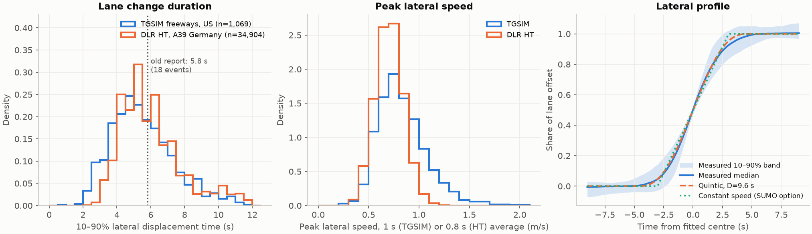
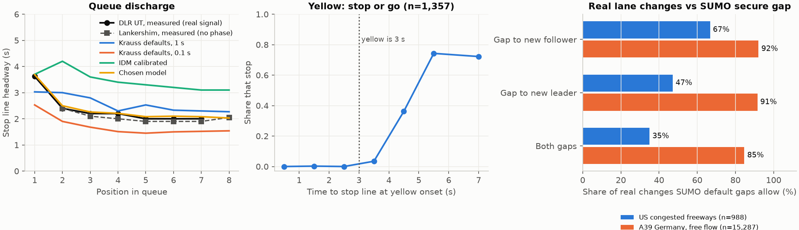
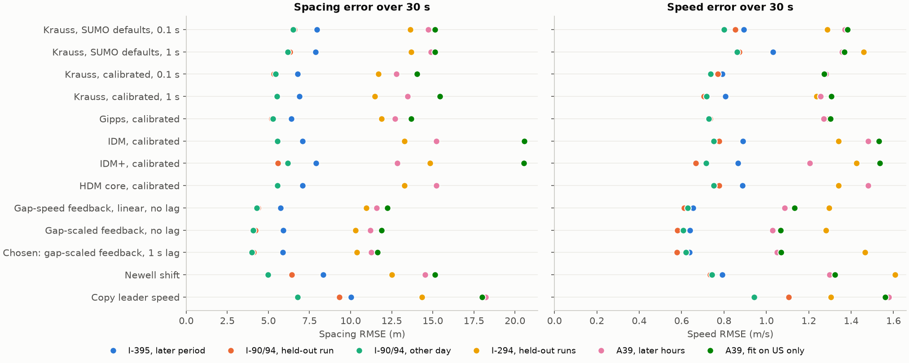
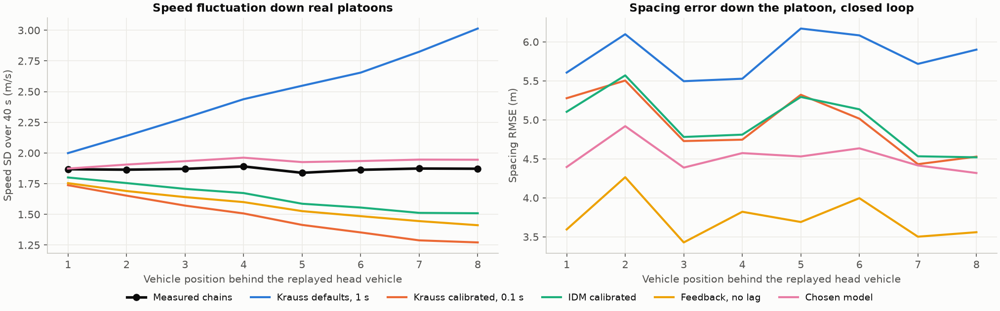

# Real human driving: measurements, model decision and GPU specification

Research date: 2026-10-31 to 2026-11-01. This replaces the earlier version of this report. No GPU was run and no kernel was written. Commercial use of the results needs Erik's licence decision (section 11).

**Decision.** Add a new model, gap-speed feedback with a 1 s response lag and small correlated acceleration noise, as `MODEL_HUMAN`. Keep Krauss as the SUMO-compatible baseline. IDM, IDM+ and HDM did not earn their place.

| Key result | Chosen model | Best calibrated Krauss | SUMO defaults | Calibrated IDM | Measured |
|---|---:|---:|---:|---:|---:|
| Held-out 30 s spacing RMSE, I-90/94 another day (4,955 windows) | **4.00 m** | 5.43 m | 6.16 m | 5.54 m | |
| Held-out 30 s spacing RMSE, A39 Germany, fit on US data only (5,248) | **11.64 m** | 14.05 m | 15.14 m | 20.57 m | |
| Speed fluctuation down an 8-car chain, position 8 ÷ 1 | **1.04** | 0.73–1.02 | 0.99–1.51 | 0.84 | 1.00 |
| Wave speed in real chains | **34.8 km/h** | 44.5–67.4 | 31.3–59.3 | 57.2 | 33.7 |
| Saturation headway | **2.05 s** | 1.62–2.60 | 1.56–2.30 | 3.00 | 2.0 |
| Lane change, 10–90% time | **5.2 s** | instant | instant | instant | 5.05–5.6 s |

**Measured, new in this version:**

- **Lane changes take 5.1–5.6 s (10–90%), not an instant**, on about 36,000 events on US and German roads. Duration barely depends on speed. The earlier 18-event estimate of 5.8 s held up.
- **Real drivers change lanes into gaps SUMO's defaults forbid.** Only 35% of US congested changes pass SUMO's secure gap test, against 85% on a free-flowing German motorway.
- **Queues discharge at about 2.0 s per car, with 2.7 s of lost time**, using real signal states from DLR Urban Traffic. Lankershim confirms the headway.
- **At yellow, half of drivers stop only when 5.1 s from the line.** Almost nobody brakes harder than 2 m/s² to stop. SUMO's rule allows 4.5 m/s².
- **Roundabout critical gap is about 2.95 s** (7,131 decisions, 3 sites).
- **A driver's own fitted parameters predict their next 30 s worse than population values.** Only the time gap shows some persistence.


## 1. Evidence rules

- **Measured:** taken from a real recording, including calculations on it in this study. A tracker's output is a measurement with error. It is not ground truth.
- **Modelled:** equations, simulation, fitted parameters.
- **Opinion:** an engineering choice or an acceptance threshold.
- **Not verified:** no defensible result here.

All links were opened in this session. Zenodo records were read through `zenodo.org/api/records/<id>` and their files. DOT datasets were read through `data.transportation.gov/api/views/<id>.json` and their exports. SUMO documentation pages were fetched with curl. Search-result snippets were not treated as opening a source. Result files are in [`human-v2/`](human-v2/), scripts are `scripts/opus_*.py`, and section 10 lists how to rerun them.

Sample sizes count events or tracked vehicles. They do not count independent drivers, because no open dataset here identifies a driver across trips.

## 2. Data used in this study

The earlier version of this report used one pNEUMA recording and a 90-track sample. It said junction data needed application forms. That was wrong: open junction data with real signal states exists. Everything below was downloaded with no account. New downloads total about 6.0 GB, against the 8 GB cap.

| Dataset, collection date | What was used | Licence as stated | Flaws found or stated |
|---|---|---|---|
| **TGSIM I-395**, Washington DC, 26 Jan 2023, 08:30–10:30 | 10,637 tracks, 4.32 M rows at 0.1 s, median track 44 s. Following windows have median speed 7.5 m/s. [Data](https://data.transportation.gov/api/views/97n2-kuqi.json), [dates and method](https://rosap.ntl.bts.gov/view/dot/74647/dot_74647_DS1.pdf) | CC0 in the [DOT catalogue record](https://catalog.data.gov/harvest_record/50629d19-5827-41eb-9a35-e6725f409aff/raw) | **76% of tracks have length exactly 6.2 m**, a default. Oblique tripod cameras, so lane labels and lateral position are poor: see 4.1. Speed clamped at 30 m/s, acceleration at −20 and +15 m/s². |
| **TGSIM I-90/94 stationary**, Chicago, 6 Oct 2021 | 9,957 tracks in 6 runs, 4.02 M rows. [Data](https://data.transportation.gov/api/views/9uas-hf8b.json) | as above | Provider acceleration disagrees with the derivative of provider speed: median 0.50 m/s², p95 3.6 m/s². I recompute acceleration from smoothed speed. |
| **TGSIM I-90/94 moving**, 27 May 2022 | 2,447 tracks in 4 runs, 1.78 M rows, median track 53 s. [Data](https://data.transportation.gov/api/views/6a6e-vfvi.json) | as above | Same acceleration issue, smaller. |
| **TGSIM I-294 L1 and L2**, Oct 2021 | 1,165 and 712 tracks. [L1](https://data.transportation.gov/api/views/7zjf-a4zf.json), [L2](https://data.transportation.gov/api/views/tpsq-zrwa.json) | as above | L1 lacks the centreline file for run 1; its Run 19 attachment is listed twice. L2 too sparse to follow vehicles: 19 usable windows. |
| **TGSIM Foggy Bottom**, Washington DC, 4 May 2023, 14:00–17:00 | Cars at four junctions, three signalised. [Data](https://data.transportation.gov/api/views/brzy-6zfh.json) | as above | No signal phases published. Few long queues. |
| **DLR Urban Traffic**, Braunschweig, 24 Sep 2023, 24 h | 32,296 trajectories at 20 Hz, 27,196 car-like tracks kept at 5 Hz, **all 30 signals at 1 Hz from the controller**. [Record](https://zenodo.org/records/20919480) | [CC BY-NC-SA 4.0](https://zenodo.org/records/20919480/files/README.md) | **That date is a Sunday**, so long queues are rare. Provider aims for 20 cm accuracy and warns of track fragments and swaps. **Car bounding-box length has median 3.3 m**, clearly short, so bumper gaps are biased high. I use front-to-front or centre spacing. |
| **DLR Highway Traffic**, A39 Germany, 7 Oct 2024 (a Monday), 06:00–16:00 UTC | 5 min batches; I processed the first 8 h: 18.2 M rows at 5 Hz, 31,795 tracks over about 6 km. [Record](https://zenodo.org/records/18540070) | CC BY-NC-SA 4.0 per its documentation | **No lane labels.** I built them from a road frame and lateral clusters, so they are my reconstruction. Lane changes are spread evenly along the road, which argues against a map artefact: [counts by 200 m bin](human-v2/ht.json). Almost no congestion: 5–95% speed 23–39 m/s. Spacing rate residual median 0.10 m/s, p99 4.5 m/s, worse than TGSIM. |
| **Swiss roundabouts**, Aargau, 23 Oct 2023 | 8,941 vehicles in provider's table, about 5.8 h, 3 sites, drone at 29.97 fps. [Record](https://zenodo.org/records/15077435) | CC BY 4.0 | One day. No lane or yield-line map: I fitted the ring and inferred arms from entries. Low-demand arms are dropped. |
| **DRaT**, Fort Worth TX | 5,278 drone tracks, 140 m merge section, about 80 min. [Record](https://zenodo.org/records/20171110) | CC BY 4.0 | Section so short that long manoeuvres are censored. |
| **NGSIM Lankershim, Peachtree**, 2005–06 | 1.61 M and 0.87 M rows at 0.1 s. [Data](https://data.transportation.gov/api/views/8ect-6jqj.json) | [CC BY-SA 3.0 in the DOT metadata](https://data.transportation.gov/api/views/8ect-6jqj.json) | [Manual re-extraction](https://ceg.osu.edu/sites/default/files/2022-06/Coifman_and_Li_2017.pdf) found acceleration and overrun errors, and added 236 vehicles (11%) visible outside NGSIM's tracking period. In Lankershim here, **14.7% of rows report |acceleration| over 3 m/s²**, not credible for normal urban driving, so I use only crossing times and stopped positions. The signal-timing archive would not open as a ZIP, so no phases were used. |
| pNEUMA, HIGH-SIM sample | Earlier report's inputs, reproduced byte for byte. [pNEUMA](https://zenodo.org/records/10491409), [HIGH-SIM](https://github.com/CATS-Lab/Filed-Experiment-Data-HIGH_Sim) | pNEUMA conflict stands: [Zenodo says CC BY 4.0](https://zenodo.org/records/10491409), [EPFL footer says BY-NC, its FAQ says BY](https://open-traffic.epfl.ch/index.php/downloads/). HIGH-SIM README says BY-SA. | Not used for fitting. |

**TGSIM position reference is uncertain.** The [report](https://rosap.ntl.bts.gov/view/dot/74647/dot_74647_DS1.pdf) says an earlier study took the front bumper as location, and elsewhere speaks of bounding-box centres when labelling lanes. I therefore fit and report **spacing**, the distance between two tracked points of the same kind, not bumper gap. Models subtract a fixed 5 m (SUMO's passenger length), so `s0` absorbs any offset. TGSIM validation was a phone GPS trend comparison with no timestamp match, so **no absolute accuracy is established**: the report says one-to-one matching was not possible. Its Kalman smoothing makes position and speed agree closely (I-395 median 0.004 m/s), which shows smoothness, not truth.

**Not obtained** (each needs an account, form or contact, section 11): highD, exiD, inD, rounD, CitySim, Waymo, SHRP2, Zen Traffic Data. I-24 MOTION's site refused the connection here, so its access terms are not verified. The [HIGH-SIM full set](https://github.com/CATS-Lab/Filed-Experiment-Data-HIGH_Sim) is on Google Drive and I did not need it.

## 3. What the earlier measurements turned out to be

**Reproduced exactly (measured).** I reran `human_measure`, `human_highsim_measure`, `human_highsim_lateral` and `human_lateral_fit` in a scratch directory. All four JSON outputs matched, with zero differences across 733 values (`scripts/opus_rerun.py`). The arithmetic was right. The problem was what the sample could support.

## 4. Measurements

### 4.1 Lane change duration and lateral motion

**Method.** A label change must have 8 s of track on each side, one change only, between adjacent lanes, and a lateral displacement of 2.2–5.5 m (TGSIM) or 2.5–5 m (DLR HT). Duration is the time between 10% and 90% of the displacement between the two end plateaus. A logistic fit is the cross-check. TGSIM uses provider centrelines. I-395 has none and uses lane medians.

| Source | Events kept | 10–90% median (p5–p95), s | Both-lane time 25–75%, s | Peak lateral speed median (p5–p95), m/s | Speed median, m/s |
|---|---:|---|---|---|---:|
| **TGSIM I-90/94 and I-294, all vehicles** | 1,092 of 1,193 | **5.0–5.8 by site** | 2.6 (modelled from fit) | 0.72–0.83 by site | 10 |
| **TGSIM, no ramp nearby, cars** | 356 | **5.2 (2.8–7.9)** | | 0.77 (0.52–1.26) | 9 |
| **TGSIM, ramp or weave nearby, cars** | 678 | 5.1 (2.9–8.6) | | 0.83 | 10 |
| **DLR HT, cars** | **34,904** | **5.6 (3.6–10.0)** | **2.8** (IQR 2.4–3.4) | 0.71 (0.48–0.94) | 34 |
| DLR HT, trucks | 3,836 | 5.8 | 3.0 | 0.68 | |
| DRaT, low speed, forced merge | 45 | 7.2 (3.3–16.5) | | | 8 |
| Earlier report, HIGH-SIM | 18 | 5.8 (3.8–7.1) | | 0.61 | |

[TGSIM results](human-v2/lane_change.json), [DLR HT results](human-v2/ht.json), [DRaT result](human-v2/drat_lc.json).

- **The 18-event estimate of 5.8 s held up.** It now rests on about 36,000 events in two countries using two tracking systems. **Measured.**
- **Duration barely depends on speed.** TGSIM cars at 5–10 m/s take 4.8 s and at 25–40 m/s take 5.9 s (r=0.11). At 34 m/s on the A39 it is 5.6 s. **Measured.** Trucks are only about 0.2 s longer on the A39.
- **Filtering does not explain it.** A 2 s moving average would move a 5.09 s logistic only to 5.30 s (**modelled**). DRaT, with no filter claimed by its provider, is not shorter, though its sample is small and forced.
- **Published values agree once definitions match.** On highD, [Li et al.](https://arxiv.org/pdf/2108.06640) report medians of 7.4–7.6 s for passenger cars using start and end of the manoeuvre. My 5–95% median is 7.3 s. [Li, Li and Ni](https://arxiv.org/pdf/2108.05710) report a highD mean of 5.7 s for 7,674 cars. [Thiemann et al.](https://arxiv.org/pdf/0804.0108) report 4.01 ± 2.31 s for the time a vehicle occupies two lanes on NGSIM and call it a lower bound. My 2.8 s for the same quantity comes from cleaner data.
- **I-395 failed screening.** Of 2,255 label changes only 106 passed, and those show a 4.47 m width and 7.9 s duration. I excluded the site as an artefact of its oblique cameras, which [the provider describes](https://rosap.ntl.bts.gov/view/dot/74647/dot_74647_DS1.pdf).

**Profile (measured against modelled).** Fitting each of 1,069 TGSIM car events with free onset and duration gave a median normalised residual of 0.027 for a quintic smoothstep, 0.028 for a logistic and 0.033 for constant lateral speed. The quintic beat constant speed in 87% of events. Constant lateral speed is what [SUMO's `--lanechange.duration` does](https://sumo.dlr.de/docs/Simulation/SublaneModel.html), and that option defaults to 0 (`/home/erikf/projects/personal/thesis-src/sumo/src/microsim/MSFrame.cpp:500`), meaning an instant jump. This repo's [`lc_commit`](../../crates/cars-core/src/shaders/lc.wgsl) also jumps. Quintic full duration is lognormal with median 9.6 s and log-SD 0.32. [Fit](human-v2/lc_shape.json).



### 4.2 Lane change gap acceptance

**Measured at the moment the label changes**, which is mid-manoeuvre. Time gap is (spacing − 5 m) ÷ speed of the rear vehicle.

| | TGSIM, mostly congested US (cars) | DLR HT, free flow Germany (4 h, cars) |
|---|---:|---:|
| Events | 1,015 | 16,622 |
| Gap to new follower, time gap p5 / p10 / p50 | **0.56 / 0.74 / 1.67 s** | **0.70 / 0.90 / 2.33 s** |
| Gap to new leader, time gap p5 / p10 / p50 | **0.33 / 0.47 / 1.13 s** | **0.61 / 0.87 / 4.14 s** |
| Spacing to new follower p5 / p50 | 9.0 / 20.7 m | 25 / 69 m |
| **Share SUMO's default secure gaps would allow, both gaps** | **35%** | **85%** |

SUMO's test here is `v_f τ + v_f²/2b − v_l²/2b + minGap` from [its source](../sumo-01-step-carfollow.md), with τ=1 s, b=4.5 m/s², minGap=2.5 m. The two sides separately are 67% and 47% in congestion. Because the test is applied mid-manoeuvre it is an estimate, not a replay of LC2013. **The finding: SUMO's defaults are about right at autobahn speed and far too strict in congestion**, where real drivers take gaps it refuses. [TGSIM](human-v2/lane_change.json), [DLR HT](human-v2/ht_gaps.json).

**Rejected gaps (weak evidence).** Real rejection needs a known intent to change, which trajectories do not show. As a proxy I compared the state 2 s before the crossing with the same vehicle's states 6–10 s before (984 and 4,621 samples on TGSIM). The new-follower time gap has a positive effect (0.15 per second) and the new-leader gap almost none (−0.02). Accept share rises from 0.29 below 0.5 s to about 0.62 above 1 s and then stays flat. So **there is a hard floor near 0.5 s and little threshold behaviour above it**. This is conditional on vehicles that do change, and earlier states may simply not have been wanted. A proper hazard needs intent or repeated drivers.

### 4.3 Queue discharge and start-up lost time

**DLR UT, real signals (measured).** 4,214 queues on all 9 vehicle signal groups, with green onset from the controller at 1 Hz. Queues must be contiguous, with the first vehicle within 12 m of the line. Headway is between front crossings, and the first is measured from the start of green. Red-yellow is separate from green at this German site, so the first driver has about 1 s of warning that the table below does not subtract.

| Position | n | Headway median (IQR), s | Moved above 1.5 m/s, s after green or after predecessor | Speed at line, m/s |
|---:|---:|---|---|---:|
| 1 | 3,884 | **3.62** (3.03–4.22) | 1.62 after green (p10–p90 0.82–2.83) | 5.2 |
| 2 | 1,140 | **2.4** (2.0–3.0) | 1.0 after predecessor (0.6–1.6) | 6.6 |
| 3 | 404 | **2.2** (1.8–2.6) | 1.0 (0.6–1.4) | 7.4 |
| 4 | 133 | **2.2** (1.8–2.6) | 0.8 (0.4–1.4) | 8.0 |
| 5 | 34 | **2.0** (1.6–2.2) | 0.9 (0.6–1.35) | 8.4 |
| 6 | 13 | **2.0** (1.6–2.2) | 1.0 (0.8–1.2) | 8.7 |
| 7 | 7 | **2.0** (1.8–2.8) | 1.0 | 9.0 |

- **Saturation headway 2.0 s** (95% CI 1.8–2.1, n=55 at position ≥5), which is 1,800 veh/h/lane. The small n is the Sunday effect.
- **Start-up lost time over the first 4 positions: 2.74 s** (95% CI 2.44–3.58). This is relative to the same median and counted from the first green sample.

[Full table](human-v2/ut_queue.json).

**Other sites, no phases (measured).** Positions 2 and up only, from stopped positions and an inferred stop line.

| Site | Records | Position 2, 3, 4 headway, s | Position ≥5 median (n), mean | Start lag on predecessor, s |
|---|---:|---|---|---:|
| Lankershim, 2005 | 399 | 2.4, 2.1, 2.0 | **1.9** (89), 2.02 | 1.0–1.2 |
| Peachtree, 2006 | 204 | 2.8, 2.4, 2.9 | 2.2 (27), 2.53 | 0.9–1.7 |
| Foggy Bottom, 2023 | 197 | 3.5, 2.9, 2.4 | 2.75 (4) | 1.1–1.6 |

[Results](human-v2/queue_second_sites.json). Three of the four sites agree on about 2 s, and two agree on the start lag near 1 s. The [FHWA Signal Timing Manual](https://ops.fhwa.dot.gov/publications/fhwahop08024/chapter3.htm) uses 2 s of green per vehicle, 1,900 ideal, 1,800 for planning, and 2 s lost time. **My lost time of 2.7 s is above that convention**, partly because it includes reaction to the signal at an unrushed Sunday site. Queue spillback and turning conflicts at Peachtree and Foggy Bottom were not separated.

**First-car launch (measured, DLR UT, n=3,050).** Peak acceleration median **1.80 m/s²** (p5–p95 1.30–2.45). Reaches 5 m/s **4.0 s** after green and 10 m/s 8.0 s after green, with the second figure conditional on reaching it within 10 s. [Results](human-v2/ut_yellow.json). SUMO's 2.6 m/s² with sigma 0.5 averages 1.95 m/s² and **starts in the first step**, because [`startupDelay` defaults to 0](https://sumo.dlr.de/docs/Definition_of_Vehicles,_Vehicle_Types,_and_Routes.html).

### 4.4 Standstill spacing

| Source | n | Median front-to-front or centre spacing, m (p10–p90) |
|---|---:|---|
| DLR UT queues, centre to centre | 1,751 | **7.0** (p25–p75 6.2–8.1) |
| Lankershim queues | 399 | **6.8–7.4** by position |
| I-90/94 stationary, stop episodes | 1,278 | **8.0** (6.3–11.0) |
| I-90/94 moving, stop episodes | 606 | **7.9** (6.6–10.8) |
| I-294 L1, stop episodes | 83 | 8.2 (6.4–11.9) |

SUMO's default gives 5 + 2.5 = 7.5 m, which **sits inside the measured range**. **Do not use the data's bumper gaps**: DLR UT's short boxes give 3.6 m and TGSIM's default lengths give nonsense. [Hou et al.](https://arxiv.org/pdf/2511.18135) show one driver stopping at 3.5 m and then just over 0.5 m in a later queue, so the spread is real and includes within-driver change. [Results](human-v2/lags.json).

### 4.5 Critical gaps and follow-up headway at roundabouts

**Method.** From the Swiss data I fit each ring per file, set the yield line 3 m outside it, and find when ring vehicles pass each entry's angle. Each first-in-line driver gives one accepted gap and a largest rejected gap. The critical gap uses the censored likelihood `F(a) − F(r)` on a lognormal, where `a` is the accepted gap and `r` the largest rejected one. Raff's crossover is the cross-check.

| Site | Decisions | With a rejected gap | **Critical gap median, s (95% CI)** | Log-SD | Raff, s | Follow-up, s (n) |
|---|---:|---:|---|---:|---:|---|
| F1 Frick (urban) | 3,491 | 799 | **3.25** (3.19–3.32) | 0.25 | 3.65 | 3.15 (106) |
| F2 Frick (urban) | 1,738 | 156 | **2.65** (2.51–2.79) | 0.23 | 3.00 | 2.52 (20) |
| L1 Laufenburg (rural) | 1,902 | 365 | **2.72** (2.64–2.85) | 0.24 | 3.00 | 2.33 (23) |
| All | 7,131 | 1,320 | **2.95** (2.89–3.00) | 0.26 | 3.30 | 3.04 (149) |

[Results](human-v2/roundabout.json). **Measured, on one day, on three small single-lane rings. The CI ignores driver clustering and my geometry.** I could not open a primary source for the US capacity manual's values, so I make no comparison with them. SUMO has no explicit critical gap: its junction model compares arrival windows with `jmTimegapMinor` (`/home/erikf/projects/personal/thesis-src/sumo/src/microsim/MSLink.cpp:1078`), so any match has to be measured by simulation.

### 4.6 Yellow and red

**DLR UT (measured).** Yellow lasts exactly 3.0 s on every signal group (over 8,000 onsets). I extracted 1,357 stop-or-go decisions among vehicles above 2 m/s at yellow onset.

| Time to line at yellow onset, s | n | Stopped |
|---|---:|---:|
| 0–3 | 1,032 | under 0.1% |
| 3–4 | 202 | 3.5% |
| 4–5 | 69 | **36%** |
| 5–6 | 35 | **74%** |
| 6–8 | 18 | 72% |

- **Half of drivers stop at a time to line of 5.1 s**, from a logistic fit.
- **Almost nobody stops if it needs more than 2 m/s².** At required deceleration 2–3 m/s² only 0.6% stop, and at 3 m/s² and above none did (644 cases).
- **SUMO stops much more readily.** Its rule [`max(min(tls.yellow.min-decel, emergency), decel)`](../../crates/cars-core/src/shaders/step.wgsl) allows braking up to 4.5 m/s² with defaults (option default 3.0 at `/home/erikf/projects/personal/thesis-src/sumo/src/microsim/MSFrame.cpp:521`). This is a clear behavioural gap.
- **25% of drivers who go cross after red begins**, p95 1.0 s after.
- **2.3% of inbound cars crossed during red without having stopped in the previous 15 s**, median 1.6 s into red. Treat this as an upper bound: some may belong to a turn signal my nearest-point mapping assigned wrongly. Sample is one Sunday. [Results](human-v2/ut_yellow.json).



### 4.7 Reaction and response lags

There is no single reaction time in these data. Each method measures something different. All TGSIM values pass through a Kalman smoother, which can shift timing.

| Measure | I-395 | I-90 stat | I-90 mov | I-294 | DLR HT | DLR UT or Lankershim |
|---|---:|---:|---:|---:|---:|---:|
| Speed cross-correlation lag, median (IQR), s | 1.4 (0.8–2.2) | 1.6 (1.2–2.2) | 1.4 (0.8–2.2) | 1.0 (0.4–1.8) | 1.8 (1.2–2.6) | |
| Acceleration cross-correlation lag, median, s | 2.0 | 1.8 | 1.8 | 1.6 | 2.0 | |
| Leader brake onset to follower braking, median (n), s | 1.6 (20) | 1.2 (77) | 1.1 (45) | 0.75 (6) | too few | |
| Leader starts to follower starts, median (n), s | | 1.5 (2,072) | 1.6 (1,140) | 1.4 (114) | | **1.0** |
| Windows at the search boundary | 14% | 2% | 8% | 19% | 18% | |

- **The earlier report rejected its pNEUMA lag of 2.0 s as a reaction time, correctly.** Validated lanes give similar values, but they are response lags, including following distance, anticipation and smoothing, not perception times.
- **Stopped-start lags agree** at 1.0–1.6 s across sites. This is the one directly usable delay, and it becomes the model's startup delay.
- [Results](human-v2/lags.json).

### 4.8 Accelerations, time gaps, free speed

**Time gap while following, measured:** at 10–15 m/s on I-395, p5/p50/p95 = 1.00 / 2.09 / 4.33 s. At 25–40 m/s on DLR HT, 0.78 / 1.79 / 4.06 s. These are instantaneous and include non-equilibrium.

**Realised acceleration, measured, DLR HT 25–40 m/s:** p5/p95 −0.71 / +0.64 m/s². I-90 stationary at 5–10 m/s: −1.06 / +0.94 m/s². Most driving is far gentler than SUMO's 4.5 m/s² decel and 2.6 m/s² accel. Do not read braking limits from segment minima: p1 reaches −4 to −12 m/s² on TGSIM, and on I-395 above 15 m/s the spread is camera noise. **I have no trustworthy measure of emergency braking.**

**Desired speed, measured, DLR HT, cars with no leader within 200 m:** median by lane 33.4 / 36.3 / 35.7 m/s, p5–p95 about 26–48 m/s. This A39 section is German motorway, and the posted limit was not verified, so **I report it but do not treat it as a general speed factor**.

**Steady following, measured.** Linear fits to steady states give spacing intercept 6.2–8.9 m and slope 1.1–1.3 s on the congested sites, implying a wave speed of 17–29 km/h. I-294 gives an outlying 49 km/h with little low-speed data. Compare the roughly [20 km/h Sugiyama et al. quote for real highways](https://ir.library.osaka-u.ac.jp/repo/ouka/all/93262/NewJPhys_10_033001.pdf).

### 4.9 Relaxation after a gap change (measured)

For segments of 25 s or more, I took those starting in the smallest and largest quartile of time gap. Medians at 2, 5, 10, 15, 20 and 25 s:

| Site | Start | 2 s | 5 s | 10 s | 15 s | 20 s | 25 s |
|---|---:|---:|---:|---:|---:|---:|---:|
| I-395, small | 0.72 | 0.75 | 0.88 | 1.09 | 1.22 | 1.31 | 1.41 |
| DLR HT, small | 0.72 | 0.80 | 0.91 | 1.02 | 1.12 | 1.21 | 1.27 |
| I-90 stat, small | 0.99 | 1.01 | 1.11 | 1.24 | 1.31 | 1.35 | 1.36 |
| DLR HT, large | 3.80 | 3.64 | 3.36 | 2.94 | 2.56 | 2.22 | 1.96 |
| I-90 stat, large | 3.44 | 3.23 | 3.05 | 2.95 | 2.94 | 2.90 | 2.83 |

**Drivers close or open a gap slowly, over 10–25 s.** Selecting extreme quartiles adds regression to the mean, so this is an upper bound on the true effect but not on its timescale. It matters because a fast gap correction would make a car too eager after a cut-in. It agrees with the very low fitted gap gain in section 5.

## 5. Model test against held-out trajectories

### Method

- **Task.** Replay a real leader. Start the follower from its real spacing and speed at the start of a 30 s window, then let the model drive open loop. Report spacing and speed RMSE over 5, 10 and 30 s, pooled across windows.
- **Windows.** Same leader, same lane, both cars not automated, 30 s or longer, spacing 3–100 m, stride 15 s (30 s on the A39). Lane changes and cut-ins are excluded by construction, and long gaps are capped, so this measures following only.
- **Split, frozen before scoring.**
  - Train: I-395 before 3,000 s, I-90/94 stationary runs 1–4, I-294 runs 1, 3, 7, 8, A39 first 4 h. Models fit on the same 3,000 windows, drawn from all of these.
  - Validation, for model choice only: I-395 3,000–3,900 s, I-90/94 run 5, I-294 run 9, A39 next 80 min.
  - Test: I-395 after 3,900 s, I-90/94 run 6, all I-90/94 moving (another day), I-294 runs 11, 18–21, A39 last 2 h 40 min.
  - **True outside test:** refit on US data only, then score on the whole A39 sample.
- **Fit.** The same differential evolution for all (population 20, 35 generations) and the same objective: spacing error in units of 5 m plus speed error in units of 1 m/s. Desired speed is a factor on each site's 99th percentile speed, because congested data cannot identify it. My first attempt fitted desired speed directly, and it failed badly at faster sites, so I discarded it.
- **Parameter limits were tested for fairness.** Calibrated IDM and Krauss hit lower limits on `b`. Refitting with much wider limits changed nothing: IDM objective 1.953 to 1.949, Krauss 1.747 to 1.741 (US-only fit).
- **Python Krauss verified against SUMO 1.28 itself.** With a SUMO leader replayed through it at sigma 0, maximum follower speed error was 0.004 m/s at 1 s steps and 0.008 m/s at 0.1 s steps; spacing error stayed within 1.2 cm. [Result](human-v2/krauss_vs_sumo.json).
- **Uncertainty.** The 95% intervals are bootstraps of paired differences, clustered by 300 s traffic block.

**Candidates, all modelled:**

| Name | Rule |
|---|---|
| Krauss, SUMO | `MSCFModel_Krauss` with defaults, then calibrated, at 0.1 s and 1 s steps |
| IDM, IDM+ | Standard forms, defaults and calibrated |
| HDM core | Reaction delay plus temporal anticipation, per [Treiber, Kesting and Helbing](https://www.akesting.de/download/HDM.pdf). One leader and no estimation noise here, so this is not their full multi-vehicle model. |
| Gipps | [As in Hou et al.](https://arxiv.org/pdf/2511.18135) |
| **Gap-speed feedback (proposed)** | Linear feedback on time-gap error and speed difference, with bounded acceleration. Variants: gap-scaled speed gain, response lag, asymmetry. The scripts call this family `helly`. |
| Baselines | Copy leader speed, Newell shift anchored on the start state (lag fitted, 1.7 s), constant speed, constant time gap |

### Results

**Spacing RMSE / speed RMSE over 30 s, in m and m/s, measured data against modelled rollout.** "Spec" is the exact parameter set of section 8, with replay desired speed set to 1.48 × the site's 99th percentile speed (fitted). The kernel will use lane limit × `speedFactor`, which is untested. Other rows are fits frozen on training data. The last column uses US-only fits, and there the Spec column shows that family's own US-only fit with 1 s lag, because the exact Spec's gains were fitted partly on the A39.

| Model | I-395 later (1,641) | I-90/94 run 6 (2,416) | I-90/94 other day (4,955) | I-294 (363) | A39 later (4,631) | **A39, US fit (5,248)** |
|---|---|---|---|---|---|---|
| **Spec** | **5.93 / 0.64** | **4.15 / 0.57** | **4.00 / 0.63** | **10.60 / 1.49** | **11.30 / 1.06** | **11.64 / 1.07** |
| Krauss calibrated, 1 s | 6.90 / 0.81 | 5.49 / 0.71 | 5.51 / 0.72 | 11.47 / 1.24 | 13.47 / 1.26 | 15.43 / 1.31 |
| Krauss calibrated, 0.1 s | 6.77 / 0.79 | 5.33 / 0.77 | 5.43 / 0.74 | 11.70 / 1.27 | 12.78 / 1.28 | 14.05 / 1.27 |
| Krauss SUMO defaults, 1 s | 7.86 / 1.03 | 6.31 / 0.87 | 6.16 / 0.86 | 13.68 / 1.46 | 14.90 / 1.36 | 15.14 / 1.37 |
| Krauss SUMO defaults, 0.1 s | 7.96 / 0.89 | 6.60 / 0.85 | 6.51 / 0.80 | 13.64 / 1.29 | 14.74 / 1.37 | 15.14 / 1.38 |
| Gipps calibrated | 6.40 / 0.73 | 5.20 / 0.74 | 5.27 / 0.73 | 11.88 / 1.29 | 12.70 / 1.27 | 13.70 / 1.30 |
| IDM calibrated | 7.07 / 0.89 | 5.51 / 0.78 | 5.54 / 0.75 | 13.27 / 1.34 | 15.21 / 1.48 | 20.57 / 1.53 |
| IDM+ calibrated | 7.90 / 0.87 | 5.58 / 0.67 | 6.18 / 0.72 | 14.85 / 1.42 | 12.83 / 1.20 | 20.55 / 1.53 |
| HDM core calibrated | 7.07 / 0.89 | 5.51 / 0.78 | 5.54 / 0.75 | 13.28 / 1.34 | 15.22 / 1.48 | not run |
| IDM with HDM paper's settings | 8.37 / 0.92 | 5.38 / 0.65 | 5.84 / 0.71 | 14.88 / 1.46 | 26.21 / 1.66 | 22.43 / 1.50 |
| Baseline: Newell shift | 8.33 / 0.79 | 6.42 / 0.74 | 4.97 / 0.74 | 12.51 / 1.61 | 14.54 / 1.30 | 15.12 / 1.32 |
| Baseline: copy leader speed | 10.01 / 0.95 | 9.31 / 1.11 | 6.77 / 0.94 | 14.34 / 1.30 | 18.23 / 1.58 | 18.01 / 1.56 |
| Baseline: constant speed | 40.59 / 2.97 | 48.28 / 3.81 | 35.12 / 2.76 | 49.12 / 3.95 | 44.37 / 3.28 | 43.31 / 3.25 |

[Pooled fit table](human-v2/tournament_all.json), [US-only table](human-v2/tournament_us.json), [Spec scores](human-v2/spec_score.json).



**Paired 95% intervals, Spec minus best calibrated Krauss for that column, spacing RMSE in m ([results](human-v2/spec_ci.json)):**

| Set | Against Krauss 1 s | Against Krauss 0.1 s | Speed RMSE against Krauss 1 s, m/s |
|---|---|---|---|
| I-395 later | −1.21 to −0.71 | −1.11 to −0.61 | −0.19 to −0.14 |
| I-90/94 run 6 | −1.54 to −1.20 | −1.33 to −1.08 | −0.15 to −0.11 |
| I-90/94 other day | −1.80 to −1.16 | −1.67 to −1.10 | −0.11 to −0.07 |
| **I-294** | **−1.63 to +0.60 (not significant)** | −1.99 to −0.05 | **+0.07 to +0.52 (worse)** |
| A39 later | −2.29 to −2.05 | −1.61 to −1.35 | −0.21 to −0.19 |

The 1 s lag family's US-only fit on the A39 beat Krauss 1 s by 3.5–4.0 m and Krauss 0.1 s by 2.2–2.6 m ([intervals](human-v2/tournament_us.json)).

**What this shows (measured against modelled):**

- **Against the best calibrated Krauss for each set, the Spec cuts spacing error by 9–26%. On the outside test, the US-only fit cuts it by 17%.** Against the better of SUMO's two default runs, the cut is 22–35%. Only I-294 is not a clear win: spacing is not significantly better than Krauss at 1 s, and speed is worse. It has 363 windows, higher speeds and few low-speed states.
- **The earlier acceptance plan is met on spacing except at I-294.** It asked for a gap error cut of 10% or more with an interval excluding zero. It also asked for a distribution score (CRPS) and intervention counts, and I did not compute CRPS.
- **IDM is the weakest calibrated family here, and is worst when moved to the A39.** IDM's fits are also odd: `a`=3.6, `b`=0.34 pooled. [Hou et al.](https://arxiv.org/pdf/2511.18135) independently report a calibrated `b` of 0.50 on congestion data. The IDM family did not gain from lag or asymmetry here.
- **Reaction delay did not help IDM.** The HDM fit drove delay to zero. [Hou et al.](https://arxiv.org/pdf/2511.18135) compare IDM, ACC, Gipps, OVM and FVDM on congestion data. Their model set does not include this feedback family with a weak gap term.
- **Calibrated Krauss has unstable, unphysical parameters.** `decel` 1.53 m/s² pooled, 0.33 m/s² on US-only data, with `tau` moving from 1.19 to 1.88 s. It can't be used in a network, because `decel` also decides stopping at junctions. Its scores are a generous reference.
- **Baselines matter.** Newell, with no driving model at all, beats default Krauss on three of five sets. Its overlap rate of 1–18% of windows rules it out as a simulator rule.
- **Kalman filtering may favour some models.** TGSIM is smooth by construction. The A39 pipeline differs, and agrees on the ranking.

### Why the feedback family wins (opinion, supported by 4.9)

The fitted gap gain is tiny: `k1` about 0.011–0.014 /s², so a 10 m gap error asks for about 0.1 m/s². The speed-difference gain is moderate (0.45–0.52 /s). So **drivers mostly match the leader's speed and let the gap drift, correcting it over tens of seconds.** That is what section 4.9 measures directly. IDM's squared gap term is too eager about gap, and Krauss's safe speed sets speed from gap. The linear form with a mild gap-scaled speed gain fits this directly. This structure is close to the gap-closing branch of the SUMO ACC model already in this repo: [`acc_gap_control`](../../crates/cars-core/src/shaders/common.wgsl) uses `0.8*dv + 0.04*spacing`.

### Personal parameters do not transfer

**Fit on one 30 s window, predict the same vehicle's next 30 s (modelled on measured).** [Results](human-v2/personal.json).

| Site (pairs) | Population spacing RMSE, m | Own previous window, m | Refit on same window (floor), m | Split-half r for T | r for `k2` | r for `k1` |
|---|---:|---:|---:|---:|---:|---:|
| I-395 (104) | **4.07** | 5.93 | 1.27 | 0.04 | 0.05 | 0.06 |
| I-90/94 stationary (1,500) | **3.40** | 3.61 | 1.11 | 0.35 | 0.19 | 0.03 |
| I-90/94 moving (1,075) | **3.84** | 3.93 | 1.11 | 0.36 | 0.14 | 0.01 |
| A39 (534) | **8.94** | 11.93 | 3.03 | 0.25 | −0.04 | −0.09 |

- **The population model predicts better than a vehicle's own fit.** IDM shows the same result. So 30 s of track does not identify a driver.
- **The large gap to the in-sample floor is the main unexplained error.** Behaviour within one driver changes across 30 s, or 30 s simply overfits. I cannot separate those two with anonymous tracks.
- **Only the time gap shows some persistence.** The covariance estimate of persistent log-SD for T is 0.17–0.49.
- **[Kurtc and Treiber](https://arxiv.org/pdf/1610.03124)** report an inter-driver to intra-driver ratio of 0.6–0.7% for speed calibration and 4.7–5.9% for gap calibration. Small between-driver effects fit this.
- **So the spec gives each vehicle only a time gap, standstill gap and launch acceleration. Gains stay constant.** The earlier proposal of correlated personal draws for everything has no support.

## 6. Waves, platoons and queues

**Measured chains.** I extracted chains of 5 or more vehicles in one lane over 40 s. Head vehicle replayed, the rest closed loop. Held out: 239 chains, 1,792 followers, from I-395 late, I-90/94 run 6 and moving. Selecting whole-window chains favours stable traffic.

| Test | **Measured** | **Spec** (0.1 s) | Krauss defaults 0.1 s | Krauss defaults 1 s | Krauss cal. 0.1 s | Krauss cal. 1 s | IDM calibrated | IDM, HDM settings | Feedback, no lag |
|---|---|---|---|---|---|---|---|---|---|
| Speed SD, position 1, 4, 8, m/s | **1.87, 1.89, 1.87** | **1.87, 1.96, 1.94** | 1.82, 1.83, 1.81 | 2.00, 2.44, **3.01** | 1.74, 1.51, **1.27** | 1.87, 1.92, 1.90 | 1.80, 1.67, 1.51 | 1.90, 2.09, 2.24 | 1.75, 1.60, 1.41 |
| Wave speed from lag, km/h | **33.7** (IQR 27.5–43.0) | **34.8** | 59.3 | 31.3 | 67.4 | 44.5 | 57.2 | 32.0 | 40.5 |
| Time gap p5 / p50 / p95, s | **0.92 / 1.96 / 3.87** | **0.86 / 1.95 / 3.67** | 1.22 / 1.52 / 1.87 | 1.24 / 1.60 / 2.59 | 1.38 / 1.86 / 2.41 | 1.56 / 1.98 / 2.49 | 1.50 / 1.97 / 2.47 | 1.32 / 1.55 / 2.24 | 1.15 / 1.97 / 3.25 |
| Spacing RMSE position 1, 8, m | | 4.40, 4.32 | 5.68, 5.29 | 5.61, 5.90 | 5.28, 4.53 | 5.02, 4.48 | 5.10, 4.52 | 7.04, 4.94 | 3.59, 3.56 |
| Speed RMSE position 1, 8, m/s | | 0.65, 1.50 | 0.74, 2.01 | 0.89, 2.59 | 0.72, 1.61 | 0.71, 1.62 | 0.73, 1.63 | 0.77, 1.67 | 0.57, 1.15 |
| Ring, 22 cars 230 m ([Sugiyama](https://ir.library.osaka-u.ac.jp/repo/ouka/all/93262/NewJPhys_10_033001.pdf)): jam forms? wave km/h | **Yes, about 20** | **Yes, 25–30**, 25% stopped | No | Yes, 12.5, 67% stopped | No | Yes, 19 | No | Yes, 25 | No |
| Saturation headway, s | **2.0** (1.8–2.1) | **2.05** | 1.56 | 2.30 | 1.62 | 2.60 | 3.00 | 2.30 | |
| Lost time, first 4, s | **2.74** (2.44–3.58) | **2.45** | 1.38 | 1.93 | 4.53 | 0.60 | 2.90 | 3.80 | |
| Headway 1, 2, 3, 4, s | **3.62, 2.4, 2.2, 2.2** | **3.69, 2.50, 2.26, 2.21** | 2.53, 1.90, 1.68, 1.51 | 3.03, 3.00, 2.80, 2.30 | 3.82, 2.73, 2.32, 2.15 | 3.00, 3.00, 3.00, 2.00 | 3.70, 4.20, 3.60, 3.40 | 3.70, 3.50, 3.00, 2.80 | |

[Closed-loop results](human-v2/dynamics_final.json), [Spec](human-v2/spec_score.json), [queues](human-v2/queue_final.json). Queues start from measured standing spacing 7.0 m and first-car position 6.7 m behind the line, with a free road ahead and desired speed 13.89 m/s (assumed, not measured).



**Findings:**

- **Speed fluctuation is flat along measured 8-car chains.** SD is 1.87 at position 1 and at position 8. On training-period chains it goes from 1.82 to 1.92. This is a real result to match, and only short natural chains support it. [Jiang et al.](https://arxiv.org/pdf/1402.2254) find concave growth along a 25-car platoon on a test road, which my chains are too short to test.
- **Krauss's result depends on the step size.** At 1 s, defaults amplify fluctuation by half in eight cars and form a jam. At 0.1 s, the same parameters form no jam on the ring and produce waves far too fast. This matches the [HDM paper](https://www.akesting.de/download/HDM.pdf), which says an update step of 2 s has about the same effect as a 1 s reaction time. **Any Krauss wave result in this repo depends on `--dt`.**
- **A 1 s response lag is what produces realistic waves.** I saw this first on held-out chains, then confirmed it on training-period chains, where measured SD rose from 1.82 to 1.92, a 1 s lag gave 1.78 to about 1.85, and the fitted 0.66 s lag fell to about 1.7. So this choice is not blind:

| Lag on the feedback model (`k2` before the discharge adjustment) | Held-out SD pos 1, 4, 8 | Wave km/h | Ring 230 m |
|---|---|---|---|
| None | 1.75, 1.60, 1.41 | 40.5 | no jam |
| 0.5 s | 1.80, 1.73, 1.59 | 36.5 | no jam |
| Free fit 0.66 s | 1.81, 1.77, 1.66 | 36.1 | no jam |
| **1.0 s** | **1.84, 1.87, 1.78** | **31.6** | **jam, 25 km/h** |
| 1.5 s | 1.89, 2.09, 2.15 | 28.9 | jam, 25 km/h |

[Ablation](human-v2/dyn_ablation_lag.json). Replay alone prefers about 0.65 s, and 1.0 s costs it little: training objective 2.669 vs 2.633, validation unchanged. Its A39 5 s error is lower with more lag.

- **Acceleration noise is needed for the spread of time gaps, but only a little.** The residual of observed acceleration against the model has SD 0.53 m/s² with a correlation time near 3 s ([results](human-v2/noise_residual.json)). That includes model error and tracker noise, so it is an upper bound. At 0.53 m/s², the time gap p5 falls to 0.25 s and overlaps appear (61 per run). At **0.20 m/s²**, p5–p95 is 0.86–3.67 against 0.92–3.87 measured, with 3 overlaps in 1,792 followers per run. **I chose this value looking at held-out chains, so its fit there is not independent.** Training-period chains agree: measured 1.82→1.92 and 1.05 / 2.05 / 4.21 s, model 1.80→1.95 and 0.88 / 2.02 / 3.94 s ([results](human-v2/spec_train.json)). Noise raises single-run spacing error (3.6 to 4.4 m), as any stochastic model must. Mean behaviour is what the deterministic row shows. [Treiber and Kesting](https://arxiv.org/pdf/1708.06952) find that instability alone gives convex growth and noise near marginal stability gives concave growth, which is consistent.
- **A drifting time gap and between-driver spread add almost nothing to chain results.** With T log-SD 0.25 or 0.40, or a slow drift of T, SD and wave speed barely moved ([ablation](human-v2/dyn_ablation.json)). I keep small spread because it is measured, and it does no harm.
- **The discharge fit used one adjustment.** The fitted `k2` of 0.445 gives a saturation headway of 2.34 s. Raising it to **0.52** gives 2.05 s and lost time 2.45 s, at a cost of 0.8% in validation spacing error (8.68 to 8.75 m). **So DLR UT discharge is a calibration target here, not an independent test.** Lankershim (position ≥5: median 1.9 s, mean 2.02 s; 89 records) was not used, and it agrees.
- **The ring is an imperfect target.** Sugiyama's drivers kept gaps of about 5.5 m (calculated from 230 m and 22 cars, assuming 5 m cars) at about 30 km/h, closer than freeway drivers here, so the Spec's mean speed (3.9 m/s) is below their cruising speed. On a 400 m ring the Spec's wave is 37–44 km/h, above the 20 km/h benchmark and above chain measurements. **Wave speed at low density is not settled.**
- **Step size.** At 1 s steps, the Spec's replay error rises at most 4% and its chain results hold (SD 1.88→2.03, wave 34.3 km/h), but overlaps rise from 3 to 7 per run on chains. On the ring at 1 s, spacing below 3 m occurred 1,252 times, with only Python's geometric floor stopping contact ([results](human-v2/dt_sensitivity.json)). **The safe-speed guard in section 8 is mandatory at 1 s.**


**Not tested:** capacity drop, hysteresis loops, closed-loop lane changing, whole-network results, or wave growth past 8 vehicles. No test here ran the GPU.

## 7. Decision

**Implement a new model, gap-speed feedback with 1 s response lag and small correlated acceleration noise, as `MODEL_HUMAN`. Keep Krauss as the SUMO-compatible baseline.**

Graded evidence:

| Claim | Grade | Strength |
|---|---|---|
| Lower replay spacing error than calibrated Krauss and IDM, on held-out runs in 4 of 5 sets and on the outside country test | Measured against modelled | Strong for following in 30 s windows. Weak at I-294. |
| Flat fluctuation, chain wave speed, spread of time gaps | Measured against modelled | Good, but noise and lag were chosen looking at the same chains |
| Queue discharge | Measured against modelled | Tuned on DLR UT, confirmed on Lankershim |
| Lane change motion | Measured | Strong: 36,000 events, two countries |
| Replacing LC2013 or junction logic | Opinion | I measured real gaps, and did not test a new decision model in closed loop |

**Rejected:** IDM with perception error and slow adaptation (the earlier recommendation). HDM's exact delay, which needs a history ring buffer and gained nothing in replay. Per-vehicle gains. A distinct fit for desired speed.

**Not compared:** Wiedemann, EIDM, ACT-R, FVDM, learned models.

## 8. Specification for the WGSL kernel

Everything here is **modelled**, using values traced below. Python reference: `helly` and `helly_accel` in [`opus_models.py`](scripts/opus_models.py), `Driver` in [`opus_sim.py`](scripts/opus_sim.py). No GPU code was written or run.

### Longitudinal equations

```text
g     = bumper gap to leader                 // s - L_leader
e     = g - s0 - T*v
dv    = vL - v
k2e   = k2 * sqrt(15 / max(g, 2))
a_fb  = k1*e + k2e*dv
a_up  = amax * max(1 - (v/v0)^4, -1)         // v capped at 1.5*v0 in the ratio; v0 = lane limit * speedFactor
a_t   = clamp(a_fb, -bmax, a_up)
if dv < 0: a_t = min(a_t, -dv*dv / (2*max(g - 0.5, 0.3)))     // closing guard
a_f  += (1 - exp(-dt/tau_a)) * (a_t - a_f)                    // response lag; state
n     = rho*n + sigma*sqrt(1 - rho*rho)*N(0,1), rho = exp(-dt/3) // state
v'    = max(0, v + (a_f + n)*dt)
if v < 0.05 and a_t > 0.05: start_timer += dt; if start_timer < t_start: v' = 0
if v < 0.05 and a_t <= 0.05: start_timer = 0
v'    = min(v', v_guard)                     // existing safe_follow, safe_stop
x'    = x + (v + v')*dt/2                    // ballistic
```

With no leader, `a_t = a_up`. With several constraints (leaders on further lanes, stops, signals), compute `a_t` for each and take the minimum **before** the lag filter, so only one filter runs per step.

**The guard is required.** Lag and noise can put a car closer than is safe. `v_guard` is the existing [`safe_follow`](../../crates/cars-core/src/shaders/common.wgsl) with an emergency-range deceleration and short headway. Count how often it binds. Set its headway so it binds only when overlap is near, since at SUMO's own settings it would override the model continually. **The exact guard headway is not fitted.** Python used a simple geometric floor of 3 m front-to-front instead, so this difference must be tested.

### Per-vehicle state: 32 bytes

No function-local arrays, and no history buffer.

```wgsl
struct Persona {        // 16 bytes, read-only, indexed by trip; #[repr(C)] twin in world.rs
    a: u32,             // unpack4x8unorm: T, s0, amax, D_lc
    b: u32,             // critical gap, yellow time-to-line, 2 spare
    c: u32,             // spare
    d: u32,             // spare
}

// Added to Veh; moved by the sort. 16 bytes.
human_acc: f32,         // a_f
human_noise: f32,       // n
lc_from: u32,           // source lane during a lane change
human_timers: u32,      // start timer (u8, 0.1 s), lc progress (u16, 0.01 s), side (i8)
```

Memory is 32 MB per million vehicles, against the earlier proposal's 48 MB, plus any occupancy overhead. Cost per step is one square root, one normal draw and one more filter. [`step.wgsl`](../../crates/cars-core/src/shaders/step.wgsl) already draws one uniform per Krauss vehicle per step, so the draw costs a little more than now. Throughput is **not measured**.

`rho` and the filter factor are computed from `dt` once per run: at 0.1 s they are 0.967 and 0.095, at 1 s they are 0.717 and 0.632.

### Parameters

| Parameter | Value | Status and source |
|---|---|---|
| `k1` | 0.011 /s², all vehicles | **Fitted.** US-only 0.012. Split-half r about 0: not a driver trait. [Fit](human-v2/fit_params_all.json). |
| `k2` | 0.52 /s, all vehicles | **Fitted 0.445 pooled, 0.49 US-only; set to 0.52 from DLR UT discharge.** |
| gap scale | `sqrt(15/g)` | **Fitted exponent 0.40–0.52, fixed at 0.5 for speed.** 15 m is a reference constant. |
| `T` | Lognormal median 1.30 s, log-SD 0.25, clamp 0.6–3 s | **Median fitted** (1.43 US-only). Spread within the measured persistent range 0.17–0.49. |
| `s0` | Lognormal median 2.8 m with 5 m leader, log-SD 0.40, clamp 0.5–6 m | **Median from measured standing spacing 7.0–8.2 m.** Free fits reach 3.9–6 m because they prefer a long intercept at speed, with no real score gain. **Spread is opinion**, from DLR IQR 6.2–8.1 m, which also holds length and tracker error. |
| `amax` | Lognormal median 1.80 m/s², log-SD 0.19, clamp 1–3 | **Measured**, DLR UT launch peak, n=3,050. Replay cannot identify it (fits 1.3–4.6). |
| `bmax` | 4.5 m/s² | **Not measured.** SUMO default kept. Fits ranged 3.7–8.9. |
| `tau_a` | 1.0 s | **Chosen on chain tests, confirmed on training-period chains.** Replay alone gives 0.64–0.66 s. |
| `sigma`, correlation | 0.20 m/s², 3 s | **Correlation time measured; level chosen below the 0.53 m/s² upper bound.** |
| `t_start` | 0.6 s, all vehicles | **Chosen on DLR UT.** Measured total start lag 1.0 s (IQR 0.6–1.6) includes the model's own response. |
| `v0` | Lane limit × existing `speedFactor` | **Unchanged.** Fitted factors are not usable. A39 free speeds are in section 4.8. |

All vehicle classes other than cars are **unfitted**: I excluded trucks and buses as leader and follower in fitting.

### Lane change motion

For signed lane displacement `w`, with `u = (t - t_start) / D`:

```text
f(u) = 10u^3 - 15u^4 + 6u^5
y    = y_start + w*f(u)
vy   = (w/D)*(30u^2 - 60u^3 + 30u^4)
D    = Lognormal, median 10.3 s, log-SD 0.33, clamp 4–22 s
```

**D's median** is the geometric mean of two estimates: 9.6 s fitted on TGSIM, and 11.05 s from DLR HT's 5.6 s 10–90 time ÷ 0.5067. Calculated results: 10–90 time 5.2 s, peak lateral speed 0.67 m/s for 3.67 m width (measured median 0.71–0.80), and **both-lane time 0.272×D = 2.8 s, matching the measured 2.8 s**.

**No speed dependence.** Measured effect is small. Trucks add about 0.2 s and can share this.

**Occupancy, for a 1.8 m car in a 3.6 m lane:**

- `f<0.25`: source lane only. `0.25≤f≤0.75`: both lanes. `f>0.75`: target lane only.
- Lane index flips at `f=0.5`, where the data's labels flip.
- While both, the car is a leader for followers in both lanes and follows the nearer leader of both.
- [`lc_commit`](../../crates/cars-core/src/shaders/lc.wgsl) now moves the car instantly. It becomes a start, with `claims` reservations and `tail` updates kept until `f>0.75`.
- Do not let a car start a second change before `f=1`.
- Aborted changes are not modelled. My screens dropped 8% of TGSIM events and 4% of A39 events, some of which are aborts.

### Lane change gates

**Keep LC2013's reasons for changing. Change only the safety test.** Use `v_f τ + v_f²/2b − v_l²/2b + minGap` with **τ=0.4 s and minGap=1.0 m** at b=4.5 m/s². This allows 86% of real changes in congestion and 95% on the A39, against 35% and 85% with SUMO's values ([TGSIM grid](human-v2/lane_change.json), [A39 grid](human-v2/ht_gaps.json)). **This is an opinion from accepted gaps only.** It says nothing about gaps rightly refused, so it must pass the closed-loop test.

### Junction and signal rules

- **Yellow.** Replace the [`stop_decel` rule](../../crates/cars-core/src/shaders/step.wgsl) with: stop if distance ÷ speed ≥ the driver's threshold, drawn once from a logistic with mean 5.1 s and scale 0.54 s. Fit on one Sunday at one site. Its scale assumes a 3 s yellow, so re-derive it if yellow length differs.
- **Unsignalised entry.** Per driver critical gap lognormal, median 2.95 s, log-SD 0.26. Follow-up 2.3–3.1 s. Do not hardcode: calibrate `timegap_minor` until the acceptance test holds, because SUMO's window logic is not a simple gap test.

## 9. Acceptance test against real data

Thresholds are **opinion**. Targets are **measured**. Build a replay harness from [`scripts/opus_cut.py`](scripts/opus_cut.py)'s frozen windows, plus chain and queue scenes, then run the kernel at `--dt 0.1` and `--dt 1`. Use a small GPU scene first, per `AGENTS.md`.

| # | Test | Target | Pass band | Python Spec | Krauss defaults 0.1 s |
|---:|---|---|---|---|---|
| 1 | Replay spacing RMSE, 30 s, I-395 later | | Within 5% of Python, and below calibrated Krauss | 5.93 m | 7.96 m |
| 2 | Same, I-90/94 run 6 | | Same | 4.15 m | 6.60 m |
| 3 | Same, I-90/94 moving | | Same | 4.00 m | 6.51 m |
| 4 | Same, A39 later | | Same | 11.30 m | 14.74 m |
| 5 | Replay speed RMSE on the same four | | Within 5% of Python | 0.64, 0.57, 0.63, 1.06 | 0.89, 0.85, 0.80, 1.37 |
| 6 | Chain speed SD, position 8 ÷ position 1 | 1.00 | 0.90–1.15 | 1.04 | 0.99 |
| 7 | Chain wave speed | 33.7 km/h | 27–43 | 34.8 | **59.3 fail** |
| 8 | Chain time gap p5 / p50 / p95 | 0.92 / 1.96 / 3.87 s | Each within 20% | 0.86 / 1.95 / 3.67 | **1.22 / 1.52 / 1.87 fail** |
| 9 | Ring, 22 cars 230 m | Jam, about 20 km/h | Over 10% stopped, 15–30 km/h | 25%, 25–30 | **no jam, fail** |
| 10 | Saturation headway | 2.0 s | 1.8–2.2 | 2.05 | **1.56 fail** |
| 11 | Lost time over first 4 | 2.74 s | 2.2–3.6 | 2.45 | **1.38 fail** |
| 12 | Standing front-to-front spacing | 7.0–8.2 m | Inside | 7.8 | 7.5 |
| 13 | Lane change 10–90 time, median | 5.05–5.6 s | 4.8–6.0 | 5.2 calculated | **0, fail** |
| 14 | Both-lane time, median | 2.8 s | 2.4–3.2 | 2.8 calculated | **0, fail** |
| 15 | Peak lateral speed, median | 0.71–0.80 m/s | 0.6–0.9 | 0.67 calculated | **no lateral motion, fail** |
| 16 | Accepted gaps in closed loop, congested: new follower p5, new leader p5 | 0.56, 0.33 s | Each within 30% | not run | not run |
| 17 | Same, A39-like free flow | 0.70, 0.61 s | Each within 30% | not run | not run |
| 18 | Yellow: time to line where half stop | 5.1 s | 4.5–5.7 | by construction | not run |
| 19 | Roundabout critical gap (censored fit on simulated traces), follow-up | 2.65–3.25 s, 2.3–3.1 s | Inside | not run | not run |
| 20 | Overlaps and guard use | Report | Overlaps under 0.5% of windows, guard under 1% of steps | 0.0–0.5% of windows, guard not comparable | 0–0.1% |

Items 13–15 fail for defaults because the current kernel jumps lanes. Items 16–19 need GPU scenes. The test **does not** cover capacity drop, hysteresis, or lane-change rates, which need their own data-based targets.

## 10. Reproduce

From the repo root. Long fits were run on the homelab because they exceed 10 CPU minutes, using a work directory `opus-20261031-heavy` with hard links to the cached pairs. `scripts/opus_runner.py` is a queue under one `nix develop`, because repeated flake evaluation was slow under load.

```sh
# Download: fresh directories, inert files
bash research/truth/scripts/opus_fetch_open.sh
bash research/truth/scripts/opus_fetch_zenodo.sh
nix develop --command python3 -I research/truth/scripts/opus_fetch_att.py <meta-dir> <new-dir>
# Then, each with: nix develop --command python3 -I research/truth/scripts/<name>
opus_pairs.py I395 I294L1 I294L2 I90mov I90stat   # leader-follower segments
opus_ut_extract.py; opus_ut_queue.py; opus_ut_yellow.py; opus_queue2.py
opus_lc.py I90stat I90mov I294L1 I294L2; opus_lc_summary.py; opus_lc_shape.py
opus_ht.py 24; opus_ht.py 12 gaps; opus_roundabout.py; opus_drat.py; opus_lag.py; opus_qc.py
opus_krauss_check.py; opus_rerun.py
opus_ht_small.py <out>; opus_cut.py <cache>       # freeze windows
opus_fit.py all [models]; opus_eval.py all; opus_fit.py us [models]; opus_eval.py us
opus_personal.py I395 I90stat I90mov HT; opus_human.py helly_sqrt_s0fix
opus_dyn2.py; opus_dyn3.py; opus_dyn4.py; opus_dt.py helly_sqrt_s0fix_tau1
opus_spec.py; opus_spec_ci.py; opus_spec_train.py; opus_queue_final.py; opus_figs.py
```

Results are in [`human-v2/`](human-v2/). Raw data is in `/home/erikf/projects/personal/cars-data/truth/trajectories/opus-20261031-*`. Set `OPUS_CACHE` for a different cache path. Earlier scripts `human_*.py` remain unchanged.

## 11. Data this study could not reach, and what only Erik can do

| What | Why it would help | What is needed |
|---|---|---|
| [highD](https://levelxdata.com/highd-dataset/): over 110,500 vehicles, six German sites, provider claims under 10 cm typical error | Independent check of following and lane changes with cleaner geometry and true lane labels | Erik fills the online form. Free for non-commercial use only, each request checked by hand. |
| [exiD](https://levelxdata.com/exid-dataset/): about 69,430 road users, seven merges | Forced merge gap acceptance | Same form route. |
| [inD](https://levelxdata.com/ind-dataset/): about 8,200 vehicles, four German junctions; [rounD](https://levelxdata.com/round-dataset/): about 13,740 road users, three roundabouts | A second country for critical gaps and unsignalised junctions | Same form route. No redistribution; derived abstract work allowed. |
| [CitySim](https://github.com/wi11Iam5-mpu/UCF-SST-CitySim-Dataset) | Weekday signalised junctions with long queues | Erik emails its request form. |
| [SHRP2](https://insight.shrp2nds.us/): 3,400+ drivers, 5.4 M trip summaries | **The only way to separate between-driver from within-driver variation**, which no anonymous short track can do | Registration and data-use approval. |
| [Zen Traffic Data](https://zen-traffic-data.net/english/) | Long Japanese trajectories | Site offline for a security issue; asks new users to contact its support office. |
| [Waymo Open Motion](https://waymo.com/open/about/): 103,354 20 s segments at 10 Hz; [Argoverse 2 Motion](https://argoverse.github.io/user-guide/datasets/motion_forecasting.html): 250,000 11 s scenarios | Many cities, but short clips around an automated vehicle | Waymo needs a login and terms. Argoverse is public but clips are too short for waves. |
| I-24 MOTION | Very long freeway stretch, oscillations at scale | [Its data page](https://i24motion.org/data) refused the request from here. Terms not verified. |
| NGSIM signal timing | Real phases for Lankershim | The [DOT attachment](https://data.transportation.gov/api/views/8ect-6jqj.json) is an archive my Python ZIP reader refused. Not gated, and a repair can use a different unpacker. |
| Licence decision | **DLR UT and DLR HT are CC BY-NC-SA 4.0.** pNEUMA's notices conflict. TGSIM is CC0, Swiss roundabouts and DRaT are CC BY 4.0, NGSIM is listed CC BY-SA 3.0. | **Erik decides** whether any non-commercial source may feed parameters used commercially. Derived values and the acceptance test here use DLR data. |
| Weekday signal data | DLR UT is a Sunday. Its release covers one day. | Ask DLR (`opendata-ts@dlr.de`) whether a weekday will be published. I sent nothing. |

I submitted no forms, created no accounts and contacted nobody.

## Reviewed by Opus

### What held

- **The earlier arithmetic.** All four JSON outputs reproduce exactly, with no differences across 733 values. The 5.8 s lane change estimate, the rejection of pNEUMA's lag as a reaction time, and the rejection of HIGH-SIM standstill values all survived better data.
- **Quoted facts I reopened.** The HDM Table 1 values, the [Hou et al.](https://arxiv.org/pdf/2511.18135) figures (60 events, 7,440.8 s, 3.5 m to about 0.5 m), [Coifman and Li](https://ceg.osu.edu/sites/default/files/2022-06/Coifman_and_Li_2017.pdf)'s 236 vehicles, the [highD](https://levelxdata.com/highd-dataset/), [exiD](https://levelxdata.com/exid-dataset/), [inD](https://levelxdata.com/ind-dataset/), [rounD](https://levelxdata.com/round-dataset/), [Waymo](https://waymo.com/open/about/), [Argoverse](https://argoverse.github.io/user-guide/datasets/motion_forecasting.html) and [SHRP2](https://insight.shrp2nds.us/) counts, the [Zen Traffic notice](https://zen-traffic-data.net/english/), [SUMO's defaults](https://sumo.dlr.de/docs/Definition_of_Vehicles,_Vehicle_Types,_and_Routes.html), and the quintic's 0.5067 factor.
- **The pNEUMA licence conflict.** [Zenodo says CC BY 4.0](https://zenodo.org/records/10491409) and [EPFL's footer says BY-NC](https://open-traffic.epfl.ch/index.php/downloads/).
- **The quintic lateral profile.** It fits measured motion as well as a logistic and better than constant speed.
- **The method.** Compare with fair baselines, hold out data, and do not trust reputation.

### What was wrong

- **The recommendation.** It chose a heterogeneous IDM with perception error and slow adaptation. IDM was the weakest calibrated family here, and worst across countries. Delay and asymmetry add nothing to it in replay. The 60 s adaptation and `k_adapt` had no evidence and were never tested, so I removed them.
- **"Junction data needs application forms."** DLR Urban Traffic has real signal states and open download. TGSIM, DLR Highway, Swiss roundabouts and DRaT were all missed too. TGSIM alone gave more than 20,000 following windows.
- **Personal parameter draws.** Correlated per-driver distributions of `a`, `b`, `s0` and `T`, centred on HDM's simulation settings, are not supported. Gains do not persist across 30 s. The HDM settings gave errors up to 26 m at 30 s on the A39.
- **Licences marked unverified.** NGSIM is CC BY-SA 3.0 in DOT's metadata, and TGSIM is CC0.
- **State budget.** 48 bytes became 32, with fewer mechanisms.

**My own errors, found and fixed during this review:**

- Desired speed fitted on congested data gave errors over 100 m at faster sites. I replaced it with a site speed reference and added fast training data.
- Provider acceleration used as the initial state made lag look useless. Clamped outliers on I-395 drove it. A first-second estimate fixed it, and free lag went from 0.03–0.24 s to about 0.65 s.
- Duration summaries first included I-395 events that failed screening. I removed them.
- Two fit jobs were killed by the PC's load guard, then moved to the homelab.

### What remains unknown

- **Absolute accuracy.** No source here has an independent accuracy audit. TGSIM's validation is a [phone GPS trend](https://rosap.ntl.bts.gov/view/dot/74647/dot_74647_DS1.pdf). DLR aims for 20 cm but its car boxes are short by more than a metre.
- **Drivers.** No open dataset here identifies a driver across trips, so "between-driver" means "between short tracks". Only SHRP2-type data can separate them.
- **Tuning leakage.** The lag and noise were first seen on held-out chains and then confirmed on training chains, and `k2` was set on DLR UT discharge. So replay tests are clean for model family choice, but chain and queue agreement for those three values is partly fit. A blind test needs new data, and highD would suit.
- **Not tested at all.** Capacity drop, hysteresis, wave growth past 8 vehicles, lane-change rates and decisions, cut-ins, closed-loop networks, and the GPU kernel. The simulator's guard differs from Python's floor and could change results.
- **Weak or thin measurements.** Signals: one Sunday in one city, long-queue n=55. Roundabouts: one day, small rings, my geometry. Red crossing: 2.3% is an upper bound. Lane change rejection: no intent data. Emergency braking: no trustworthy data. Urban free speed: not measured. Permissive left-turn gaps: not measured. Trucks: not fitted.
- **High-speed free flow.** The Spec's speed error at I-294 is worse than Krauss's. Low-density wave speed on rings (37–44 km/h) exceeds the benchmark.
- **A39 lane labels** are my reconstruction, though lane change counts are even along the road and the numbers match TGSIM.
- **Sources I could not open:** [I-24 MOTION's data page](https://i24motion.org/data) refused the request, the US capacity manual's critical gap values, and NGSIM's signal-timing archive.
