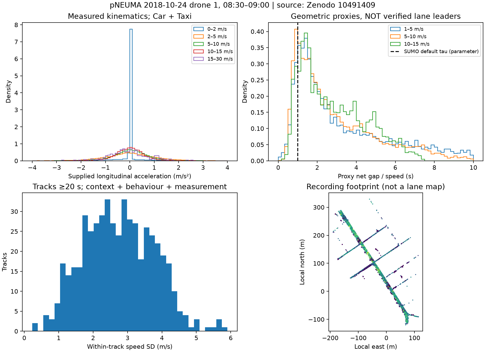
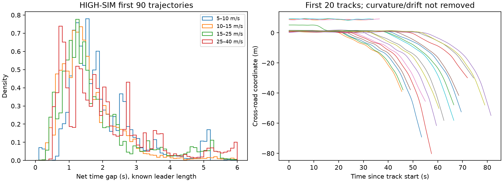
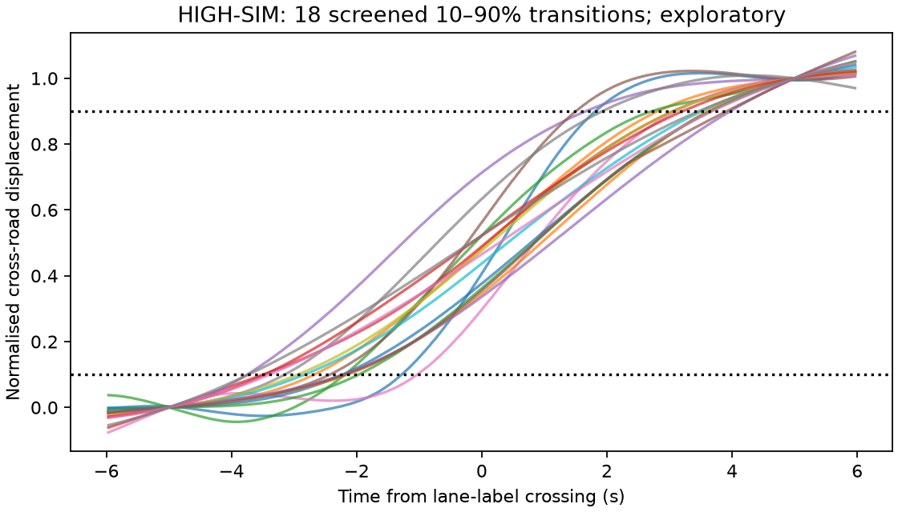
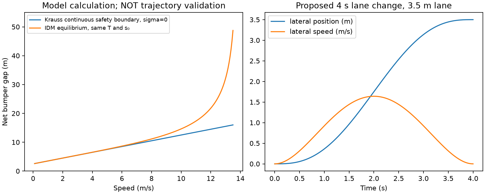

# Real human driving: measurements, model choice and a GPU implementation proposal

Research date: 2026-10-31. This is a research deliverable, not an implemented or validated replacement model.

**Recommendation — opinion:** keep the SUMO-compatible engine as a baseline, and add a separately named human model: heterogeneous IDM with persistent perception error, intermittent acceleration decisions, slow behavioural adaptation and finite-duration lane changes. Evaluate it against held-out trajectories before calling it better. Neither this study nor the opened literature establishes one universal winner. The independent congestion comparison below is particularly useful evidence against choosing by model reputation alone. [Independent comparison](https://arxiv.org/html/2511.18135v1).

## Evidence convention

- **Measured:** observations extracted from a real recording, including this report's calculations on them. Tracker outputs are measurements with processing error, not exact ground truth.
- **Modelled:** equations, simulation results, synthetic calculations or fitted latent quantities.
- **Opinion:** proposed engineering choices or experimental acceptance criteria.
- **Unverified:** no defensible result obtained here. Unknown accuracy and licence conditions remain unknown; no generic centimetre accuracy is assumed.

All external sources linked below were opened during this session. Some explicitly identified pages failed to load; those failures are not evidence for their contents. Links to downloaded data and its documentation also identify the primary inputs to the accompanying scripts. Local implementation observations are additionally tied to the exact files inspected.

## 1. Dataset inventory and acquisition

Counts are release-specific, not estimates of independent drivers. A tracked vehicle is not a persistent human identity. Years below are collection years where verified; otherwise publication/release years are explicitly labelled.

| Dataset; date | What and how much is measured | Accuracy and important limitations | Licence and access checked this session |
|---|---|---|---|
| **pNEUMA, Athens; 2018 recordings, 2024 Zenodo deposit** | Drone trajectories: positions, speed, longitudinal/lateral acceleration, class and time. Provider describes about half a million trajectories across an urban network. | No absolute error bound verified. Native trajectories need lane reconstruction. Some georegistration problems and a non-25 Hz recording are acknowledged by the provider. | Zenodo archive accessible without login. **Licence conflict:** download page footer says CC BY-NC 4.0 but its FAQ says CC BY 4.0. EPFL's institutional page says BY-NC. Treat commercial rights as unresolved. Downloaded one recording, not the 15.8 GB archive. [Deposit](https://zenodo.org/records/10491409), [format/limitations/licence](https://open-traffic.epfl.ch/index.php/downloads/), [institutional licence](https://www.epfl.ch/schools/enac/about/open-science/open-research/neuma/). |
| **I-24 MOTION; 2023 instrument/INCEPTION publications** | Fixed-camera freeway tracking. INCEPTION-derived virtual trajectories are available in the authors' research. | Virtual trajectories are derived from a traffic field; they must not be treated as observed individual humans. Raw tracking is noisy. Instrument site's access timed out; numerical accuracy, downloadable shard size and licence were not verified. | Start from the official organisation and the authors' release paper. No download attempted from an unverified mirror. [Official organisation](https://github.com/I24-MOTION), [authors' data paper](https://arxiv.org/abs/2311.10888). |
| **highD; 2018 publication** | German motorway drone tracks: **110,500 vehicles**, six locations, 44,500 vehicle-km and 147 driven vehicle-hours. | Provider claims typical position error <10 cm; this is not a bound on acceleration or an independent audit. Short roadside observation windows do not identify long-term driver traits. | Free academic/research access, manual application for noncommercial access; no form submitted. [Provider](https://levelxdata.com/highd-dataset/). |
| **exiD; current provider release, collection year not verified** | Motorway entry/exit drone trajectories: **~69,430 road users**, seven sites, ~27,300 km; maps, lane/neighbor enrichment and longitudinal/lateral kinematics. | Provider describes high accuracy without a numeric error bound on the opened page. Merge geometry and visibility limit generalisation. | Provider application; exact granted licence needs review before use. [Provider](https://levelxdata.com/exid-dataset/). |
| **inD; collection year not verified** | Four intersection locations; **~8,200 vehicles + ~5,300 vulnerable road users**; positions, headings, kinematics and maps. | No numerical accuracy bound verified; do not infer signal states from the word “intersection.” | Application for access; no form submitted, exact grant terms unreviewed. [Provider](https://levelxdata.com/ind-dataset/). |
| **rounD; collection year not verified** | Three roundabouts, **~13,740 road users**, multiple classes, maps and trajectories. | No numeric error bound verified. Good candidate for accepted/rejected roundabout gaps; persistent driver identities absent from the advertised track data. | Provider application; exact granted licence unreviewed. [Provider](https://levelxdata.com/round-dataset/). |
| **uniD; 2021 provider citation** | Shared space by a university, one site, **~1,380 vehicles + ~8,600 vulnerable road users**. | No numeric bound verified. Shared-space interactions are a separate domain from motorway following. | Provider application; exact granted licence unreviewed. [Provider](https://levelxdata.com/unid-dataset/). |
| **NGSIM; 2005 Lankershim recording** | Video-extracted vehicle tracks; Lankershim: **500 m, three signalised intersections, 30 min at 0.1 s**. Official hub also lists I-80 and US-101. | Raw acceleration/spacing can be badly wrong. A manual re-extraction study found errors that smoothing alone cannot repair, including missing vehicles. Never use raw acceleration tails as human braking distributions. | FHWA distributes data freely through the DOT hub; a specific machine-readable licence for each asset was not verified. [FHWA hub](https://ops.fhwa.dot.gov/trafficanalysistools/ngsim.htm), [Lankershim fact sheet](https://www.fhwa.dot.gov/publications/research/operations/07029/index.cfm), [independent manual audit, 2017](https://ceg.osu.edu/sites/default/files/2022-06/Coifman_and_Li_2017.pdf). |
| **NGSIM corrections/re-extractions; 2013–2017 research** | Reconstructed I80 trajectories are used in the opened IDM/FVDM calibration paper; independent manual re-extraction provides a different check. | Reconstruction enforces plausibility, which can bias later model selection. “Corrected” is not a guarantee of true reaction timing. Audit reports **236 additional vehicles (11%)** in the camera coverage beyond original tracking. | No currently working, clearly licensed corrected-trajectory download verified here. Keep original and corrected versions separately when obtained. [Calibration paper](https://arxiv.org/abs/1610.03124), [manual audit](https://ceg.osu.edu/sites/default/files/2022-06/Coifman_and_Li_2017.pdf). |
| **ZTD / Zen Traffic Data; release year unverified** | The official access endpoint is currently a maintenance notice. Dataset size, sampling, accuracy and schema could not be verified from that endpoint. | Official notice says access was suspended after a website vulnerability. Do not substitute uncited recollections about Osaka collection scale. | Current instructions require contacting support; Erik would have to do that. Licence unknown. [Official notice](https://zen-traffic-data.net/english/). |
| **CitySim; 2022 preprint, revised 2023** | **1,140 minutes**, 12 drone locations, freeway and signalised/stop/uncontrolled intersections; rotated bounding boxes. | Extraction and filtering pipeline described, but no independent numerical absolute accuracy established here. Safety-oriented selection needs checking before inferring population prevalence. | Sample link available; full release instructions require sending a request form by email. Not submitted. Repository/code licence must not be assumed to license all data. [Authors' paper](https://arxiv.org/abs/2208.11036), [access instructions](https://github.com/wi11Iam5-mpu/UCF-SST-CitySim-Dataset). |
| **HIGH-SIM; 2021 paper, updated 2026 description** | Helicopter video trajectories on I-75; public repository contains **first 90 trajectories**, full data advertised as ~1 GB on Drive. Sample has lane, preceding ID, headway, size, speed, acceleration and cross-road coordinate. | Authors compare consistency against NGSIM; that is not surveyed absolute accuracy. Downloaded description says speed/acceleration use a **2 s moving average**. Our sample exhibits large gap/coordinate anomalies; see below. | **Conflict:** README text says CC BY-SA 4.0; its hyperlink targets BY-NC 4.0. Downloaded small research sample, no claim of commercial rights. [Repository](https://github.com/CATS-Lab/Filed-Experiment-Data-HIGH_Sim), [README with conflicting link](https://raw.githubusercontent.com/CATS-Lab/Filed-Experiment-Data-HIGH_Sim/main/README.md), [description downloaded/read as XML](https://github.com/CATS-Lab/Filed-Experiment-Data-HIGH_Sim/blob/main/data_description2026.docx), [authors' paper](https://www.sciopen.com/article/10.1016/j.commtr.2021.100014). |
| **Waymo Open Motion; provider page updated October 2025** | **103,354 20 s segments, 10 Hz, 574 hours, 10.8M tracked objects**, interactions mined from instrumented vehicles. | Interaction-mined ego-centric data, not uniform traffic sampling. No numeric trajectory accuracy bound verified. Separate human neighbors from the automated ego vehicle. | Motion download redirected to Google login. Custom dataset terms need review; no account or consent flow completed. [Current provider description](https://waymo.com/open/about/). |
| **Argoverse 2 Motion; current documentation** | **250,000 11 s scenarios**, six cities, positions/headings/velocities and scored/fragment quality categories. | Interaction-selected around ego; fragments explicitly lower quality. No numeric absolute accuracy bound verified. Clips are too short for many wave/discharge and driver-history tests. | Public download instructions. Exact data licence not verified; the API's software licence is a separate object. No bulk download. [Dataset guide](https://argoverse.github.io/user-guide/datasets/motion_forecasting.html), [software licence](https://github.com/argoverse/av2-api/blob/main/LICENSE). |
| **SHRP2; present portal, original years not independently resolved here** | Instrumented naturalistic driving; portal lists **3,400+ drivers, 5.4M+ trip summaries, 36,000+ crash/near-crash/baseline events**. | Driver history makes this more suitable for within-driver variation than anonymous short clips. Sensor accuracy is channel-specific and unverified here. Portal counts differ from some study enrolment definitions. | Guest exploration exists; detailed access requires registration and controlled data-use permissions. Exact proposal/ethics requirements must be checked for requested fields. No registration. [Owner portal](https://insight.shrp2nds.us/). |
| **European/Swedish naturalistic evidence: UDRIVE, 2015–2017 collection** | Final EU report: **>88,000 h**, 186 car drivers, 48 truck drivers, 47 scooter riders; video, GPS, CAN and speed. | Final collected sample differs from project plans; do not repeat planned vehicle counts as achieved counts. Useful persistent identities; not a public aerial trajectory benchmark. | Access/licence and sensor accuracy not verified. Swedish route: Chalmers' documented research use, requiring an authorised arrangement rather than an open download. [Final EU report](https://cordis.europa.eu/project/id/314050/reporting), [Chalmers research thesis, 2019](https://research.chalmers.se/publication/514337/file/514337_Fulltext.pdf). |

**Signalised junction priority — opinion:** obtain CitySim with explicit signal timing or annotate pNEUMA signal video and stop lines; use NGSIM Lankershim for a second-site check after trajectory QC. The accessible pNEUMA CSV does not itself provide a signal-phase table. A more recent signalised-intersection study describes using CitySim trajectories with signal timing, but this session did not obtain that asset; its existence in a paper is not possession of the release. [pNEUMA format](https://open-traffic.epfl.ch/index.php/downloads/), [Lankershim](https://www.fhwa.dot.gov/publications/research/operations/07029/index.cfm), [2026 CitySim application](https://doi.org/10.26599/JICV.2026.9210085).

## 2. Acquired data and reproducibility

**Measured/acquisition:** two fresh directories contain downloaded inert data, never executed:

- `/home/erikf/projects/personal/cars-data/truth/trajectories/human-20261031-pneuma/`: `20181024_d1_0830_0900.csv`, archive index and manifest. **14,945,804 downloaded bytes**, **85,620,788 CSV bytes**, ZIP CRC verified. SHA-256 `3ac43b4d76c6b0a9a683102c01da07c53b2b8436a7fbbb645455721ec42c7d6c`. [Primary archive](https://zenodo.org/records/10491409).
- `/home/erikf/projects/personal/cars-data/truth/trajectories/human-20261031-highsim/`: `1-90.xlsx`, `data_description2026.docx`, README and manifest, **23,855,343 bytes total payload**. XLSX SHA-256 `3aa9afa27f323fb68c5cb05368310f287e594578e21e4086dfbd47739aba8ee1`. Read spreadsheet/document XML with Python's ZIP/XML readers; no macros or downloaded helpers executed. [Primary sample](https://github.com/CATS-Lab/Filed-Experiment-Data-HIGH_Sim).

Total data transfer **38,801,147 bytes**, comfortably below 8 GB. Python scripts in this directory are locally authored. Reproduce analysis from the repository root:

```sh
OMP_NUM_THREADS=1 OPENBLAS_NUM_THREADS=1 nix develop --command python3 -I research/truth/scripts/human_measure.py
OMP_NUM_THREADS=1 OPENBLAS_NUM_THREADS=1 nix develop --command python3 -I research/truth/scripts/human_highsim_measure.py
OMP_NUM_THREADS=1 OPENBLAS_NUM_THREADS=1 nix develop --command python3 -I research/truth/scripts/human_models.py
OMP_NUM_THREADS=1 OPENBLAS_NUM_THREADS=1 nix develop --command python3 -I research/truth/scripts/human_highsim_lateral.py
OMP_NUM_THREADS=1 OPENBLAS_NUM_THREADS=1 nix develop --command python3 -I research/truth/scripts/human_lateral_fit.py
```

Acquisition scripts `human_fetch.py` and `human_highsim.py` deliberately refuse to reuse an existing directory. Choose a fresh destination when repeating acquisition. The pNEUMA helper reads the ZIP central directory and fetches only one compressed member with HTTP ranges; it refuses a non-206 response. No full-archive download occurs. Each sample has a provenance manifest; remote `main` files can change, so retain the hashes. [Archive](https://zenodo.org/records/10491409), [HIGH-SIM source](https://github.com/CATS-Lab/Filed-Experiment-Data-HIGH_Sim).

### pNEUMA kinematics: measured, not a fitted driver model

**Measured:** the recording contains **922 tracks**, including **426 cars and 176 taxis**. Analysis uses those **602 tracks**, with 954,132 native car/taxi records. Every tenth record is sampled after trimming 13 frames at each end for a symmetric heading estimate: **94,005 observations**, approximately 0.4 s apart. Supplied km/h is divided by 3.6; supplied accelerations are retained. No invented physical outlier clipping is applied. Quantiles weight time samples, not drivers. [Input and units](https://zenodo.org/records/10491409); exact computations: `scripts/human_measure.py`, `human-pneuma-summary.json`.

| Speed (m/s) | Samples | Longitudinal acceleration p05 / p50 / p95 (m/s²) | Positive acceleration median / p95 | Braking magnitude median / p95 |
|---|---:|---|---|---|
| 0–2 | 36,550 | −0.642 / 0 / 0.583 | 0.711 / 2.289 | 0.604 / 1.905 |
| 2–5 | 14,239 | −1.712 / −0.019 / 1.695 | 0.675 / 2.108 | 0.662 / 2.150 |
| 5–10 | 32,734 | −1.367 / 0.024 / 1.212 | 0.474 / 1.525 | 0.474 / 1.866 |
| 10–15 | 10,206 | −1.026 / 0.003 / 0.974 | 0.387 / 1.319 | 0.404 / 1.352 |
| 15–30 | 276 | −1.261 / −0.075 / 1.321 | 0.558 / 1.708 | 0.504 / 1.750 |

**Measured definitions:** positive/braking subsets require acceleration >0.05 or <−0.05 m/s². The last speed bin is sparse. These are realised accelerations in traffic, including turns and stops, not desired maximum acceleration or emergency braking ability. No confidence interval treating 94,005 correlated samples as independent is appropriate. [Measurement source](https://zenodo.org/records/10491409).



**Measured speed variability:** among **516 tracks** with at least 50 sampled points (approximately 20 s), within-track speed SD p05/median/p95 is **1.092 / 2.727 / 4.298 m/s**. This mixes signal stops, traffic constraints, speed choice and tracker error. It does not estimate within-human psychological variability. Track IDs do not identify the same driver across days. [Input](https://zenodo.org/records/10491409).

### Gap/headway measurements and their QC limits

Define bumper gap `s = x_leader_front − L_leader − x_ego_front`; net time gap `s/v_ego`; front-to-front instantaneous spacing headway `(s+L_leader)/v_ego`. These are distinct from time headway measured at a detector crossing. **Modelled definitions:** they must not be interchanged when fitting `T`. [SUMO parameter meanings](https://sumo.dlr.de/docs/Definition_of_Vehicles,_Vehicle_Types,_and_Routes.html).

**Measured proxy, pNEUMA:** choose the nearest car/taxi 5–80 m forward in a 2.5 m-wide corridor with direction dot product >0.95, simultaneous within 0.03 s. Use provider's nominal 5 m car/taxi length. This yields **23,358 candidate pairs**. It can select vehicles on another road/lane or miss motorcycles. It is **not lane-matched following ground truth**. At 5–10 m/s (13,686 pairs), net gap p05/median/p95 is **5.20 / 16.64 / 59.42 m**, and net time gap is **0.729 / 2.223 / 7.516 s**. At 10–15 m/s (4,068), those are **8.77 / 27.13 / 68.89 m** and **0.810 / 2.446 / 5.975 s**. Do not fit desired time gaps from these mixtures. [Source/nominal dimensions](https://open-traffic.epfl.ch/index.php/downloads/).

**Measured, HIGH-SIM exploratory:** **90 tracks, 233,456 native rows**, every-third-row sample **77,848 rows**. Use supplied front-to-front headway minus the referenced leader's median length; require the leader to appear in the 90-track sample and gap ≥0. At 5–10 m/s (**5,142 samples**) net time gap p05/median/p95 is **0.893 / 1.697 / 4.982 s**; at 10–15 m/s (**26,302**) it is **0.620 / 1.411 / 3.676 s**. These include non-equilibrium states and are not fitted `T` distributions. [Data](https://github.com/CATS-Lab/Filed-Experiment-Data-HIGH_Sim), [field description](https://github.com/CATS-Lab/Filed-Experiment-Data-HIGH_Sim/blob/main/data_description2026.docx).

**Measured QC failure:** the nominal standstill filter `speed<0.1 m/s` returns just **42 samples** with median reported gap **849.13 m**, and the uncorrected cross-road derivative has p05 **−2.10 m/s**. Neither is accepted as a standstill-gap or lane-change statistic. The raw calculation is preserved in `human-highsim-summary.json` to make the failure visible. There are **77 lane-label transitions**, many into ramp label −1; these are not 77 verified lane changes. A distant reported leader is not necessarily a tracking error: this filter lacks verified queue membership. Coordinate seams, filtering, ramp geometry and headway/leader consistency need checking against the full release. [Sample and schema](https://github.com/CATS-Lab/Filed-Experiment-Data-HIGH_Sim).



### Screened lateral transitions: a small useful measurement

**Measured, exploratory:** after removing ramp-label transitions, require six seconds of coverage on either side, adjacent nonnegative lane labels, 2.5–4.5 m lateral displacement, stable endpoint windows (SD ≤0.3 m) and no substantial reversal. Use median positions during −6 to −4 s and +4 to +6 s relative to the lane-label transition as endpoints. The first crossings of 10% and 90% of that displacement define duration. This retains **18 events in 17 tracks**: duration p05/median/p95 **3.809 / 5.816 / 7.082 s**; peak absolute one-second-averaged cross-road speed **0.385 / 0.614 / 0.942 m/s**. This screens out obvious ramp geometry but does not validate the extraction against video. Its selected, smoothed sample is not a population lane-change distribution. [Primary data and description](https://github.com/CATS-Lab/Filed-Experiment-Data-HIGH_Sim); scripts `human_highsim_lateral.py`, `human_lateral_fit.py`, outputs `human-highsim-lateral.json`, `human-lateral-fit.json`.



**Modelled fit:** a normal fit to log(10–90% duration in seconds) is supplied in `human-lateral-fit.json`. It can initialise a duration distribution for this sample, with the small sample and endpoint-window selection clearly retained. For the proposed quintic polynomial, the 10–90% interval is only **0.506727 times its full duration**. Therefore plugging the measured 5.816 s into the polynomial as its *full* duration would systematically shorten the measured motion. A full-video onset definition and filtering sensitivity remain necessary before production calibration. [Measured source](https://github.com/CATS-Lab/Filed-Experiment-Data-HIGH_Sim).

### Requested quantities not established by this sample

The following are **unverified here**, rather than filled with literature folklore:

| Quantity | What was actually obtained | Required measurement/test |
|---|---|---|
| Reaction lag | pNEUMA proxy acceleration correlations: **95 continuous ≥20 s pair segments**, lag grid 0–3.2 s; median apparent maximum at **2.0 s**, p95 at search boundary **3.2 s**. **Rejected as reaction-time estimate**: geometry, common signals, smoothing and boundary maxima confound it. | Validate persistent leaders; compare delayed response models with anticipation; report lag uncertainty and filter sensitivity. |
| Standstill gap | HIGH-SIM QC failed as above; pNEUMA stopped heading deliberately not inferred. | Lane-map queues, both vehicles <0.1 m/s for ≥2 s; use measured dimensions; one event per stopping episode. |
| Lane-change duration/lateral speed | **18 screened transitions** with an explicit 10–90% definition, above; exploratory and unvalidated against video. | Road-relative lateral coordinate, stable lane centres; define onset/end (e.g. 10–90% displacement), exclude curvature, seams and truncated events. |
| Lane-change gap acceptance | No accepted/rejected opportunity table extracted. | Reconstruct target front/rear vehicles before commitment; record rejected as well as accepted gaps; separate mandatory/discretionary manoeuvres. |
| Signal discharge headways/start-up lost time | No verified signal phase/stop-line mapping downloaded. | Front crossings per lane and green, queued vehicles only; saturation headway from stable later positions; lost time `sum(h_j − h_sat)` for startup positions, with first headway measured from green. |
| Critical gaps: unsignalised/roundabout | No conflict-point arrival/opportunity reconstruction. | rounD/inD/CitySim, accepted and rejected conflict gaps, censored likelihood with driver effects; accepted-gap mean alone is not critical gap. |
| Red/yellow behaviour | No phase-synchronised labels. | Signal onset + stop-line crossing + approach speed/distance, stop feasibility and amber duration; estimate stop/go probability and red-crossing rate. |
| Between/within-driver heterogeneity | Between/within **track** kinematics only. | SHRP2/UDRIVE or explicitly repeated-driver experiments; separate contextual variation, driver random effects and slowly changing state. |

These requirements are **opinion / proposed measurement protocols**, motivated by the available schemas and the independent naturalistic comparison's observed within-driver stopping variability. They are not claimed measurements. [pNEUMA schema](https://open-traffic.epfl.ch/index.php/downloads/), [HIGH-SIM schema](https://github.com/CATS-Lab/Filed-Experiment-Data-HIGH_Sim/blob/main/data_description2026.docx), [independent comparison](https://arxiv.org/html/2511.18135v1).

## 3. Comparison with the current simulator, without running the GPU

**Modelled/source inspection:** read [common.wgsl::safe_follow/idm_v](../../crates/cars-core/src/shaders/common.wgsl), [step.wgsl dawdling](../../crates/cars-core/src/shaders/step.wgsl), [lc.wgsl::lc_commit](../../crates/cars-core/src/shaders/lc.wgsl), and [following specification](../sumo-01-step-carfollow.md), [lane-change specification](../sumo-03-lanechange-insertion-outputs.md). The shader's IDM iterates scalar integration, and `lc_commit` assigns the destination lane directly. This observation concerns this checkout, not every possible SUMO configuration. Official SUMO supports lateral parameters and its EIDM is a distinct stateful extension. [SUMO parameters](https://sumo.dlr.de/docs/Definition_of_Vehicles,_Vehicle_Types,_and_Routes.html), [EIDM](https://sumo.dlr.de/docs/Car-Following-Models/EIDM.html).

**Modelled:** passenger defaults in the opened SUMO documentation are acceleration **2.6 m/s²**, deceleration **4.5 m/s²**, emergency deceleration **9 m/s²**, `tau=1 s`, `minGap=2.5 m`, `sigma=0.5`, startup delay **0 s**. Desired headway is not measured reaction time. [Official defaults](https://sumo.dlr.de/docs/Definition_of_Vehicles,_Vehicle_Types,_and_Routes.html).

**Modelled derivation:** far from constraints and above the shader's low-speed dawdling branch, Krauss gives `a=2.6−1.3 U`, `U~Uniform(0,1)`: **1.3–2.6 m/s²**, mean **1.95 m/s²**. This is a conditional prediction, not the unconditional acceleration distribution. The pNEUMA positive medians of **0.675** at 2–5 m/s and **0.387 m/s²** at 10–15 m/s therefore motivate a free-acceleration test but do **not** alone falsify Krauss: most observed vehicles may be constrained. The model's 4.5 m/s² braking parameter also is not a prediction that every braking event has that magnitude. [Defaults](https://sumo.dlr.de/docs/Definition_of_Vehicles,_Vehicle_Types,_and_Routes.html), [measurement input](https://zenodo.org/records/10491409).

**Modelled derivation:** with stationary relative speed and continuous braking approximation, Krauss's safety boundary is `s=s0+vT`; it is not an asserted stochastic equilibrium. IDM's equilibrium is

` s_eq(v) = (s0 + vT) / sqrt(1 − (v/v0)^4) `.

At **v=10 m/s, v0=13.89 m/s, T=1 s, s0=2.5 m**, the boundary is **12.5 m** and IDM equilibrium **14.62 m**. Numerical discrete safe-stop arithmetic and dawdling change actual Krauss results; the shader/spec's discrete equations must be retained for a replay baseline. [IDM basis](https://www.akesting.de/download/HDM.pdf), [SUMO parameter definitions](https://sumo.dlr.de/docs/Definition_of_Vehicles,_Vehicle_Types,_and_Routes.html).



**Opinion:** compare full conditional distributions and multi-step trajectories. No LC2013 trajectory distribution was generated here, and no calibrated human model was demonstrated to beat it. The present instantaneous lane assignment has no physical lane-change duration to compare; rendering a smooth move alone would leave interaction physics wrong.

## 4. What model evidence actually supports

### Independent checks before author demonstrations

**Measured + modelled, independent of the original model authors:** Hou, Kusari and Lin's 2025 comparison uses IVBSS naturalistic data (source database **160 drivers**, not all necessarily in this subset). It identifies **60 continuous following events, 7,440.8 s / 2.07 h** from 24 highway-dominant congestions. Under common calibration objectives IDM, ACC, Gipps, OVM and FVDM perform similarly. OVM/FVDM collide in **two** sequences; the other three do not in that experiment. Their video review identifies coasting/creep and changing standstill preferences; one example changes from **3.5 m to just over 0.5 m**. These are study-specific findings, not population frequencies. Small congestion subset, implementation choices and calibration objective limit transfer. [Full primary paper](https://arxiv.org/html/2511.18135v1).

**Measured + modelled, controlled experiment rather than an independent model tournament:** Jiang et al. (2014) study a **25-car platoon**. Their disturbance-growth evidence motivates allowing a region of speed–spacing states rather than a unique deterministic equilibrium curve. Tian et al.'s follow-up uses that experiment and reports a mode-switching stochastic model with speed adaptation/spacing indifference matching oscillation/discharge features. These are authors' model results; they do not prove universal superiority or validate Greek urban junctions. [Experiment](https://arxiv.org/pdf/1402.2254), [follow-up](https://arxiv.org/abs/1611.00527).

**Modelled/calibration methodology:** Kurtc and Treiber (2016) compare IDM/FVDM calibration using reconstructed NGSIM and platoons up to **five vehicles**, with local, global and platoon objectives. This is useful for experimental design, but is not fully independent evidence for IDM because Treiber co-developed it. Filtering out lane changes also narrows what the result tests. [Primary paper](https://arxiv.org/abs/1610.03124).

**Unverified:** a 2021 “comprehensive comparison” advertises >5,000 following events in search results, but the primary full/abstract endpoints repeatedly returned 403. I do not use its advertised percentage improvements as verified findings. Likewise I could not obtain the ACT-R driver paper, an independently validated current NGSIM correction download or a current ZTD release.

### Candidate assessment

Entries below distinguish demonstrated modelling capability from real-data validation. “Not established” means this session found no adequate opened primary comparison, not that the model cannot do it.

| Model | Evidence and limitations | Million-vehicle judgement (opinion) |
|---|---|---|
| Krauss | **Modelled:** original 1997 paper demonstrates a parameter-family subset with metastability/hysteresis. This is not evidence that current SUMO defaults reproduce all human wave statistics. [Original abstract](https://journals.aps.org/pre/abstract/10.1103/PhysRevE.55.5597). | Keep exact baseline and safety logic; do not confuse cheap noise with measured human variation. |
| IDM | **Modelled:** deterministic gap/speed response, usable as HDM base; independent congestion study finds no universal separation from calibrated alternatives. [HDM](https://www.akesting.de/download/HDM.pdf), [independent test](https://arxiv.org/html/2511.18135v1). | Best initial scalar baseline for a human extension; equations and parameters are inspectable. |
| IDM+ | **Modelled:** separates free and following acceleration by a minimum; a Delft human-factors framework uses it but explicitly describes face validation and missing quantitative psychological evidence. It is not synonymous with IIDM or EIDM. [Framework](https://pure.tudelft.nl/ws/portalfiles/portal/72398801/FramewSimAV_vAuthorsFinal_corr.pdf). | Include an ablation; no verified independent advantage here. |
| HDM | **Modelled:** delays, correlated estimation error, spatial/temporal anticipation; anticipation can offset destabilising delay. Parameter settings are modelling choices, not measured population distributions. [Authors' full paper](https://www.akesting.de/download/HDM.pdf). | Borrow mechanisms; an exact delay history and many-leader anticipation cost more memory/bandwidth than a scalar approximation. |
| EIDM | **Modelled/implementation:** SUMO describes jerk reduction and startup/lane-change acceleration treatment; intended timestep **0.05–0.5 s**, warns of unwanted braking/collisions at larger steps. No independent all-phenomena superiority verified. [Implementation documentation](https://sumo.dlr.de/docs/Car-Following-Models/EIDM.html). | Strong CPU reference; do not silently replace by plain IDM or promise its behaviour from fewer states. |
| Wiedemann 74 / 99 | **Modelled/vendor specification:** psychophysical following parameters; 99 exposes standstill spacing, headway and oscillatory thresholds separately. Vendor documentation is not independent validation. This session did not verify a fair W74/W99 versus Krauss benchmark. [W74](https://cgi.ptvgroup.com/vision-help/VISSIM_2025_ENG/Content/4_BasisdatenSim/FahrverhaltensparameterFolgeverh_Wied74.htm), [W99](https://cgi.ptvgroup.com/vision-help/VISSIM_2025_ENG/Content/4_BasisdatenSim/FahrverhaltensparameterFolgeverh_Wied99.htm). | Action thresholds are useful; wholesale port adds calibration burden without established benefit here. |
| Gipps | **Modelled + measured comparison:** explicit response interval and safe-distance speed rule; the independent congestion implementation was competitive and collision-free in its subset, not a general safety theorem. [Primary comparison and equations](https://arxiv.org/html/2511.18135v1). | Cheap alternative baseline; timestep and braking assumptions need explicit treatment. |
| Newell | **Unverified original/full independent test here.** The 2004 verification endpoint was inaccessible; no precise claims of universal wave-growth or capacity-drop accuracy are made. | Test a translated-trajectory baseline; do not assert constant shifts explain oscillation growth. |
| FVDM | **Modelled:** includes relative velocity; original analytical/numerical study claims congestion phase transitions. Independent congestion study exposes collisions in its tested implementation. [Original abstract](https://journals.aps.org/pre/abstract/10.1103/PhysRevE.64.017101), [independent test](https://arxiv.org/html/2511.18135v1). | Inexpensive, but needs an independently checked safety envelope. |
| ACT-R based | **Unverified full paper here:** author PDF and publisher endpoints failed. No independently verified sample size, error or large-scale cost claim. | Use cognitive ideas as hypotheses; no basis here to choose a full cognitive architecture for millions. |
| Stochastic/action-point models | **Measured motivation + modelled result:** 25-car experiment/follow-up supports variable spacing and persistent fluctuations; this is not validation of every random update rule. [Follow-up](https://arxiv.org/abs/1611.00527). | Add correlated state and update thresholds; test against white-noise and fixed-parameter ablations. |
| MOBIL | **Modelled:** uses prospective accelerations for safety and utility, plus politeness; original paper is an author demonstration rather than independent real-data dominance over LC2013. [Original](https://mtreiber.de/publications/MOBIL_TRB.pdf). | Attractive scalar discretionary decision rule; retain route urgency, cooperation and keep-clear. |
| LC2013 | **Implementation/modelled:** SUMO's default model has strategic/cooperative/speed-gain elements. No opened independent study establishes a universal MOBIL/LC2013 winner. [Official description](https://sumo.dlr.de/docs/Definition_of_Vehicles,_Vehicle_Types,_and_Routes.html). | Preserve route/cooperation behaviour while testing changes separately from motion duration. |
| Gap acceptance | **Opinion:** use censored accepted/rejected-opportunity likelihood and conflict geometry; one constant threshold cannot be assumed calibrated to every junction. | Low-dimensional logistic hazard plus legal conflict constraints is implementable; parameters remain unfitted here. |
| Learned/data-driven | **Modelled:** I24-MSD work explicitly addresses measurement noise in generative simulation; its abstract is an author claim, not independent deployment evidence. [Authors' research](https://arxiv.org/abs/2508.07453). | Benchmark as an offline teacher or small residual; closed-loop and out-of-city validation required before accepting prediction gains. |

**Phenomena verdict:** Krauss's original family demonstrates hysteresis/metastability; HDM demonstrates delayed/anticipatory wave dynamics; experimental stochastic work addresses observed platoon oscillation growth. That does **not** establish which default engine reproduces **capacity drop, wave growth, hysteresis and platoon oscillations simultaneously**. No opened independent common-data, common-calibration tournament established that ranking for all candidates. Treat all four as separate acceptance tests, measuring capacity drop `(q_before−q_after)/q_before`, upstream propagation speed, acceleration/deceleration speed–gap loops, and SD(speed) versus platoon position. These definitions/tests are proposed methodology, not reported observations. [Krauss](https://journals.aps.org/pre/abstract/10.1103/PhysRevE.55.5597), [HDM](https://www.akesting.de/download/HDM.pdf), [experiment](https://arxiv.org/pdf/1402.2254).

## 5. Concrete WGSL human-driver proposal

Everything in this section is **modelled proposal / opinion**, unless explicitly marked sourced. No performance, calibration or superiority is claimed.

### Longitudinal rule

Use real bumper gap `s`, speed `v`, closing speed `dv=v−vL`. On a decision tick:

```text
rho = exp(-h / tc)
z_next = rho*z + sqrt(1-rho*rho)*normal(seed, tick)
s_hat = max(eps, s*exp(0.05*z))
dv_hat_next = dv_hat + (1-exp(-h/tr))*(dv-dv_hat)
T_eff = clamp(T_driver * (1 + k_adapt*m), 0.5, 3.0)
s_star = s0 + max(0, v*T_eff + v*dv_hat/(2*sqrt(a*b)))
a_target = a * (1-(v/v0)^4-(s_star/s_hat)^2)
```

Hold the target between decision ticks. For normal operation move acceleration toward it with a jerk limit; for an imminent collision, an un-delayed safety constraint overrides comfort. Integrate position ballistically with a stop-within-step case, never a backwards step. The scalar filtered `dv_hat` is an **approximation to perceptual response**, not an exact physiological reaction delay. Changing leader resets it to observed relative speed to avoid stale-leader memory. [IDM/HDM equations and error motivation](https://www.akesting.de/download/HDM.pdf), [EIDM jerk/startup reference](https://sumo.dlr.de/docs/Car-Following-Models/EIDM.html).

Adaptation state proposal: `m_next=m+(1-exp(-dt/60))*(1-v/max(v0,eps)-m)`. It modifies time gap slowly during congestion; coefficient `k_adapt=0.3` and **60 s** are **engineering hypotheses**, not fitted findings. Startup timer begins when a stopped vehicle first has permission **and usable space**; it must not restart each tick. Keep signal/route/conflict constraints external to the psychological CF rule. [Mechanistic context, not these numeric settings](https://sumo.dlr.de/docs/Car-Following-Models/EIDM.html).

Safety proposal: use true, un-noised geometric gaps and the simulator's existing emergency safe-speed calculation. Take the minimum across physically occupied lanes/conflicts. It is a simulation guard with its own intervention counter. It is not a claim that human drivers always drive safely, and it must not hide a poorly calibrated model by intervening continuously. [Existing safe-distance parameter semantics](https://sumo.dlr.de/docs/Definition_of_Vehicles,_Vehicle_Types,_and_Routes.html).

### Parameters: sourced starting points versus unfitted distributions

The HDM paper's Table 1 uses **a=1 m/s², b=1.5 m/s², s0=2 m, T=1.1 s, v0=128 km/h**, relative distance error **5%**, error correlation **20 s**. These are **published simulation settings**, not a measured driver population fit. Use local speed limits rather than transplanting its motorway desired speed into Athens. [Table 1](https://www.akesting.de/download/HDM.pdf).

Proposed initial population for a controlled experiment, explicitly **not an empirically fitted population**:

| Parameter | Initial distribution/settings | Status |
|---|---|---|
| `a` | truncated lognormal, median 1.0 m/s², log-SD 0.25, [0.4, 2.6] | Median sourced above; width/bounds opinion. Fit free-acceleration episodes, not all positive acceleration samples. |
| `b` | truncated lognormal, median 1.5 m/s², log-SD 0.25, [0.7, 3.5] | Median sourced; width/bounds opinion. Keep physical emergency bound separate. |
| `s0` | truncated lognormal, median 2.0 m, log-SD 0.35, [0.5, 5] | Median sourced; width/bounds opinion. Standstill data here rejected, so not fitted. |
| `T_driver` | truncated lognormal, median 1.1 s, log-SD 0.30, [0.5, 2.5] | Median sourced; width/bounds opinion. Measured instantaneous time gaps do not directly estimate it. |
| `v0/limit` | truncated normal, mean 1.0, SD 0.10, [0.7, 1.3] | Opinion; fit unconstrained straight driving by site/class. |
| `tc`, distance error | 20 s, 5% | Sourced HDM model settings; test sensitivity, not assumed measured truths. |
| Decision interval, `tr`, jerk | initial 0.5 s, 0.5 s, 3 m/s³ | Opinion for this simplified kernel. These are not interchangeable reaction-time estimates. |
| Startup delay | initially Uniform[0.3, 1.2] s | Opinion pending measured queued starts. Do not report as sourced human distribution. |

The requested fully real-data-fitted distribution of all parameters was **not achieved**. Inventing that fit from the available anonymous noisy samples would weaken the recommendation. Fit a hierarchical joint population, including covariance, rather than independent draws by default. Between-driver random effects should cover desired speed, time gap, acceleration/braking preference, standstill gap, decision interval and lane-change utility. Within-driver variation should be correlated state, mode changes and context. A physical braking limit need not share the distribution of preferred braking. [Observed variability and caution](https://arxiv.org/html/2511.18135v1), [HDM mechanisms](https://www.akesting.de/download/HDM.pdf).

### Lane-change decisions and real lateral motion

Discretionary incentive proposal, following MOBIL:

`Δa_ego + p*(Δa_newFollower+Δa_oldFollower) + routeBias − threshold > 0`,

with a target-follower prospective braking check and legal/conflict constraints. Initial politeness `p~Beta(2,5)` and threshold `0.2 m/s²` are **unfitted engineering priors**. Keep mandatory route urgency and cooperative preparation from LC2013 rather than deleting them. Rejected opportunities must be logged for fitting the decision hazard. [MOBIL rule](https://mtreiber.de/publications/MOBIL_TRB.pdf), [LC2013 official description](https://sumo.dlr.de/docs/Definition_of_Vehicles,_Vehicle_Types,_and_Routes.html).

Once committed, for signed lane displacement `w`, duration `D`, progress `u=clamp((t−t_start)/D,0,1)`:

```text
f(u)  = 10u^3 - 15u^4 + 6u^5
f'(u) = 30u^2 - 60u^3 + 30u^4
y     = y_start + w*f(u)
vy    = (w/D)*f'(u)
```

This is a **proposed polynomial trajectory**, analytically zero lateral velocity and acceleration at its endpoints. For **w=3.5 m, D=4 s**, peak lateral speed is **1.641 m/s**. For the initial experiment, draw **10–90% duration** from the exploratory lognormal fit in `human-lateral-fit.json`, then divide by **0.506727** to obtain polynomial full duration `D`. The 4 s example is a calculation, not that fitted default. Validate onset definition, smoothing and external-site duration before production use. [Fit input](https://github.com/CATS-Lab/Filed-Experiment-Data-HIGH_Sim). The existing instantaneous assignment should be tested as a separate baseline so any gain from finite duration is distinguishable from the decision-rule change. [Decision/movement decomposition context](https://mtreiber.de/publications/MOBIL_TRB.pdf).

During the manoeuvre, insert the vehicle's footprint into **both lanes' neighbor/occupancy representations** whenever overlapping. Constrain it by both lanes' relevant leaders; target and original followers must see overlap too. Reserve swept space through time, arbitrate simultaneous swaps, and only retire original-lane occupation when the footprint clears it. Pre-commit cancellation and post-commit abort require explicit trajectories, not lane-index teleportation. These are **implementation recommendations**, not claims that a cosmetic interpolation fixes traffic physics.

### State and compute cost

**Modelled engineering budget:** pack static personality into a 16-byte record (`u32` seed plus quantised parameter fields, reconstruct rarely used values), and dynamic additions into two 16-byte vectors: noise/perceived relative speed/held acceleration/adaptation plus startup timer/lateral progress/duration/packed lanes and mode. Budget **48 bytes additional state per vehicle**, **48 MB per million vehicles**, plus occupancy and sorting overhead. Exact Rust/WGSL alignment and the choice of bit packing must be tested; this is a proposed layout, not an existing structure. No function-local arrays are needed: scalar expressions and fixed neighbor references suffice. Use fourth powers as multiplication, cache parameter transforms, stagger action updates by hashed phase, and update perception noise only at action times. This changes arithmetic cost but does not prove throughput; millions-of-vehicles timing remains unmeasured.

## 6. The held-out test that could establish improvement

**Opinion / pre-registered acceptance plan; not a completed experiment:**

1. QC full trajectories and maps first. Check simultaneous leader existence, projected headway agreement, positive lengths, timestamp monotonicity, coordinate seams and differentiation/filter consistency. Quarantine the HIGH-SIM standstill anomalies. Keep both raw and processed signals. [Primary sample/schema](https://github.com/CATS-Lab/Filed-Experiment-Data-HIGH_Sim), [NGSIM audit](https://ceg.osu.edu/sites/default/files/2022-06/Coifman_and_Li_2017.pdf).
2. Split entire recording sessions/sites **60/20/20** train/validation/test, and persistent drivers where available; never adjacent frames of a track across splits. Reserve a different city/site as an external test. Bootstrap by recording/driver, not frames. Current downloaded 90-track illustration is not a credible independent-site test set.
3. CPU leader-replay at the same timestep and boundary conditions: exact shader-equivalent Krauss defaults, **calibrated Krauss**, calibrated IDM, proposed heterogeneous IDM, and mechanism ablations. Score open-loop rollouts at **5, 10, 30 s**, not acceleration fits alone. Fit only on training, choose hyperparameters on validation, freeze before test. Local/platoon objective differences motivate a separate multi-follower replay. [Calibration methodology](https://arxiv.org/abs/1610.03124).
4. Compare speed/gap RMSE and quantile/CRPS scores, acceleration/jerk tails conditional on speed, collision count and safety interventions. Test driver-specific and population forecasts separately. Proposed pass criterion: **≥10% held-out gap-RMSE reduction versus calibrated Krauss**, recording-bootstrap **95% CI excluding zero**, improved distribution score, and no increase in collisions or hidden safety overrides. These numbers are acceptance choices, not results.
5. Lane-change task: LC2013 baseline versus finite-duration LC2013 versus finite-duration MOBIL/hazard. Evaluate event precision/recall, accepted/rejected probability calibration, duration/lateral-speed distributions, target follower braking and held-out lane usage. A missed-change penalty must accompany trajectory error; otherwise a model can “win” by never changing lanes.
6. Signals/roundabouts: replay observed arrival demand, routes, phases and geometry; evaluate discharge headways, startup lost time, queue growth, accepted/rejected conflict gaps, amber stop/go and red crossings. Estimate each on held-out cycles/intersections. No phase labels means no test result.
7. Closed-loop scale: compare capacity drop, upstream wave speed, hysteresis loops and concavity of platoon SD growth. Require agreement within recording-level empirical uncertainty. Only then benchmark the GPU implementation, with small-to-large runs and the repository's VRAM/desktop limits. **No GPU was run in this study.** [Experimental oscillation reference](https://arxiv.org/pdf/1402.2254).

**What this session establishes:** actual useful trajectory acquisition, reproducible kinematic/gap summaries, QC diagnostics and a small explicitly screened lateral sample, and a concrete small-state candidate with a falsifiable evaluation plan. **What it does not establish:** a fitted universal driver population, reliable population reaction/standstill/lateral/junction distributions, or that the proposed model already beats Krauss/LC2013.

## 7. Actions requiring Erik

- Apply personally for highD/exiD/inD/rounD/uniD and review the grant terms. No forms were submitted. [Provider application example](https://levelxdata.com/highd-dataset/).
- Send CitySim's request if full signalised-junction data is wanted; ZTD currently asks new users to contact support. No messages were sent. [CitySim instructions](https://github.com/wi11Iam5-mpu/UCF-SST-CitySim-Dataset), [ZTD notice](https://zen-traffic-data.net/english/).
- Complete Waymo login/terms if desired; arrange SHRP2/UDRIVE permissions for persistent-driver analysis. [Waymo](https://waymo.com/open/about/), [SHRP2](https://insight.shrp2nds.us/), [UDRIVE](https://cordis.europa.eu/project/id/314050/reporting).
- Resolve pNEUMA/HIGH-SIM licence conflicts before any commercial reuse. Public downloadability does not resolve the contradictory primary notices. [pNEUMA](https://open-traffic.epfl.ch/index.php/downloads/), [HIGH-SIM README](https://raw.githubusercontent.com/CATS-Lab/Filed-Experiment-Data-HIGH_Sim/main/README.md).
