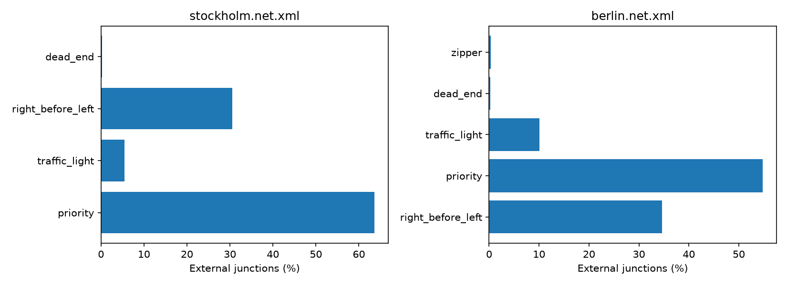
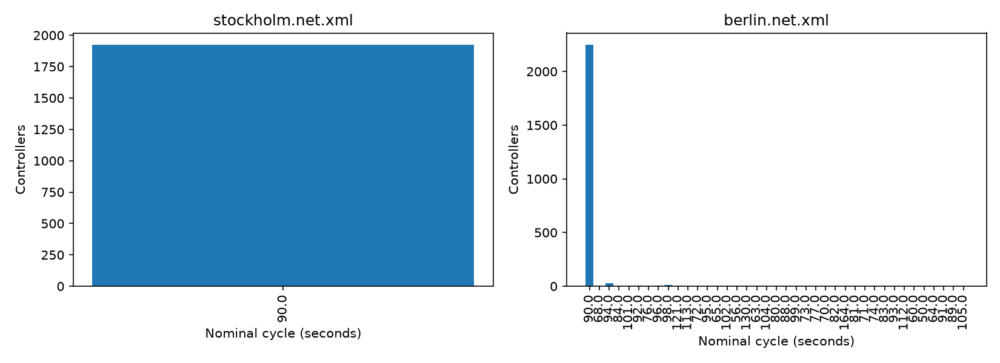

# Maps, intersections and capacity: Stockholm and Berlin

First draft by another model, 2026-10-31. Checked and corrected by Opus on 2026-11-01; see [Reviewed by Opus](#reviewed-by-opus) at the end for what changed. **Measured** means read or calculated from the named files or official registers, not observed on the street. **Modelled** means an analytical estimate. **Opinion** marks judgement. Local files use `file:///` URLs. Web sources are listed at the end, with a note on which were reopened in the review.

## Short answer

Is the problem the map data? Partly, and mostly not the part the first draft stressed. Lane counts and geometry agree with OSM on almost every edge where OSM has a tag, though 188 major-road edges fall to one lane because the tag is missing. The signal layer is the weak part: one real installation becomes several independent controllers, every controller gets the same generated 90 s program with offset 0, and many stop lines sit on edges shorter than a car. Bus lanes are also open to cars, which errs the other way and adds capacity that does not exist. How much of Stockholm's overload this explains is measured separately by the agent running the simulator; this report does not claim an effect size.

## Findings, corrected

1. **Measured, new:** Stockholm's open WFS publishes the real signal register with no key and no account: 10,301 positioned lanterns, 5,368 poles and 3,861 positioned push buttons, tagged with installation id and signal group such as `Fordonslykta F2:1`. That gives 519 installation ids, 502 of them with lanterns. Trafiknämnden's own report says it manages "drygt 500 trafiksignalanläggningar", so the count matches. Timing is not in this data. [SWFS] [STERMS] [SCOUNT]
2. **Measured, new:** inside Stockholm municipality the net has 1,304 controllers against those 519 installations, 2.5 per installation. 689 of them have one approach. Only 145 installations map to exactly one controller; 187 touch three or more. 95% of OSM signal nodes have register equipment within 40 m, so these are mostly real signals cut into pieces, not false signals. The first draft's single-approach count (937 citywide) stands, but its reading as possible "false installations" does not. [SNET] [SWFS] [sanity base](maps-sanity-base.json)
3. **Measured, corrected:** "556 signalised approaches lost by omitting `--osm.turn-lanes`" overstates it. 556 counts any turn tag on the source way, either direction. Rebuilding with the option changes connections on 431 edges citywide, 278 of them among the 546 directional segments. Signal approaches with a turn-only lane go from 205 to 406. The option also removes 393 movements, 313 of them U-turns, which breaks 14.2% of vehicle routes in the current demand until they are rerouted. [recheck](maps-turnlane-recheck.csv) [v1 sanity](maps-sanity-v1_turn.json)
4. **Measured, corrected:** "411 of 546 turn inconsistencies" is inflated. 138 of the 411 are on upstream pieces of a way split by a crossing, where arrows can never apply because netconvert only uses them at the way's last node. On the 377 true terminal segments there are 273 flags, and `--osm.turn-lanes` clears them to 49. [EDGE] [recheck](maps-turnlane-recheck.csv)
5. **Measured, held with a caveat:** 100% of Stockholm's and 95.8% of Berlin's controllers have a 90 s duration sum and all have offset 0. But these are nominal. Every generated green has `minDur=5 maxDur=50`, so the sum says little about real cycles under actuation. 1,146 of 1,922 Stockholm controllers have the pattern 82-3-5; by its limits that is at most 50 s green, then 8 s of yellow and red, with no pedestrian call behind it. The one documented Stockholm corridor runs coordinated plans of 85 and 100 s, and the city handbook gives 70-85-100 s as an example. [TLS] [TIDPLAN] [STYR]
6. **Measured, corrected:** "802 veh/h on two lanes" is correct arithmetic and a weak finding. It is 1,900 × 38/90 for one lane of a 4.82 m stub whose second lane has no connection, because the next OSM way is tagged `lanes=1`. It uses a nominal green that actuation does not hold to and calls a stub a road. The real finding underneath: 745 of 3,690 signal approaches (20%) have their stop line on an edge shorter than 7.5 m. See [the capacity section](#analytical-capacity-and-candidate-bottlenecks).
7. **Measured, new:** the OSM bus-lane tags are unused in the current net. 263 net edges carry `psv:lanes` or `bus:lanes` with a designated lane and none honour it. `--osm.lane-access` fixes 293 of 295 in the build where it is on. At S:t Eriksgatan/Fleminggatan the aerial shows buses on exactly the lanes it closes to cars. [v2 sanity](maps-sanity-v2_lane.json) [fig](fig/maps07/s12_steriks_fleming_v5.png)
8. **Measured, new:** SUMO's recommended `--tls.discard-simple --tls.join` is wrong for Stockholm. It drops controllers in the municipality from 1,304 to 307, leaves 238 installations with no controller within 40 m, removes 2,464 edges by merging and breaks routes for 50.7% of vehicles. [IMPORT] [v3 sanity](maps-sanity-v3_tls.json)

## Reproduction and scope

The first draft's generators reproduced every CSV, JSON and the report byte for byte. Do not run them from the repo root any more: `maps_report.py` overwrites this file. To check them, run them in a scratch directory:

```sh
nix develop --command python3 -I research/truth/scripts/maps_rerun.py /tmp/rerun-07
```

Input hashes of the audited snapshots: Stockholm `3171eb231e186b63b7c6e0f53b2654067d7fc8b429ac001d6c56c8013d82c0d0`, Berlin `73c6651c8d517c2ae81a9c9cbd9991cdfa3b55975fbedaec8f8df668dc3d8860`. `clip.osm.xml` and `clip.osm.pbf` have equal object CRC (`a3cd0cc3`) and counts (2,586,640 nodes, 435,105 ways); the newest edit in the extract is 2026-10-23. Rerunning the embedded netconvert command gives a byte-identical net after the header, so the baseline is reproducible.

Counts refer to normal edges with at least one passenger-permitted lane. External junction counts exclude ids beginning `:`. A controller may control several nodes.

## Quantitative network audit

| Quantity (measured) | Stockholm | Berlin |
|---|---:|---:|
| Passenger road edges | 76,609 | 71,324 |
| External junction nodes | 34,885 | 28,547 |
| Internal/crossing/walking edges | 215,551 | 159,982 |
| Unique TLS controllers | 1,922 | 2,344 |
| Signalised passenger approach segments | 3,690 | 8,000 |
| Approaches with a turn-only passenger lane | 205 | 2,352 |
| Passenger lanes without outgoing connections | 544 | 756 |
| Invalid TLS link indices found | 0 | 0 |
| Nominal cycles outside screening range 30–180 s | 0 | 0 |

All cells: [SNET] [BNET]. Zero outgoing connections includes legitimate network exits; it is a review flag, not a defect count. The 30–180 s range is an **opinion** screening threshold, not an HCM rule.

| Junction type (measured) | Stockholm count (%) | Berlin count (%) |
|---|---:|---:|
| dead_end | 95 (0.27%) | 74 (0.26%) |
| priority | 22,194 (63.62%) | 15,633 (54.76%) |
| right_before_left | 10,674 (30.60%) | 9,878 (34.60%) |
| traffic_light | 1,922 (5.51%) | 2,875 (10.07%) |
| zipper | 0 (0.00%) | 87 (0.30%) |

Source for the entire table and figure: [SNET] [BNET].



### Lanes and speeds by road class

Measured distributions: lane count is passenger lanes per directed edge; speeds are lane-weighted km/h, rounded below. Full histograms, including all lane counts and speed values, are in [Stockholm CSV](stockholm-map-road-classes.csv) and [Berlin CSV](berlin-map-road-classes.csv). [SNET] [BNET]

| City / class | Edges | 1 lane / 2 lanes / 3+ lanes | Speed p05 / median / p95 km/h |
|---|---:|---:|---:|
| Stockholm / living_street | 4,503 | 4,503 / 0 / 0 | 10 / 10 / 20 |
| Stockholm / motorway | 543 | 8 / 158 / 377 | 70 / 80 / 100 |
| Stockholm / motorway_link | 699 | 518 / 160 / 21 | 40 / 70 / 90 |
| Stockholm / primary | 350 | 25 / 195 / 130 | 40 / 60 / 70 |
| Stockholm / primary_link | 145 | 119 / 21 / 5 | 30 / 50 / 80 |
| Stockholm / residential | 50,025 | 49,981 / 42 / 2 | 30 / 30 / 50 |
| Stockholm / secondary | 4,322 | 2,187 / 1,771 / 364 | 40 / 50 / 70 |
| Stockholm / secondary_link | 230 | 197 / 33 / 0 | 40 / 50 / 80 |
| Stockholm / tertiary | 9,326 | 8,322 / 903 / 101 | 30 / 40 / 60 |
| Stockholm / tertiary_link | 82 | 77 / 5 / 0 | 30 / 50 / 80 |
| Stockholm / trunk | 105 | 24 / 32 / 49 | 50 / 60 / 70 |
| Stockholm / trunk_link | 121 | 102 / 16 / 3 | 31 / 50 / 70 |
| Stockholm / unclassified | 6,158 | 6,049 / 103 / 6 | 30 / 40 / 50 |
| Berlin / living_street | 17 | 17 / 0 / 0 | 5 / 5 / 12 |
| Berlin / motorway | 430 | 11 / 95 / 324 | 60 / 80 / 120 |
| Berlin / motorway_link | 512 | 219 / 242 / 51 | 40 / 60 / 80 |
| Berlin / primary | 2,868 | 422 / 1,195 / 1,251 | 30 / 50 / 60 |
| Berlin / primary_link | 82 | 59 / 21 / 2 | 30 / 50 / 80 |
| Berlin / residential | 49,171 | 49,056 / 109 / 6 | 30 / 30 / 50 |
| Berlin / secondary | 9,321 | 5,213 / 2,687 / 1,421 | 30 / 50 / 50 |
| Berlin / secondary_link | 75 | 46 / 26 / 3 | 30 / 50 / 80 |
| Berlin / service | 19 | 18 / 1 / 0 | 20 / 30 / 50 |
| Berlin / tertiary | 7,851 | 7,046 / 662 / 143 | 30 / 50 / 80 |
| Berlin / tertiary_link | 10 | 9 / 1 / 0 | 50 / 50 / 80 |
| Berlin / trunk | 100 | 3 / 58 / 39 | 30 / 80 / 120 |
| Berlin / trunk_link | 47 | 34 / 13 / 0 | 30 / 50 / 80 |
| Berlin / unclassified | 799 | 753 / 39 / 7 | 30 / 50 / 50 |
| Berlin / residential | 1 | 0 / 1 / 0 | 11 / 11 / 11 |
| Berlin / unknown | 21 | 18 / 2 / 1 | 30 / 50 / 50 |

**Opinion:** rare very high urban-class speeds and abrupt lane changes deserve review, but road class alone cannot establish the legal speed. Compare official directional speed records at the edge's validity date before changing anything. [NVDB]

**Measured:** 937 Stockholm signalised junction nodes have just one passenger approach segment. This includes possible crossings and stop-line representations; it is not a count of false installations. [SNET]

### Signal programs

**Measured:** the build command is `scripts/stockholm/build_net.sh`; the net header records `tls.guess-signals`, `tls.default-type=actuated`, `ramps.guess`, `junctions.join`, and no `osm.turn-lanes`, `osm.lane-access`, `tls.join` or `tls.discard-simple`. SUMO's documented defaults are a 90 s cycle, green split equally, and generated actuated greens of 5–50 s. All 1,922 Stockholm programs and 2,246 of 2,344 Berlin programs sum to 90 s; Berlin has one program per controller, all `actuated`, all offset 0. Berlin's header records netedit 1.21 editing an existing BeST net, so its history cannot be reconstructed. [SNET] [BNET] [TLS] [NETCONVERT]



| Stockholm phase pattern (s) | Controllers of 1,922 |
|---|---:|
| 82-3-5 | 1,146 |
| 42-3-42-3 | 318 |
| 81-4-5 | 102 |
| 38-3-6-3-37-3 | 47 |
| 41-4-41-4 | 34 |

**Measured from city documents:** at Västerbroplan and Gjörwellsgatan/Rålambsvägen, three controllers run coordinated so that some movements get a green wave. Before a trial they switched by clock between P2 (85 s, 18:00–23:00), P3 (100 s, 09:00–18:00) and P4 (100 s, 06:00–09:00). The city's control handbook describes classic coordination with fixed common cycles, "t.ex. 70 - 85 - 100 s", for systems of up to about ten junctions, cycles selectable up to 180 s, and LHOVRA at isolated signals. This is one corridor and a handbook, not a citywide plan. [TIDPLAN] [STYR]

**Opinion:** the 90 s default is not far from these values. Fragmentation and the absence of coordination are likelier to matter than the cycle length, but this report did not test that.

## Turn lanes

**How netconvert uses arrows (from source):** `turn:lanes` are ignored unless `--osm.turn-lanes` is set. They are applied only on the edge ending at the way's last node, and only when the arrow count equals the lane count; otherwise it warns. If signed directions exceed the edge's targets it gives up and keeps guessed connections. Junction joining does not lose them, because `joinNodeCluster` retargets them. [IMPORTER] [EDGE] [NODECONT]

**Measured, recount of the first draft's numbers on the same snapshot:**

| Count | Value |
|---|---:|
| Signalised segments whose source way has any `turn:lanes*` key | 556 |
| Direction resolved | 546 |
| of which no exclusive turn arrow is tagged at all | 92 |
| True terminal segments (connection does not continue on the same way) | 377 |
| Flags, all 546, baseline / with `--osm.turn-lanes` | 411 / 187 |
| Flags, 377 terminal, baseline / with `--osm.turn-lanes` | 273 / 49 |
| Edges whose connections change, citywide / signalised / among the 546 | 431 / 307 / 278 |
| Netconvert warnings: more signs than targets / too few target lanes / lane count differs | 192 / 35 / 23 |

Of the 187 still flagged, by class: 101 have one target because the edge continues to another piece; 58 have enough targets but SUMO's direction class differs; 25 have a branch that is a removed class (`service`, `cycleway`, `footway`); 3 others. The removed-class group is a build choice: the arrow is right but the road it points to was deleted. Details: [recheck](maps-turnlane-recheck.csv).

**Measured, side effects:** 393 movements disappear, 313 U-turns, 44 right, 23 left, 9 straight, the rest `L`/`R`. No movement is gained. Stranded lanes rise from 478 to 484. Example of an arrow doing real work: `41123422#1` S:t Eriksgatan loses its movement onto Fleminggatan because the tag says `through|through|right`. Whether that matches the street at each of the 80 non-U-turn losses was not checked.

## Analytical capacity and candidate bottlenecks

**Reference:** FHWA's archived Signal Timing Manual describes capacity as saturation flow times effective green over cycle, with ideal saturation flow 1,900 pc/h/lane. Not reopened in the review. [FHWA]

**Modelled screen, every passenger edge:**

`c_edge = 1900 * Σ_passenger_lanes max_connected_movements(nominal_Gg_seconds / nominal_cycle)`.

Unsignalised connected lanes use green share 1; lanes without any outgoing connection use 0. A second column uses protected `G` only. Those two columns are green-service references, **not calibrated upper/lower capacity bounds**: permissive `g` requires a suitable gap; a shared lane cannot independently serve every movement at its maximum green; startup/clearance losses, gradients, pedestrians, heavy vehicles, lane utilisation and downstream storage are not modelled. The formula uses displayed nominal green rather than measured effective green. Unsignalised values are ideal lane-service references, not HCM gap-acceptance capacities or freeway capacities. [FHWA] [TLS]

**Modelled junction totals:** incoming edge references are summed per junction. This is an accounting total, not a max-flow solution under conflicting demands or proof that all approaches can discharge simultaneously. Full outputs: [Stockholm links](stockholm-map-link-capacity.csv), [Stockholm junctions](stockholm-map-junction-capacity.csv), [Berlin links](berlin-map-link-capacity.csv), [Berlin junctions](berlin-map-junction-capacity.csv). Inputs: [SNET] [BNET].

The following are the lowest nonzero major-road capacity fractions, not empirically established worst congestion sites. Ranking is `c_edge / (1900 * passenger_lanes)`; source IDs make each case traceable. All rows **modelled**, geometry and connection counts **measured**. [SNET] [BNET] [FHWA]

| City / edge | Street | Lanes; length m | Nominal screen veh/h | Fraction ideal | Lanes without outgoing connection |
|---|---|---:|---:|---:|---:|
| Stockholm `280799625#1` | Danderydsvägen | 2; 4.82 | 802 | 21.1% | 1 |
| Stockholm `155195602#4` | Sankt Eriksgatan | 2; 3.26 | 866 | 22.8% | 1 |
| Stockholm `343737477#0` | Drottningholmsvägen | 3; 56.16 | 1330 | 23.3% | 0 |
| Stockholm `1374225547#0` | Sveavägen | 1; 3.11 | 507 | 26.7% | 0 |
| Stockholm `1374225550#0` | Cedersdalsgatan | 1; 0.20 | 507 | 26.7% | 0 |
| Stockholm `42105882#0` | Cedersdalsgatan | 1; 8.10 | 507 | 26.7% | 0 |
| Stockholm `1142050938` | Södertäljevägen | 2; 24.46 | 1056 | 27.8% | 0 |
| Stockholm `1153510088#0` | Huddingevägen | 2; 0.11 | 1098 | 28.9% | 0 |
| Berlin `-437054297` | (not stored) | 1; 144.14 | 207 | 10.9% | 0 |
| Berlin `340726958#0` | (not stored) | 3; 14.48 | 704 | 12.3% | 1 |
| Berlin `485217473#3` | (not stored) | 3; 7.00 | 712 | 12.5% | 1 |
| Berlin `485218960#2` | (not stored) | 3; 8.24 | 712 | 12.5% | 1 |
| Berlin `485218966#2` | (not stored) | 3; 5.34 | 712 | 12.5% | 1 |
| Berlin `-29992454#1` | (not stored) | 1; 14.00 | 253 | 13.3% | 0 |
| Berlin `336572467` | (not stored) | 1; 89.46 | 274 | 14.4% | 0 |
| Berlin `420112505#2` | (not stored) | 1; 197.06 | 274 | 14.4% | 0 |


**Correction to this table:** read it as a list of stubs, not bottlenecks. Six of the eight Stockholm rows are shorter than 9 m. Checked on the net:

| Edge | What it is |
|---|---|
| `280799625#1` Danderydsvägen, 802 | 4.82 m stub. Lane 1 has no connection because the next way, `70912411`, is tagged `lanes=1`. Green 38 s of nominal 90, limits 5–50 s. Five controllers within 120 m in the net; outside the city register. Aerial cannot settle the lane count at 0.5 m. [fig](fig/maps07/b23_danderyd_base.png) |
| `155195602#4` Sankt Eriksgatan, 866 | 3.26 m stub, lane 1 unconnected. The next way `155195601` has no `lanes` tag, so it defaults to one lane while the street upstream has two. At Sankt Eriksplan the aerial shows a wide crossing; 13 controllers in the tile against 2 register ids. [fig](fig/maps07/b24_steriksplan_base.png) |
| `1374225547#0` Sveavägen, 507 | 3.11 m stub at Sveaplan, also carrying a default 100 km/h because the way has no `maxspeed` and `highway.secondary` defaults to 27.78 m/s. 24 s green because three approaches share one fragment of an installation that really has 14 vehicle groups. |
| `343737477#0` Drottningholmsvägen, 1330 | A real 56 m approach with three lanes and generated 21 s green. Generated plan, not a map error. |

**Measured, a real map defect class:** 188 edges (16.8 km) in `tertiary` or higher classes have no `lanes` tag, are fed by the same street with more lanes, and so fall to the type default. This is the map data causing a false lane drop, and no option fixes it. These are candidates: some may be true drops. Tagging them in a patch or taking NVDB `AntalKörfält2` is the fix.

**Measured:** across the net, 5,388 edges are shorter than one car (7.5 m), and 745 of them are signal approaches. Passenger lanes with no outgoing connection, on edges that do have connections: 478, of which 17 on signal approaches. The first draft's 544 also counted lanes on edges with no connections at all.

**Modelled:** the screen above still cannot name a bottleneck. It takes nominal green under actuation, ignores coordination and starts from invented signal plans. Nothing in this report proves a site is false or real capacity; that takes observed saturation flow.

## What netconvert guesses, and what the options do

| Option or mechanism | Verified behaviour | Measured result on Stockholm |
|---|---|---|
| `--tls.guess-signals` | Interprets signal nodes up to 25 m around a junction as its stop lines. Propagates only through geometry nodes; default slack 0. [NETCONVERT] [NODECONT] | Only 36 `GS_` controllers in the baseline. Widening to `dist 40, slack 1` moved controllers in the municipality from 754 to 731 and left the 745 stubs. Not worth it. |
| `--tls.join` | Clusters signal nodes within 20 m into one controller. [NETCONVERT] | 1,304 → 754 in the municipality. Seven controllers get default cycles of 272–374 s, which are nonsense. |
| `--tls.discard-simple` | Drops signals at geometry-like nodes, keeps joined ones, records the position. [NODECONT] | See finding 8. Do not use here. |
| `--osm.turn-lanes` | Above. | 205 → 406 approaches with turn-only lanes; routes must be repaired. |
| `--osm.lane-access` | Reads `vehicle:lanes`, `bus:lanes`, `psv:lanes`, `bicycle:lanes`. [IMPORTER] | 293 of 295 tagged bus-lane edges now closed to cars; 72 more passenger edges, 9 lost; 8.5% of vehicle routes need repair. Lowers capacity, correctly. |
| `--junctions.join` | Joins clusters within 10 m with exclusions; 538 "not joining" and 267 "reducing" messages in the log. | 2,075 cluster nodes. 15 junction shapes over 60 m across, 81 internal lanes over 60 m. Keep it: SUMO warns unjoined clusters risk deadlocks. [IMPORT] |
| `--ramps.guess` | Adds ramp lanes. | 120 edges have more lanes than OSM says (ramp guessing is the likely cause, not traced), 3 fewer, 12,267 equal. Against OSM's tagged edges, lane counts hold. Not compared with NVDB because that needs an account. |
| `--junctions.limit-turn-speed` | Default 5.5 m/s² "average lateral acceleration". [NETCONVERT] | Internal lane speeds: right 23.5, left 28.8 km/h median. See below. |
| Priority rules | The importer does not read `highway=give_way` or `stop`; type comes from road class and speed. Below 49 km/h with equal rank gives `right_before_left`. [IMPORTER] [ALGOS] | 1,877 sign nodes tagged; 119 sit at `right_before_left` junctions, so that sign is ignored. 62 `right_before_left` junctions have a secondary-or-higher approach. |
| Default speeds | `highway.secondary` 100, `tertiary` 80 km/h when `maxspeed` is missing. [SNET] | 57 urban edges at 75+ km/h in the municipality, mostly stubs. Tagged share: primary 100%, secondary 99.2%, tertiary 99.4%, residential 95%, unclassified 66.8%. |
| `remove-edges.by-type highway.service` | Build choice. | Removes targets of some arrows; see turn lanes. |

### OSM fields

| Field | Ways or nodes in the extract | Used |
|---|---:|---|
| `highway=traffic_signals` on a way | 2,181 nodes | Always, becomes a signal |
| `crossing=traffic_signals` on a way | 1,862 nodes | Always, becomes a signal. This is why crossings multiply controllers |
| `lanes` | 9,773 ways; tagged share: motorway 99.7%, primary 87%, secondary 79%, tertiary 54%, residential 3% | Always |
| `maxspeed` | 33,071 ways | Always |
| `turn:lanes*` | 1,157 ways | Only with `--osm.turn-lanes` |
| `psv:lanes` / `bus:lanes` | 271 / 52 ways | Only with `--osm.lane-access` |
| `highway=give_way` / `stop` | 1,770 / 107 nodes | Not read |

## Real data: what can be had

| Source | Verified in this review | Use |
|---|---|---|
| **Stockholm WFS signal register** | Fetched without a key: `Signallykta` 12,150 records (10,301 positioned; `namn` gives the group, e.g. `F2:1`, `G5:3`, `C`, `BPL`), `Signalstolpe` 5,368, `Tryckknapp` 4,539, all with installation id. Service text: data "får vidareutnyttjas fritt och tillhandahållas 'licensfritt' om inget annat anges". [SWFS] [STERMS] | Installation inventory and signal group count. City equipment only; no state roads. No phases or times. |
| **Stockholm WFS NVDB layers** | `NVDB_Korsning` 9,447 points across the county with `Signalreglering` ja 729 / nej 4,499 / okänt 3,931 and `Trafikplatsnamn`; `NVDB_Forbjuden_svang` 504; `NVDB_Kollektivkorfalt` 910; `NVDB_Hastighetsgrans` 173,874, `NVDB_Vagbredd` 50,010 (counted, not downloaded). No lane count. [SWFS] | Second signal evidence, official names, turn bans. |
| **NVDB `AntalKörfält2`** | Listed. Page: reading needs no login, but "om du vill hämta data behöver du registrera ett konto". Not done. [NVDBA] | Official lane counts. Needs Erik. |
| **Signal plans** | Not public as far as found. Corridor report and handbook only. [TIDPLAN] [STYR] | Needs a records request to Trafikkontoret. |
| **Aerial** | Esri World Imagery, no key. At the Stockholm test point: Vantor WV02, 2025-06-14, 0.5 m, stated accuracy 8.47 m. Enough for lanes and road layout on open streets; arrows and stop lines are not reliably readable. Shadows hide narrow streets. [ESRI] | Check layout, not markings. |
| **Berlin LSA WFS** | Works: `gdi.berlin.de/services/wfs/lsa`, 2,305 records with `lsa_id`, `standort`, `anwahlnummer`, licence Datenlizenz Deutschland Zero 2.0. The city page says "mehr als 2.100". The net has 2,344 controllers on 2,875 nodes. Not joined to the net in this review. [BWFS] [BCOUNT] | The same fragment check can be run for Berlin. |
| Lanelet2, OpenDRIVE, Overture, TomTom, HERE, Mapillary, aerial ML | From the first draft, not reopened. None was opened as a Stockholm dataset. | No use until a local sample exists. |

## A better intersection representation

**What already exists.** `cars` carries SUMO's model: internal lanes, link foes, and for each link pair the conflict point offsets and widths (`Conflict` in `crates/cars-core/src/topology.rs`, `GpuLink.conf_start`). That is a conflict area in all but name: Vissim's conflict areas are overlap regions with a front gap, rear gap (default 0.5 s each) and an avoid-blocking rule; SUMO has conflict offsets, one `jmTimegapMinor` (default 1 s) and keep-clear logic; Aimsun has conflict zones computed from turns, yellow boxes and give-way times. [PTV] [AIMSUN] [VTYPE]

**Decision: keep SUMO's junction geometry and foes. Do not build polygon conflict areas.** They would break SUMO parity, the one validation that works today, and I found nothing they would fix. Add a small data layer beside the net instead:

| Field | Per | Source | GPU cost |
|---|---|---|---:|
| Installation id, signal group → links | Controller | Register, one group per `F` number | None; netconvert `tl=` today |
| Cycle, offset, plan per time of day | Controller | Records request; 85/100 s known for one corridor | Offset already read. Plan switching is a phase-list swap |
| Turn speed from curvature, with a lateral acceleration limit | Link | Internal lane shape. Netconvert flag today | None |
| Gap class: minor through, permissive left, right, roundabout entry, merge | Link | From `dir` and priority state; value fitted from trajectories | One table lookup scaling `ty.timegap_minor` at `step.wgsl:945`, as a uniform; no function-local array |
| Provenance: OSM, register, NVDB, guessed | Item | Build | None |

**Evidence on turn speed.** SHRP2 naturalistic left turns from a stop (420 traversals, 15 signalised US intersections) peak at 0.315 g, 3.1 m/s². A drone study's validation turns average a peak of 0.37 g, 3.6 m/s². Netconvert's cap is 5.5 m/s² as an average. On a 10 m radius that cap allows 7.4 m/s; 3.1 m/s² allows 5.6 m/s, 25% slower. These are US data and different definitions. **Opinion:** A/B `--junctions.limit-turn-speed 3` when calibrating; do not change it blind. [SHRP2L] [SHRP2R] [CARTER]

**Evidence on gaps.** None measured for this project. Report 05 found no accepted/rejected gap table. HCM's values are licensed and were not opened; third-party copies appeared only in search snippets, so I do not cite them. Fit from rounD, inD or pNEUMA before adding the table.

### What to build, in order

1. **Now, no GPU change:** the net recipe and the sanity checks below.
2. **Now, no GPU change:** run the 20 test cases in cars and SUMO on the new net; the agent running the simulator can start from `builds/v5_inventory/net.xml`.
3. **When plans arrive:** per-controller cycle and offset as data; time-of-day plan switching.
4. **After a fit exists:** the gap-class table. About ten lines of WGSL and one Params field.
5. **Not worth it now:** polygon conflict areas, Lanelet2 or OpenDRIVE import, lateral movement inside junctions, generating programs from signal groups before phase order is known. There is no data or no evidence for any of them.

## Reviewed by Opus

Checked 2026-11-01 by rerunning the scripts and adding new measurements. New scripts are `research/truth/scripts/maps_*.py` and `maps_*.sh`; site images are in [fig/maps07](fig/maps07), each showing aerial, aerial with net and signal heads, OSM tags, and net connections with controllers.

### What held

- Every number the first draft's scripts produce reproduces byte for byte: edge, junction and signal counts, 556, 546, 411, cycles, offsets, road class tables, 802 veh/h.
- All Stockholm controllers actuated, nominal 90 s, offset 0. Berlin 2,246 of 2,344 at 90 s (95.82%), all offset 0. One program per controller.
- Stockholm's authority reports just over 500 installations (p. 27 of the 2024 report); Berlin "mehr als 2.100".
- No motorway through-lane signals, no invalid link indices.
- Its caution that it had not verified real lanes or plans, and most of its site identification: 17 of 20 sites are at the named place.

### What was wrong

| First draft | Correction |
|---|---|
| 556 approaches "lost" by omitting `--osm.turn-lanes` | 278 of the 546 change, 431 edges citywide. 556 counted tags in either direction and upstream pieces. |
| 411 of 546 inconsistent | 273 of 377 on true terminal segments; 49 after the flag. 138 of the remainder can never apply. |
| Turn-lane import described as a simple gain | Removes 393 movements. Needs route repair. |
| 802 veh/h as a leading candidate bottleneck | A 4.82 m stub with nominal green. The real finding is 745 signal approaches on stubs and 188 missing-tag lane drops. |
| 1,922 vs "just over 500" as not comparable, 937 as possibly false installations | Comparable inside the municipality: 1,304 vs 519. Mostly fragments of real installations. |
| "public bulk signal inventory not verified" | Stockholm's WFS has it. It has been in the capabilities file since the first download. |
| Berlin LSA WFS failed | It works: 2,305 records. |
| "No satellite pixels obtained" | Esri imagery was available with no key. |
| Pipeline: A/B `--osm.turn-lanes` first | Does nothing for the worst defect. Fix controllers and bus lanes in the same build. |
| Recommended options not examined | `--tls.discard-simple` is harmful here; `--tls.join` alone creates cycles up to 374 s. |
| Cases 14, 15 Södra länken Årsta, Hammarby | Tunnel under residential streets, no junction of that road. Replaced. |
| Case 16 "Södra länken Nynäsvägen" | Relabelled: Johanneshovsavfarten ramp signal. |

### What remains unknown

- Effect on traffic. A separate agent is running it. Nothing here shows the new net reduces overload. It has less bus-lane capacity and fewer signal stops, which pull opposite ways.
- Real phase order, greens, offsets and detectors, except one corridor's cycles. Signal group counts are known, not what they do.
- State-road signals. The register is the city's. Where it is silent or has only poles and NVDB says yes, as at Roslagstull and Lindhagensplan, I kept the signal and cannot say who runs it or how.
- Register age. Lanterns in Slussen's work site may be stale or not yet active. 41 installations with vehicle lanterns have a car road but no OSM signal, for example 4413 Norrbro with 5 groups, where OSM has give-way signs. Either the register or OSM is wrong; a street check decides. [list](maps-signal-missing-baseline.csv)
- NVDB forbidden turns. 163 of 504 match a net movement and 116 of those stay open in the rebuilt net. Five or more of eight sampled look like correct matches, e.g. Norrlandsgatan onto Mäster Samuelsgatan, Valhallavägen onto Sibyllegatan. The layer gives no exemptions, so buses or taxis may be allowed and I did not delete them. [fig](fig/maps07/nvdb_forbidden_samples.png)
- Lane counts against an official source, and lane arrows against the street. 0.5 m imagery shows road layout, not arrows.
- Stockholm turn speed and gap behaviour. Only US data was opened.
- Berlin: the same fragment check was not run. Esri's terms were not read, so treat the images as private analysis.

### What netconvert got wrong at real junctions

Seen by eye on the images. Controllers and register ids are counted over the whole image tile, so the counts include neighbouring junctions.

| Site | Tile m | Controllers / register ids | Seen |
|---|---:|---:|---|
| [Sveaplan](fig/maps07/s09_sveaplan_base.png) | 300 | 11 / 1 | Joined clusters are right, signals wrong: one installation becomes many. Inner triangle is a work site. [rebuilt](fig/maps07/s09_sveaplan_v5.png): 6, still too many because the 444 s program had to be split. |
| [S:t Eriksgatan/Fleminggatan](fig/maps07/s12_steriks_fleming_base.png) | 260 | 12 / 4 | Central junction shares five controllers. Bus lanes open to cars. Rebuilt: [4 and 4](fig/maps07/s12_steriks_fleming_v5.png). |
| [Fridhemsplan](fig/maps07/s11_fridhemsplan_base.png) | 280 | 12 / 3 | Same pattern. Register lacks lanterns but has 17 poles at the centre: lanterns alone miss signals. |
| [Västerbroplan](fig/maps07/x21_vasterbroplan_base.png) | 340 | 14 / 4 | Connections and lanes plausible. Real system is coordinated at 85/100 s; net has 90 s and independent programs. Rebuilt: 4. |
| [Hornstull](fig/maps07/s19_hornstull_base.png) | 260 | 7 / 2 | Big joined shape, geometry fine. Rebuilt: 3. |
| [Tegelbacken](fig/maps07/s20_tegelbacken_base.png) | 340 | 19 / 5 | Viaduct topology right. Signals scattered. |
| [Slussen north](fig/maps07/s06_slussen_n_base.png) | 340 | 14 / 4 | Heads on a road with no car edge in the net. Site under rebuild, June 2025 image. |
| [Slussen south](fig/maps07/s07_slussen_s_base.png) | 340 | 14 / 3 | Same. Heads east of Katarinavägen sit on a work site. |
| [Norrtull](fig/maps07/s08_norrtull_base.png) | 440 | 11 / 3 | Image older than OSM, heavy construction. Lanes not judged. |
| [Roslagstull](fig/maps07/s10_roslagstull_base.png) | 380 | 22 / 1 | Two-lane roundabout right. Register silent, NVDB says signals. |
| [Lindhagensplan](fig/maps07/s13_lindhagensplan_base.png) | 440 | 15 / 2 | Roundabout right, level separation kept. Same source conflict. |
| [Gullmarsplan](fig/maps07/x22_gullmarsplan_base.png) | 380 | 4 / 2 | Roundabouts right, bus lanes tagged and ignored. |
| [Gustav Adolfs torg](fig/maps07/m26_gustav_adolf_base.png) | 240 | 0 / 3 | **Missing signals**: register has 4413–4415, net has none, OSM has give-way. |
| [Danderydsvägen](fig/maps07/b23_danderyd_base.png) | 240 | 5 / 0 | Crossing signals on a stub before the junction, lane stranded. Danderyd is outside the register. |
| [Sankt Eriksplan](fig/maps07/b24_steriksplan_base.png) | 240 | 13 / 2 | Untagged stubs cut lanes at the crossing. |
| [Fredhäll](fig/maps07/s01_fredhall_base.png), [Kristineberg](fig/maps07/s02_kristineberg_base.png), [Stora Essingen](fig/maps07/s03_st_essingen_base.png), [Lilla Essingen](fig/maps07/s04_li_essingen_base.png), [Nybohov](fig/maps07/s05_nybohov_base.png), [Kungens kurva N](fig/maps07/s17_kk_north_base.png), [S](fig/maps07/s18_kk_south_base.png) | 520–660 | 0–10 / 0–3 | Carriageways, ramps, bridges and tunnels follow the aerial at this scale. No error seen. Not lane-level at 0.6 m per pixel. |
| [Årsta](fig/maps07/s14_sl_arsta_base.png), [Hammarby](fig/maps07/s15_sl_hammarby_base.png), [Johanneshov ramp](fig/maps07/s16_sl_nynas_base.png) | 520 | 3 / 3, 4 / 1, 2 / 1 | First two: tunnel below local streets, correctly no junction. Third: real ramp signal. |

**Pattern, opinion:** connections and geometry look right far more often than signals. Priorities are right where road class settles them; the known exceptions are the 119 ignored signs. Internal lanes looked plausible at every site viewed, but no site was measured.

### Network build recipe

Run from the repo root. It takes about 5 minutes and 1.5 GB. I ran it twice; the output net is identical after its header.

```sh
nix develop --command research/truth/scripts/maps_recipe.sh inventory
```

Which runs these steps (`B=/home/erikf/projects/personal/cars-data/truth/maps/builds`, `C=/home/erikf/projects/personal/cars-data/stockholm`):

```sh
# 1. Fetch the open register (first run only; no key)
python3 -I research/truth/scripts/maps_wfs_fetch.py /home/erikf/projects/personal/cars-data/truth/maps/wfs-20261031 \
  Signallykta Signalstolpe Tryckknapp NVDB_Korsning NVDB_Forbjuden_svang NVDB_Kollektivkorfalt NVDB_Cirkulationsplats
# 2. Stage 1: OSM to net and plain files
netconvert --osm-files $C/clip.osm.xml -o $B/inventory_stage1/net.xml \
  --keep-edges.by-vclass passenger \
  --remove-edges.by-type highway.footway,highway.path,highway.cycleway,highway.steps,highway.pedestrian,highway.service \
  --output.street-names true --tls.guess-signals --tls.default-type actuated --ramps.guess --junctions.join \
  --roundabouts.guess --geometry.remove --remove-edges.isolated --keep-edges.components 1 \
  --junctions.corner-detail 3 --proj.utm \
  --osm.turn-lanes --osm.lane-access --tls.join --plain-output-prefix $B/inventory_stage1/plain
# 3. One controller per installation; no evidence means no signal
python3 -I research/truth/scripts/maps_patch_tls.py $B/inventory_stage1/plain $B/inventory/patched.nod.xml $B/inventory/patch-report.json
# 4. Rebuild from plain files, all programs regenerated
netconvert --node-files $B/inventory/patched.nod.xml --edge-files $B/inventory_stage1/plain.edg.xml \
  --connection-files $B/inventory_stage1/plain.con.xml --type-files $B/inventory_stage1/plain.typ.xml \
  --output.street-names true --tls.default-type actuated --junctions.corner-detail 3 \
  --offset.disable-normalization true -o $B/inventory/net.xml
# 5. Split controllers whose default program is above 120 s, rebuild; repeat at 30, 12 and 5 m
python3 -I research/truth/scripts/maps_split_tls.py $B/inventory/patched.nod.xml $B/inventory/net.xml $B/inventory/next.nod.xml 30
# 6. Check
python3 -I research/truth/scripts/maps_sanity.py $B/inventory/net.xml inventory $C/stockholm.net.xml $C/stockholm.rou.gz
# 7. Repair routes: 20.3% of vehicles are on routes the new net breaks
duarouter -n $B/inventory/net.xml --route-files $C/stockholm.rou.gz --repair true --ignore-errors true -o stockholm.repaired.rou.xml
```

A built copy is at `/home/erikf/projects/personal/cars-data/truth/maps/builds/v5_inventory/net.xml`; the single-change nets `v1_turn`, `v2_lane`, `v3_tls` and `v5_stage1` are beside it for A/B runs. Tested so far: route repair on every 60th vehicle kept 48,642 of 48,654 in 52 s, and SUMO loaded that and ran 30 simulated minutes. The full route set and cars were not run. Repair leaves U-turn demand to the router, so compare demand before and after.

**Not in the recipe, on purpose:** `--tls.discard-simple` (harmful), wider `--tls.guess-signals.*` (no gain), `--osm.all-attributes` (no effect on traffic), turn-speed change and turn-ban deletes (need evidence above). **Still fragile:** outside the municipality (618 signal nodes) only `--tls.join` applies, so the fragments stay. 15 of 519 installations still touch two or more controllers, some because SUMO cannot build one sane default program; those are the ones to hand-write first.

### Automatic sanity checks

`research/truth/scripts/maps_sanity.py` runs all of these in about a minute. Limits are my proposals, not traffic law.

| Check | Base | Turn | Lane | discard+join | Stage 1 | **Recipe** | Proposed limit |
|---|---:|---:|---:|---:|---:|---:|---:|
| Controllers in municipality (register 519) | 1,304 | 1,304 | 1,304 | 307 | 754 | **492** | 0.8–1.2 per id |
| Installations with 0 / 1 / 2 / 3+ controllers | 59/145/128/187 | same | same | 238/263/17/1 | 60/311/97/51 | **64/440/6/9** | 3+ near 0; review 0 |
| Single-approach controllers in municipality | 689 | 689 | 689 | 0 | 287 | **12** | review all |
| Longest default cycle, s | 90 | 90 | 90 | 90 | 374 | **90** | ≤120 |
| Signal approaches with a turn-only lane | 205 | 406 | 196 | 156 | 403 | **396** | rising |
| Bus-tagged edges honoured / not | 0/263 | 0/263 | 293/2 | 0/231 | 293/2 | **293/2** | 0 not honoured |
| Signal approach stop lines on edges under 7.5 m | 745 | 745 | 744 | 116 | 744 | **741** | falling; unsolved |
| Stranded passenger lanes | 478 | 484 | 443 | 502 | 458 | **458** | review new |
| Largest strong component | 99.597% | 99.590% | 99.597% | 99.594% | 99.591% | **99.591%** | ≥99.5% |
| Movements lost vs base | | 393 | 113 | 8,380 | 504 | **504** | list and review |
| Vehicles on broken routes | | 14.2% | 8.5% | 50.7% | 20.3% | **20.3%** | repaired before use |
| Missing-tag lane drops | 188 | | | | | **182** | review |
| Forbidden turns open of 163 matched | 122 | 116 | 122 | 124 of 171 | 116 | **116** | review with exemptions |

Also reported per run: lane count vs OSM, default speeds of 75+ km/h on urban edges (57), `right_before_left` with a secondary-or-higher approach (62), junctions over 60 m across (15), internal lanes over 60 m (81), turn speeds, and the share of default cycles and offsets. All cycles and offsets remain default in every variant; no build here has real timing. Add a hard failure when a program exceeds 180 s, since the handbook gives 180 s as the upper range for a plan. [STYR]

### Twenty test cases

Junction ids are in the current base net and all exist in the rebuilt net. Coordinates are WGS84 from the net. "Controllers" counts within the radius in [maps-cases.csv](maps-cases.csv), base → rebuilt. Bracket: NVDB signal yes/no/unknown within the radius. Names are from NVDB or OSM, or the approach streets. Aerial checks are at 0.5–0.6 m per pixel, so no lane arrows were verified and no case has field data. Cases 14 and 15 are replacements, and case 16 relabelled. Full ids and approach edges are in the CSV.

| # | Place, lat, lon | Junction | In lanes / turn-only (base) | Controllers | Register ids (NVDB) | Verified | Tests |
|---|---|---|---:|---:|---|---|---|
| 1 | Trafikplats Fredhäll (Essingeleden/Drottningholmsvägen)<br>59.328592, 18.008713 | `4405645705` (priority) | 5 / 0 | 0 → 0 | none (0/3/0) | Interchange on Essingeleden. Lanes and grade separation follow the aerial at 0.6 m/px. | Merge lane continuity; no signals |
| 2 | Trafikplats Kristineberg ramp merge<br>59.335837, 18.009981 | `2745595522` (priority) | 2 / 0 | 0 → 0 | none (0/5/0) | Roundabout around the motorway, as in the aerial. Node is a ramp merge. | Merge, ramp length |
| 3 | Trafikplats Stora Essingen ramp terminal<br>59.322052, 17.995994 | `206139553` (priority) | 4 / 2 | 0 → 0 | none (0/1/1) | Ramp terminal; through lanes L4–L5 follow the aerial. | Ramp terminal priority |
| 4 | Trafikplats Lilla Essingen (Essinge Brogata)<br>59.324988, 18.004264 | `29020561` (priority) | 2 / 0 | 0 → 0 | none (0/3/0) | Local bridge street beside the motorway ramp system; net keeps the levels apart. | Give-way logic beside ramps |
| 5 | Trafikplats Nybohov merge<br>59.308828, 18.008624 | `146927911` (priority) | 4 / 0 | 0 → 0 | none (0/0/2) | Merge on Essingeleden, at OSM `motorway_junction` Trafikplats Nybohov; net is 4 incoming lanes. | Lane drop `merge_to_left` |
| 6 | Slussen north: Skeppsbron/Slussplan<br>59.321776, 18.07424 | `cluster_11195455977_11195455978_11970884644_11970884646_#9more` (traffic_light) | 4 / 2 | 3 → 1 | 109 111 (2/0/0) | Slussen rebuild visible in aerial. Base: 14 controllers in the 340 m tile against 4 register ids. | Controllers per installation; network changes dated |
| 7 | Slussen south: Katarinavägen/Stadsgårdsleden<br>59.319327, 18.072737 | `cluster_13285915162_13285915163_8046859151` (traffic_light) | 2 / 0 | 2 → 1 | 8808 (0/0/0) | Same rebuild. Register has heads east of Katarinavägen on a work site with no car edge. | Stale or future equipment |
| 8 | Norrtull: Norrtullsavfarten/Uppsalavägen<br>59.351129, 18.042448 | `cluster_12723906137_12723906139_12865276868_12865276871_#3more` (traffic_light) | 4 / 1 | 2 → 1 | 5525 (5/0/0) | Heavy construction in the June 2025 image, so OSM (Oct 2026) and aerial disagree; lanes not judged. Register 5525 has poles only here. | Date alignment; four-lane ramp to junction |
| 9 | Sveaplan<br>59.350218, 18.050363 | `cluster_12723882194_12723898812_12726719633_6003359904` (traffic_light) | 3 / 0 | 8 → 3 | 5535 (12/0/0) | One register id, 14 vehicle groups, 12 NVDB signal points. Base: 11 controllers. Joined default program had a 444 s cycle. | One installation, many nodes: the hardest signal case |
| 10 | Roslagstull roundabout<br>59.351593, 18.056174 | `2453067331` (priority) | 5 / 0 | 7 → 2 | none (7/0/0) | Two-lane roundabout as in the aerial. OSM and 7 NVDB points say signalled; city register has nothing within 110 m. Unresolved. | Roundabout entries; source conflict |
| 11 | Fridhemsplan: Drottningholmsvägen/S:t Eriksgatan<br>59.332126, 18.031201 | `cluster_1673767222_1673767225_1673767231_1673767233_#10more` (traffic_light) | 8 / 1 | 3 → 1 | 3316 (2/2/0) | Register 3316 with 17 poles but only 1 vehicle group digitised. Base: 12 controllers in the 280 m tile. | Register completeness |
| 12 | S:t Eriksgatan/Fleminggatan<br>59.334478, 18.032525 | `cluster_119698_1673767356_1673767360_1673767364_#8more` (traffic_light) | 11 / 0 | 5 → 1 | 3301 (1/0/0) | Base: 12 controllers against 4 register ids, bus lanes open to cars. Rebuilt: 4 controllers, bus lanes closed; buses in the aerial sit on those lanes. | Bus lanes, controllers per installation |
| 13 | Lindhagensplan roundabout<br>59.331363, 18.017359 | `208343357` (priority) | 2 / 0 | 3 → 1 | 3322 (8/1/0) | Three-lane roundabout, through road grade separated in OSM and net. 8 of 9 NVDB points say signalled; register has only poles (3322) in the radius. | Roundabout priority; source conflict |
| 14 | Västerbroplan (city timing trial site)<br>59.328237, 18.022217 | `21760826` (traffic_light) | 5 / 0 | 8 → 2 | 3302 3342 (5/0/0) | Only site with documented real timing: three coordinated controllers, 85 and 100 s plans. Base: 14 controllers in the tile. | Real cycle and coordination test |
| 15 | Gullmarsplan west arm (Johanneshovsvägen signals)<br>59.299067, 18.078818 | `cluster_6018434024_6018434039` (traffic_light) | 2 / 0 | 3 → 1 | 1054 1080 (0/6/0) | Replaces the first draft's Södra länken Hammarby, which is a tunnel under a residential area with no junction. Two small roundabouts plus signals. | Bus lanes on Nynäsvägen, roundabout pair |
| 16 | Johanneshovsavfarten ramp signal<br>59.292504, 18.085426 | `4880682303` (traffic_light) | 2 / 0 | 1 → 1 | 1055 (0/0/0) | First draft called this Södra länken Nynäsvägen. It is a signalled off-ramp by the arena, register 1055 with 2 vehicle groups. | Ramp signal spillback onto Södra länken |
| 17 | Trafikplats Kungens Kurva north merge<br>59.278788, 17.918935 | `1593635928` (priority) | 5 / 0 | 0 → 0 | none (0/2/0) | Motorway merge at OSM Trafikplats Kungens Kurva. No signals. Plain geometry case. | Merge throughput |
| 18 | Trafikplats Kungens Kurva south merge<br>59.269352, 17.910784 | `119751` (priority) | 4 / 1 | 0 → 0 | none (0/1/0) | Merge beside two roundabouts, as in the aerial. | Merge plus roundabout pair |
| 19 | Hornstull: Hornsgatan/Långholmsgatan<br>59.315237, 18.034306 | `cluster_12184692946_12184692947_159868_1645783034_#9more` (traffic_light) | 10 / 4 | 3 → 1 | 2207 (2/0/0) | Base: 7 controllers against 2 register ids. Largest turn-pocket count in the set, 4 turn-only lanes. | Turn pockets, big joined shape |
| 20 | Tegelbacken: Vasagatan/Tegelbacken<br>59.328562, 18.061181 | `cluster_12957251835_13910476913_13910476914_13910476916_#12more` (traffic_light) | 4 / 1 | 3 → 1 | 4403 (0/10/0) | Viaduct topology follows the aerial. Base: 19 controllers against 5 register ids in a 340 m tile. | Dense stack of signals |

### What only Erik can do

1. **Signal plans.** Ask Trafikkontoret for signal plans and phase orders for the 502 installations in the register, including detector layouts, coordination groups and offsets. Start with Västerbroplan and Sveaplan. I contacted no one and found no public export; I could not confirm their request route, so check stockholm.se.
2. **NVDB account.** Register for `AntalKörfält2` and the full `Hastighetsgräns`. The page says downloads need an account. With it I can compare lanes per edge and fix the 188 drops.
3. **State signals.** Decide whether to ask Trafikverket about signals on state roads and ramps, such as the Roslagstull and Lindhagensplan entries.
4. **Street check.** Look at Gustav Adolfs torg/Norrbro, or any of the 41 sites in [the list](maps-signal-missing-baseline.csv), to settle whether the register or OSM is right.
5. **Esri images.** Check Esri's terms before publishing any image in `fig/maps07`. They are in the working tree, 75 MB, uncommitted.

### Sources

Reopened or first opened in the review, 2026-10-31 to 2026-11-01:

[SWFS]: https://apigw.stockholm.se/Open/VirtialOpenDataGeoServerDMZ.svc/Rest/api/wfs?service=WFS&version=1.1.0&request=GetFeature&typeName=od_gis:Signallykta&outputFormat=application/json
[STERMS]: https://openstreetgs.stockholm.se/Home
[SCOUNT]: https://insynsverige.se/documentHandler.ashx?did=2052842
[TIDPLAN]: https://skonhetsradet.stockholm/wp-content/uploads/sites/10/2020/09/Rapport-trafikstyrda-tidplaneval-resultat.2020021.pdf
[STYR]: https://tillstand.stockholm/globalassets/foretag-och-organisationer/tillstand-och-regler/tillstand-regler-och-tillsyn/mark--och-gatuarbeten/teknisk-handbok-for-byggande-drift-och-underhall-pa-offentlig-mark/05.04-styrteknik-styrapparater-v1.pdf
[NVDBA]: https://www.nvdb.se/sv/kund/hamta-aktuella-data/
[ESRI]: https://services.arcgisonline.com/arcgis/rest/services/World_Imagery/MapServer
[BWFS]: https://gdi.berlin.de/services/wfs/lsa?service=WFS&request=GetCapabilities
[BCOUNT]: https://www.berlin.de/sen/uvk/mobilitaet-und-verkehr/verkehrsmanagement/ampeln-und-co/generaluebernehmer/
[IMPORT]: https://sumo.dlr.de/docs/Networks/Import/OpenStreetMap.html
[NETCONVERT]: https://sumo.dlr.de/docs/netconvert.html
[TLS]: https://sumo.dlr.de/docs/Simulation/Traffic_Lights.html
[VTYPE]: https://sumo.dlr.de/docs/Definition_of_Vehicles%2C_Vehicle_Types%2C_and_Routes.html
[PTV]: https://cgi.ptvgroup.com/vision-help/VISSIM_2026_EN-DE/en-us/Content/5_Netzbearbeiten/Konfliktflaechen_Attr.htm
[AIMSUN]: https://docs.aimsun.com/next/latest/UsersManual/NodeEditing.html
[SHRP2L]: https://saemobilus.sae.org/content/2021-01-0889
[SHRP2R]: https://saemobilus.sae.org/content/2024-01-2472/
[CARTER]: https://jsheld.com/uploads/PDFs/Lateral-and-Tangential-Accelerations-of-Left-Turning-Vehicles-from-Naturalistic-Observations.pdf

Local, SUMO 1.28 source and inputs:

[EDGE]: file:///home/erikf/projects/personal/thesis-src/sumo/src/netbuild/NBEdge.cpp
[NODECONT]: file:///home/erikf/projects/personal/thesis-src/sumo/src/netbuild/NBNodeCont.cpp
[ALGOS]: file:///home/erikf/projects/personal/thesis-src/sumo/src/netbuild/NBAlgorithms.cpp
[IMPORTER]: file:///home/erikf/projects/personal/thesis-src/sumo/src/netimport/NIImporter_OpenStreetMap.cpp
[SNET]: file:///home/erikf/projects/personal/cars-data/stockholm/stockholm.net.xml
[BNET]: file:///home/erikf/projects/personal/cars-data/best/berlin.net.xml
[OSM]: file:///home/erikf/projects/personal/cars-data/stockholm/clip.osm.xml

Opened in the first draft and not reopened: [FHWA](https://ops.fhwa.dot.gov/publications/fhwahop08024/chapter3.htm), [Lastkajen](https://www.trafikverket.se/lastkajen), [Lantmäteriet](https://www.lantmateriet.se/sv/geotorget-produktstod/om-tillhandahallandet/), [Overture](https://docs.overturemaps.org/guides/transportation/roads/), [Lanelet2](https://github.com/fzi-forschungszentrum-informatik/lanelet2), [OpenDRIVE](https://www.asam.net/standards/detail/opendrive/), [Mapillary](https://help.mapillary.com/hc/en-us/articles/4407521157138-Downloading-map-data-via-the-Mapillary-web-app), [TomTom](https://docs.tomtom.com/tomtom-orbis-maps/documentation/introduction), [HERE](https://docs.here.com/intro-to-mapping-concepts/docs/catalogs-layers-partitions-and-tiles), [aerial lane extraction](https://arxiv.org/abs/2312.13449).

Generated evidence: [sanity results by build](maps-sanity-v5_inventory.json), [signal match](maps-signal-installations-baseline.csv), [controllers](maps-signal-controllers-baseline.csv), [turn recheck](maps-turnlane-recheck.csv), [first-draft audit](stockholm-map-audit.json).
