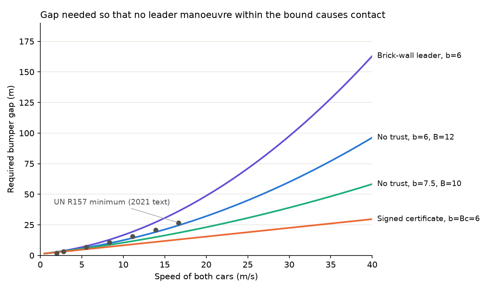

# V2X and safety from first principles

Research date: 2026-10-31 to 2026-11-01. This is a design for `cars`, not a validated vehicle safety system. An earlier draft of this file was written by another model. This version replaces it after every key source was reopened, the derivation redone, and the rule attacked numerically. No GPU was used.

Evidence grades: **FIELD** = measured on physical equipment, including closed tracks. **LAB** = measured on cabled or bench equipment. **SIM** = simulated. **SPEC** = requirement or standard, untested by that document. **DERIVED** = calculated here. **PROPOSED** = a design choice here. **UNVERIFIED** = could not be substantiated from text opened in this review. A field result is one set of conditions, not a worst-case bound. Every link in the [source register](#source-register) was opened in this review; sources the draft cited that could not be reopened are listed there and carry no numbers here.

Test code: [`scripts/v2x_safety_attack.py`](scripts/v2x_safety_attack.py), results [`v2x-safety-attack-results.json`](v2x-safety-attack-results.json), figure [`fig/08-required-gap.png`](fig/08-required-gap.png).

## 1. The short answer

**How quickly can you stop?** DERIVED from the closed form in §3, with 0.25 s of tick plus actuator dead time, 1 m/s² acceleration still applied until the brake takes over, and a brake ramp of 12.7 m/s³. That ramp is the 0.6 s to 0.774 g in [UN R157][r157]. The deceleration values are measured: 0.77 g dry ([NTSB][ntsb]), 0.55 g wet, 2.6 m/s² snow and 2.0 m/s² ice ([Sokolovskij][sokol]), 0.45 g for a loaded tractor ([NHTSA][fmvss121]).

| Surface | 30 km/h | 50 km/h | 70 km/h | 110 km/h |
|---|---|---|---|---|
| Dry, .77 g | 10.2 m, 1.8 s | 22.0 m, 2.5 s | 38.0 m, 3.2 s | 82.1 m, 4.7 s |
| Wet, .55 g | 11.5 m, 2.1 s | 26.2 m, 3.2 s | 46.7 m, 4.2 s | 104.8 m, 6.3 s |
| Packed snow, 2.6 m/s² | 18.0 m, 3.8 s | 44.7 m, 5.9 s | 83.3 m, 8.0 s | 196.2 m, 12.3 s |
| Ice, 2.0 m/s² | 22.1 m, 4.7 s | 56.0 m, 7.5 s | 105.4 m, 10.3 s | 250.4 m, 15.8 s |
| Truck, .45 g | 12.7 m, 2.5 s | 29.8 m, 3.7 s | 54.0 m, 5.0 s | 123.2 m, 7.5 s |

**The rule.** Each car keeps one number, the stop line `Y`: the furthest point the car ahead is guaranteed to reach, however hard it brakes. A car may do anything as long as it can stop before `Y`, and it brakes the moment it cannot. A message can only move `Y` backward. Only the car's own sensors can move it forward, unless it holds a signed certificate from the car ahead (§5).

**Did it survive?** Yes, under its premises. The rule produced zero contacts in 503,333 adversarial cases, including every message lost, the brake message lost exactly, replay and 5 s of reordering, sensor dropout, and full-brake leaders at the worst tick phase. Removing any one premise produced contacts, which shows that the test can detect failure and that the premise is needed. §6 has the table. The test also caught one real flaw in my first crossing tie-break and one setup bug in the test itself, which at first looked like a rule failure. Both are documented in §7.

**What radio is worth.** Radio cannot make the safe gap smaller by being fast. Between the reaction times that matter, 100 ms is worth 3 m at 30 m/s. Not knowing the other car's brakes to within 1 m/s² is worth 7 m. Radio shrinks the gap only by removing that brake uncertainty, through a binding promise from the car ahead. That cuts the gap at 30 m/s from 60 m to 22.5 m and raises flow from about 1,670 to about 4,000 veh/h per lane, but it means trusting the other car, though still not the channel.

## 2. Communication: what is actually available

### Interfaces

**SPEC.** TS 23.287 defines 5G V2X over two reference points, PC5 (direct, with broadcast, groupcast and unicast) and Uu (through the network). [TS 23.287][ts23287]. NR sidelink has two allocation modes: network-assigned (mode 1) and UE-selected (mode 2). [TS 38.300 §5.7.2][ts38300]. A [tutorial by Garcia et al.][tutorial] states mode 2 can reach a 1 ms minimum latency against 10 ms for LTE mode 4. That is a scheduling limit, not a measurement.

**SPEC. TS 22.186 targets:**

| Row | Latency | Reliability | Rate | Range |
|---|---|---|---|---|
| Platooning, highest automation, [R.5.2-006] | 10 ms | 99.99% | 30 msg/s, 50 to 1200 B | 80 m |
| Cooperative collision avoidance, [R.5.3-001] | 10 ms | 99.99% | 100 msg/s, 2000 B | not read |
| Emergency trajectory alignment, [R.5.3-006] | 3 ms | 99.999% | 30 Mbit/s | 500 m |
| Sensor sharing, higher automation, [R.5.4-003] | 3 ms | 99.999% | 50 Mbit/s | 200 m |
| Remote driving, [R.5.5-002] | 5 ms | 99.999% | 25 up, 1 down Mbit/s | n/a |

[TS 22.186 V18.0.1][ts22186]. **DERIVED:** even if met, 99.999% at 100 msg/s still loses 3.6 messages per link-hour. Across a million vehicles that is 3.6 million lost messages per hour. A design that needs a message to arrive will meet this case.

### NR-V2X sidelink has no field number here

**UNVERIFIED, stated plainly.** Four targeted searches, plus the [5GAA 2024 evaluation paper][5gaanr] (which lists field measurements as a possible future input), found no field measurement of NR-PC5 latency or loss, at any density. The campaign most often cited for "5G", [Kutila et al.][kutila], says in its own text that NR was not available and that Release 14 non-standalone devices were used for both PC5 and Uu. Do not call any number below an NR sidelink number. Do not use the 3 ms to 10 ms targets as a channel model without labelling them as never measured here.

### Field and lab anchors

All are FIELD unless marked. "Jitter" is undefined in Kutila, so it must not be fitted as a standard deviation.

| Technology and setup | Latency | Loss and gaps | Source |
|---|---|---|---|
| LTE-V2X PC5, 250 B, 100 ms interval, 1.4 m antenna, 30 km/h | 18 to 52 ms, mean 35, jitter 9 | n/a | [Kutila][kutila] |
| Same stack, 50 ms interval, 10 to 40 km/h | mean 24 to 25, jitter 39 to 41 | n/a | [Kutila T1][kutila] |
| Same stack, 100 ms interval, by size 250/500/750/1000 B | mean 15/15/13/13, jitter 5/9/6/6 | 0/0/2/6% | [Kutila T2][kutila] |
| Range 250 to 400 m, foliage, RSU at 1.4/2.8/3.8 m, 250 B | n/a | 9/19/9% | [Kutila T3][kutila] |
| Shanghai driving, LOS/NLOS, 0 and 400 m | 16.3, 15.5 | 0% | [Kutila T4][kutila] |
| Shanghai fixed NLOS, 400 then 450 m | 15.3, 18.8 | 0 then 17% | [Kutila T5][kutila] |
| Shanghai, 20 stations (6 RSU, 14 OBU) | mean under 38 | under 10% | [Kutila][kutila] |
| LTE-V2X and ITS-G5, 40 Hz, 23 dBm, one pair, airfield | C-V2X about 25 ms, doubling at low SNR; ITS-G5 about 10 ms | LoS: no important errors to 650 m. 800/1000 B: 10/13% (1σ). NLOS long messages: up to 100%. ITS-G5 floor 12 to 20% next to C-V2X | [DLR][dlr] |
| LTE-V2X, 20 MHz, 383 B, 8 moving DUTs plus 50 stationary emulating up to 250 (vendor) | n/a | See below | [Qualcomm][qc] |
| LTE-V2X and DSRC, **LAB** cabled | mean 14 to 17, p95 22 to 26 | PER 0.44% to 99.84% across 1.1 dB of noise | [5GAA][5gaa] |
| 802.11p, 250 B, 6 Mbit/s, 15 dBm, one pair, Elche | n/a | PDR(d)=1/(1+e^(p1(d−p2))): urban p1=.019, p2=367 m; highway .015, 563 m | [Sepulcre][sepulcre] |
| 802.11p, 5 vehicles, 4 trips of about 160 km, 10 Hz, 100 B | n/a | See below | [Librino][librino] |
| Commercial 5G (Rel-14 NSA devices), no handover | mean 43 to 61, jitter 14 to 26 | 0% | [Kutila T2][kutila] |
| Same, with handover | mean 66 to 130, jitter 944 to 4799 | Whole-route mean 208 ms, link "always lost in one point" | [Kutila T1][kutila] |
| 5G V2N2V, private and public, 0 to 80 km/h, over 300,000 records | avg 16.6 to 20.8, p90 20 to 25, max 694 | Share over 100 ms 0.12 to 0.23% where read. Weak coverage: disconnections | [CICV5G][cicv] |

**Bursts are measured, and they are what matters.** The draft said no burst law was available and invented its sweep values. Field data exist:

- **802.11p** ([Librino et al.][librino]): the packet inter-reception tail is a power law without congestion and a power law with exponential cutoff with it. A blackout (over 1 s) lasted 1.28 to 1.44 s on average. At 24% channel busy time the fitted model gives one blackout about every 5.2 s on the head-to-tail link, and one every 20 s with multi-hop relaying. Treating blackouts as independent is always too optimistic.
- **LTE-V2X** ([Qualcomm][qc], vendor-authored, emulated load): at 1X and 2X load (50 and 100 devices, CBR 25% and 47%) PER stayed under 0.7% and the maximum gap under 0.9 s. At 5X (250 devices) with congestion control off, CBR reached 82 to 87%, PER up to 13 to 17%, maximum gap about 3 s, and 20 or more packets lost in a row. With it on, the send interval backed off from 100 ms to 450 to 600 ms, PER fell under 3 to 6%, and the maximum gap was 1.6 s.
- **One van in the way** ([Qualcomm §10.3.3][qc]): at 5X load with congestion control off, PER across a large van was 47 to 60%, with p95 gaps of 720 to 1085 ms. With it on, 2 to 3% and about 635 ms. Congestion control trades loss for age. p95 gap got no better than the 600 ms send interval.
- **The link is a cliff** ([5GAA][5gaa], LAB): 1.1 dB moved PER from 0.44% to 99.84%. **DERIVED:** with the [TR 37.885][tr37885] exponents, 1.1 dB is a 14 to 16% change in distance, which fits Kutila's 0% to 17% across 400 to 450 m.

**TR 37.885** gives evaluation assumptions, not field data: highway LOS/NLOSv `32.4+20log10(d)+20log10(f)` with σ=3 dB, urban `38.77+16.7log10(d)+18.2log10(f)` with σ=3 dB, NLOS `36.85+30log10(d)+18.9log10(f)` with σ=4 dB, urban same-street `P(LOS)=min(1,1.05e^(−0.0114d))`. [Tables 6.2-1, 6.2.1-1][tr37885].

### Message meaning

CAM generation interval is bounded to 100 to 1000 ms. [EN 302 637-2 §6.1.3][cam]. A DENM reports an event with potential impact on road safety. [EN 302 637-3][denm]. A CPM shares perceived objects and sensing regions. [TS 103 324][cpm]. Maneuver Coordination is still a stable draft, 0.0.10, as of 2025-02-17, so no published interoperable protocol backs a binding promise. [ETSI work item][mcm]. **PROPOSED:** every one of these is an assertion. A signature proves who sent the bytes, not that they are true.

### 200 vehicles

**DERIVED from FIELD.** Qualcomm's loads map roughly as 50 devices to CBR .25, 100 to .47, 250 to .85 at 10 Hz, 383 B, 20 MHz. So 200 cars actively sending in one contention domain sits near CBR .7, above the 25% that [Librino][librino] quotes as ETSI's acceptable level. The offered payload at 10 Hz is 4, 8, 16 Mbit/s for 250, 500, 1000 B, which matches the draft's arithmetic. "Lots of data from all cars" is the piece with the least support: sensor-sharing targets of 25 to 1000 Mbit/s exist only in [TS 22.186][ts22186], and [Kutila][kutila] says video-class payloads go beyond LTE-V2X capacity. A stop-line message is about 32 B of payload before security overhead. Security overhead size and PC5 resource granularity were not verified, so no airtime saving is claimed.

## 3. The safety rule, derived from physics

Own derivation. It follows the same logic as [RSS][rss] Lemma 2, which was read and checked, and the claimed sets of [SFF][sff]. It extends both in the three ways marked below.

### Follower stopping distance with build-up

The worst the follower can do is accelerate at `A` for dead time `t_d`, then ramp from `+A` to `−b` at jerk `J`, then hold `−b`.

- Dead time: `s1 = V t_d + A t_d²/2`, speed `v1 = V + A t_d`.
- Ramp from `A` to 0: `s2 = v1 A/J + A³/(3J²)`, speed `vp = v1 + A²/(2J)`.
- Ramp from 0 to `−b`, then hold: at most `vp b/(2J) + vp²/(2b)`.

So `S⁺(V) = s1 + s2 + vp b/(2J) + vp²/(2b)`, which is a quadratic in `V`:

```
K  = A t_d + A²/(2J)
c2 = 1/(2b)
c1 = t_d + A/J + b/(2J) + K/b
c0 = A t_d²/2 + A² t_d/J + A³/(3J²) + K b/(2J) + K²/(2b)
S⁺(V) = c2 V² + c1 V + c0
```

**Extension 1: one polynomial, no branches.** It drops the small credit `−b t_r²/24` in the VRTC equation the [NHTSA rule][fmvss121] uses, `St = V t_r/2 + V²/(2a) − a t_r²/24`. That makes it an upper bound even when the car stops inside the ramp: with `V_p = J t²/2` and `k = t/t_r`, the difference is `J t_r³ k²(1/4 − k/3 + k²/8) > 0`. Checked numerically over 3,000 random parameter sets, the smallest value of `S⁺ − exact` was -0.0000 m and the largest ratio 1.63. The ratio is worst at very low speed. The three coefficients sit in a per-type table.

Build-up is not a small correction. At 110 km/h, 0.77 g gives `V²/(2b)` = 61.8 m against about 82 m with build-up.

### The leader

With no reversing and deceleration at most `B`, the leader's rear reaches at least `Y = x + W²/(2B)`, where `x` is a lower bound on its rear position and `W` a lower bound on its speed, both at the moment of observation.

### Extension 2: message age cancels

The draft used an age-dependent formula, `x + Q(W,B,a)` for position and `W−Ba` for speed. Its algebra is right. But add its two parts:

`x + (Wa − Ba²/2) + (W − Ba)²/(2B) = x + W²/(2B)`

**Age cancels exactly** (numerical check over 200,000 samples: largest error 2.3e-13 m). The stop line from a message does not move as the message gets older. The draft's 8/11/23/38 m growth for ages 0/.1/.5/1 s reproduces exactly, but only because it was measured from a dead-reckoned position that moves forward. In absolute coordinates nothing changed.

The consequences are large:

1. **The safety kernel needs no clock, no timestamp and no message age.** A wrong clock cannot hurt it.
2. **Old messages are harmless.** A replay carries an older, lower `Y`, and `Y = max(Y_old, Y_new)` ignores it. Reordering is the same.
3. **Silence needs no handling.** `Y` simply stops growing, and the car brakes when it must. There is no timeout and no loss detector.
4. **Sensor age does not belong in the reaction time.** It shows up by itself as a lower `Y`. In steady cruise the effect is `V·τ_s`, as expected. Counting it in `ρ` as well would count it twice.

### The invariant

```
Y_sense = x_rear_obs − e_x + max(0, v_obs − e_v)² / (2 B_max)
Y       = max(Y, Y_sense)              while the leader's identity is unchanged
M       = Y − (x_f + e_o) − S⁺(v_f + e_vo) − m
if M < 0 at a tick: command full brake. Otherwise any a ≤ A.
```

`t_d = Δ + τ_d`, the control tick plus actuator dead time. If nothing is sensed, `Y` is a stationary object at the edge of sensor range.

**Proof.** Suppose `M ≥ 0` at tick `t`. Any commanded acceleration up to `A` is covered for one tick plus the pipeline. If `M < 0` at `t + Δ`, the brake command reaches the wheels at `t + Δ + τ_d`, which is the `t_d` already inside `S⁺`. So the follower's final position is at most `Y − m`, and the leader's final rear is at least `Y`. For the path between: let `x_ub(t)` be the follower's trajectory under `S⁺`, decelerating at `b ≤ B`, and `y_lb(t)` the leader's lowest trajectory, `y_lb = Y − W(t)²/(2B)`. First contact needs `v_ub ≥ W`. Then the remaining follower distance is at least `v_ub²/(2b) ≥ W²/(2B)`, so `x_ub ≤ (Y−m) − W²/(2B) < y_lb`. That is a contradiction. Harder real braking only lowers the true trajectory. ∎

**Extension 3: no actuator state in the check.** The rule re-evaluates from scratch at every tick and assumes the worst state. If the brake was already on, `S⁺` overestimates. That is safe, and a chattering comparator is safe too, because the comparison each tick covers what the pipeline can do. The draft's statement that restarting a fresh response interval each tick invalidates the calculation is wrong for the check. It is right only for the physical actuator: a dead-time timer that restarts on each brake request gives 85% contacts. So the kernel must not reset the actuator timer, but needs no actuator phase in its safety test.

**The transient closure problem.** The draft's counterexample holds: V=20, W=10, b=10, B=2 gives 6.25 m of closure while the final-position check gives 0, and `b_*=min(b,B)` requires 75 m. But it occurs only if a leader's weak brakes are believed. With no-trust `B_max ≥ b` it cannot occur. It returns in certificate mode (§5), where `b_*` is required. The attack confirms this: weak leader with final-position check 90% contacts, with `b_*` 0.

### Premises

The theorem holds only if these are true. §6 removes each one.

1. The leader does not reverse.
2. The leader does not decelerate harder than `B_max`, so it does not crash.
3. The follower's real braking is at least `b` over its whole stopping path, after friction, grade, fade and load.
4. `A`, `J`, `τ_d` and `Δ` are true bounds.
5. Sensor error is within `e_x`, `e_v`, including common-mode failures.
6. The leader's identity is correct, and `Y` resets on a leader change.
7. `M ≥ 0` held initially.
8. Longitudinal only. Lateral motion, pedestrians and being struck from behind are outside.

## 4. What sets the gap

**DERIVED.** Equal speeds, `t_d=.25`, `A=1`, `J=12.7`, `e=1 m`, sensor age `.1 s`, length 4.5 m.

| Policy | 50 km/h | 60 km/h | 108 km/h | 130 km/h |
|---|---|---|---|---|
| No trust, b=6, B=12 | 19.1 m, 1.37 s, 2,121/h | 24.6 m, 1.48 s, 2,062/h | 60.0 m, 2.00 s, 1,673/h | 81.2 m, 2.25 s, 1,516/h |
| No trust, b=7.5, B=10 | 15.0 m, 1.08 s, 2,570/h | 18.5 m, 1.11 s, 2,610/h | 39.0 m, 1.30 s, 2,481/h | 50.4 m, 1.40 s, 2,367/h |
| Certificate, b=B_c=6 | 11.0 m, 0.79 s, 3,218/h | 13.0 m, 0.78 s, 3,425/h | 22.5 m, 0.75 s, 3,996/h | 26.9 m, 0.74 s, 4,142/h |
| Certificate, b=B_c=7.5 | 11.7 m, 0.84 s, 3,079/h | 13.9 m, 0.83 s, 3,269/h | 24.0 m, 0.80 s, 3,786/h | 28.7 m, 0.79 s, 3,917/h |
| Brick-wall leader, b=6 | 27.1 m, 1.95 s, 1,581/h | 36.2 m, 2.17 s, 1,475/h | 97.5 m, 3.25 s, 1,058/h | 135.5 m, 3.75 s, 928/h |
| Wet, no trust, b=4, B=12 | 26.3 m, 1.90 s, 1,621/h | 35.2 m, 2.11 s, 1,509/h | 95.9 m, 3.20 s, 1,076/h | 133.6 m, 3.70 s, 941/h |
| Ice, no trust, b=1.5, B=12 | 66.8 m, 4.81 s, 701/h | 93.5 m, 5.61 s, 612/h | 284.0 m, 9.47 s, 374/h | 406.0 m, 11.24 s, 316/h |



**Sensitivity at 30 m/s** (DERIVED):

| Term | Worth |
|---|---|
| 100 ms of reaction, sensor or radio | 3.0 m |
| 1 m/s² of brake uncertainty around 8 m/s² | 7.1 m, the same as 235 ms |
| 0.1 of friction around 0.75 | 8.2 m, the same as 273 ms |
| 0.5 m/s of speed error at b=8 | 1.9 m |
| 3 m versus 0.5 m of position error | 2.5 m |

So the fastest radio in [TS 22.186][ts22186] against [LTE-V2X in the field][kutila], 3 ms against 35 ms, is worth under 1 m. Knowing the other car's brake capability is worth tens of metres.

**Is no-trust better than people?** Not at speed. Flow of the no-trust policy is near the 1,800 veh/h of a 2 s front-to-front headway (arithmetic only). It tops out near 2,100 at 50 km/h and falls to 1,670 at 108 km/h. A brick-wall guarantee, as below, gives about 1,060 at 108 km/h. **Provable safety against an uncooperative leader does not by itself raise capacity.**

**Regulatory check.** [UN R157 as published in 2021][r157] requires 1.0 to 1.6 s from 2 to 16.67 m/s, or 26.7 m at 60 km/h. The no-trust curve gives 24.6 m there, so the two nearly coincide without having been fitted. R157's model uses a 1.0 g leader, 0.4 s plus 0.75 s of perception and decision, and a 0.6 s ramp to 0.774 g, and its test leader brakes at 6 m/s² or more. The draft listed R157 as unreadable. EUR-Lex opened in a browser. The later amendment raising the speed limit was not read. [FMVSS 127][fmvss127] tests only 0.3 to 0.5 g leaders at 12 to 40 m, far below a physical bound, so meeting it says nothing about this invariant.

**The brick wall.** A leader that hits something stops far faster than `B_max`. The rule then fails, as RSS says of itself ([Remark 2][rss]): an infinite bound gives extremely defensive driving. Holding that bound costs a gap of 97.5 m at 30 m/s. Off-design severity also rises as gaps shrink: if the leader stops dead at 30 m/s, impact speed is 20.0 m/s from the no-trust gap and 29.2 m/s from the certificate gap, about twice the energy. **DERIVED.** Certificates raise capacity and worsen this tail. Whether the simulator allows them is a policy choice (§8).

## 5. What radio can safely buy

**Tier 0, no trust.** `Y` comes from the car's own sensors. A received hazard may lower `Y`, and a phantom hazard only causes a brake, which the car behind is already prepared for (tested in a chain of 4: zero contacts). A forged claim that raises `Y` is ignored. Radio here gives earlier comfort braking, string stability and intersection tie-breaks. It does not shorten the gap. [Ploeg et al.][ploeg] measured what that nominal benefit is worth: on six production-based Prius, predecessor feedforward allowed a string-stable 0.7 s, against a calculated 3.16 s for ACC on the same plant.

**Tier 1, signed stop-line certificate. PROPOSED.** The leader signs one number: "my rear will reach at least `Y_c`."

```
Leader issues   Y_c = max(Y_c, min(x_rear + v²/(2 B_c), Y_own − m − L))
Leader obeys    deceleration ≤ v² / (2 (Y_c − x_rear))
Follower uses   Y = max(Y_sense, Y_c_received), with b_* = min(b, B_c)
```

Properties, all tested:

- **Message loss costs distance, never safety.** The leader does not know it is in a blackout and keeps its promise. The follower's `Y` freezes, and it stops before the last certificate it heard.
- **No expiry is needed.** The promise is about a final position, which time does not change. Replay and reorder are harmless by the same argument as §3.
- **It chains.** `Y_c` is clipped by the car's own `Y`, so a certificate never promises past what the car can honour. The gap of the whole chain is set by the car with the weakest brakes.
- **The enforcement is one comparison** in the leader's brake command. That is the part a real vehicle would need attested.

This is the same idea as the consensus braking limit in [Mair & Althoff][mair], who prove collision freedom under message failure for a platoon protocol and simulate it with a 0.3 s nominal headway and a −12 m/s² worst case. Their version uses timestamps and confirmations. **SIM/formal.** It is the closest published work found. The stop-line form here is simpler and has not been reviewed by anyone else.

**The trust boundary is explicit.** Tier 1 does not trust the channel. It does trust that the peer's firmware honours its promise. A leader who breaks it gives 82% contacts in the test. No standard provides this today: Maneuver Coordination is still a [draft][mcm], and authentication cannot prove honesty.

## 6. Adversarial test

**Method.** [`scripts/v2x_safety_attack.py`](scripts/v2x_safety_attack.py) keeps truth (position, speed, acceleration, FIFO dead time, jerk limit, friction patches) separate from what the rule sees. Exact piecewise integration at 10 ms, with cases up to 30 s. Per-case sampling: `A` .5 to 4, `b` 2 to 9, `J` 10 to 80, dead time 0 to .3 s, tick 20/50/100 ms at random phase, sensor age 0 to .3 s, `e_x` up to .5 m, `e_v` up to .5 m/s, `m` .05 to 1 m, length 3.5 to 18 m, speeds 0 to 40 m/s, `B_max`=12. Half the cases use worst-sign errors, half uniform. The follower is greedy: it commands `+A` whenever the rule permits, and 70% start exactly at `M=0`. The leader may brake at once, brake just after a follower tick, repeat a sawtooth, or do random bang-bang with instantaneous jerk at up to 12 m/s². A contact is true bumper gap below zero.

**Limits.** Monte Carlo sampling is not exhaustive and this is not a machine-checked proof. It is one-dimensional. It runs on CPU in Python, not in WGSL. The follower has no speed cap, so contact speeds above about 45 m/s in the tables come from greedy acceleration in a failed run and are not realistic; read the means. The repo's dev-shell Python ran the suites directly when other jobs held the Nix lock. To reproduce: `nix develop --command python3 -I research/truth/scripts/v2x_safety_attack.py attacks --n 4000`, with `baseline`, `cross`, `analytic` and `tier0big` the same way. The smallest true gap reached (0.046 m, against `m` as low as .05) shows the rule was pushed to the edge, not that it was loose.

### Rule holds: zero contacts expected

| Suite | Cases | Contacts | Smallest true gap |
|---|---:|---:|---:|
| Sensor rule, 2 cars | 10,000 | 0 | 0.054 m |
| Sensor rule, chain of 6 | 3,333 | 0 | 0.051 m |
| Sensor dropout, `Y` frozen | 10,000 | 0 | 0.053 m |
| Messages only, 50% loss | 10,000 | 0 | 0.053 m |
| Messages only, 95% loss | 10,000 | 0 | 0.064 m |
| Messages only, field-rate 802.11p bursts | 10,000 | 0 | 0.053 m |
| Messages only, 10 s bursts | 10,000 | 0 | 0.063 m |
| Messages only, permanent blackout at a random time | 10,000 | 0 | 0.053 m |
| Messages only, **every message from the first brake lost** | 10,000 | 0 | 0.069 m |
| Messages only, half replayed or reordered up to 5 s | 10,000 | 0 | 0.054 m |
| Certificate, blackout | 10,000 | 0 | 0.050 m |
| Certificate, every message from the first brake lost | 10,000 | 0 | 0.050 m |
| Certificate, field-rate bursts | 10,000 | 0 | 0.048 m |
| Certificate, chain of 4, blackout | 5,000 | 0 | 0.046 m |
| Certificate, replay and reorder | 10,000 | 0 | 0.046 m |
| Forged hazard brakes a middle car, chain of 4 | 5,000 | 0 | 0.052 m |
| Cooperative cut-in with allowance (9,000 cut-ins) | 10,000 | 0 | 0.053 m |
| Sensor rule, 2 cars, large | 220,000 | 0 | 0.053 m |

### One assumption removed: contacts expected

| Removed or broken | Cases | With contact | Mean / max contact speed |
|---|---:|---:|---:|
| Reaction time ignored | 4,000 | 63.2% | 4.7 / 18.9 m/s |
| Control tick ignored | 4,000 | 10.3% | 2.1 / 9.7 m/s |
| Actuator dead time ignored | 4,000 | 48.8% | 4.2 / 15.0 m/s |
| Brake ramp ignored | 4,000 | 38.3% | 3.9 / 17.9 m/s |
| Acceleration during response ignored | 4,000 | 42.9% | 3.4 / 14.6 m/s |
| Position error ignored | 4,000 | 11.3% | 0.6 / 2.1 m/s |
| Speed error ignored | 4,000 | 6.9% | 1.1 / 4.1 m/s |
| Sensor reads 3 m long, outside bound | 4,000 | 92.8% | 3.6 / 6.9 m/s |
| Sensor reads 3 m/s fast, outside bound | 4,000 | 79.7% | 3.7 / 12.7 m/s |
| Unseen friction patch, μ=.15 | 4,000 | 61.5% | 13.7 / 36.2 m/s |
| Fade or downhill, 1 m/s² less than certified | 4,000 | 54.1% | 8.0 / 27.7 m/s |
| Follower claims 120% of its brakes | 4,000 | 43.3% | 6.5 / 18.9 m/s |
| Leader advertises B=4, believed | 4,000 | 91.2% | 10.6 / 45.2 m/s |
| Leader advertises B=8, believed | 4,000 | 55.6% | 7.2 / 22.7 m/s |
| Leader brakes at 14, bound is 12 | 4,000 | 49.5% | 4.2 / 11.4 m/s |
| Weak leader, final-position check only | 4,000 | 89.8% | 6.1 / 16.0 m/s |
| Silent leader dead-reckoned, blackout | 4,000 | 51.6% | 15.3 / 53.6 m/s |
| Silent leader dead-reckoned, brake message lost | 4,000 | 96.2% | 17.5 / 53.6 m/s |
| Forged message raises `Y` by 40 m | 4,000 | 97.7% | 11.2 / 26.7 m/s |
| Leader stops dead, rule assumes `B_max` | 4,000 | 72.9% | 11.2 / 35.5 m/s |
| Leader reverses at 2 m/s | 4,000 | 100.0% | 7.0 / 13.4 m/s |
| Cut-in without checking | 4,000 | 83.0% | 11.6 / 36.0 m/s |
| Cooperative cut-in without allowance for sensor age and tick | 4,000 | 24.2% | 5.2 / 14.9 m/s |
| Cut-in, `Y` not reset on leader change | 4,000 | 78.0% | 17.5 / 45.7 m/s |
| Actuator timer restarted by each brake tick | 4,000 | 85.2% | 23.7 / 73.9 m/s |
| Rule short by 1.5 m | 4,000 | 89.3% | 1.9 / 4.6 m/s |
| Certificate broken by leader | 4,000 | 81.7% | 10.1 / 33.7 m/s |
| Certificate inflated by leader | 4,000 | 96.6% | 15.1 / 52.4 m/s |
| Fixed 0.3 s gap at 25 m/s, sensor reaction, mixed brakes | 4,000 | 97.8% | 9.2 / 12.7 m/s |
| Fixed 0.6 s, same | 4,000 | 90.6% | 12.8 / 17.6 m/s |
| Fixed 1.0 s, same | 4,000 | 72.6% | 13.7 / 21.9 m/s |
| Fixed 0.3 s, radio works (30 ms), mixed brakes | 4,000 | 95.3% | 9.0 / 12.5 m/s |
| Fixed 0.3 s, radio works, equal force | 4,000 | 68.1% | 2.2 / 6.9 m/s |

Controls in the same run, each expected to be zero: leader stops dead with a brick-wall rule, 0 contacts in 4,000. Weak leader with `b_*`, 0 in 4,000.

**Reading the table.**

- Each assumption is needed. Smaller ones fail less often and more gently, for example position error ignored and speed error ignored. Large ones fail often and hard, for example friction.
- The worst single realistic error is dead reckoning a silent leader, which feels natural and is what a nominal CACC often does. It failed in almost every case where the brake message was the one lost.
- A leader that brakes 14 against a bound of 12 shows that `B_max` is a real, breakable number. Greibe measured up to about 9.5 m/s² in a speed interval, and 12 is a proposed margin, not a measured limit (§8).
- **Fixed gaps.** A fixed 0.3 s gap fails even with the radio working and equal brake force, since dead time and ramp can exceed 0.3 s. Short platoon gaps need fast, verified actuators and equal brakes together. This is the reasoning behind the "law of the weakest" in the title of Murthy and Masrur's platoon paper, whose full text could not be opened.

### Demonstrated gaps under the same physics

**DERIVED.** Leader brakes at full force at `t=0`, follower reacts by sensor alone. Equal brakes means 8/8 m/s², unequal means follower 6, leader 10. This does not claim these systems crash. They ran with controlled conditions and fallback logic that the opened sources do not describe.

| Demonstrated gap | Equal brakes, ρ=.2 | Equal brakes, ρ=.5 | Unequal, ρ=.2 | Unequal, ρ=.5 | Gap needed, unequal, ρ=.2 |
|---|---|---|---|---|---|
| SARTRE, 6 m at 25 m/s | none | 4.0 m/s | 7.1 m/s | 7.9 m/s | 25.8 m |
| PATH 1997, 6.5 m at an assumed 26.8 m/s | none | 4.0 m/s | 7.4 m/s | 8.2 m/s | 29.3 m |
| Peloton, 12.2 m at 24.6 m/s | none | 1.3 m/s | 10.0 m/s | 10.6 m/s | 25.1 m |
| Ploeg, 0.7 s at 16 m/s | none | none | 2.5 m/s | 8.0 m/s | 11.7 m |

Cells are contact speed.

## 7. The crossing case

**DERIVED and PROPOSED.** A car on a path with a conflict zone from `s=0` to `s=Z`, length `L`, is clear when `s − L ≥ Z`.

**The point of no return** is where `M` hits zero against a stop line at the zone edge: `s_pnr(v) = −m − S⁺(v)`. At 50 km/h with `b=6`, `m=0.5` and the §4 parameters it is about 25 m out. Before that point the car needs nothing, because it can always stop. It cannot pass that point without holding all of the following.

**A car must hold, at the point of no return:**

1. **Stop capability until the last moment.** `M ≥ 0` with the real `S⁺`. Ignoring reaction and ramp gives 57% collisions, and true brakes at 60% of certified give 54%, even with a perfect arbiter.
2. **Exclusivity**, one of three kinds:
   - **Token.** A durable grant from a single arbiter, held until the zone is seen clear. A lost grant wastes time and nothing else. **Silence never releases it.**
   - **Physics.** Every conflicting car, seen or assumed, cannot reach the zone before this car has cleared: `t_foe_earliest > t_me_clear⁺`. The foe is taken at maximum acceleration to its speed limit, from its observed position and speed bounds minus sensor age. This needs no radio at all, and at most one car can satisfy it at a time: if both did, `t_b_arrive > t_a_clear ≥ t_a_arrive > t_b_clear ≥ t_b_arrive`, a contradiction.
   - **Certified to clear.** The car ahead in the zone cannot stop inside it: `W² ≥ 2 B_max (Z + m − x_rear)`, and it clears before this car's earliest arrival.
3. **A clear-time bound built from the actuator's real state.** `t_me_clear⁺` uses the speed after every brake command already in the pipeline. This is a precaution from the derivation. The test did not show it to be necessary: 0 collisions in 10,000 with or without it. See the note below the table.
4. **Exit room, or an unbounded hold.** Either `Y_exit ≥ Z + L + m` so the rear clears even if the exit queue stops now, or the token is held until the zone is seen clear, however long. The second is safe but can block.
5. **Unseen foes as phantoms.** A foe not seen is at the sight limit at the speed limit. With a 50 km/h foe limit a car at 30 to 70 km/h needs about 38 to 40 m of sight along the crossing road, per the table below. Treating an occluded road as empty gives 9% collisions.
6. **No promise from a committed car.** A committed car cannot promise to yield. My first tie-break let it. With that rule the test gave 1 collision in 2,000 and, in the direct comparison at the same seed, 1 in 10,000 against 0 in 10,000 with the fix. The logic is clear but the count is small.

**What is not enough:** "the other car can still stop". The draft's step 4 asked for this. It holds only if the other car will. Against a red-light runner a compliant arbiter protocol gave 15% collisions. The earliest-arrival check gave zero, with no radio.

Half of the runs have one car stall somewhere unless noted, which is why progress stays under 100%.

| Protocol, must be zero | Cases | Collisions | Both cars cleared |
|---|---:|---:|---:|
| Token, no loss | 10,000 | 0 | 82.2% |
| Token, 50% loss | 10,000 | 0 | 81.8% |
| Token, 95% loss | 10,000 | 0 | 80.2% |
| Token, 100% loss | 10,000 | 0 | 0.0% |
| Token, field-rate bursts | 10,000 | 0 | 82.0% |
| Token, one car always stalls in or near the zone | 10,000 | 0 | 64.2% |
| Physics rule, no radio | 10,000 | 0 | 43.3% |
| Physics rule, always a stall | 10,000 | 0 | 35.5% |
| Physics rule, 40 m sight, phantom at edge | 10,000 | 0 | 13.1% |
| Physics rule against a red-light runner | 20,000 | 0 | 100.0% |
| Physics rule plus yield promise, 50% loss | 10,000 | 0 | 80.3% |
| Certified to clear, foe may brake at 12 m/s² | 10,000 | 0 | 77.3% |

| Attack | Cases | Collisions | Rate |
|---|---:|---:|---:|
| Grant reissued after 3 s of silence | 10,000 | 3,012 | 30.12% |
| No reply means go, 50% loss | 10,000 | 408 | 4.08% |
| Time slots, no clearance check | 10,000 | 1,774 | 17.74% |
| Forged release | 10,000 | 976 | 9.76% |
| Arbiter restarts, state lost | 10,000 | 981 | 9.81% |
| Stop rule ignores reaction and ramp | 10,000 | 5,657 | 56.57% |
| True brakes 60% of certified | 10,000 | 5,430 | 54.30% |
| Token against a red-light runner | 10,000 | 1,455 | 14.55% |
| Occluded road treated as empty, 15 m sight | 10,000 | 860 | 8.60% |
| Clear time assumes constant speed | 10,000 | 395 | 3.95% |
| Certified foe crashes in the zone | 10,000 | 251 | 2.51% |
| Committed car may promise to yield | 10,000 | 1 | 0.01% |
| Clear time ignores pending brake commands | 10,000 | 0 | 0.00% |

**A false alarm worth recording.** The physics rule first showed 15 collisions in 10,000 against the runner. I blamed pending brake commands and added item 3, but the count did not change. Tracing the colliding cases showed a bug in my test: the sensor history was filled before the runner's speed was set, so for the first 0.3 s the rule saw a nearly stopped car actually doing 10 m/s, which no real car can do. With the history corrected: 0 in 20,000. Nothing in the rule changed to reach that. A rule whose sensed history can be false is outside premise 5.

**Headway between conflicting cars. DERIVED.** Zone plus length 11.5 m, `b=6`, `B=12`, reaction plus half-ramp 0.5 s.

| Own speed | Zone occupancy | Clear needed before entry, `ρ+v/(2b)` | Nominal slot (unsafe) | Token, clear seen | Certified to clear | Sight for a 50 km/h foe |
|---|---|---|---|---|---|---|
| 30 km/h | 1.38 s | 1.19 s | 1.38 s | 2.57 s | 2.23 s | 38 m |
| 50 km/h | 0.83 s | 1.66 s | 0.83 s | 2.49 s | 1.91 s | 37 m |
| 70 km/h | 0.59 s | 2.12 s | 0.59 s | 2.71 s | 1.90 s | 40 m |

A second car must learn the first has cleared `ρ + v/(2b)` before it enters. That is 1.66 s at 50 km/h, more than the zone occupancy itself. A nominal time slot of 0.83 s is what a reservation scheme can show on paper, and it is exactly what fails when the first car stops inside. Certified-to-clear buys back `v/(2B)` by relying only on physics, giving about 1.9 s at 50 to 70 km/h. Compare this with the 2 s saturation headway used in [report 09](09-coordinated-intersections.md).

**The role of radio at a crossing:** progress only. The physics rule is safe with every radio dead. In the test it finishes both cars in 43% of runs, the rest being a safe standoff, or a permanent stall in the zone. A yield promise over a 50% loss channel lifts that to 80%, and the token with 95% loss reaches 80%. With 100% loss the token never grants and both stop short, as it should. The reservation mechanism itself comes from [Dresner & Stone][dresner], demonstrated only in simulation.

## 8. Braking and platoon evidence

### Braking

| Grade | What was measured | Source |
|---|---|---|
| FIELD | Two recent ABS cars, professional drivers. Whole-stop average 8.4 m/s² dry, 7.9 wet. Interval averages about 9.5 at 50 to 30 km/h and 9.1 at 100 to 70 km/h dry. Wet falls from about 8.5 to about 7 as friction goes from .75 to .5 | [Greibe][greibe] |
| FIELD | .77 g average for an ABS passenger car at 65 mph, dry, at the crash site. The .65 g truck value is an adjustment, not a test. Air-brake lag 0.20 to over 1.00 s, .50 s used | [NTSB][ntsb] |
| FIELD | Best loaded tractor-trailer 186 ft from 60 mph, slightly under .8 g reached in about .5 s of application. Another tractor with an unbraked trailer 249 ft, about .45 g reached in about .4 s | [NHTSA][fmvss121] |
| SPEC | 250 ft requirement. Chamber 60 psi within .45 s | [NHTSA][fmvss121] |
| FIELD | ABS on ice 2.0, snow 2.6 m/s². Non-ABS 1.8, 3.0 (different cars). Dry .8 g, wet .55 g, and **.22 g across a petrol spot 10 s after spilling** | [Sokolovskij][sokol] |
| FIELD | Prius longitudinal set-point response: lag τ=0.1 s and dead time φ=0.2 s, fitted to measured steps. Not an emergency stop | [Ploeg][ploeg] |
| SPEC | Lead vehicle at 6 m/s² or more in tests. Model of a 1.0 g leader, 0.6 s ramp to .774 g | [UN R157][r157] |
| SIM | −12 m/s² worst case for unknown vehicles | [Mair & Althoff][mair] |
| Claim | "Fast pressure build-up", no number | [Bosch iBooster sheet][ibooster] |

**Unknown:** no opened source gives a measured upper bound on a passenger car's deceleration above about 9.5 m/s², a measured emergency brake dead-time distribution for current passenger cars, or any instrumented loaded-bus stop. **PROPOSED:** `B_max=12` for no-trust (R157's 1.0 g plus a margin, matching Mair & Althoff), with 10 and 14 as sensitivity. Certified `b` is a lower bound for the surface and the vehicle, never the measured average.

**A friction patch is the hardest premise.** `b` must hold over the whole stopping path, including what the car has not seen. A .22 g petrol spot exists in field data. At .15 the test gives 62% contacts at up to 36 m/s. On a domain without a positive friction lower bound, no finite gap is safe.

### Platoons and CACC

| Program | Verified | Not established |
|---|---|---|
| [Ploeg 2011][ploeg] | FIELD. Six Prius, h=0.7 s, link delay about 150 ms, 10 Hz, calculated minimum h=.67 s. h=.5 needs delay under about 80 ms. ACC needs h≥3.16 s on this plant | The paper's own list of work to do includes fail safety. Linear model excludes limit braking |
| [Rajamani & Shladover 2001][rajamani] | FIELD, abstract level. 8 cooperative vehicles, 6.5 m spacing, ±20 cm. Autonomous control needed about 30 m. **The draft marked the 6.5 m as unverified. It is verified** | Emergency or loss tests |
| [Milanés & Shladover 2014][milanes] | FIELD. Four production vehicles. ACC strings amplify, CACC strings smooth | Gaps, loss. The HAL copy of the companion IEEE paper would not open |
| [Naus 2010][naus] | FIELD. Two vehicles. Constant-distance spacing "can not be guaranteed" string stable | Achieved gap, loss |
| [PATH truck CACC][pathtruck] | FIELD slides. Selectable 1.5, 1.2, .9, .6 s | Loss |
| [SARTRE][sartre] | Manufacturer claim. Truck plus 3 cars, up to 90 km/h, no more than 6 m | Emergency or failure tests not mentioned |
| [Peloton][peloton] | Manufacturer claim. Proprietary DSRC, about 40 ft, trucks brake together | Latency and failure behaviour not given |
| [ENSEMBLE][ensemble] | Overview confirms support-function testing | Gaps, loss |

No opened source reports a controlled test where a close platoon loses its link during hard braking. That is the single most useful missing experiment.

### Frameworks

[RSS][rss] Lemma 2 is `V ρ + A ρ²/2 + (V+Aρ)²/(2b) − W²/(2B)` and §3 reduces to it when `J` is infinite. Its Remark 2 says plainly that `B` is an assumption the rear car cannot know. [SFF][sff] says absence of collisions cannot be guaranteed regardless of other actors, and looks instead for the minimal symmetric responsibility. Neither addresses channel loss. ISO 21448's page returned 403 here, so nothing is claimed from it.

## Reviewed by Opus

### What held

- The draft's arithmetic: 6.25 m, 75 m, 8 m, 2.6 m, 48 m, 176.75 m, and 11/23/38 m all reproduce exactly (`analytic` in the results file).
- The architecture: communication-independent braking invariant, with radio as advisory.
- The durable-arbiter crossing logic: silence never releases.
- The finding that no NR-PC5 field measurement could be verified, and that LTE must not be relabelled as NR.
- The quoted anchors from [Kutila T2 to T5][kutila], [TS 22.186][ts22186], [CAM][cam], [TR 37.885][tr37885], [NTSB][ntsb], [NHTSA][fmvss121], [Sokolovskij][sokol], [Ploeg][ploeg], [SARTRE][sartre] and [Peloton][peloton], which all matched the source text.

### What was wrong or missing

1. **Message age treated as a growing safety term.** In absolute coordinates it cancels exactly. The kernel needs no clock and no timestamp. This removes the draft's clock-error term and timestamp attacks from the safety path.
2. **"Restarting a fresh response interval each tick invalidates the calculation."** False for the check. True only for the physical actuator.
3. **Sensor age inside `ρ` and also inside `a`.** Double counted. The stop-line form makes this impossible.
4. **"Communication cannot eliminate the braking mismatch term; coordinated braking is outside the model."** Too strong. A certificate removes it without trusting the channel. What it needs is an honest peer, and the draft did not separate those.
5. **"Verify every conflicting agent can still stop."** Not enough. A car that can stop may not. Replaced with an earliest-arrival check, tested against a runner.
6. **Cherry-picked latency.** The draft fit its lognormal to 15 ms, while the same paper reports 18 to 52 ms with mean 35, means of 24 to 25, and "20 to 50 ms" in its abstract. It also dropped the commercial-network handover jitter of 944 to 4799 ms and the outage. And it did not report that the authors state NR was unavailable.
7. **"No burst law."** Field burst data exist ([Librino][librino], [Qualcomm][qc]). The draft's sweeps and loss anchors (.001/.005/.05/.5, occlusion multipliers 3 and 10, outage .1 to 10 s) were invented, and are replaced below.
8. **"UN R157 unreadable", "PATH 6.5 m unverified".** Both are now verified.
9. **NTSB air-lag range omitted:** 0.20 to over 1.00 s.
10. **64 to 128 bytes of state and explicit actuator phase.** 24 bytes are enough, see below.
11. **No per-vehicle physics for the crossing.** No point-of-no-return equation, no headway number and no physics-only rule. All added.
12. **Citations.** Zhao 2014, EN 302 663, TS 36.300, TS 103 300-3, J2735 and J3224 could not be opened or parsed in this review and are removed as evidence.

### What remains unknown

- **NR-PC5 in the field**: latency, loss, bursts, at any density. This is the biggest gap in the evidence for Erik's stated system.
- A burst model for LTE-V2X. Only gap percentiles and maxima were found, not a fitted state model. Librino is 802.11p, and 5 vehicles.
- Region-wide radio or GNSS outage durations, and time to re-acquire synchronisation.
- Real emergency-brake dead time for current passenger cars, a defensible `B_max`, and bus stopping.
- Whether a real vehicle's firmware can attest a brake cap. No standard exists.
- Lateral safety, pedestrians, and mixed traffic beyond the runner case. The rule says nothing about being struck from behind.
- Security overhead and PC5 resource granularity for small messages.
- Whether WGSL float behaviour keeps the margin. Rounding must go toward caution; `m` must exceed accumulated error.
- Actual GPU cost. Nothing here was benchmarked.

### Final spec for the simulator

#### Invariant

Per vehicle `f`, leader `l`, at every control tick:

```
K  = A t_d + A²/(2J),   t_d = Δ + τ_d
c2 = 1/(2b),  c1 = t_d + A/J + b/(2J) + K/b,  c0 = A t_d²/2 + A² t_d/J + A³/(3J²) + K b/(2J) + K²/(2b)

Y_new = (x_l^rear(t−τ_s) + ε_x) − e_x + max(0, v_l(t−τ_s) + ε_v − e_v)² / (2 B_max)
Y     = max(Y, Y_new)   if id(l) unchanged and sensor valid; Y unchanged if sensor invalid
Y     = Y_new           if id(l) changed, after the sensor has shown the new leader
Y_use = min(Y, Y_hazard)   for a hazard received this tick, never stored in Y
M     = Y_use − (x_f + e_o) − (c2 V² + c1 V + c0) − m,    V = v_f + e_vo

a_cmd = −b_cmd if M < 0, otherwise min(a_nominal, A)
```

- No-trust defaults, all PROPOSED: `B_max=12`, `m=0.5 m`, `e_x=0.5 m`, `e_v=0.5 m/s`, `Δ=0.1 s`, `τ_d=0.2 s` ([Ploeg][ploeg]), `J=12.7` ([R157][r157]).
- `b` by surface, certified: dry 7.0, wet 4.5, snow 2.0, ice 1.5, a margin under the §8 measurements, as sensitivity axes.
- The simulated truth must use its own, separate `b_true`, `τ_d,true`, and friction field. The kernel must not read them.
- **Certificate mode:** add `Y = max(Y, Y_c)` and replace `b` with `min(b, B_c)`. The leader issues and obeys as §5.
- **Crossing:** the conditions of §7, with `t_me_clear⁺` from speed after pending brake commands.
- **Cut-ins:** a cutter must leave room for `S⁺` with `t_d + τ_s + Δ`, since the follower learns of it only after sensor age and one tick.

The kernel uses `f32` and one per-type lookup, with no function-local arrays and no neighbour lists beyond the sorted lane order `step.wgsl` already has. About 15 multiply-adds per vehicle, which is arithmetic and not a benchmark.

#### Channel model

Stateless. Decide delivery from a hash of `(sender, receiver, sequence, epoch)`. Safety must behave identically with every message dropped; test 1 below enforces it.

`delivered = !burst(link, t) && hash > p_loss`, with `p_loss = 1 − (1−p_range)(1−p_size)(1−p_load)`.

| Parameter | Value | Grade |
|---|---|---|
| LTE-PC5 latency | Uniform 18 to 52 ms, mean 35 ([Kutila][kutila]). Doubled when `p_range > .05` ([DLR][dlr]) | FIELD range, PROPOSED shape |
| LTE-PC5 clean, short | 13 to 15 ms mean ([Kutila T2][kutila]), as an optimistic sweep | FIELD |
| ITS-G5 latency | About 10 ms, rising with size ([DLR][dlr]) | FIELD |
| `p_range` shape | Cliff of width 15% of `R50` ([5GAA][5gaa] with [TR 37.885][tr37885], fits [Kutila T5][kutila]). Per-link shadow offset σ=3 to 4 dB ([TR 37.885][tr37885]) | LAB plus SPEC, field-consistent |
| `R50` by class | LOS over 650 m ([DLR][dlr]). NLOS 470 m ([Kutila T5][kutila]). Foliage floor .09 to .19 at 250 to 400 m ([Kutila T3][kutila]). 802.11p urban 367 m, highway 563 m at 15 dBm ([Sepulcre][sepulcre]) | FIELD |
| `p_size` | 0 up to 500 B, .02 at 750, .06 at 1000 ([Kutila T2][kutila]), .10 to .13 for 800 to 1000 ([DLR][dlr]) | FIELD |
| `p_load(CBR)` | .005 at .25, .007 at .47, .13 at .82 ([Qualcomm][qc]). Interpolate | FIELD, vendor |
| CBR | .25, .47, .85 at 50, 100, 250 senders ([Qualcomm][qc]), scaled by rate, size and bandwidth (scaling PROPOSED) | FIELD, vendor |
| Congestion control | Interval 100, 170, 450 to 600 ms as CBR rises, keeping CBR near .25 to .3 ([Qualcomm][qc]) | FIELD, vendor |
| Vehicle blocker at high load | PER 47 to 60%, or 2 to 3% with congestion control ([Qualcomm][qc]) | FIELD, vendor |
| Burst, 802.11p, hard link | Bad 1.3 to 1.4 s, one per 5.2 s at CBT 24%, one per 20 s with relay ([Librino][librino]) | FIELD, modelled |
| Burst, LTE | Bad 0.5 s, max gap .9 s, 3 s at overload ([Qualcomm][qc]). The rate and duration are PROPOSED; only maxima are measured | Partly FIELD |
| Uu, good coverage | 14 ms + exponential mean 5 ms. Share .2% at 100 to 694 ms ([CICV5G][cicv]) | FIELD, shape PROPOSED |
| Uu, commercial | Mean 43 to 61. Handover mean 66 to 130, spikes to several seconds. One lost-link stretch per route ([Kutila][kutila]) | FIELD |
| NR-PC5 | **Not measured.** Default to LTE-PC5. Optional stress profile of 3 to 10 ms and 10⁻⁴ to 10⁻⁵ loss, labelled SPEC, from [TS 22.186][ts22186] | SPEC |
| Region outage, sync loss | Sweep .5, 2, 10, 60 s. Unmeasured | PROPOSED |

#### Per-vehicle state

Added to the 88+ bytes `GpuVeh` already has:

| Field | Type | Bytes | Purpose |
|---|---|---:|---|
| `y_stop` | f32 | 4 | The stop line. Offset when crossing into the next lane |
| `y_cert` | f32 | 4 | Highest certificate issued, Tier 1 only |
| `leader_id` | u32 | 4 | Detect a leader change and reset `y_stop` |
| `claim` | u32 | 4 | Conflict resource id and epoch, with commit flag |
| `a_cmd` | f32 | 4 | Requested acceleration entering the actuator |
| `cmd_tick_flags` | u16+u16 | 4 | Tick the current brake request began (never reset while held), plus mode bits |
| **Total** | | **24** | 24 MB per million vehicles, 48 MB double-buffered |

Per type and surface class, in a table: `c0, c1, c2, A, b_cmd, τ_d`. Channel state: none per link, by hashing; one optional bit per sender for shared burst state. No message queue: with `Δ=0.1 s` above the latency values, a one-tick delay reading the previous snapshot covers delivery. Longer delays are represented as extra loss, which the theorem makes harmless. Truth values for testing live in a separate buffer the kernel does not bind.

#### Degradation

There is no safety mode switch, because `Y` and `M` do not know or care. Modes change only the nominal controller.

| Condition | Nominal behaviour | What safety does |
|---|---|---|
| Fresh messages | CACC feedforward, joint planning, slots | Same `M` |
| Messages late or missing | Fade feedforward, widen desired gap, accept no joint manoeuvres | Nothing. `Y` stops rising if it relied on certificates, and the car slows by itself |
| Total radio blackout | Sensor ACC. Physics rule at crossings | Nothing |
| Sensors degraded | Slow down | Widen `e`, reduce range |
| Sensors blind | Slow to a stop | `Y` frozen: stops before the last known line |
| Friction or brake worse than certified | Switch surface class early | If `M` is already negative, brake now and log `PREMISE_VIOLATED`. Never count this as a pass |
| Recovery | Rejoin gradually | `Y` rises only on sensor evidence or a valid certificate |
| Unresolvable standoff at a crossing | Tie-break by radio promise. No radio: wait | Stays stopped |

#### Attack tests

A kernel passes only if every line behaves as listed. Rates are from this review, so the numbers are a CPU reference and a GPU port must match them statistically.

| # | Attack | Must give |
|---|---|---|
| 1 | **Every message dropped from any tick. Safety outcomes identical to a run with radio off** | 0 |
| 2 | Lose exactly the brake message | 0 |
| 3 | Field bursts, 10 s bursts, 95% iid loss | 0 |
| 4 | Replay, reorder, delay up to 5 s | 0 |
| 5 | Greedy follower at `M=0`, leader full brake just after each tick phase | 0 |
| 6 | Leader sawtooth and bang-bang with instantaneous jerk | 0 |
| 7 | Chain of 6, mixed brakes | 0 |
| 8 | Sensor dropout with `y_stop` frozen | 0 |
| 9 | Phantom hazard on a middle car | 0 |
| 10 | Cooperative cut-in, with allowance | 0 |
| 11 | Certificate mode: blackout, brake message lost, replay, chain of 4 | 0 |
| 12 | Crossing: token with 0, 50, 95, 100% loss and stall in zone | 0, with lost progress |
| 13 | Crossing: physics rule with no radio, stall, runner, phantom at sight edge | 0 |
| 14 | Crossing: certified to clear | 0 |
| 15 | Each premise removed in turn, as in the §6 table | Contacts near those rates. **Zero here means the test or the kernel is broken** |
| 16 | Crossing attacks in §7, except the pending-brake row, which is a precaution | Collisions near those rates |
| 17 | Tick .02, .05, .1, .2 and `f32` rounding on 5 km lanes | 0 at `m ≥` the proved rounding bound |
| 18 | Determinism: same seed gives the same result; compaction does not change which messages drop | Exact |

Tests 17 and 18 were not run here. The Python suite samples ticks of .02, .05 and .1 s in `f64`. Do not repair contacts by clipping positions. A contact in tests 1 to 14 is a bug. Report it, do not hide it.

## Source register

**Communication.**

[ts22186]: https://www.etsi.org/deliver/etsi_ts/122100_122199/122186/18.00.01_60/ts_122186v180001p.pdf
[ts23287]: https://www.etsi.org/deliver/etsi_ts/123200_123299/123287/19.00.00_60/ts_123287v190000p.pdf
[ts38300]: https://www.etsi.org/deliver/etsi_ts/138300_138399/138300/18.02.00_60/ts_138300v180200p.pdf
[tr37885]: https://atisorg.s3.amazonaws.com/archive/3gpp-documents/Rel15/ATIS.3GPP.37.885.V1530.pdf
[cam]: https://www.etsi.org/deliver/etsi_en/302600_302699/30263702/01.04.01_60/en_30263702v010401p.pdf
[denm]: https://www.etsi.org/deliver/etsi_en/302600_302699/30263703/01.03.01_60/en_30263703v010301p.pdf
[cpm]: https://www.etsi.org/deliver/etsi_ts/103300_103399/103324/02.01.01_60/ts_103324v020101p.pdf
[mcm]: https://portal.etsi.org/webapp/WorkProgram/Report_WorkItem.asp?WKI_ID=53496
[tutorial]: https://arxiv.org/pdf/2102.04538
[5gaanr]: https://5gaa.org/content/uploads/2024/07/5gaa-wi-nr-v2x-eval.pdf
[kutila]: https://5g-drive.eu/wp-content/uploads/2021/09/A-C-V2X-5G-Field.pdf
[dlr]: https://elib.dlr.de/142341/1/ITS-G5_and_C-V2X_Link_Level_Performance_Measurements_dePonteMueller_v4.0.pdf
[qc]: https://www.qualcomm.com/media/documents/files/c-v2x-congestion-control-study.pdf
[5gaa]: https://5gaa.org/content/uploads/2018/11/5GAA_P-190033_V2X-Functional-and-Performance-Test-Report_final-1.pdf
[sepulcre]: https://uwicore.umh.es/files/paper/2015_international/Empirical%20Performance%20Models%20for%20V2V%20Communications.pdf
[librino]: https://webhost.services.iit.cnr.it/staff/paolo.santi/papers/IEEESecon14.pdf
[cicv]: https://arxiv.org/pdf/2504.08255

[TS 22.186][ts22186], [TS 23.287][ts23287], [TS 38.300][ts38300], [TR 37.885 via ATIS][tr37885], [EN 302 637-2][cam], [EN 302 637-3][denm], [TS 103 324][cpm], [ETSI MCM work item][mcm], [Garcia et al. tutorial][tutorial], [5GAA NR evaluation][5gaanr], [Kutila et al.][kutila], [De Ponte Müller et al., DLR][dlr], [Qualcomm congestion study][qc], [5GAA test report][5gaa], [Sepulcre et al.][sepulcre], [Librino, Renda & Santi][librino], [CICV5G, Zhang et al.][cicv].

**Safety and vehicles.**

[rss]: https://arxiv.org/pdf/1708.06374v6
[sff]: https://www.nvidia.com/content/dam/en-zz/Solutions/self-driving-cars/safety-force-field/an-introduction-to-the-safety-force-field-updated.pdf
[r157]: https://eur-lex.europa.eu/legal-content/EN/TXT/HTML/?uri=CELEX:42021X0389
[fmvss127]: https://www.law.cornell.edu/cfr/text/49/571.127
[fmvss121]: https://www.nhtsa.gov/sites/nhtsa.gov/files/121_stopping_distance_fr.pdf
[ntsb]: https://www.ntsb.gov/investigations/AccidentReports/Reports/HAR1002.pdf
[sokol]: https://journals.vilniustech.lt/index.php/Transport/article/download/7810/6745
[greibe]: https://trafitec.dk/wp-content/uploads/2024/02/Braking-distance-friction-and-driver-behaviour.pdf
[ibooster]: https://www.bosch-mobility.com/media/global/solutions/passenger-cars-and-light-commercial-vehicles/driving-safety-systems/brake-booster/ibooster/summary-ibooster.pdf
[mair]: https://arxiv.org/pdf/2312.08076
[ploeg]: https://vandewouw.dc.tue.nl/ITSC2011_Ploeg.pdf
[rajamani]: https://its.berkeley.edu/node/6439
[milanes]: https://its.berkeley.edu/publications/modeling-cooperative-and-autonomous-adaptive-cruise-control-dynamic-responses-using
[naus]: https://research.tue.nl/en/publications/string-stable-cacc-design-and-experimental-validation-a-frequency/
[pathtruck]: https://path.berkeley.edu/wp-content/uploads/2024/11/path_truckcaccsummaryv2.pdf
[sartre]: https://www.volvogroup.com/en/news-and-media/news/2012/jan/news-116817.html
[peloton]: https://peloton-tech.com/v2v-communication-platooning/
[ensemble]: https://repository.tno.nl/SingleDoc?docId=61052
[dresner]: https://www.cs.utexas.edu/~aim/papers/JAIR08-dresner.pdf

[RSS v6][rss], [SFF][sff], [UN R157 2021 text, EUR-Lex][r157], [FMVSS 127, Cornell LII][fmvss127], [NHTSA FMVSS 121 final rule][fmvss121] (opened through a browser, plain download returned 403), [NTSB HAR-10/02][ntsb], [Sokolovskij][sokol], [Greibe][greibe], [Bosch iBooster][ibooster], [Mair & Althoff][mair], [Ploeg et al.][ploeg], [Rajamani & Shladover record][rajamani], [Milanés & Shladover record][milanes], [Naus et al. record][naus], [PATH truck CACC slides][pathtruck], [Volvo SARTRE][sartre], [Peloton][peloton], [ENSEMBLE overview][ensemble], [Dresner & Stone][dresner].

**Tried and not usable here, no numbers taken:** ISO 21448 page (403), Zhao et al. 2014 via DOI (redirect not followed in tooling), EN 302 663 (saved PDF would not parse), the HAL copy of Milanés et al. in IEEE T-ITS (landing page only), Martelli et al. INFOCOM 2012 (no full text, cited only through Librino), Murthy & Masrur 2016 (bibliographic record only), ENSEMBLE D4.6 and TS 36.300 (not reopened), UNECE's own R157 pages (403), the amended R157 for higher speeds (not read).
