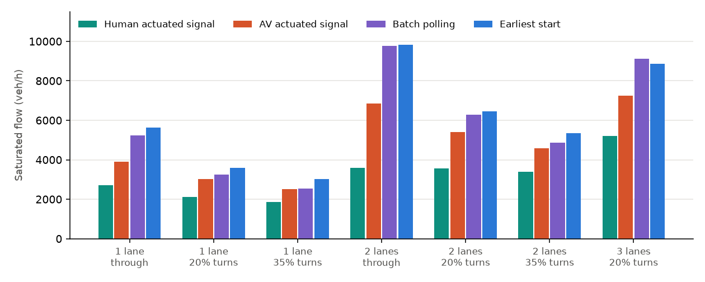
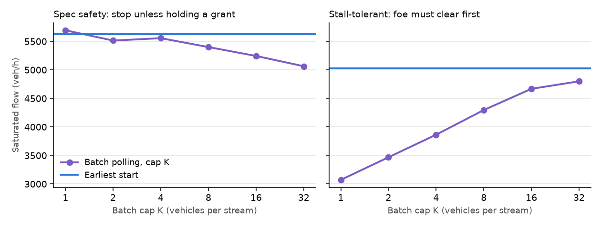
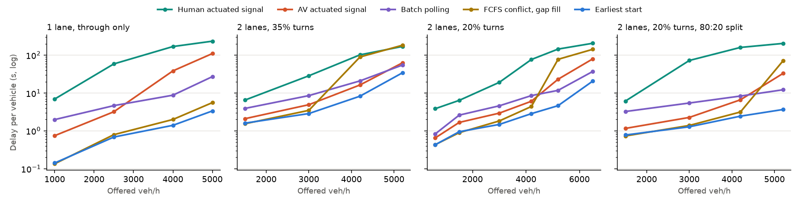

# Coordinated intersections: what limits them, what to build, and a CPU oracle to check it against

Reviewed and rebuilt 2026-11-01 by Opus 5.5. The earlier draft was by another model. Its point-queue model is replaced here, and the evidence was re-checked against primary sources. No GPU work was run. This is a design and a simulation result, not a validated vehicle system.

## The answer

**Build earliest-start scheduling on conflict pairs: every 0.5 s, each junction schedules whichever car can reach its stop line first without crossing anything already reserved.** Add exit credits, an exit check at the point of no return, and a sensing-based brake that doesn't depend on the schedule. The build spec is in the last section.

Cars cannot literally all enter at once, since crossing bodies need time apart. But opposing streams do go together, and crossing streams thread through each other's gaps about 1.1 s apart, without stopping.

Results from our trajectory-level CPU model on real SUMO junction shapes, against a signal tuned for each demand level:

| Measure | Human actuated signal | AV actuated signal, same cars | Earliest start |
|---|---:|---:|---:|
| Capacity, 2 lanes, 20% turns, veh/h | 3555 | 5412 | **6462** |
| Capacity, 1 lane, through only, veh/h | 2700 | 3894 | **5619** |
| Delay at 3000 veh/h, 2 lanes, s | 19.1 | 2.9 | **1.5** |
| Delay at 5200 veh/h, 2 lanes, s | 145 | 23.1 | **4.6** |
| Stops per car at 5200 veh/h | 3.18 | 1.09 | **0.02** |

**Four things to know before quoting those numbers:**

1. **Against a fair signal the capacity gain is +17% to +44%, not 2×.** Against a human signal it is 1.6× to 2.7×, but 41% to 64% of that comes from the vehicles (shorter gaps, no lost time) and would also appear behind a signal. Delay and stops are where removing the light pays most.
2. **Safety sets the gain.** The specified rule protects against any message fault but not a car stalling in the box: 0.23 collisions per stall. Requiring tolerance of a stall cuts collisions to 0.07 per stall and shrinks the capacity gain with turns to between −8% and +3%. Then a signal is about as good. **This is Erik's decision.**
3. **Deep network overload is not solved.** On a saturated grid of 150 m links, up to 12 collision events remain in a run, and past a point the AV signal carries more (16 096 against 14 040 veh/h). Metering traffic at the perimeter is the remedy the data suggest, and it was not built or tested.
4. **No real vehicles have shown this.** The largest verified multi-vehicle intersection tests have about three cars, and I found no saturated four-way test against a tuned signal.



## Evidence

Grades: **field** means full-size vehicles on real pavement, **scale** means miniature vehicles, **simulation**, **theory**. Every URL below was opened in this review on 2026-10-31 or 2026-11-01, unless the row or the "Could not open" list says otherwise.

### The comparison that matters: conflict-level control against a good signal at high demand

| Work | Grade | What it found | What it leaves open |
|---|---|---|---|
| [Yu, Sun, Liu & Yang, TR-B 2019, abstract on IDEAS](https://ideas.repec.org/a/eee/transb/v122y2019icp416-435.html) | Theory, simulation | Queueing analysis says FCFS reservation cannot handle high demand with several conflicting streams. In simulation, optimisation-based control beats both reservation and vehicle-actuated control. At high demand reservation offers little advantage over vehicle-actuated control | Abstract only: the [publisher page](https://www.sciencedirect.com/science/article/pii/S0191261517309980) returned 403, so no table is used |
| [Yang, Lin, Li & He, IEEE T-ITS manuscript 2020](https://arxiv.org/pdf/2008.06256) | Simulation | The fairest comparison found: same vehicles for all controllers. FCFS holds until 2.0 arrivals/s, then at 2.1/s delay jumps from 8.2 s to 118.9 s. Conflict-point control saturates at 3.4/s. An AV phase controller still gives 14.1 s at 4.0/s (14 400 veh/h, 12 lanes) | Cars are 4 m with a 1 m gap at 15 m/s, so same-lane headway is about 0.33 s. "Vehicle-based" loses in that regime, and the crossover below explains why |
| [Soltani, Levinson & Ramezani, TR-C 2025](https://transportlab.sydney.edu.au/wp-content/uploads/2025/09/AS-DL-MR-2025.pdf) | Simulation | Eight-lane junction, communication-free. Saturated throughput **855 veh/h/lane against 835 for an actuated max-pressure signal**, a 2.4% gain. Delay is much lower at low to moderate inflow. FCFS is cut off above 4500 veh/h because delay grows without bound | Vehicles are points with footprints checked at conflict zones. The 1-minute maximum is a peak measure |
| [Levin, Boyles & Patel, TR-A 2016](https://experts.umn.edu/en/publications/paradoxes-of-reservation-based-intersection-controls-in-traffic-n/) | Theory, network simulation | Reservations can favour local roads over arterials and raise total delay. Two metropolitan networks do worse than signals. **The downtown Austin grid does better**, so the authors see strong potential in symmetric grids | Not a correction of Tachet. The earlier report omitted the Austin result |
| [Fajardo, Au, Waller, Stone & Yang, 2011, Table 1](https://www.cs.utexas.edu/~chiu/papers/Fajardo11Automated.pdf) | Simulation | **Verified:** signal 9.11 s against FCFS 0.67, 1.84, 4.51 s at the top setting. SYNCHRO-optimised signal, three lanes per approach | **Not a capacity test.** That top setting is 1000 through + 100 left + 200 right per approach, about 433 veh/h/lane. Table 2 shows the buffer effect grows with left-turn load: 16.06 s against 0.69, 1.93, 9.50 s |
| [Tachet et al., PLOS ONE 2016](https://pmc.ncbi.nlm.nih.gov/articles/PMC4794159/) with [Supporting Information](https://journals.plos.org/plosone/article/file?id=10.1371/journal.pone.0149607.s001&type=supplementary) | Theory, simulation in the SI | See below | See below |
| [Lioris, Pedarsani, Tascikaraoglu & Varaiya, 2017](https://arxiv.org/pdf/1511.00775) | Theory, simulation | Platoons can double saturation flow, and a signalised 16-junction, 73-link network then supports proportionally more demand under fixed-time or max-pressure control | The gain is headway, and the signals stay. This is the strongest evidence that the short headway, not the removal of lights, is the main lever |
| [Miculescu & Karaman, 2016 preprint](https://arxiv.org/pdf/1607.07896) | Theory, simulation | Models the junction as a polling system with switchover times. Gives no-collision and wait-time bounds | Exhaustive service is best in the classic polling setup it cites. That holds when switchover is the dominant cost, which is exactly the crossover condition below |
| [Chen, Li, Lin, Yin & He, 2020](https://arxiv.org/abs/2010.04322) | Theory, simulation | A preset "rhythm" lets vehicles cross without stopping and raises capacity | No number in the abstract. Needs the arrival process to fit the rhythm |

### Tachet's 2×

The number is real and its source is narrow.

- **Service times, from the SI:** same-stream access time `T1 = 1 s`. Cross-stream `T2 = 2.47 s`, computed with `a_brake = 7.72 m/s²`, reaction 0.5 s, box 10 m, car 5 m, at the speed `v* = 15.2 m/s` that minimises `T2`. The 1.47 s setup is `T2 − T1`.
- **Baseline, from the SI:** the analytic FIXED light has a 2 s slot, so 0.5 veh/s. BATCH tends to `1/T1` = 1 veh/s as batches grow. **That ratio is the 2×.** It compares a 1 s rolling headway with a 2 s queue discharge headway. FAIR, which serves one car at a time in arrival order, is "only marginally higher" than FIXED.
- **Second comparison, also in the SI:** a four-phase adaptive light with a 100 s cycle and phase shares set from the trajectory mix, with a green that ends early if the queue empties. It uses a car-following model with no car-to-car communication. The earlier report called the baseline only fixed-cycle, and that was incomplete.
- **What is a fair reading?** Give the signal the same 1 s headway and rolling arrivals and most of the 2× goes to the signal too. Yang et al. and Lioris et al. above both point the same way.
- **Second-level safety, which the earlier report missed:** `T2` already builds in the requirement that the next car can still stop if the previous one stops in the box. That is the same idea as the stall-tolerant mode below, and it is why `T2` is large.
- **Published critique:** I found none addressed to this paper. Levin, Yu and Yang criticise reservation-based control more generally. The critique above comes from reading the SI and is ours.

### Protocols and methods

| Work | Grade | Use here |
|---|---|---|
| [Dresner & Stone, JAIR 2008](https://www.cs.utexas.edu/~aim/papers/JAIR08-dresner.pdf) | Simulation | Origin of request/grant over space-time tiles. It excludes gross vehicle malfunction from the safety claim, then studies its effect separately |
| [Au, Shahidi & Stone, AAAI 2011](https://www.cs.utexas.edu/~aim/papers/AAAI11-au.pdf), [proofs](https://www.cs.utexas.edu/~aim/papers/AAAI2011-Au-proofs.pdf) | Theory, simulation | Batching with age-based locking gives liveness at one junction under stated conditions. Source of the age rule |
| [Xu, Zhang, Li & Li, 2019](https://arxiv.org/abs/1902.01024) | Simulation | Monte Carlo tree search over passing orders. No numbers in the abstract |
| [Xu, Cassandras, Li & Zhang, 2020](https://arxiv.org/abs/2010.03148) | Simulation | MCTS best on traffic efficiency, dynamic resequencing best on energy, both ahead of FIFO variants. Efficiency sometimes costs fairness |
| [Zhang, Malikopoulos & Cassandras, ACC 2016](https://people.bu.edu/cgc/Published/ACC2016_CAVs.pdf) | Theory, VISSIM | Decentralised energy-optimal trajectories at two Boston junctions |
| [Malikopoulos, Cassandras & Zhang, 2018](https://arxiv.org/abs/1602.03786), [feasibility](https://arxiv.org/abs/1608.04311) | Theory, simulation | An analytical solution exists under conditions. A feasibility enforcement zone comes before the control zone. Same reasoning as our firm horizon |
| [Zhang & Cassandras, 2019](https://arxiv.org/abs/1903.04600) | Theory, simulation | Adds turns and comfort |
| [Rios-Torres & Malikopoulos manuscript](https://ids-lab.net/wp-content/uploads/2023/07/Malikopoulos15-uk57hw-1k8v1aa.pdf) | Theory, simulation | Merging coordination |
| [Morales Medina, van de Wouw & Nijmeijer, T-ITS 2018](https://pure.tue.nl/ws/portalfiles/portal/79592698/FINAL_VERSION.pdf) | Theory, simulation | Virtual platooning. Our merge handling is the same idea |
| [Vasirani & Ossowski, JAIR 2012](https://arxiv.org/pdf/1401.5851) | Simulation | Auction: high bidders get about 30% less delay |
| [Ahn & Del Vecchio, 2018](https://arxiv.org/abs/1612.02795) | Theory, simulation | Crossing verification as jobshop scheduling, which is what our release-time schedule is |
| [Ahn, Rizzi, Colombo & Del Vecchio, 2016](https://arxiv.org/abs/1603.03916) | Theory, simulation, experiment | Supervisor with uncontrolled vehicles |
| [Kang & Lin, DASHX manuscript 2022](https://lab.vanderbilt.edu/lin-iprivacylab/wp-content/uploads/sites/180/2022/11/DASH___TIST.pdf) | Simulation | Conflict checks over travel plans. I did not re-verify the earlier report's signal baseline details, so no number from it is used |
| [Wu et al., Flow, 2021](https://arxiv.org/abs/1710.05465) | Simulation | **Verified:** up to 57% system velocity at 4–7% AVs. Not a junction capacity result |
| [Le Vine, Zolfaghari & Polak, 2015](https://www.njdottechtransfer.net/wp-content/uploads/2017/05/1-s2.0-S0968090X15000042-main.pdf) | Simulation | **Verified:** comfort limits from high-speed rail cut signalised capacity from 1793 to 850 veh/h. The authors call these boundary conditions |
| [Companion safety report](08-v2x-and-safety-first-principles.md) | Derived | Source of the invariant. Being verified separately |

### What has moved on real wheels

| Work | Grade | Vehicles | What it does not show |
|---|---|---|---|
| [Hafner, Cunningham, Caminiti & Del Vecchio, 2013](https://scripts.mit.edu/~ddv/publications/ITS-Final.pdf) | **Field** | **Verified:** 2 Lexus IS 250, Toyota Technical Center, Ann Arbor | Collision avoidance, not capacity |
| [Di Vaio et al., T-VT 2019, Chalmers record](https://research.chalmers.se/en/publication/513411) | Field, size not stated | **Verified:** 3 self-driving cars, 802.11p | The record does not say full-size, so the earlier report's "full-size" is unverified. No capacity measure |
| [University of Delaware, 2021](https://www.udel.edu/udaily/2021/april/connected-automated-vehicles-arpa-mechanical-engineering-andreas-malikopoulos/) | Field, one car | **Correction: one real Audi A3 e-tron among virtual vehicles at Mcity.** 25% is its energy saving | Not a multi-vehicle test of any kind. The earlier report did not say it was one real car |
| [Zhang et al., VTL prototype, 2018](https://arxiv.org/abs/1807.01633) | Field, preliminary | Pittsburgh, count not stated in the abstract | No number. Virtual lights, not interleaving |
| [Fang et al., Engineering 2026](https://www.engineering.org.cn/engi/EN/10.1016/j.eng.2026.03.022) | Field claimed | Count not stated on the page | No capacity figure |
| [Farina et al., 2026](https://arxiv.org/pdf/2606.30838) | **Scale** | 4 cars at 1:10 on a figure-of-eight, centralised scheduling, non-stop | A concept demonstration. It says that field trials so far "typically involve only two or three vehicles and consider a single crossing event" |
| [Hyldmar, He & Prorok, 2019](https://arxiv.org/abs/1902.06133) | Scale | 16 miniature cars on a miniature highway | Not an intersection |
| [Tongji group project page](https://yimcui.github.io/Cooperative-driving/) | Hardware and human in the loop on CARLA | 2 to 4 simulated | Shows no physical vehicles |
| [Lee et al., CIRCLES, 2024](https://arxiv.org/abs/2402.17043) | **Field** | 100 controlled vehicles on an open road | Traffic smoothing, not an intersection. It shows that a field trial at this scale is possible |

**Nothing I found measures saturated four-way throughput on real vehicles against a tuned signal.** The largest multi-vehicle intersection tests I could verify have about three cars. Absence from my search is not proof that none exists.

The [VTL project page](https://users.ece.cmu.edu/~tonguz/vtl/about.html) says the technology "is proven to increase the traffic flows in urban areas by 60%" and gives no study, data or conditions behind it. Treat it as a marketing claim.

### Could not open in this review

Not used for any number: [MCross](https://www.sciencedirect.com/science/article/pii/S2352146517302855) (403), so the 99.51% lead stays unverified. [Levin & Rey conflict-point formulation](https://www.sciencedirect.com/science/article/abs/pii/S0968090X17302735) (403) and its [ISAIM abstract](https://isaim2018.cs.ou.edu/papers/ISAIM2018_Traffic_Levin_Rey.pdf) (certificate failure); Yang et al. describe it second-hand. [Wu, Jiang & Zhang CoMADDPG](https://onlinelibrary.wiley.com/doi/10.1155/2020/1820527) (403), so its 39.28% is unverified here. [Varaiya, max pressure](https://www.researchgate.net/profile/Pravin-Varaiya-2/publication/259138901_Max_pressure_control_of_a_network_of_signalized_intersections/links/606642dba6fdccad3f664404/Max-pressure-control-of-a-network-of-signalized-intersections.pdf) (403): the earlier report's description of its assumptions is unverified, and only Lioris's use of the controller is confirmed. [Levin, Fritz & Boyles on optimising reservations](https://www.researchgate.net/publication/305417472_On_Optimizing_Reservation-Based_Intersection_Controls): not opened. [Mcity facility page](https://mcity.umich.edu/what-we-do/mcity-test-facility/) (403). The Biao Xu distributed-conflict paper from the earlier report was not retried and is dropped.

## What limits throughput

These are our derivations, not literature results. The model below tests them. Symbols: `L` car length, `s0` standstill gap, `tau` time gap, `v` crossing speed.

**1. Same-lane headway.** `h = (L + s0)/v + tau`. With `L = 5, s0 = 2, tau = 0.8, v = 13.89`, `h = 1.304 s`, or 2760 veh/h/lane. The model reproduces this exactly: `pair_headway` returns 1.304 s. At 5 m/s the same car needs 2.2 s. **Stopped cars are the expensive part.**

**2. Crossing time.** A foe body occupies a conflict for `T_x = (region + L)/v + margin`. Real numbers from the swept paths on the SUMO `j1` junction: a through-through conflict region is 5.8 m along the path (two lanes' clearance at 2.3 m swept width), so `T_x = (5.8 + 5)/13.89 + 0.3 = 1.08 s`. On 265 sampled Berlin Mitte junctions, the median is 1.06 s, with the 10th and 90th percentiles at 0.97 and 1.56 s ([data](fig/09b-foes-check.json)). Whole-box locking on `j1` is `(14.4 + 5)/13.89 + 0.3 = 1.70 s`.

**3. The crossover rule.** Two opposed streams alternate with two crossing ones. Serve `k` cars from each side, then switch:

```
capacity(k) = 2k / ((k - 1) h + T_x)     for T_x >= h/2
```

This rises with `k` if `T_x > h` and falls with `k` if `T_x < h`. So **batching wins only when a switch costs more than a same-lane headway.** Otherwise threading single cars through each other's gaps carries more. The limits are `2/T_x` for `k = 1` and `2/h` for large `k`.

| Regime | `T_x` | `h` | Best | `k = 1` | `k → ∞` |
|---|---:|---:|---|---:|---:|
| Specified safety, rolling at 13.89 m/s | 1.08 | 1.30 | Interleave | 6667 | 5520 |
| Stall-tolerant, rolling at 13.89 m/s | 2.37 | 1.30 | Batch | 3038 | 5520 |
| From rest, first car, 2.6 m/s² | about 3.3 | about 2.9 falling to 1.3 | Batch | 2180 | about 5000 |
| Yang et al., 4 m car, 1 m gap, 15 m/s | about 0.5 to 1 | 0.33 | Batch | — | — |
| Tachet, `T2 = 2.47`, `T1 = 1` | 2.47 | 1.00 | Batch | — | — |

This one comparison reconciles literature that looks contradictory. Yang's phase control wins because a 1 m gap makes `h` far shorter than `T_x`. Tachet's BATCH wins because `T2` carries a stopping-distance term. Fajardo's FCFS looks excellent because at 433 veh/h/lane nothing queues. The old model's sensitivity table flips at `T_x = 2` for the same reason: `h = 2` there.

**4. Keep them moving.** Everything above assumes rolling arrivals. A car from rest at the line takes 3.4 s for its rear to clear that conflict, which ends 9.8 m past the line. So the coordinator's main physical job is converting a standing queue into a moving one, by slowing cars far upstream, a strategy Tachet's authors also describe. This costs storage: at 8 m/s spacing is 13.4 m instead of 7 m. On 300 m that is 22 cars rather than 42 in a moving queue. It is also where the delay accounting must stay honest: time spent crawling upstream is delay.

**5. The exit is a server and a store.** Sustained inflow cannot exceed the exit lane's flow, about 2760 veh/h/lane. A merge is a follow-the-leader relation with no crossing, and needs `h`, not `T_x`. A full exit must stop admissions, otherwise a car stops in the box and blocks every crossing path.

**6. Safety sets `T_x`.** The specified invariant says a car must be able to stop before the line unless it holds a confirmed slot and clear exit. With a grant, a car may follow a foe through a conflict separated only by a time margin. If that foe then stalls, the car may not be able to stop. So there are two levels:

- **Level A, specified:** margin = `m_t` = 0.3 s. Protects against any message fault. A stall in the box can cause a collision.
- **Level B, stall-tolerant:** margin = `m_t + T_r + v/(2 b_e)`. The foe clears the conflict before this car passes the point where it could still stop for it. At 13.89 m/s this adds 1.29 s. This is Tachet's second-level safety applied per conflict.

**Level B is why the safety choice is also the throughput choice:** it pushes `T_x` above `h`, moving the junction from the interleaving regime to the batching one, and takes away much of what makes signal-free crossing attractive.

## Audit of the earlier model

The earlier [`coordinated_intersections.py`](scripts/coordinated_intersections.py) is unchanged. It reproduces exactly as published ([audit script](scripts/ci_audit_old.py), [output](fig/09b-audit-old.csv)): batch 4447 against signal 3299.5 veh/h at demand 4400, and FCFS 118.71 s against signal 49.05 s at 3 s crossing separation. The arithmetic is right. The physics and the comparison are not.

| Problem | Evidence | Effect |
|---|---|---|
| **Queued cars cross at full speed.** A car waiting in a point queue crosses in 1.2 s, a figure derived at 13.89 m/s. It has no acceleration, no position and no length | `run()`, and the report's own derivation | Favours reservations in every high-demand case |
| **The "matched" comparison only matches `h`.** The signal loses 5.5 s per switch, a human figure (4 s clearance, 1.5 s start-up). Reservations lose 1.2 s | `run()` line 42 | Widens the gap between signal and FCFS. Not separately measured |
| **The 34.8% is not a capacity gain.** At demand 4400 batch flow simply equals demand. Saturate the same model and batch gives 5538 against 3304 (+68%), FCFS 4515 (+37%) | [audit output](fig/09b-audit-old.csv) | Understates the model's own gain, for the wrong reason, and the model is wrong anyway |
| **The 3 s "reversal" is the normal case, not a corner case.** 3.0 to 3.4 s is about what a car from rest takes to clear a conflict. FCFS loses to the signal there because its capacity, about 2850, is below demand. 118.7 s is one finite 2400 s window on a growing queue, not a delay figure. The signal in that table was untuned | [audit output](fig/09b-audit-old.csv) | Conclusion was right, but it applies to any FCFS queue that has stopped, so it deserved more weight |
| **The signal could not see approaching cars.** It gaps out only when the queue at the line is empty | `run()` line 40 | Weak actuation. Tuning over 18 settings was fair, on separate seeds |
| **Safety was not modelled.** No stopping, no conflict geometry, no exit, no stall. 1.2 s separation fails Tachet's second-level safety | Whole file | Any safety statement drawn from it would be unfounded. The report did say so |
| **Straight only, one lane, no storage.** No turns, which is where signals pay most | Whole file | Biases against reservations in one direction and for them in another |
| **Delay ignores slowing upstream.** Only queue time is counted, and cars have no speed | `run()` | Favours whichever policy slows cars upstream |

## The new model

[`scripts/ci_model.py`](scripts/ci_model.py) replaces it. Sweeps are in [`scripts/ci_sweep.py`](scripts/ci_sweep.py), tables and figures in [`scripts/ci_tables.py`](scripts/ci_tables.py). This is still our own CPU model, not SUMO and not data.

| Aspect | Treatment |
|---|---|
| Geometry | Real SUMO 1.28 nets from `netgenerate`, in [`fig/09-nets/`](fig/09-nets/). Movements follow internal lane shapes. 1, 2 and 3 lanes per direction, SUMO's default lane use: on 2+ lanes, rightmost through + right, leftmost through + left. Approach 300 m, exit 300 m. Lefts are permissive in the signal, as SUMO generates them |
| Vehicles | 5 m × 1.8 m, `s0` = 2 m, `tau` = 0.8 s, `a` = 2.6, planning decel 2.5, service 4.5, emergency 7 m/s², reaction 0.3 s. Limits integrate at 0.1 s. SUMO defaults for length, width and accel |
| Conflicts | Swept paths at `W + 0.5` = 2.3 m. A crossing pair is a scalar release time. Shared entry and shared exit are leader-follower relations with a kinematic headway over the whole shared stretch |
| Queues | Cars start from rest, accelerate at `a` and follow. A demand queue beyond the zone discharges at the equilibrium headway of the tail's speed, and its wait is counted as delay and one stop. This boundary is a simplification |
| Control | Firm cars follow the schedule under a safety filter. Others do nominal following under the same filter, and stop at the line unless granted. A sensing-based brake acts on any foe seen in a conflict ahead |
| Exit | Finite storage credit plus a run-out check against a slow tail at grant, then a second check at the point of no return |
| Messages | State and grant messages drop with probability `p` per attempt at 10 Hz, or all at once during a blackout. A grant is written to the table before it is sent |
| Faults | Coordinator crash, all-way-stop fallback, exit block, downstream bottleneck, stalled car in the box |
| Auditor | Independent of the planner: every step, oriented rectangles for all cars in or near the box, and the stop-before-line invariant for all cars without a grant. Each pair is counted once per 10 s |

**Delay** is time lost per offered vehicle in the window, integrating `1 - v/v_cap` over every car plus all waiting beyond the zone. So it counts slowing upstream and cars that never finish. **Stops** count falling below 0.5 m/s after moving above 2 m/s.

**Baselines.** `AV actuated signal` uses the same vehicles as the coordinated cases: no yellow, no start-up lag, clearance from the same conflict table, and permissive lefts threaded by the same table, which is smarter than any real permissive left and helps the signal. It cannot advise speed, so cars stop on red. `Human actuated signal` uses `tau` = 1.4 s, `s0` = 2.5 m, 1 s reaction and start-up, and 4 s lost per switch. Its measured saturation flow is about 1800 veh/h/lane, close to the HCM base of 1900 quoted by [Lioris et al.](https://arxiv.org/pdf/1511.00775). Both use the same exit discipline as the coordinated cases, which real human drivers do not have. Both are tuned for each demand level over six settings of max green and gap on a separate training seed. Capacity runs use a 60 s max and 1 s gap, and grid runs a 30 s max and 2 s gap.

**Variants.**

| Name | Order | Grant timing | Resource |
|---|---|---|---|
| FCFS whole box | Arrival | Firm at 60 m | One car at a time in the box |
| FCFS conflict | Arrival | Firm at 60 m | Crossing conflicts, with or without gap-filling calendar |
| Earliest start | Whichever car can arrive first; age over 90 s goes first | Advice from entry, firm at 4 s | Crossing conflicts, scalar release |
| Platoon-weighted | Smith's rule: `(wait + n h)/n` over a platoon of `n` | As above | As above |
| Batch polling | Rolling conflict-free groups from SUMO phases; up to `K` cars, gap-out | As above | As above: a software signal with rolling arrivals |

**What the auditor and traces caught, each of which would have produced a confident wrong answer:**

- Firm cars keeping a nominal time gap started too late from a queue and broke their slots.
- A leader's turn slowed a follower inside the box after its conflict times were computed from a free run.
- Insertion at near-zero speed silently capped every policy at about 1600 veh/h/lane.
- The exit lane used line-crossing order, so a car could brake for one physically behind it.
- A car could go firm behind one whose grant was unconfirmed, which caused overlaps under heavy loss.
- A car waiting close to the line could start its final acceleration before its time.
- Grants checked the exit only when issued, 4 s ahead, so queues that formed later caused collisions.
- Demand seeds used Python's randomised string hash, so "seed 0" meant different arrivals each run. `PYTHONHASHSEED=0` and a CRC seed fix this. All results here are from the fixed model.

All are fixed. Together they show how far a kinematics-free model can be from the truth.

## What the model found

375 single-junction runs: capacity, demand, crossover, sensitivity, faults with exit checks on. **Zero overlaps and zero invariant breaches in all of them.** Stall and grid runs are reported separately because they are not zero.

### Capacity

Saturated demand, mean of 2 seeds for the signal, polling and Earliest start rows and 1 for FCFS gap fill in most columns. T through only, M 10% left + 10% right, H 25% left + 10% right. [Data](fig/09b-capacity.csv).

| veh/h | 1 lane T | 1 lane M | 1 lane H | 2 lanes T | 2 lanes M | 2 lanes H | 3 lanes M |
|---|---:|---:|---:|---:|---:|---:|---:|
| Human actuated signal | 2700 | 2127 | 1857 | 3600 | 3555 | 3384 | 5208 |
| AV actuated signal | 3894 | 3021 | 2505 | 6843 | 5412 | 4578 | 7254 |
| FCFS conflict, gap fill | 5268 | 2130 | 1614 | 8472 | 3822 | 3234 | 6630 |
| Batch polling | 5238 | 3258 | 2529 | 9762 | 6276 | 4866 | 9111 |
| **Earliest start** | **5619** | **3600** | **3021** | **9834** | **6462** | **5346** | **8850** |
| Earliest start, Level B | 5022 | 2988 | 2316 | 9852 | 5430 | 4725 | 7446 |
| Batch polling, Level B | 4659 | 3063 | 2295 | 9789 | 5655 | 4551 | 8391 |
| *Earliest start ÷ AV signal* | *+44%* | *+19%* | *+21%* | *+44%* | *+19%* | *+17%* | *+22%* |
| *Level B Earliest start ÷ AV signal* | *+29%* | *−1%* | *−8%* | *+44%* | *0%* | *+3%* | *+3%* |
| *Share of the gain from human signal that the AV signal already gets* | *41%* | *61%* | *56%* | *52%* | *64%* | *60%* | *56%* |

Also measured at seed 0 only: FCFS whole box 2124 (1 lane T) and 1458 (2 lanes M). Whole-box locking is far below every other option, including the human signal. Platoon-weighted (Smith's rule) gave 4938 and 5418, worse than Earliest start, and is dropped. FCFS without a calendar gave 5952 and 2952. FCFS gap fill at Level B on 2 lanes M did not finish within its time budget in two attempts, and is omitted.

**FCFS collapses once turns appear.** It holds grants from 60 m with no reordering, and followers miss slots behind slow turners: on 2 lanes M it dropped 452 grants in one run. Other firm distances were not tested in this final model, so this result may not be its best setting. This matches [Yu et al.](https://ideas.repec.org/a/eee/transb/v122y2019icp416-435.html), [Yang et al.](https://arxiv.org/pdf/2008.06256) and [Soltani et al.](https://transportlab.sydney.edu.au/wp-content/uploads/2025/09/AS-DL-MR-2025.pdf).

**On three lanes Batch polling is equal or slightly better.** At Level B on 3 lanes it carries 13% more than Earliest start. A larger box means a larger `T_x`, so batches pay. Earliest start's greedy choice does not fully capture that.

### The crossover holds

1 lane, through only, one seed. [Data](fig/09b-crossover.csv).

| Level | `tau` | K=1 | K=2 | K=4 | K=8 | K=16 | K=32 | Earliest start |
|---|---:|---:|---:|---:|---:|---:|---:|---:|
| A | 0.8 | 5694 | 5514 | 5556 | 5400 | 5244 | 5064 | 5628 |
| B | 0.8 | 3072 | 3468 | 3864 | 4296 | 4668 | 4800 | 5028 |
| A | 0.6 | 6000 | 6000 | 6174 | 5580 | 5430 | 5316 | 5820 |
| B | 0.6 | 3150 | 3504 | 3936 | 4344 | 4800 | 5052 | 5400 |
| A | 1.2 | 6000 | 5976 | 4788 | 4398 | 4326 | 4272 | 6000 |
| B | 1.2 | 3360 | 3360 | 3768 | 3762 | 3930 | 4068 | 4164 |

At Level A flow falls as batches grow, at Level B it rises, as the rule predicts. **Earliest start needs no batch-size setting:** a same-stream follower is next when `h < T_x`, and a crossing car is next when `T_x < h`, so it picks the right regime by itself. It is within 2% of the best fixed K at Level A with `tau` = 0.8 and beats every K at Level B. On Level A with `tau` = 0.6 K=4 beat it by 6%. These are single seeds, so differences of 2-3% are noise.



### Demand

Delay in seconds per offered vehicle, with signals tuned per demand over six settings on a separate training seed. [Data](fig/09b-demand.csv), [tuning](fig/09b-signal-tuning.json). Mean of 2 seeds.

| 2 lanes, 20% turns | Human signal | AV signal | Batch polling | FCFS gap fill | Earliest start |
|---:|---:|---:|---:|---:|---:|
| 600 | 3.8 | 0.6 | 0.8 | 0.4 | **0.4** |
| 1500 | 6.4 | 1.7 | 2.6 | 0.9 | **0.9** |
| 3000 | 19.1 | 2.9 | 4.6 | 1.8 | **1.5** |
| 4200 | 76.8 | 6.0 | 8.5 | 4.4 | **2.8** |
| 5200 | 145 | 23.1 | 11.8 | 77.7 | **4.6** |
| 6500 | 207 | 80.0 | 37.2 | 143 | **20.7** |

Earliest start has the lowest delay, or within 0.1 s of it, at every demand in all four demand cases. It holds on the 80:20 arterial split that the [Levin paradox](https://experts.umn.edu/en/publications/paradoxes-of-reservation-based-intersection-controls-in-traffic-n/) warns about: 3.7 s against 33 s at 5200 veh/h, with 99th percentile trip 58 s against 131 s. That is one junction. The paradox is about networks, so this does not refute it.

**Batch polling costs more delay at low demand than the AV signal**, since it holds cars to form groups. Polling is not a free upgrade from a signal. Its gain is in stops and at high demand.



### Faults

2 lanes, 20% turns, Earliest start, Level A, one seed. [Data](fig/09b-faults.csv).

| Fault | At 3000 veh/h | At 5000 veh/h | Overlaps |
|---|---|---|---:|
| None | 1.7 s | 5.5 s | 0 |
| 10%, 30%, 50% message loss | 2.1, 1.9, 2.4 s | 4.6, 4.9, 11.6 s | 0 |
| 70% loss | 5.8 s | 93 s, flow 4338 | 0 |
| 90% loss | 317 s, flow 1206 | 390 s, flow 1146 | 0 |
| Radio blackout 2, 10, 30 s | 1.7, 1.8, 2.8 s | 5.4, 7.9, 13.1 s | 0 |
| Coordinator down 60 s, cars stop and wait | 6.1 s, peak queue 38 | 35.9 s, peak queue 120 | 0 |
| Coordinator down 60 s, all-way-stop fallback | 4.9 s, peak queue 29 | 23.7 s, peak queue 106 | 0 |

**Message loss degrades service, not safety.** No loss rate here produced an overlap: a car without a grant stops, and a lost grant wastes a slot. Up to 50% loss costs little because each message retries at 10 Hz. The model assumes clocks and positions stay good while messages drop, which is the favourable case, and burst structure beyond the blackouts was not modelled. See [the companion report](08-v2x-and-safety-first-principles.md) for what radios actually do.

| Exit fault at 3000 veh/h | Delay | Overlaps | Vehicle-seconds stopped in the box |
|---|---:|---:|---:|
| Exit blocked 450 s, credits and point-of-no-return check on | 71 s | **0** | **0.1** |
| Same, both off | 62 s | **25** | **779** |
| Downstream bottleneck 250 veh/h/lane, on | 36 s | 0 | 0.0 |
| Same, off | 36 s | 0 | 0.0 |

**Exit protection holds the box clear, at a small delay cost.** The bottleneck case shows no difference, because its queue never reached the junction in the run.

| Stalled car, 2 lanes, 20% turns, 3 seeds | Stalls | Collision events | Per stall |
|---|---:|---:|---:|
| 3000 veh/h, Level A | 55 | 13 | **0.24** |
| 3000 veh/h, Level B | 56 | 4 | **0.07** |
| 5000 veh/h, Level A | 62 | 14 | **0.23** |
| 5000 veh/h, Level B | 65 | 4 | **0.06** |
| 3000, 5000 veh/h, Level A, perception off, 1 seed | 26, 21 | 10, 15 | 0.38, 0.71 |

An event is a car pair overlapping, counted once per 10 s, and one stall can cause several. The stall rate of 120 per hour is a stress test, not a forecast. **Level B does not reach zero.** A car that stops for one conflict can be sitting in another, where a car with no room to stop arrives. [Data](fig/09b-stalls.csv).

### Grid

9 controlled junctions on 150 m links, one seed, signals at a fixed 30 s max and 2 s gap rather than tuned. [Data](fig/09b-network.csv).

| Net, offered veh/h | Human signal flow | AV signal flow | Earliest start flow | Earliest start delay | AV signal delay | Earliest start overlap events | AV signal overlap events |
|---|---:|---:|---:|---:|---:|---:|---:|
| 1 lane, 4000 | 3864 | 3848 | 3832 | 4.0 | 6.6 | 0 | 0 |
| 1 lane, 9000 | 6088 | 8176 | 8856 | 21.1 | 45.3 | 1 | 0 |
| 1 lane, 14 000 | 5912 | 8720 | 10 088 | 104 | 147 | 4 | 0 |
| 2 lanes, 8000 | 7816 | 7960 | 7912 | 2.7 | 6.1 | 0 | 0 |
| 2 lanes, 16 000 | 10 848 | 15 128 | 15 912 | 8.4 | 31.9 | 0 | 0 |
| 2 lanes, 20 000 | 10 720 | 14 952 | 18 136 | 41.4 | 86.3 | 10 | 0 |
| 2 lanes, 24 000 | 10 376 | 16 096 | **14 040** | 117 | 127 | 12 | 0 |

- **No gridlock appeared** in these 10-minute runs. That is not a proof: exit credits do not rule out a cycle of full links.
- **Up to the network's critical load, Earliest start is ahead on flow and delay**, up to +21% on flow at 20 000.
- **Past that, it falls behind the AV signal.** At 24 000 it carries 13% less, because cars keep dropping grants at the exit check. Without the exit checks it would carry 17 360, but with 405 collision events. So the check is working correctly and the junction is over-admitted. Holding traffic out at the perimeter is the next thing to try, and it is not tested here.
- **Overlaps are not zero in overload.** 12 events at about 1750 completed trips is a real defect under Level A.
- **Level B collapses on a loaded grid:** 7480 against 18 136 at 20 000, with 11 overlap events against 10. At 24 000 it has fewer (2 against 12), but carries half the flow. So Level B is not a good fallback for a saturated network. A signal is.

### Sensitivity

2 lanes, 20% turns, saturated, one seed each, against a baseline of 6330. [Data](fig/09b-sens.csv).

| Parameter | Values and flow |
|---|---|
| Lateral acceleration limit | 1.5: 5592 · 2.5: 6330 · 5.5 (SUMO's own): 7410 |
| Longitudinal acceleration | 1.5: 5346 · 2.6: 6330 · 3.5: 6714 |
| Time margin `m_t` | 0.15: 6648 · 0.3: 6330 · 0.5: 5940 · 0.8: 5844 |
| Time gap `tau` | 0.6: 6438 · 0.8: 6330 · 1.0: 6048 · 1.5: 5784 |
| AV signal, time gap | 0.6: 5604 · 0.8: 5286 · 1.0: 5100 · 1.5: 4632 |
| Firm horizon | 2: 5718 · 4: 6330 · 8: 5952 |
| Tick | 0.25: 6342 · 0.5: 6330 · 1.0: 6210 |
| Lateral margin | 0.25: 6258 · 0.5: 6330 · 1.0: 6204 |
| Lane look-ahead | 2: 6348 · 6: 6330 · 12: 6156 |
| Starvation age | 30: 6360 · 90: 6330 · 300: 6420 |

**With turns, comfort limits matter more than following gaps.** How hard cars may turn moves capacity by −12% to +17%, against +2% to −9% for the time gap. Ticks from 0.25 to 1 s and lane look-ahead barely matter, so tuning them further is not worthwhile.

### Tried and rejected, at grid saturation

Before the point-of-no-return check, on 1 lane at 14 000 veh/h, these gave no help. Measuring windows were 400 to 600 s, one seed, so treat them as direction only. The switches remain in the model, off by default.

| Idea | Flow | Overlap events | Baseline at that stage |
|---|---:|---:|---|
| Stall-tolerant margin only against foes bound for a congested exit | 6399 | 19 | 10 440, 26 |
| Using exit cars' planned speed, with that adaptive margin | 4284 | 45 | 10 440, 26 |
| Planning box occupancy from the exit tail's speed | 5616 | 75 | 10 440, 26 |
| Doubling the time margin to 0.6 s | 8217 | 25 | 10 440, 26 |

The margin experiment is the informative one: overlaps did not move, which showed the problem was not schedule precision. The point-of-no-return check took the comparable run from 26 to 9 events.

## The design decision

**Chosen: Earliest start, conflict pairs, Level A, exit credits, point-of-no-return check, perception brake.** Level B stays as a switch.

| Question | Answer | Why |
|---|---|---|
| Whole junction or conflict level? | Conflict pairs | 1458 against 6462 veh/h. Whole-box locking is worse than a human signal |
| FCFS or reorder? | Rolling reorder | FCFS collapses with turns. Rolling advice lets cars plan early while grants stay late |
| Batches or single cars? | Neither fixed | Earliest start falls into whichever is better from `h` and `T_x` |
| When to grant? | 4 s out | Tested at 2, 4 and 8 s. Long enough to hold speed and short enough to reorder |
| Calendar? | No, a scalar per conflict pair | O(1) per check, no slot search, fits a GPU kernel. Calendar on Earliest start not tested |
| Exit? | Counter at grant, tail check, then recheck at the point of no return | Off gives 25 overlaps and 779 vehicle-seconds blocked |
| Platoons? | They emerge | Explicit platoon-weighting was worse on capacity in both cases measured |
| Upstream speed? | Advice from zone entry | Stops per car at 5200 veh/h: 0.02 against 1.09 |
| Coordinator failure? | Grants stand, everyone else stops, all-way-stop fallback | Zero overlaps. Fallback cuts delay by a fifth to a third over stopping alone |
| Lost message? | Costs a slot, never safety | Zero overlaps to 90% loss |
| Safety independent of schedule? | Perception brake | Without it collisions per stall were higher at 5000 veh/h (0.71 against 0.23, one seed against three) |
| Overload? | Meter at the perimeter, or fall back to a signal | Not built. Past critical load a signal is better |

**The safety spec from [08](08-v2x-and-safety-first-principles.md) maps directly.** The stop curve is the invariant: `v T_r + v²/2b_c ≤ d − 0.5` for any car without a grant, and the auditor counted zero breaches. Grants are written before they are visible. The spec's "clear exit" needed one refinement: it has to hold at the point of no return, because the exit can fill in the 4 s after a grant. The spec's tube invariant also covers a stalled foe, which Level A does not. **Level A meets the wording "unless it holds a confirmed slot and clear exit" but is weaker than that section's full tube invariant. Level B is closer but still not the whole of it.**

### Reproduce

```sh
nix develop --command research/truth/scripts/ci_make_nets.sh           # already generated in fig/09-nets
export PYTHONHASHSEED=0 OMP_NUM_THREADS=1
for p in crossover capacity tune demand faults stalls network sens; do
  nix develop --command python3 -I research/truth/scripts/ci_runs.py $p
done
nix develop --command python3 -I research/truth/scripts/ci_tables.py   # tables and figures
nix develop --command python3 -I research/truth/scripts/ci_audit_old.py
```

The full set is about 1 CPU hour, so send anything beyond one part to `heavy`. The sensitivity csv also holds three grid probes run by hand before `ci_runs.py` was written. `ci_census.py` and `ci_foes_check.py` read the city nets outside the repo.

## Reviewed by Opus

### What held

- **Fajardo's numbers.** 9.11 s against 0.67, 1.84, 4.51 s, and the derived 92.6%, 79.8%, 50.5%.
- **Tachet's 2×, setup 1.47 s and "about five times shorter"** are in the text, and it is theory plus simulation.
- **The arithmetic of the old model.** 34.8% and 118.7 s against 49.1 s reproduce exactly.
- **The earlier report's core warnings.** Do not promise 2×. FCFS can lose to signals. The exit is a server. Coordinate through a single owner of each exit lane. Write the grant before exposing it. Never reuse a slot on a timeout. Do not trust a turn signal.
- **Verified as stated:** Levin's signals-can-win finding, Lioris's scaling, Le Vine's 1793 to 850, Vasirani's 30%, Flow's 57%, Hafner's two Lexus, VTL's unsupported 60%, and the absence of any saturated field test in what I could find.

### What was wrong or missing

| Earlier claim | Correction |
|---|---|
| Point-queue model as a basis for predictions | Queued cars crossed at full speed with no length or acceleration, and "matched" meant only `h`. Replaced |
| "Batching gain 34.8%" | A demand-capped number. That model's own saturated gain was 68%, and neither number is physical. Trajectory-level: +17% to +44% against an AV signal |
| FCFS 118.7 s against signal 49.1 s as a corner-case reversal | From-rest crossing takes about that long, so this is the normal state of a stopped FCFS queue |
| Tachet's baseline was "fixed-cycle" | The SI also has a basic adaptive 100 s light. The 2× is `1/T1` over a 2 s queue slot |
| Tachet not criticised directly | Still no published critique found, but the headway reading above and second-level safety were missing |
| University of Delaware as Mcity track testing | **One real Audi among virtual cars** |
| Di Vaio "full-size" | The record says three self-driving cars. Size unverified |
| Levin 2016 | Omitted that the Austin grid favoured reservations |
| Literature seen as disagreeing | The crossover rule accounts for most of it |
| 64-byte vehicle state, slot search, candidate schedules, tile validator | 32 bytes, closed-form times, one greedy list, swept-path auditor. The earlier compute budget is replaced by a smaller design and neither is measured |
| Exit credit at grant time | Not enough. Needs the point-of-no-return check, shown by the grid and exit tests |

### What remains unknown

- **Real-world transfer.** Nothing here is measured on vehicles. It is one CPU model, written here, not validated against SUMO or data.
- **Sensing and clocks.** The model gives perfect positions and clocks, and loses only messages. Position error and clock skew would eat directly into the 0.3 s margin, and sensitivity shows that margin costs about 8% at 0.8 s.
- **Radio.** No propagation, burst structure or channel load is modelled. Whether 10 Hz per car at city density is available is a question for [08](08-v2x-and-safety-first-principles.md).
- **People.** No pedestrians, cyclists or human drivers among coordinated cars. Berlin Mitte's net has no `crossing` edges, so the simulator cannot represent crosswalks there. [Report 10](10-mixed-autonomy-transition.md) covers transition.
- **Vehicles.** One car type, no trucks and no lane changing on the approach. Lanes and exits are fixed at insertion.
- **Overload.** Perimeter metering is inferred and not tested. Whether exit credits can gridlock a loop was not shown either way.
- **Better schedulers.** No exact optimum or MCTS comparison was run, so the gap to optimal is unknown. Earliest start with a calendar is untested. [Xu et al.](https://arxiv.org/abs/2010.03148) found MCTS best on efficiency in their tests.
- **Statistics.** Most capacity cells have 2 seeds and most fault and grid rows 1. The wider sweep in `ci_sweep.py` was queued for the homelab, but the worker stayed full for over two hours and it never started. I cancelled it and ran bounded subsets locally instead. Differences under about 3% are noise.
- **Sources I could not open** are listed above. Yu et al. is abstract-only.

### Build spec

Everything below can be implemented without reading the rest of this report. The reference for any ambiguity is [`scripts/ci_model.py`](scripts/ci_model.py). Function names in brackets point to it.

**Algorithm in one paragraph.** Each junction runs a coordinator every 0.5 s. It reads every approaching car's distance and speed, then builds a schedule one car at a time: for each lane's next unscheduled car it computes the earliest time that car could reach its stop line while staying clear of everything already scheduled, and it schedules whichever car comes out earliest. Cars more than 4 s from their line receive that time as advice and slow down smoothly. Cars within 4 s get a firm grant, which is written into the reservation table before the car can see it. A car with no firm grant holds a speed from which it can stop at the line. A firm grant needs a storage credit on the exit lane, and the exit is checked again at the car's point of no return. Separately, any car that can still stop brakes for a foe it senses inside a conflict ahead, whatever the schedule says.

#### 1. New data

All offsets are bytes. All structs are `#[repr(C)]` with a WGSL twin in `common.wgsl`. Times are `f32` seconds since simulation start (resolution 8 ms at 86 400 s, below the 0.3 s margin).

**`GpuVeh` grows by 32 bytes, from 160 to 192.** The fields travel with the vehicle through `gather`.

| Offset | Field | Type | Meaning |
|---:|---|---|---|
| 160 | `cj_t_line` | f32 | Scheduled time at the stop line |
| 164 | `cj_v_line` | f32 | Scheduled speed at the stop line |
| 168 | `cj_v_cruise` | f32 | Current cruise target from the profile solver |
| 172 | `cj_link` | u32 | Movement the car is scheduled on, `NONE` if none |
| 176 | `cj_state` | u32 | 0 none, 1 advised, 2 firm, 3 past line |
| 180 | `cj_zone_t` | f32 | Time it entered the control zone, for the age rule |
| 184 | `cj_seq` | u32 | Commit sequence of its grant. Used for idempotent retransmission and for the exit lane order |
| 188 | `cj_hold` | f32 | Route position it must stop at during a fault, `1e30` if none |

**`cj_links`, read-only, 48 bytes per movement.** One per `GpuLink` at a coordinated junction.

| Offset | Field | Type | Meaning |
|---:|---|---|---|
| 0 | `junction` | u32 | Index into `cj_junctions` |
| 4 | `from_lane` | u32 | Index into `cj_lanes` |
| 8 | `to_lane` | u32 | Index into `cj_lanes` |
| 12 | `conf_start` | u32 | First entry in `cj_conflicts` |
| 16 | `conf_count` | u32 | Number of crossing conflicts |
| 20 | `pair_start` | u32 | First entry in `cj_pairs` |
| 24 | `pair_count` | u32 | Number of diverge and merge partners |
| 28 | `path_len` | f32 | Stop line to box end along the swept path |
| 32 | `v_turn` | f32 | Speed cap inside the box |
| 36 | `v_after` | f32 | Exit lane speed limit |
| 40 | `group` | u32 | Bitmask of SUMO phases serving it, used only by the fallback and signal baselines |
| 44 | `pad` | u32 | |

**`cj_conflicts`, read-only, 16 bytes per ordered crossing pair.**

| Offset | Field | Type | Meaning |
|---:|---|---|---|
| 0 | `rel_index` | u32 | This car waits for `cj_rel[rel_index]` |
| 4 | `rev_index` | u32 | This car, once committed, raises `cj_rel[rev_index]` |
| 8 | `s_in` | f32 | Front position where this path enters the conflict |
| 12 | `s_out` | f32 | Front position where this path leaves it, before adding length |

**`cj_pairs`, read-only, 8 bytes per ordered partner sharing an entry or exit lane.** `other` is a link index. `s_end` is the follower's path position up to which it must stay behind the partner: the divergence point for a shared entry, and the distance before the box end at which the paths come within swept width for a shared exit. Bit 31 of `other` marks a shared exit.

**`cj_rel` and `cj_rel_s`, read-write, 4 bytes per ordered crossing pair.** `cj_rel[i]` is the time the most recently committed car on the foe movement leaves the conflict. `cj_rel_s` is the same array used as scratch while a schedule is built. A junction writes only its own range, so invocations never race. There is no calendar and no gap filling. Earliest start with this scalar table beat FCFS with a full gap-filling calendar in every turning case. A calendar on earliest start itself was not tested.

**`cj_lanes`, read-write, 64 bytes per lane adjacent to a coordinated junction.**

| Offset | Field | Type | Meaning |
|---:|---|---|---|
| 0 | `req_start` | u32 | First of `K_LANE` entries in `cj_req`, `NONE` for a pure exit lane |
| 4 | `line_link` | u32 | Last committed car over this stop line: its movement |
| 8 | `line_v` | f32 | Its speed at the line |
| 12 | `line_t` | f32 | Its time at the line |
| 16 | `exit_link` | u32 | Last committed car into this lane as an exit: its movement |
| 20 | `exit_v` | f32 | Its speed at its own stop line |
| 24 | `exit_t` | f32 | Its time at its own stop line |
| 28 | `n_on_lane` | u32 | Cars physically on the lane or in the box bound for it |
| 32 | `n_committed` | atomic u32 | Firm grants not yet across their stop line |
| 36 | `credit_len` | u32 | `floor(length / (L + s0 + 1))`: a real queue packs looser than `L + s0` |
| 40 | `tail_x` | f32 | Rear of the last car, measured from the lane start |
| 44 | `tail_v` | f32 | Its speed |
| 48 | `n_armed` | atomic u32 | Cars past their point of no return, bound for this lane |
| 52 | `pad` | 12 bytes | |

`L + s0` is a per-type maximum for vehicle types on the lane, which is conservative for mixed traffic.

**`cj_req`, read-write, 32 bytes, `K_LANE = 6` per approach lane.** Rank 0 is the lane head.

| Offset | Field | Type | Meaning |
|---:|---|---|---|
| 0 | `veh` | u32 | Index in `cur` this step |
| 4 | `link` | u32 | Requested movement |
| 8 | `d` | f32 | Distance to the stop line |
| 12 | `v` | f32 | Speed |
| 16 | `age_t` | f32 | `cj_zone_t` |
| 20 | `flags` | u32 | Bit 0 valid, bit 1 message received this tick, bit 2 firm |
| 24 | `t_plan` | f32 | Scheduled line time |
| 28 | `v_plan` | f32 | Scheduled line speed |

**`cj_junctions`, read-write, 32 bytes.** `lane_start`, `lane_count`, `link_start`, `link_count`, `tick_phase` (u32 in 0..4, used to stagger), `flags` (bit 0 frozen, bit 1 coordinator down), `awsc_free` (f32), `epoch` (u32).

**Size at Berlin scale.** From the [census](fig/09b-census.json): 28 473 junctions, 161 881 links, 257 426 lanes, and 474 332 ordered SUMO foe bits. That gives about 7.8 MB of links, up to 7.6 MB of conflicts, 3.8 MB for both release arrays, 16.5 MB of lanes, about 25 MB of requests if half the lanes approach a coordinated junction, and 0.9 MB of junctions. The total is about 65 MB, plus 64 bytes per vehicle because `prev` and `cur` both grow. These are arithmetic, not measurements.

#### 2. Geometry pre-pass: new `crates/cars-core/src/coord.rs`

Port `build_conflicts` from the model. For every junction:

1. Build each movement's path by concatenating `Conn.via` and any following internal lanes. `Topology` already follows this chain with `internal_before`. Resample at 0.25 m.
2. For every pair of movements at the junction, find where their centrelines come within `W + m_lat` = 2.3 m.
3. Shared entry lane: store the last close point in `cj_pairs`. Shared exit lane: store the first close point in `cj_pairs`. Otherwise store `(s_in, s_out)` from first to last close point, in both directions, in `cj_conflicts`.
4. `v_turn` is `lane.speed * sqrt(a_lat / 5.5)` when the internal lane's speed is below the approach speed, otherwise the approach speed. SUMO's own limit uses 5.5 m/s² ([`NBFrame.cpp`](/home/erikf/projects/personal/thesis-src/sumo/src/netbuild/NBFrame.cpp), option `junctions.limit-turn-speed`); we use a comfort value of 2.5.

**Do not reuse `GpuConflict` or `<request foes>` for this.** On 265 sampled Berlin Mitte junctions, 432 of 3605 swept-path crossing pairs (12%) had no foe bit, and 706 foe bits (18% of 3879) had paths that never come within swept width ([data](fig/09b-foes-check.json)). `foes` answers who yields under right-of-way rules, which is a different question. Use it only as a logged cross-check. `GpuConflict` stores a crossing point and a lane width with no vehicle width, one point per pair, and it sits in link-relative coordinates that serve SUMO's yielding logic.

| Needed | SUMO net gives it? | What to do |
|---|---|---|
| Path through the box | Yes, internal lane `shape`; all 161 881 Berlin and 201 519 Stockholm connections have `via` | Use it. For a net built with `--no-internal-links`, refuse coordination on that junction |
| Stop line | Yes, end of the incoming lane | Use it |
| Turn speed | Yes, internal lane `speed` | Rescale to the comfort limit |
| Exit storage | Yes, lane `length` | Compute `credit_len` |
| Vehicle swept width in a turn | **No** | `W + m_lat`; verified against oriented rectangles in the auditor |
| Actual junction dimensions | Derived, not surveyed | OSM-derived shapes are the geometry we have; see [07](07-maps-and-intersections.md) |
| Pedestrian crossings | Only if the net has `crossing` edges; Berlin Mitte has none | Without them the model has no pedestrians. State this in any result |
| Sight lines, occlusion | **No** | Out of scope in the simulator |
| Lane change across the exit | Not a geometry issue | A lane change or insertion into a credited lane must count in `n_on_lane` at the next snapshot, which is why it is recomputed each tick |

Each exit lane has exactly one upstream junction in a SUMO net, so that junction owns the lane's credits and no cross-junction arbitration is needed. Chained internal junctions inside one SUMO junction are one coordinator.

#### 3. Staged kernels and where they go in `Sim`

Insert stages 0 to 5 in `Sim::step` after `clear_links` and before `plan`. Each is a separate dispatch, so a global barrier separates them. Stages 0 to 3 run only for junctions whose `tick_phase == step % 5`, at `dt = 0.1`, which spreads a 0.5 s tick over five steps. Stages 4 and 5 run every step.

| Stage | Kernel, size | Work | Reads | Writes |
|---|---|---|---|---|
| 0 Snapshot | `cj_snapshot`, per lane, 64 | Copies `n_on_lane`, `tail_x`, `tail_v` from `seg` and `cur`. Clears `flags` in the lane's `cj_req` | `seg`, `cur` | `cj_lanes`, `cj_req` |
| 1 Propose | `cj_propose`, per vehicle, 64 | Rank is `seg[lane].end - 1 - i`, since `keys` sorts by ascending position. If rank < `K_LANE`, on a coordinated approach and not firm: writes its request. Draws the state-message loss from `e.rng` and sets bit 1 on success | `cur` | `cj_req` slot owned by this car |
| 2 Arbitrate | `cj_arbitrate`, per junction, 16 | Copies this junction's `cj_rel` to `cj_rel_s`. Runs the list schedule below on scratch and writes `t_plan`, `v_plan` | `cj_req`, `cj_links`, `cj_conflicts`, `cj_pairs` | `cj_rel_s`, `cj_req` |
| 3 Commit | `cj_commit`, per junction, 16 | Walks the plan in list order. For a car in the firm horizon whose lane is not blocked: recomputes its time on the real `cj_rel`, checks the exit credit, writes `cj_rel`, lane records and `n_committed`, then sets bit 2 | `cj_req` | `cj_rel`, `cj_lanes`, `cj_req` |
| 4 Apply | `cj_apply`, per vehicle, 64 | Reads its own request on tick steps. Draws the grant-message loss. Takes a grant only if it can still meet it. Solves the profile. Detects a missed slot. Runs the point-of-no-return check. Decrements `n_committed` and `n_armed` on line crossing, with `atomicSub` | `cj_req`, `cj_lanes` | Its `cur` entry, `n_committed`, `n_armed` |
| 5 Perceive | `cj_perceive`, per junction, 16 | For each car in the box and each of its conflicts: if its body is still in the region when a foe would arrive and the foe can stop, write that foe's `cj_hold`. Reads true positions, never the schedule | `cur`, `cj_conflicts` | `cj_hold` on its own vehicles, in a per-junction table read by `cj_apply` next step |

A junction may write only its own lanes in stage 3 and a vehicle only its own record in stage 4, so the grant is durable before any car can act on it. Lost-grant waste is the only cost of a lost message.

**No kernel needs a function-local array.** The schedule's per-lane read pointers live in `cj_lanes` scratch or as a counter over `cj_req` flags. The loop bound is `R × lanes × conflicts`, with `R = 32`, `lanes ≤ 16`, conflicts per movement ≤ 32. A candidate re-evaluates only lanes conflicting with the last commit. Junctions above those caps get `flags` bit 1 and stay on their SUMO control: never truncate a conflict list.

**Stage 2, the list schedule** (`list_tick`, `cand_time`, `commit_scratch`):

```
copy cj_rel to cj_rel_s, lane records to scratch
repeat up to R times:
    for each approach lane with an unscheduled request:
        t, v = candidate(next request on that lane)
    pick the lane with the smallest t
        (but any car older than A_max = 90 s goes first)
    record t_plan, v_plan; raise scratch: rel[rev_index] = max(., t + T_out(link, v, s_out + L))
    update scratch lane records

candidate(req):
    for v_line in v_turn * {1, .8, .6, .4, .2, 0}, highest first:
        te = earliest(d, v, v_line)       # none if it cannot reach or brake to v_line in d
        tl = latest(d, v, v_line)         # none or finite if it cannot stop and wait
        if te is none or tl is none: continue
        t = max(now + te, now + 0.1)
        t = max(t, line_t + H_same(pred, this))
        t = max(t, exit_t + H_exit(pred, this))
        if exit tail speed vt > 0.5:     # it may be slowing for its own next junction
            t = max(t, now + (2 L + s0 + v_out tau - tail_x_front) / vt - T(link, v_line, path_len + L))
        for each conflict: t = max(t, rel[rel_index] + margin - T_in(link, v_line, s_in))
        if t - now <= tl: return t, v_line
    return none

margin = m_t = 0.3 s                                   # Level A, the specified invariant
margin = m_t + T_r + max(v_line, 2) / (2 b_e)          # Level B, stall-tolerant
```

All functions are closed form, with no iteration and no tables:

```
T(link, v0, s):  # front travels s from the stop line at accel a, capped at v_turn to path_len, then v_after
    segment 1 from v0 capped at v_turn over min(s, path_len)
    segment 2 capped at v_after over max(0, s - path_len)
    in each: if v < cap: accelerate; t += (sqrt(v^2 + 2 a x) - v) / a, or the capped form plus cruise

earliest(d, v, ve):
    none if v <= ve and (ve^2 - v^2) / 2a > d; none if v > ve and (v^2 - ve^2) / 2b > d
    vp = sqrt((2 a b d + b v^2 + a ve^2) / (a + b))
    if vp <= vmax: (vp - v)/a + (vp - ve)/b
    else: (vmax - v)/a + (vmax - ve)/b + (d - (vmax^2 - v^2)/2a - (vmax^2 - ve^2)/2b) / vmax

latest(d, v, ve):
    C = d - v^2/2b - ve^2/2a; if C >= 0: infinity
    vc = sqrt(-C / (1/2b + 1/2a)); if vc > min(v, ve): none
    (v - vc)/b + (ve - vc)/a

H_same(p, this): # follower stays L + s0 + v tau behind the leader over the shared stretch
    max over s in 5 points of [0, s_end]:
        T(p, v_p, s + L + s0 + V(this, v, s) * tau) - T(this, v, s)
H_exit(p, this): the same in box-end coordinates over [-s_end, 30] m
```

The 1 m sampled form in `pair_headway` is the reference. A 3-point version differed from it by at most 0.13 s across all class pairs on `j2`. Use 5 points and keep the difference below `m_t`. If `H` is hot, cache it per movement pair and line-speed class in a table.

**Stage 3, firm condition.** A request goes firm when `d <= v T_r + v^2/2b_c + v (tick + 0.3) + 5` or `t_plan - now <= T_firm = 4 s`, and `t_plan - now <= T_firm + 1`, and its message arrived, and no car ahead of it on the lane failed this tick, and **no car ahead of it on the lane has an unconfirmed grant**. `exit_ok` must also hold, trying lower line speeds before giving up (`firm_time`, `exit_ok`):

```
unit = L + s0 + 1
(n_on_lane + n_committed + 1) * unit <= exit.length
and if the exit tail is below 5 m/s:
    tail_rear + tail_v^2 / (2 b_s) - n_committed * unit >= unit + T_r v_out + v_out^2 / (2 b_s)
```

Credits are a counter and do not depend on where cars are on the lane. The run-out check adds the case of a slow tail near the box. Do not exempt a tail that is accelerating: that version was tried, and a queue shuffling forward stopped again and caused 13 overlaps.

**The exit is checked again at the point of no return (`exit_clear_now`).** Four seconds is long enough for a queue to form after the grant. When a firm car reaches `d <= v T_r + v^2/2b_s + 2`, once only:

```
tail = last car past the box on the exit lane
ahead = n_armed + cars in the box bound for this lane
clear if: tail_rear + tail_v^2 / (2 b_c) - ahead * unit >= unit
if clear: mark armed, atomicAdd n_armed
else if it can still stop: drop the grant and stop at the line
```

**The exit lane's order is commit order, not line-crossing order.** Paths differ in length, so a later-committed right turner can cross its line first and still merge behind. Insert into the lane's order by `cj_seq` among cars still in the box. Getting this wrong makes a car brake for one physically behind it.

**Stage 4, vehicle control** (`step`, `plan_vc`, `events_after_step`):

```
if no firm grant:
    speed cap = stop curve: b_c * (sqrt(T_r^2 + 2 max(d - .5, 0) / b_c) - T_r)        # this IS the safety invariant
if advised or firm:
    solve v_cruise by bisection every 0.2 s (12 iterations; no arrays)
    if d <= (v_line^2 - v^2) / 2rate + v dt: target v_line, else target v_cruise
if firm or inside the box: follow the schedule under the safety filter alone
    v_safe = -b_s T_r + sqrt((b_s T_r)^2 + v_l^2 + 2 b_s max(gap - s0/2, 0))
else: nominal following under the same filter
if firm and t_line - now > 0.3 and d < 8 and v > 1.5 d / (t_line - now):
    cap speed at 1.5 d / (t_line - now)                                               # never well ahead of the slot
every 0.2 s if firm and t_line - now <= 6:
    if earliest(...) > t_line - now + 0.15:
        if it can still stop at service braking: drop the grant (missed slot), return to no grant
        else: fly on and count it in late_committed
```

The firm-car rule matters. An earlier version kept constant-time-gap following on firm cars, and a queued follower started too slowly to meet its slot, which produced real overlaps in the auditor. Separating the schedule from the safety filter removed them.

**Hooks in the existing kernels.** Add `L_COORD` to `GpuLink.flags` for links at coordinated junctions.

- `link_opened` (`step.wgsl:960`): at the top, `if ((k.flags & L_COORD) != 0u) { return ego_cj_state == CJ_FIRM && ego_cj_link == link; }`. All SUMO yielding logic is bypassed for those links. The existing "stop if not opened" flow in `exec` (`step.wgsl:1144`) then enforces the line.
- `exec`, `finalize_speed`: cap the result by the Stage 4 target. For cars inside the box, keep `v_safe` from `adapt_to_leader`.
- `plan` and `approach`: skip writing `slots` for `L_COORD` links, which saves their cost.
- `collide`: add the debug auditor as a separate entry point. For each pair of cars in one box, an oriented-rectangle test (`overlap` in the model). Never repair overlaps: count them.
- `tls_step`: unchanged. A signal stays available as a per-junction fallback.

Scale up in the repo's usual order, with one job at a time and 3 GB of VRAM kept spare: the single junction first, then a grid, then Charlottenburg.

#### 4. Faults

| Event | Rule |
|---|---|
| Lost state message | The car is not eligible this tick. Later cars on that lane wait. Nothing else changes |
| Lost grant | The slot stays reserved, since `cj_rel` was written first. The coordinator retransmits on the next tick with the same `cj_seq`. If it arrives too late to meet, the car rejects it and asks again, and the slot is wasted |
| Late or duplicate grant | `cj_seq` makes it idempotent. A car accepts only if `earliest ≤ t_line + 0.15` and `t_line - now ≤ latest` |
| Missed slot, still able to stop | Drop the grant, stop at the line, request again. The old slot stays wasted |
| Missed slot, past the stopping point | Keep going under the safety filter and count it. The margin covers tracking error. Beyond that the auditor will show it |
| Coordinator down | No new grants. Firm grants stand. Every car without one reaches the line and stops. Once stopped, cars fall back to all-way-stop by V2V or sensing (`awsc`): the oldest head car proceeds from rest with the whole box to itself |
| Coordinator restart | Rebuild `cj_rel` from firm grants held by cars and bump `epoch`. A new coordinator must not issue grants overlapping old ones. If it cannot recover them, it waits for the longest grant horizon (5 s) plus sensing that the box is clear |
| Stalled car in the box | Freeze the junction: no new grants. Every car that can stop short of the stalled body or of the line does, at up to `b_e`. When it clears, the box drains before grants resume. Collisions remain: see the table |
| Exit blocked | Credits run out, so cars stop at the line and the box stays clear. The queue is upstream, where it belongs |
| Queue forms after a grant | Point-of-no-return check drops the grant if the car can still stop. |
| Foe slowed inside the box | `cj_perceive`: stoppable cars brake for it |
| Network overload | Meter at the perimeter. See the grid table. Credits stop box blocking but do not prevent cyclic gridlock in principle, and no gridlock occurred in the runs here |

#### 5. Tests, in order

Compare against [`scripts/ci_model.py`](scripts/ci_model.py) on the nets in [`fig/09-nets/`](fig/09-nets/). Run each case with the audit on. Hard requirements in every case: **zero overlaps, zero invariant breaches, zero negative credits, vehicle conservation.**

| # | Test | Pass condition | CPU model reference |
|---:|---|---|---|
| 1 | Kinematics unit test: `earliest`, `latest`, `T` on a grid of inputs | Within 1e-3 s of Python | `ci_model.py` |
| 2 | Single car, `j1`, 150 veh/h | Crosses within ±0.15 s of grant. Delay under 0.2 s | err ±0.1 s, delay 0.08 s |
| 3 | Headway, through only, one stream | Saturation headway converges to 1.304 s | `pair_headway` = 1.304 s |
| 4 | Crossover on `j1` through, `tau` = 0.8 | The K ordering flips between Level A and B, and Earliest start matches or beats the best K | Table below |
| 5 | Capacity | Within ±5% of the table below | [csv](fig/09b-capacity.csv) |
| 6 | Demand curve | Delay within ±25% or 1 s, whichever is larger | [csv](fig/09b-demand.csv) |
| 7 | Exit block 450 s, 3000 veh/h on `j2` | On: 0 overlaps, under 5 veh·s stopped in the box. Off must fail, which proves the test detects it | On: 0 and 0.1. Off: 25 and 779 |
| 8 | Loss 0 to 0.9, blackout, crash | 0 overlaps at every setting. Flow and delay within the tolerances above | [csv](fig/09b-faults.csv) |
| 9 | Stall injection | Report per-stall collisions for Level A and B. Do not expect zero | A 0.23, B 0.07 |
| 10 | Grid | Teleporting off. Report overlap events and any gridlock | [csv](fig/09b-network.csv) |
| 11 | Compute | Measure ms per step against vehicles and coordinated junctions. No estimate here is a benchmark | none |

**Hard requirements for all single-junction cases:** zero overlaps, zero invariant breaches, zero negative credits, vehicle conservation. Across 375 such runs the CPU model recorded 0 and 0.

**Expected numbers to check against**, from the tables above: capacity on `j1` through 5619, `j2` through 9834, `j2` 20% turns 6462, `j3` 20% turns 8850, all ±5%. AV signal on the same cases: 3894, 6843, 5412, 7254. Delay on `j2` at 20% turns, 3000 veh/h: 1.5 s against 2.9 s; at 5200: 4.6 s against 23.1 s. Stops per car at 5200: about 0.02 against 1.09.

#### 6. Scenes to film

Use `cars record` once the GPU version passes tests 1 to 8. Show the real run with no hidden teleports, and label each clip with its offered flow, safety level, and whether the audit was clean.

1. **The weave, top down, close.** One junction, 1 lane each way, through only, 5000 veh/h, Earliest start, Level A. Slow to quarter speed at the moment crossing streams interleave. This is Erik's "all at the same time" shot.
2. **Three panels, same arrivals.** Human signal, AV signal, Earliest start, on 2 lanes with 20% turns at 5200 veh/h. HUD with cumulative trips and stops. This is the honest comparison and should end with the +19% capacity number on screen, not 2×.
3. **Slowed far upstream.** Long shot of the approach, cars colour-coded advised, firm or none. Shows the queue moving instead of standing.
4. **Exit blocked.** Exit closes for several minutes. Cars stop at the line and the box stays empty. Then the same clip with credits off, where the box locks up.
5. **Packet loss ramp.** Message loss climbs from 0 to 90%, with traffic slowing but no contact. Caption: losing messages costs time, not safety, under this model's assumptions.
6. **Coordinator crash.** Coordinator dies for 60 s: everyone stops, all-way-stop, recovery.
7. **A car stalls in the box, Level A then Level B.** Show the collision. This is the shot that makes the safety choice real, and it should not be cut.
8. **Grid in overload.** The 9-junction grid past critical load, side by side with the AV signal, where the signal wins. Include it.

