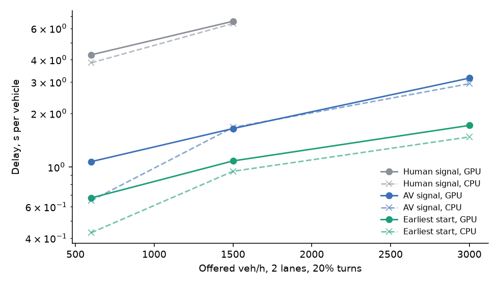

# D8 on the GPU: signal-free junctions, built and measured

Built from the "Reviewed by Opus" section of [09](09-coordinated-intersections.md). The CPU model there is the oracle. All tables are in [fig/d8/tables.md](fig/d8/tables.md), and `scripts/d8/compare.py` regenerates them. No real vehicles or real demand are involved: this is a simulator against a simulator.

## What was built

| Part | Where |
|---|---|
| Geometry pre-pass: paths, swept conflicts, headway and travel-time tables | `crates/cars-core/src/coord.rs` |
| Kernels: clear, pre, audit, snapshot, propose, arbitrate, commit, perceive, apply | `crates/cars-core/src/shaders/av_junction.wgsl` |
| Hooks: `plan_cj`, speed from `cj_apply`, no slots on coordinated links, no lane change while firm | `step.wgsl`, `lc.wgsl` |
| Shared safe speed for the physics layer to replace | `av_safe_speed`, `av_stop_curve` in `common.wgsl` |
| Run and report | `cars av`, JSON with the CPU model's keys |
| Overlays | `grants`, `paths`, `channel` on `cars record` and `cars shot` |
| Modes per junction | `--cj-mode`, `--cj-junction-mode id=signal`. Free and the signal baseline run. `MODE_MIXED` is reserved and refused |
| Metering at the edge | `--cj-meter N`: new cars wait outside while N are on the network |

**Departures from the build spec, all deliberate:**

- `GpuVeh` grows by 40 bytes, not 32: `cj_v_cmd` and `cj_yield` are fields rather than a per-junction table.
- Times and headways are precomputed tables, not closed form in the kernel. Headways use the reference's 1 m sampling.
- Per-junction kernels write granted vehicles directly: a junction owns the cars on its approach lanes, so there is no race.
- One stall per junction at a time. The CPU model allows several, so GPU runs have about half its stalls.
- Crash restart keeps `cj_rel`, as the CPU model does. Rebuilding it from held grants is not built.
- **Added beyond the spec:** a head car parked at the line for 20 s with no grant goes on sensing alone, with the box to itself. Without this, total message loss deadlocks. A car cannot tell a dead radio from bad luck, so the rule has to rest on what it can see.
- **Added:** the sensing brake also covers cars with a tail across a conflict and cars that have missed their slot past their stopping point (see below).
- **Added:** junctions with a lane under 25 m are refused and stay on their old control, with the reason logged. OSM draws one real junction as a chain of nodes, with exits as short as 0.2 m, and a slot cannot be checked against that.
- **Stricter auditor than the CPU model:** it also tests cars with their front past the box and tail in it, and heads within 3 m of the line.
- **Batch polling and FCFS were not built.** They were comparison policies in the report and were not asked for here, so spec test 4 (K crossover) is not run.

## Corrections after a fact check

- **Device labels.** The columns headed "GPU" in [tables.md](fig/d8/tables.md) and the legends of `capacity.png` and `demand.png` were mostly CPU Vulkan (llvmpipe), as the section below says but the labels did not. They now read "this build" against "Python model". Only `gpu_cells.jsonl` ran on the RX 7900 XT: the 26 cases in the table "CPU Vulkan against the RX 7900 XT" and the table of numbers the spec names.
- **"Network held at 0".** Those rows in the metering table of tables.md averaged signal-free and AV-signal runs, because `compare.py` did not separate policy, and `metering.png` plotted them as if metered. Removed. The unmetered baselines are the separate "none, signal-free" and "AV signal" rows, which were right, and so are the numbers quoted in this report.

## Which device ran what

The GPU lock had about ten jobs waiting for most of this work, and each sweep had to be rerun twice after bugs below. So the final sweeps ran the same kernels on CPU Vulkan (llvmpipe), and on the RX 7900 XT ran the cells the spec names, compute cost and the clips, plus a 26-case sample of the rest ([fig/d8/verify.jsonl](fig/d8/verify.jsonl), table in the tables file). In that sample 14 cases match to the digit on flow, and the rest differ by up to 1.3% on single junctions and 4.3% on one grid case. Overlap counts differ too when they are not zero: 3 and 5, 3 and 8, 0 and 1. So the two are statistically comparable, not identical, and an overlap count of 0 from CPU Vulkan is evidence for that seed on that device only. At 3000 veh/h a run repeats exactly on one device, including with message loss.

## Results against the CPU model

Every table is in [fig/d8/tables.md](fig/d8/tables.md). The short version:

| Spec test | Pass condition | Result |
|---:|---|---|
| 1 Kinematics | Within 1e-3 s of Python | **Pass.** 378 cases of `earliest` and `latest` as WGSL within 3e-6 s; `T` within 1e-3 s (`cargo test -p cars-core coord::`) |
| 2 Single car | Crossing within 0.15 s of grant, delay under 0.2 s | **Pass.** Delay 0.067 s (reference 0.08), mean error 0.053 s, none over 0.15 s |
| 3 Headway | 1.304 s | **Pass for the table:** 1.304 s. A run measures 1.40 s on both this build and the CPU model (5136 veh/h on both, seed 0), because the insertion boundary limits both |
| 4 K crossover | | **Not run.** No polling policy here |
| 5 Capacity | Within 5% | **Pass, 28 of 28 cells** on CPU Vulkan, largest difference 3.6%. On the GPU, 8 named cells: also within 5% |
| 6 Demand | Delay within 25% or 1 s | **48 of 54 cells.** The misses are saturated or noisy cases, in the tables |
| 7 Exit block | On: 0 overlaps, under 5 veh s in the box. Off must fail | **Pass.** On: 0, 2.9. Off: 17 overlaps, 572 veh s |
| 8 Loss, blackout, crash | 0 overlaps, tolerances above | **Pass on overlaps,** all 0. Delay misses listed below |
| 9 Stalls | Report per stall | A 0.10 and 0.30, B 0.00. See below |
| 10 Grid | Report | See below. Not zero past critical load |
| 11 Compute | Measure | See below |

**Hard requirements in every signal-free single-junction run** (capacity, demand, faults with checks on, faults2, T): zero overlaps, zero ungranted crossings, zero negative credits, zero teleports, vehicle conservation. The stricter auditor saw nothing. Injected stalls and the deliberately unprotected exit are the only single-junction cases with contacts.

**One overlap in the human signal baseline** (j2, 4200 veh/h, 80:20 split, a permissive left), and a few in the AV signal baseline on one Stockholm junction with a stop line close to a foe's path. Neither is the signal-free system, and the signal baseline is not built for real geometry. They are left in the tables.

**Three bugs the stricter audit found that the CPU model also has or could not see:**

1. Bodies with the front past the box and the tail still in it were not audited, and the sensing brake did not see them. This was the main source of grid contacts. Fixed in the brake; 09's numbers undercount these.
2. A firm car held up behind a slow leader misses its slot past its stopping point and enters later than reserved. The spec counts this as `late_committed` and does nothing. Foes that can still stop now treat its predicted occupancy as a body in the road. On the 2-lane grid at 16 000 veh/h, seed 0, this took 4 events to 0.
3. Mine, not the model's: grants numbered per junction let two cars in one box share a table slot, hiding one from its follower and the auditor. Numbered per exit lane now, and the auditor counts any car the table loses: none in any run. All tables here were rerun after this fix, because the earlier zeros could not be trusted.

**Delay cells outside the tolerance** are saturated or noisy cases, listed in the tables. Exit block also misses: 42.8 s and 3000 veh/h against the model's 71.3 s and 2658. I did not find out why. The likely cause is this build's fixed lane assignment against the model's shortest-queue choice. With coordinator down and no fallback at 5000 veh/h the delay is 21 s against 36 s, also unexplained.

**Loss at 90%:** this build carries more than the model (about 1500 against 1200 veh/h), because of the sensing fallback. Set `--cj-no-fallback` to compare directly.

**Stalls:** about half the model's stall count, since one junction takes one at a time. Level B saw none in 63 stalls against the model's 0.06 to 0.07 per stall. With so few events this is not evidence that it is zero. Five ungranted crossings appear in stall runs: a car ordered to give up its grant that then could not stop.

**The T junction,** with signals tuned as in the report: delay 1.4 s against 2.5 s at 1500 veh/h, flow about 3600 against 3490 at 6000 veh/h offered, so close to a fair signal at saturation. Zero contacts.

**The grid, past critical load, is not fixed.** Signal-free stays ahead of the AV signal on flow in every case here, but overlap events remain: 57 over 3 seeds at 24 000 veh/h on 2 lanes, against 0 for the signal. So Level A does not meet the zero-collision test on a saturated grid.

**Metering helps and is a trade.** Mean of up to 4 seeds:

| Net, offered | Held at | Flow | Delay incl. waiting outside | Overlap events, all seeds |
|---|---:|---:|---:|---:|
| 2 lanes, 24 000 | none, signal-free | 15 803 | 112 | 57 (3 seeds) |
| 2 lanes, 24 000 | AV signal | 15 291 | 136 | 0 (3 seeds) |
| 2 lanes, 24 000 | 280 | 17 372 | 103 | 10 (4 seeds) |
| 2 lanes, 24 000 | 240 | 16 508 | 115 | 5 (4 seeds) |
| 2 lanes, 24 000 | 200 | 14 872 | 139 | 0 (4 seeds) |
| 1 lane, 14 000 | none, signal-free | 9 539 | 121 | 18 (3 seeds) |
| 1 lane, 14 000 | AV signal | 8 413 | 154 | 0 (3 seeds) |
| 1 lane, 14 000 | 140 | 8 798 | 137 | 0 (4 seeds) |

Metering at a level with no contacts on 1 lane beats the signal by 5% with less delay. On 2 lanes the level with no contacts in these seeds carries 3% less than the signal, and the level that beats it still has contacts. Four seeds of 450 s cannot show that any level is safe, and the threshold here is a fixed number picked by sweep, not a controller. No gridlock appeared.

**Stockholm.** Through traffic picked to load the net, no count data. The net has no crossing edges, so it has no pedestrians whatever the street has.

- **A real junction** (Sveavägen at Apelbergsgatan, `cluster_1363066780_...`, 6 approach lanes), its own signal removed, neighbours on their signals. Against AV cars on the real signal: time lost per trip 17.5 s against 24.7 s at 800 veh/h, flow 3088 against 2613 veh/h at 4000 offered. **But the coordinator's signal baseline does about the same as signal-free here** (3078, and 17.6 s), so most of that gain comes from the cars and the conflict table, not from removing the signal.
- **A 1 km district:** 44 of 108 junctions coordinated. 64 refused for a lane under 25 m, the rest on their own control. Zero contacts and zero teleports. At low load time lost falls from 47.7 s to 40.6 s. **Under overload it does worse than the real signals:** at 8000 offered, 1846 veh/h against 2659, with cars stuck over 120 s all over the district. At 5000, 2289 against 2484. Metering at 150 cars clears the stuck cars (14 against 958) but carries 2325. So this build is not ready for a real district at peak. The likely reason is the mix of refused and coordinated junctions, and merging OSM clusters into one coordinator is the next thing to try.

**The channel of report 08** (`--cj-chan 1`, LTE-PC5 statistics: range cliff, shadowing, bursts, load) changes little at one junction: 16 to 20 lost messages in a run, delay as without. It has no burst structure from a fit, no latency beyond one step, and no position or clock error, which matter more and are not modelled.

**The numbers the spec names, on the RX 7900 XT, seeds 0 and 1:**

| Case | Signal-free, GPU | CPU model | AV signal, GPU | CPU model |
|---|---:|---:|---:|---:|
| Capacity, 1 lane through, veh/h | 5679 | 5619 | 3888 | 3894 |
| Capacity, 2 lanes through | 9918 | 9834 | 6837 | 6843 |
| Capacity, 2 lanes 20% turns | 6615 | 6462 | 5175 | 5412 |
| Capacity, 3 lanes 20% turns | 8931 | 8850 | 7269 | 7254 |
| Delay at 3000 veh/h, s | 1.6 | 1.5 | 3.2 | 2.9 |
| Delay at 5200 veh/h, s | 4.1 | 4.6 | 20.2 | 23.1 |
| Stops per car at 5200 veh/h | 0.01 | 0.02 | 0.96 | 1.09 |





## Compute

Bounds checks on, 0.1 s steps, and the desktop and other agents sharing the GPU, so treat these as upper bounds.

| Net | Junctions | Vehicles | ms per step | Device |
|---|---:|---:|---:|---|
| 1 lane 4-way, saturated | 1 | 120 | 0.48 | RX 7900 XT |
| 2 lanes, 20% turns, saturated | 1 | 250 | 0.71 | RX 7900 XT |
| 3 lanes, 20% turns, saturated | 1 | 370 | 0.85 | RX 7900 XT |
| 9-junction grid, 2 lanes | 9 | 208 to 387 | 0.98 to 1.33 | RX 7900 XT |
| Grid of 400 | 400 | 462 | 1.16, without coordinator 0.84 | CPU Vulkan, 2 threads |
| Grid of 2500 | 2500 | 355 | 2.15, without coordinator 0.92 | CPU Vulkan, 2 threads |

At 2500 junctions the coordinator kernels take 1.26 ms of a step on CPU Vulkan, and most of that is per-junction overhead in audit and perceive, not vehicles. Memory is 57.7 MB for 2500 junctions, 23 KB each, and 40 bytes per vehicle in each of two buffers. **The 400 and 2500 runs did not get a GPU turn:** `scripts/d8/scale.py` measures them on the RX 7900 XT, and it waited over an hour and a half in the lock queue before I stopped it. A thousand-junction measurement on the GPU is still open. With the audit off the coordinator should be cheaper, and that was not measured either.

## Clips

`/home/erikf/projects/personal/cars-data/videos/gallery/d8/`, made with `cars record` because a trace does not hold grants: `cars replay` cannot draw these overlays until the trace format carries `cj_state`. Each frame's HUD counts teleports and everything the auditor saw.

| Clip | Shows |
|---|---|
| `weave.mp4`, `weave_turns.mp4` | No signal, streams interleaving at speed |
| `versus_signal.mp4` | Same arrivals: no signal, AV signal, human signal |
| `paths_and_slots.mp4` | Planned paths, wide where a foe also needs the road, and the slot chart |
| `loss_70pct.mp4` | 70% message loss, lost grants in magenta |
| `coordinator_crash.mp4` | Coordinator down 40 s: grants stand, everyone stops, one at a time |
| `exit_blocked.mp4`, `exit_blocked_unprotected.mp4` | A full exit: the box stays clear, then with checks off it locks and collides |
| `stall_level_a.mp4`, `stall_level_b.mp4` | An injected stall that causes a contact. Level B has its own stalls in the same window |
| `grid.mp4`, `grid_overload_metering.mp4` | 9 junctions; overload unmetered and metered |
| `stockholm_junction.mp4` | Sveavägen at Apelbergsgatan with the signal removed |

## Mixed traffic next

A junction already has a mode, and the signal baseline shares the conflict table with the signal-free one, so both write `cj_rel`. `MODE_MIXED` goes in `cj_commit`: humans get phases from `signal_tick`, AVs get `cand_time` on the same table, with `cj_rel` raised for the humans' green. The other parts needed are a human stop-line rule on `L_COORD` links, which `link_state` currently reports as red, and a way for the sorted lane order to mix followers.

## Reproduce

```sh
nix develop --command bash
python3 scripts/d8/kinematics_ref.py   # then: cargo test --release -p cars-core coord::
python3 scripts/d8/runs.py smoke headway capacity demand faults faults2 stalls t_tune t grid meter meter_seeds
python3 scripts/d8/stockholm.py && python3 scripts/d8/scale.py && python3 scripts/d8/verify.py target/release/cars
python3 scripts/d8/compare.py > research/truth/fig/d8/tables.md
python3 scripts/d8/film.py
```

Runs take `/tmp/cars-gpu.lock` in five minute turns. `CARS_ADAPTER=llvmpipe` runs anything without the lock. Finished cases are not rerun.

## What still fails

- **Zero collisions on a saturated grid.** Level A leaves contacts past critical load. Metering reduces them, but only a level that carries less than the signal had none on 2 lanes.
- **Real districts at peak.** 64 of 108 junctions are refused, and past capacity flow falls below the real signals. Merging OSM clusters is the next step.
- **`--trusted` hangs on llvmpipe** with the audit on, and any small edit to the audit kernel makes it go away. It looks like a compiler effect of unbounded loops, and I could not prove it. `cars av` no longer offers the flag, and this has not been seen on the RX 7900 XT.
- **Not built:** position error, clock skew and message latency beyond one step, which report 08 requires and 09 says matter most; mixed traffic; lane changes on the approach beyond SUMO's model; several vehicle types (one AV type, so buses and trucks are not represented); `cars replay` of grants; physics layer, which has not merged and goes in at `av_safe_speed`, `av_stop_curve` and the `exec` position line.
- **Unexplained:** exit block delay 43 s against 71 s and coordinator down without fallback 21 s against 36 s.
- **Evidence:** a few seeds per cell. No vehicle, no count data, one model checking another.
