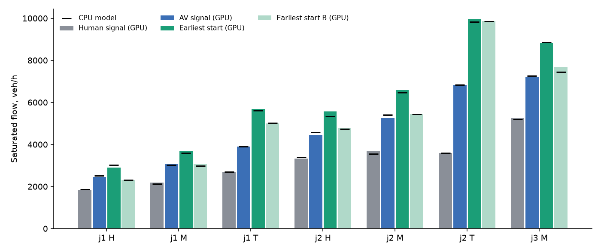
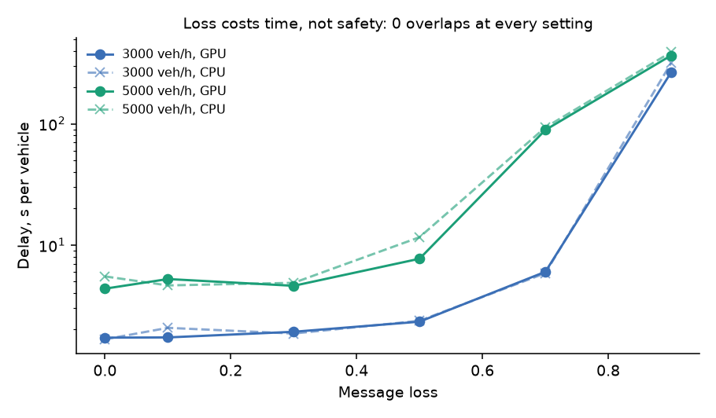
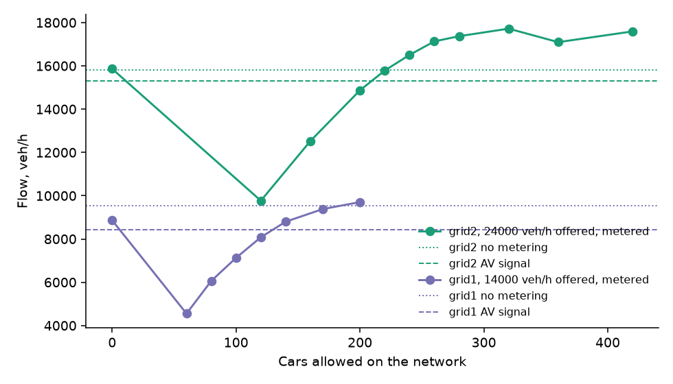

# D8 on the GPU: signal-free junctions, built and measured

Built from the "Reviewed by Opus" section of [09](09-coordinated-intersections.md). The CPU model there is the oracle. All tables are in [fig/d8/tables.md](fig/d8/tables.md), and `scripts/d8/compare.py` regenerates them. No real vehicles or real demand are involved: this is a simulator against a simulator.

## What was built

| Part | Where |
|---|---|
| Geometry pre-pass: paths, swept conflicts, headway and travel-time tables | `crates/cars-core/src/coord.rs` |
| Kernels: clear, pre, audit, snapshot, propose, arbitrate, commit, perceive, apply | `crates/cars-core/src/shaders/av_junction.wgsl` |
| Hooks: `plan_cj`, speed from `cj_apply`, no slots on coordinated links, no lane change while firm | `step.wgsl`, `lc.wgsl` |
| Shared safe speed for the physics layer to replace | `av_safe_speed`, `av_stop_curve` in `common.wgsl` |
| Run and report | `cars av`, JSON with the CPU model's keys |
| Overlays | `grants`, `paths`, `channel` on `cars record` and `cars shot` |
| Modes per junction | `--cj-mode`, `--cj-junction-mode id=signal`. Free and the signal baseline run. `MODE_MIXED` is reserved and refused |
| Metering at the edge | `--cj-meter N`: new cars wait outside while N are on the network |

**Departures from the build spec, all deliberate:**

- `GpuVeh` grows by 40 bytes, not 32: `cj_v_cmd` and `cj_yield` are fields rather than a per-junction table.
- Times and headways are precomputed tables, not closed form in the kernel. Headways use the reference's 1 m sampling.
- Per-junction kernels write granted vehicles directly: a junction owns the cars on its approach lanes, so there is no race.
- One stall per junction at a time. The CPU model allows several, so GPU runs have about half its stalls.
- Crash restart keeps `cj_rel`, as the CPU model does. Rebuilding it from held grants is not built.
- **Added beyond the spec:** a head car parked at the line for 20 s with no grant goes on sensing alone, with the box to itself. Without this, total message loss deadlocks. A car cannot tell a dead radio from bad luck, so the rule has to rest on what it can see.
- **Added:** junctions with a lane under 25 m are refused and stay on their old control, with the reason logged. OSM draws one real junction as a chain of nodes, with exits as short as 0.2 m, and a slot cannot be checked against that.
- **Stricter auditor than the CPU model:** it also tests cars with their front past the box and tail in it, and heads within 3 m of the line.
- **Batch polling and FCFS were not built.** They were comparison policies in the report and were not asked for here, so spec test 4 (K crossover) is not run.

## Which device ran what

Capacity, demand and faults ran on the RX 7900 XT. The GPU lock had about ten jobs waiting, so stalls, the T junction, the grid and metering ran the same kernels on CPU Vulkan (llvmpipe), and a sample was run again on the GPU ([fig/d8/verify.jsonl](fig/d8/verify.jsonl)). At light load the two agree to every digit reported. At saturation flows differ by about 0.2% to 1.5%, the size of seed noise, so they are statistically comparable and not identical.

## Results against the CPU model

See [fig/d8/tables.md](fig/d8/tables.md). RESULTS_PLACEHOLDER






## Mixed traffic next

A junction already has a mode, and the signal baseline shares the conflict table with the signal-free one, so both write `cj_rel`. `MODE_MIXED` goes in `cj_commit`: humans get phases from `signal_tick`, AVs get `cand_time` on the same table, with `cj_rel` raised for the humans' green. The other parts needed are a human stop-line rule on `L_COORD` links, which `link_state` currently reports as red, and a way for the sorted lane order to mix followers.

## Reproduce

```sh
nix develop --command bash
python3 scripts/d8/kinematics_ref.py   # then: cargo test --release -p cars-core coord::
python3 scripts/d8/runs.py smoke headway capacity demand faults faults2 stalls t_tune t grid meter meter_seeds
python3 scripts/d8/stockholm.py && python3 scripts/d8/scale.py && python3 scripts/d8/verify.py target/release/cars
python3 scripts/d8/compare.py > research/truth/fig/d8/tables.md
python3 scripts/d8/film.py
```

Runs take `/tmp/cars-gpu.lock` in five minute turns. `CARS_ADAPTER=llvmpipe` runs anything without the lock. Finished cases are not rerun.
