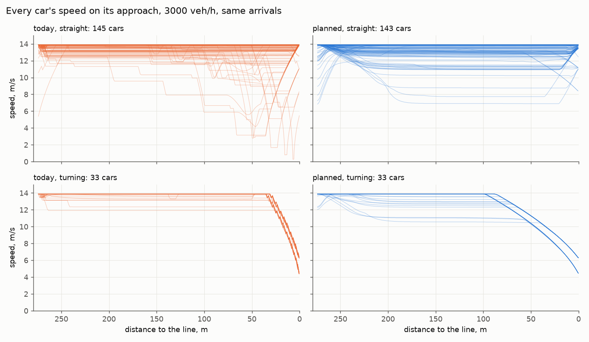
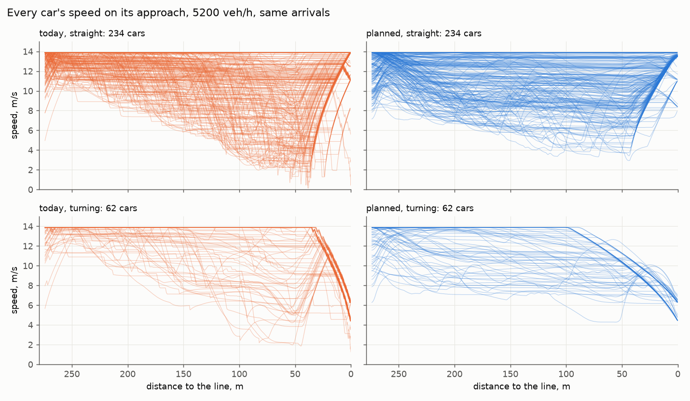
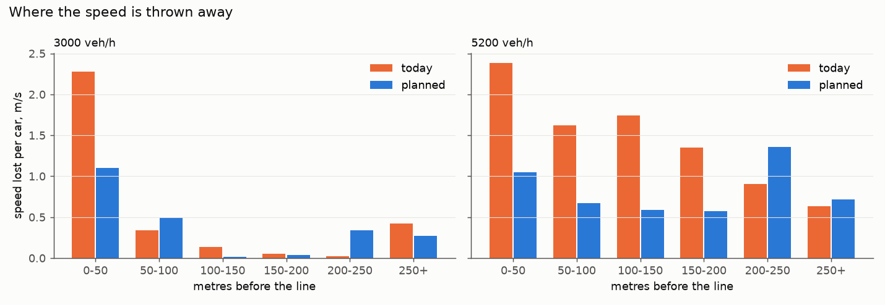
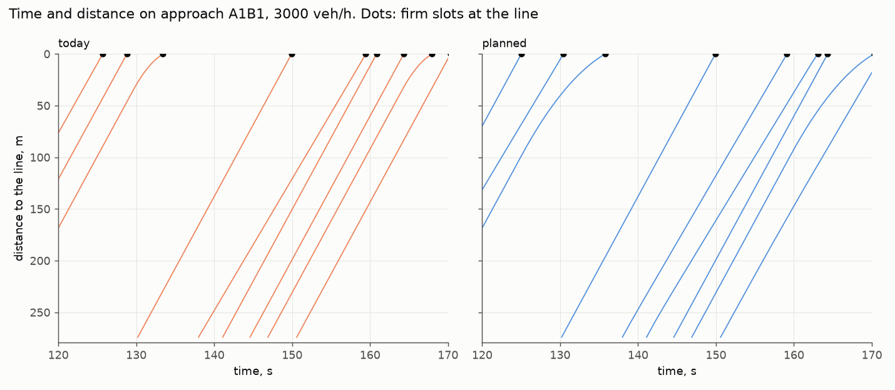

# D8: the planned approach

Follows [09c](09c-d8-gpu-build.md). Erik, after watching the clips: "They should perfectly plan, not suddenly brake in front of the intersection." The binding text is "Plan ahead, no unnecessary braking" in [AV-REQUIREMENTS](AV-REQUIREMENTS.md).

`--cj-plan off|profile|stable|full|cubic|dr` switches it, and `full` is the design. `off` is the baseline: on j2 at 5200 veh/h its flow, delay, grants, dropped grants, time lost and rms acceleration match the Job 1 binary to the last digit, on the same arrivals.

**Device:** every number here is CPU Vulkan (llvmpipe), on the homelab or the PC. The GPU lock stayed busy for three attempts of about an hour each, so there is no GPU sample on the final code. 09c measured the two devices within 1.3% on single junctions. The off column reproduces 09c's CPU capacity numbers exactly.

## What it does for braking

j2, 20% turns, 3 seeds, 600 s, same arrivals, today against planned. "Gentlest" is Erik's bound: v0 minus the lowest of average speed to the line, turn speed and v0.

| veh/h | Cars | Speed lost m/s today / planned / gentlest | Wh | Peak decel median | p99 | Braking jerk p90 | % over 1/2/3 today , planned | Slot changes p50, p90 today / planned | First firm m |
|---|---|---|---|---|---|---|---|---|---|
| 3000 | all | 3.08 / 2.22 / 1.44 | 13.1 / 9.6 / 6.7 | 4.5 / 0.5 | 4.5 / 2.0 | 71 / 5 | 79/78/76 , 5/1/0 | 0, 3 / 0, 2 | 49 / 48 |
| 3000 | straight | 1.34 / 0.86 / 0.51 | 6.3 / 4.3 / 2.7 | 4.5 / 0.1 | 4.5 / 2.0 | 45 / 5 | 75/73/71 , 5/1/0 | 0, 3 / 0, 1 | 49 / 49 |
| 3000 | turning | 11.11 / 8.53 / 5.74 | 44.5 / 33.9 / 25.4 | 4.5 / 0.9 | 4.8 / 1.7 | 71 / 2 | 100/100/100 , 5/1/0 | 0, 6 / 0, 5 | 47 / 25 |
| 5200 | all | 6.05 / 3.40 / 1.96 | 24.9 / 14.6 / 9.1 | 4.5 / 0.9 | 7.0 / 2.3 | 71 / 5 | 93/92/92 , 16/2/0 | 4, 13 / 0, 11 | 44 / 44 |
| 5200 | straight | 4.52 / 2.16 / 1.13 | 19.2 / 10.0 / 5.6 | 4.5 / 0.9 | 5.0 / 2.0 | 71 / 5 | 92/90/90 , 16/1/0 | 4, 12 / 0, 9 | 45 / 46 |
| 5200 | turning | 12.43 / 8.60 / 5.44 | 48.8 / 33.9 / 23.7 | 4.5 / 0.9 | 6.9 / 3.3 | 71 / 3 | 100/100/100 , 18/6/2 | 2, 16 / 1, 17 | 43 / 24 |

- **At 3000 veh/h:** speed thrown away falls from 3.08 to 2.22 m/s per approach, against a bound of 1.44. Energy braked away falls from 13.1 to 9.6 Wh, against 6.7. Cars over 3 m/s² fall from 76% to 0 and 2% exceed 1.5 m/s². Hard brakes fall from 1090 per run to 2.
- **At 5200 veh/h:** speed lost falls from 6.05 to 3.40 m/s against 1.96, energy from 24.9 to 14.6 Wh against 9.1, cars over 3 m/s² from 92% to 0, hard brakes from 2688 to 3.
- **Cost:** delay rises 0.5 s at 3000 veh/h (1.5 to 2.0 s). At 5200 it is unchanged (4.4 s). Flow is unchanged within 0.5%.
- **Turning cars look far from the bound, and mostly are not.** The bound uses the net's internal lane speed, 6.5 to 9.3 m/s, but the conflict table has them enter at about 5.4 m/s. Measured against the real entry speed, the bound in the seed 0 run at 3000 veh/h is 8.29 m/s and they lose 8.42. They are at the gentlest profile for the speed the table allows. Letting them enter faster needs a new table and is not done.

Braking moved upstream, but less than this suggests at low demand: at 3000 veh/h 49% of it is still in the last 50 m (71% today), mostly turning cars slowing for the corner.

| veh/h | Plan | 0-50 m | 50-100 | 100-150 | 150-200 | 200-250 | 250+ |
|---|---|---|---|---|---|---|---|
| 3000 | full | 49% | 22% | 1% | 2% | 15% | 12% |
| 3000 | off | 71% | 7% | 3% | 1% | 1% | 17% |
| 5200 | full | 33% | 14% | 6% | 7% | 26% | 14% |
| 5200 | off | 41% | 16% | 13% | 10% | 8% | 12% |

All demands, today / planned:

| net | mix | demand | Flow today / planned | Delay s | Overlaps | Speed lost today / planned / gentlest | Wh today / planned / gentlest | % over 3 m/s2 today / planned | Planned % over 1 / 1.5 / 2 | Hard brakes per run |
|---|---|---|---|---|---|---|---|---|---|---|
| j1 | M | 1000 | 960 / 963 | 1.4 / 1.9 | 0 / 0 | 3.31 / 2.34 / 1.60 | 13.5 / 9.8 / 7.3 | 69 / 0 | 5 / 2 / 0 | 380 / 0 |
| j1 | M | 2000 | 2043 / 2043 | 2.8 / 3.6 | 0 / 0 | 3.93 / 2.81 / 1.89 | 16.2 / 12.0 / 8.7 | 80 / 0 | 13 / 5 / 1 | 850 / 1 |
| j1 | M | 3000 | 2971 / 2965 | 6.6 / 8.3 | 0 / 0 | 6.75 / 3.84 / 2.23 | 26.5 / 15.4 / 9.8 | 93 / 2 | 31 / 15 / 3 | 1610 / 13 |
| j1 | T | 1000 | 957 / 957 | 0.2 / 0.2 | 0 / 0 | 0.25 / 0.07 / 0.05 | 1.4 / 0.4 / 0.3 | 51 / 0 | 0 / 0 / 0 | 63 / 0 |
| j1 | T | 2500 | 2485 / 2485 | 0.7 / 0.7 | 0 / 0 | 0.45 / 0.32 / 0.24 | 2.5 / 1.8 / 1.3 | 64 / 0 | 0 / 0 / 0 | 227 / 0 |
| j1 | T | 4000 | 3941 / 3939 | 1.5 / 1.5 | 0 / 0 | 0.86 / 0.62 / 0.48 | 4.6 / 3.4 / 2.6 | 77 / 0 | 1 / 0 / 0 | 486 / 0 |
| j2 | H | 1500 | 1469 / 1472 | 1.5 / 2.2 | 0 / 0 | 4.43 / 3.24 / 2.03 | 18.4 / 13.6 / 9.4 | 77 / 0 | 4 / 3 / 2 | 822 / 0 |
| j2 | H | 3000 | 2952 / 2957 | 2.9 / 4.3 | 0 / 0 | 5.52 / 4.04 / 2.34 | 22.8 / 16.8 / 10.7 | 86 / 1 | 16 / 10 / 5 | 1784 / 7 |
| j2 | H | 4200 | 4096 / 4120 | 8.8 / 10.6 | 0 / 0 | 9.05 / 4.86 / 2.41 | 34.4 / 18.9 / 10.4 | 95 / 3 | 35 / 21 / 5 | 3087 / 17 |
| j2 | M | 1500 | 1472 / 1472 | 1.0 / 1.4 | 0 / 0 | 2.71 / 1.91 / 1.29 | 11.3 / 8.0 / 6.0 | 70 / 1 | 2 / 2 / 1 | 524 / 1 |
| j2 | M | 3000 | 2952 / 2957 | 1.5 / 2.0 | 0 / 0 | 3.08 / 2.22 / 1.44 | 13.1 / 9.6 / 6.7 | 76 / 0 | 5 / 2 / 1 | 1090 / 2 |
| j2 | M | 4200 | 4147 / 4128 | 2.2 / 2.8 | 0 / 0 | 3.83 / 2.74 / 1.72 | 16.3 / 11.8 / 8.1 | 81 / 1 | 7 / 3 / 2 | 1704 / 8 |
| j2 | M | 5200 | 5131 / 5117 | 4.4 / 4.4 | 0 / 0 | 6.05 / 3.40 / 1.96 | 24.9 / 14.6 / 9.1 | 92 / 0 | 16 / 7 / 2 | 2688 / 3 |
| j2 | T | 1500 | 1472 / 1472 | 0.2 / 0.2 | 0 / 0 | 0.31 / 0.12 / 0.09 | 1.7 / 0.7 / 0.5 | 59 / 0 | 0 / 0 / 0 | 113 / 0 |
| j2 | T | 3000 | 2955 / 2955 | 0.4 / 0.4 | 0 / 0 | 0.39 / 0.25 / 0.19 | 2.2 / 1.4 / 1.1 | 62 / 0 | 0 / 0 / 0 | 255 / 0 |
| j2 | T | 4200 | 4131 / 4131 | 0.6 / 0.6 | 0 / 0 | 0.45 / 0.36 / 0.27 | 2.5 / 2.0 / 1.5 | 63 / 0 | 0 / 0 / 0 | 370 / 0 |
| j2 | T | 5200 | 5085 / 5088 | 0.7 / 0.8 | 0 / 0 | 0.54 / 0.45 / 0.34 | 3.0 / 2.5 / 1.9 | 69 / 0 | 0 / 0 / 0 | 508 / 0 |

## Capacity: four cells pass, three miss

Offered well above capacity, 800 s, 4 seeds. Gate: no more than 2% below today unless explained.

| Net | Mix | Seeds | Today | Planned | Change | Delay s | Overlaps | Hard brakes per run | Grants dropped per run |
|---|---|---|---|---|---|---|---|---|---|
| j1 | H | 4 | 2966 | 2889 | -2.6% | 295 / 299 | 0 / 0 | 2036 / 85 | 28 / 6 |
| j1 | M | 4 | 3728 | 3746 | +0.5% | 241 / 234 | 0 / 0 | 2457 / 86 | 24 / 3 |
| j1 | T | 4 | 5685 | 5812 | +2.2% | 84 / 80 | 0 / 0 | 2052 / 0 | 2 / 0 |
| j2 | H | 4 | 5451 | 5192 | -4.8% | 255 / 263 | 0 / 0 | 3493 / 142 | 49 / 8 |
| j2 | M | 4 | 6525 | 6652 | +2.0% | 204 / 197 | 0 / 0 | 3835 / 148 | 25 / 4 |
| j2 | T | 4 | 9926 | 10492 | +5.7% | 43 / 21 | 0 / 0 | 3086 / 32 | 0 / 4 |
| j3 | M | 4 | 8998 | 8550 | -5.0% | 199 / 205 | 0 / 0 | 4860 / 131 | 50 / 6 |

- **Passes:** j1 T +2.2%, j2 T +5.7%, j2 M +2.0%, j1 M +0.5%.
- **Misses:** j1 H −2.6%, j2 H −4.8%, j3 M −5.0%. **I cannot fully explain these three.** Two have the most left turns; j3 is the only 3-lane cell. Removing the exit-room rule below makes them worse, and neither a looser fixed order nor firmer braking recovered them in shorter runs. My untested guess is that the fast-behind-slow-turner headway bites most where turners are most common.
- **Zero overlaps in all 56 runs,** and grants dropped fall from about 25 per run to about 5.
- **On report 08's realistic channel,** 2 seeds: j2 T +5.7%, j2 M −1.2%, j1 M −1.5%, j3 M −6.8%, j2 H −7.8%, zero overlaps. Level A takes a wider margin there (rule 6 below).
- **Below saturation none of this shows.** At 5200 veh/h and below, flow is the same.

Capacity by factor, same runs. `dr` drops no grants at all, and it costs a lot on 2 and 3 lanes:

| Net | Mix | Today | `full` | `stable`, no follower factor | `dr` |
|---|---|---|---|---|---|
| j1 | T | 5685 | 5812 (+2.2%) | 5810 (+2.2%) | 5752 (+1.2%) |
| j1 | M | 3728 | 3746 (+0.5%) | 3622 (-2.8%) | 3741 (+0.4%) |
| j1 | H | 2966 | 2889 (-2.6%) | 2876 (-3.0%) | 2958 (-0.3%) |
| j2 | T | 9926 | 10492 (+5.7%) | 9912 (-0.1%) | 9633 (-2.9%) |
| j2 | M | 6525 | 6652 (+2.0%) | 6502 (-0.3%) | 6220 (-4.7%) |
| j2 | H | 5451 | 5192 (-4.8%) | 5102 (-6.4%) | 4892 (-10.3%) |
| j3 | M | 8998 | 8550 (-5.0%) | 8572 (-4.7%) | 7012 (-22.1%) |

## How close to a millisecond

**The message and the clock carry 1 ms. The physics does not reach it.** A slot is whole milliseconds since the start in a `u32`, compared by wrapped subtraction, because f32 seconds has only 8 ms of resolution at 86,400 s. Line crossing is computed exactly from the ballistic update, not rounded to the 100 ms step.

| Case, 3000 veh/h, 2 seeds | Mean arrival error | Within 1 ms | 5 ms | 20 ms | 100 ms |
|---|---|---|---|---|---|
| Perfect position and clock | 1 ms | 72% | 91% | 99% | 100% |
| 0.1 m position error | 8 ms | 9% | 37% | 91% | 100% |
| 0.3 m | 25 ms | 3% | 13% | 53% | 98% |
| 1 m | 90 ms | 1% | 5% | 15% | 72% |
| 1 ms clock error | 2 ms | 54% | 90% | 99% | 100% |
| 10 ms clock | 7 ms | 24% | 48% | 95% | 100% |
| 50 ms clock | 33 ms | 20% | 26% | 43% | 98% |
| 100 ms clock | 68 ms | 17% | 19% | 31% | 69% |

- **With perfect position and clock:** 72% of cars arrive within 1 ms of their slot and 99% within 20 ms. At saturation it is 19% and 81%, because cars there are often limited by the engine.
- **Position error dominates:** 0.3 m gives 25 ms, which matches Erik's 0.3 m at 50 km/h being 21 ms.
- **So tens of milliseconds is the honest figure with today's positioning.** A true 1 ms slot needs about 1 cm of position error at this speed.
- **Against today,** 3 seeds: at 3000 veh/h mean error goes from 10 to 1 ms and within-1-ms from 52% to 72%. At 5200 it goes from 16 to 3 ms and from 28% to 46%. Big misses at 5200: 15 of 1911 today, 0 of 1915 planned.

What tighter timing buys, j2 M, 2 seeds:

| Margin m_t | Saturated flow | Overlaps | Flow with 0.3 m position error | Overlaps | Overlaps at 3000 veh/h |
|---|---|---|---|---|---|
| 0.3 s | 6449 | 0 | 6573 | 0 | 0 |
| 0.2 s | 6711 | 0 | 6696 | 0 | 0 |
| 0.1 s | 7025 | 0 | 6938 | 1 | 0 |
| 0.05 s | 7066 | 0 | 7123 | 1 | 1 |
| 0.02 s | 7251 | 2 | 7298 | 1 | 1 |
| 0.0 s | 7437 | 4 | 7344 | 9 | 0 |

- **0.3 s down to 0.2 s buys 4.1%** (6449 to 6711) with no contact in these runs.
- **0.1 s and 0.05 s buy 8.9% and 9.6%, but contact begins there.** One overlap at 0.1 s with position error, one at 0.05 s at 3000 veh/h. Below that they rise quickly, 9 at 0 s with position error. The extra flow from 0.1 s to 0 is small against that.
- **I would use 0.2 s at most without far more seeds.** If that 4% carries over to the three cells that miss the gate, they would come close to it or pass, but I measured the margin only on j2 M.
- **At 1 m position error and the default margin, contacts appear:** 1 at 3000 veh/h and 1 at saturation, with 100 to 200 big misses. The error is then larger than the margin. This is a limit of the design, not a tuning issue.

## What was built, and what I invented

**A. Broadcast and horizon.** Every car sends its expected arrival once a second from as far as report 08's channel reaches (R50, 470 m), and gets a slot as soon as it is heard. Billed as report 12 maps it: CAM Path Prediction, 262 B on air up, 180 B per slot message down. That comes to about 5.0 kB up and 3.8 kB down per car per approach at 3000 veh/h, 5.7 and 4.6 kB at 5200.

**Departure from the standard:** the [CDD](https://forge.etsi.org/rep/ITS/asn1/cdd_ts102894_2/-/blob/release2/ETSI-ITS-CDD.asn) gives Path Prediction points a `PathDeltaTimeChoice` whose best precision is 0.1 s. 1 ms does not fit. It needs a new field, proposed here as junction plus `TimestampIts`, about 12 B more per message, not included in the billing above.

**B. Schedule.** Each tick, cars within 5 s of their slot keep their order. Further out every car takes the earliest slot it can, the baseline's list rule. A slot that could move earlier by under 0.5 s stays put. Firm stays at 4 s. Moving a slot 2 s at 250 m changes speed only slightly, so far-out changes are cheap. This fixed near zone is my own design, tested here.

"A slot moves only for a reason" is met at 3000 veh/h (changes per car: median 0, 90th percentile 2) and only partly at 5200 (median 0 against 4 today, 90th percentile 11 against 13). The plan mostly tolerates far-out churn rather than removing it.

**Dynamic resequencing (Xu et al. 2020, [2010.03148](https://arxiv.org/abs/2010.03148)) is `--cj-plan dr`.** Order stays and each new car goes where the sum of arrival times is least. It brakes least of all (2.94 m/s at 5200) and drops no grants, but it loses 22% at j3 M saturation. A car that has slowed for its slot has no slack left, so the order set at assignment sticks. For light traffic it is arguably the better scheduler. I did not try a mix of the two.

**C. Speed profile. Not the published optimum by default.**

- **Malikopoulos, Cassandras and Zhang 2018 ([1602.03786](https://arxiv.org/abs/1602.03786))** is `--cj-plan cubic`: acceleration linear in time. Their terminal condition is free end speed with zero final acceleration. The conflict table needs a fixed end speed, which is a departure, and with it the arc dips 1.5 times as far below the start speed as a steady cruise does. It loses on Erik's metric (4.20 against 3.40 m/s at 5200) and on saturation flow (5722 against 6624).
- **Default, mine, tested here:** slow once at 0.9 m/s², hold the speed that arrives on time, ramp to class speed in the last metres at 0.8 of the engine. Only the final ramp uses their exact arc, which hits both time and speed. Re-solved every step, as their eq. 33 allows.
- **Limits:** 0.9 m/s² planned and 2.0 as the advice limit, from report 11's operating braking of about 2 m/s². Jerk 2 m/s³ braking, 5 near a firm slot and accelerating. Report 11 cites 1.0 m/s² with jerk 0.3 as comfortable and 2.5 with 1.7 as not, so these are looser than its comfort evidence, and I did not sweep them. A car with a long total wait (over 8 s, full by 16 s) brakes firmer and later, so it can still take an earlier slot.

**D. Followers.** A car plans behind its leader's broadcast motion over the next 1, 2 and 4 s: the speed the leader will cruise at, its ramp, and a leader in the box speeding up after the corner. Firm and in-box cars rely on the headway table and the hard safe-speed limit, as today.

This factor only pays if the prediction is right. Predicting the leader on the cubic arc, or holding its current speed, cost up to 20% on j2 T. Predicting the speed it will really cruise at gives 5.8 points more than no follower factor on j2 T and 2.3 points more on j2 M.

**E. Safety.** Stop curve without a firm grant, sensing brake, point-of-no-return recheck and auditor stay. Hard terms are applied after the comfort and jerk limits and are never limited by them. **A far-out slot promises nothing about safety.** It is non-binding until firm, the car stays on its stop curve until then, and a lost slot message leaves it with an old plan and the same stop curve. The point of no return now forces braking 0.3 times per run at 3000 veh/h (3 today) and 0.7 at 5200 (10.7 today).

Six rules are mine, not from any source:

1. **Exit room in the table:** a fast car behind a slow turner on the same exit gets a headway long enough that the point of no return will pass it, plus 0.4 s. Without it, about 1 grant in 5 was dropped in an early build. Without the 0.4 s, dropped grants on three saturated cells were ten times as many (101 against 10, 2 seeds), and the case I traced failed by half a metre.
2. **Class by clearing time:** each car takes the class speed that clears the box soonest rather than the fastest feasible.
3. **Waiting needs room:** a slot must be reachable at 0.9 of the engine and 0.8 of plan braking, so nobody is scheduled at their limits.
4. **Late check:** a firm car short of its class speed is judged by whether it can still arrive on time flat out.
5. **Sensing clear time:** a foe speeding up out of a slow turn is projected with its acceleration, which removes false alarms that caused the lateness they feared. Planned mode only.
6. **Slow crossing margin:** a slip in position costs more time the slower the car. Level B always takes 1/v seconds. Level A takes 0.5/v on a lossy channel, 1/v from 30% loss, and none on a lossless one. In the simulator "lossy" is read from the config; a real car has to estimate it, which is not modelled. Always on at Level A it cost up to 7 points of capacity.

**The three causes in the brief:**

1. **Bang-bang execution: confirmed.** Braking jerk p90 falls from 71 to 5 m/s³. Fixing it alone is not enough (`profile` below): a gentle car on a plan rebuilt every tick still misses slots, 5 overlaps at saturation.
2. **Firm grant 40 to 50 m out, at a time differing from the advice: half right.** Firm distance is still 48 m at 3000 veh/h. It stopped mattering because the time rarely changes at that point. Much of the late surprise came from the exit rule above, which I did not expect.
3. **Plan rebuilt every 0.5 s: partly.** Rebuilding far out is cheap and capacity needs it. Rebuilding near the line is what hurts.

Hard brakes are counted by cause, and braking past 2.5 m/s² is what counts. Per 600 s run at 5200 veh/h: plan 2.3, stop curve 0.7, leader 0.3. At saturation about 130 per run, mostly cars whose slot moved late or that lost one.

## Ablation

Same arrivals, 3 seeds. 11000 is saturated, 500 s.

| veh/h | Factor | Flow | Delay s | Overlaps | Hard brakes | Dropped | Speed lost | % over 3 | Slot changes p50 |
|---|---|---|---|---|---|---|---|---|---|
| 3000 | off | 2952 | 1.5 | 0 | 1090 | 5 | 3.08 | 76 | 0 |
| 3000 | profile | 2952 | 2.1 | 0 | 62 | 1 | 2.63 | 16 | 2 |
| 3000 | stable | 2957 | 2.0 | 0 | 2 | 0 | 2.22 | 0 | 0 |
| 3000 | full | 2957 | 2.0 | 0 | 2 | 0 | 2.22 | 0 | 0 |
| 3000 | cubic | 2957 | 2.1 | 0 | 0 | 0 | 2.41 | 0 | 0 |
| 3000 | dr | 2957 | 2.0 | 0 | 4 | 1 | 2.18 | 1 | 0 |
| 5200 | off | 5131 | 4.4 | 0 | 2688 | 18 | 6.05 | 92 | 4 |
| 5200 | profile | 5117 | 6.0 | 0 | 115 | 2 | 5.26 | 16 | 8 |
| 5200 | stable | 5123 | 4.4 | 0 | 5 | 2 | 3.58 | 1 | 0 |
| 5200 | full | 5117 | 4.4 | 0 | 3 | 1 | 3.40 | 0 | 0 |
| 5200 | cubic | 5112 | 5.1 | 0 | 7 | 0 | 4.20 | 1 | 2 |
| 5200 | dr | 5093 | 4.7 | 0 | 1 | 0 | 2.94 | 0 | 1 |
| 11000 | off | 6357 | 134.8 | 0 | 2181 | 18 |  |  |  |
| 11000 | profile | 6168 | 137.1 | 5 | 285 | 6 |  |  |  |
| 11000 | stable | 6518 | 128.6 | 0 | 78 | 3 |  |  |  |
| 11000 | full | 6624 | 126.9 | 0 | 82 | 2 |  |  |  |
| 11000 | cubic | 5722 | 144.5 | 0 | 66 | 2 |  |  |  |
| 11000 | dr | 6357 | 135.3 | 0 | 0 | 0 |  |  |  |

## Faults

Single junction, j2, 800 s.

| veh/h | Fault | Flow today / planned | Delay s | Overlaps | Hard brakes | Dropped |
|---|---|---|---|---|---|---|
| 3000 | blackout10.0 | 3042 / 3054 | 1.8 / 2.8 | 0 / 0 | 1464 / 10 | 7 / 3 |
| 3000 | blackout2.0 | 3042 / 3054 | 1.7 / 2.2 | 0 / 0 | 1446 / 0 | 7 / 0 |
| 3000 | blackout30.0 | 3042 / 3054 | 2.7 / 3.6 | 0 / 0 | 1779 / 11 | 9 / 2 |
| 3000 | channel08 | 3042 / 3054 | 1.7 / 2.2 | 0 / 0 | 1439 / 0 | 7 / 0 |
| 3000 | crash_awsc | 3042 / 3054 | 4.4 / 5.5 | 0 / 0 | 1505 / 8 | 7 / 2 |
| 3000 | crash_none | 3042 / 3054 | 5.6 / 6.5 | 0 / 0 | 1519 / 11 | 7 / 1 |
| 3000 | exit_block_chkFalse | 2652 / 2658 | 49.6 / 57.2 | 17 / 39 | 2102 / 112 | 114 / 113 |
| 3000 | exit_block_chkTrue | 3000 / 2634 | 42.8 / 58.6 | 0 / 0 | 2518 / 84 | 15 / 8 |
| 3000 | exit_cap_chkFalse | 2736 / 2742 | 36.1 / 38.8 | 0 / 0 | 1512 / 83 | 0 / 0 |
| 3000 | exit_cap_chkTrue | 2730 / 2730 | 36.3 / 39.0 | 0 / 0 | 1643 / 94 | 5 / 1 |
| 3000 | loss0.0 | 3042 / 3054 | 1.7 / 2.1 | 0 / 0 | 1446 / 0 | 7 / 0 |
| 3000 | loss0.1 | 3054 / 3054 | 1.7 / 2.2 | 0 / 0 | 1445 / 4 | 5 / 0 |
| 3000 | loss0.3 | 3048 / 3054 | 1.9 / 2.6 | 0 / 0 | 1496 / 17 | 10 / 0 |
| 3000 | loss0.5 | 3042 / 3048 | 2.3 / 7.0 | 0 / 0 | 1663 / 92 | 18 / 11 |
| 3000 | loss0.7 | 3054 / 2646 | 6.0 / 73.7 | 0 / 0 | 3027 / 162 | 65 / 38 |
| 3000 | loss0.9 | 1530 / 1446 | 266.1 / 294.0 | 0 / 0 | 2699 / 102 | 287 / 80 |
| 3000 | loss1.0 | 552 / 522 | 432.9 / 433.1 | 0 / 0 | 599 / 0 | 0 / 0 |
| 3000 | radio_off | 1530 / 1530 | 107.2 / 107.2 | 0 / 0 | 1963 / 0 | 2 / 0 |
| 3000 | stallA | 2874 / 2688 | 8.6 / 19.7 | 3 / 10 | 1818 / 104 | 36 / 46 |
| 3000 | stallB | 2844 / 2626 | 12.9 / 27.1 | 0 / 0 | 2020 / 97 | 41 / 49 |
| 5000 | blackout10.0 | 4914 / 4926 | 5.7 / 7.1 | 0 / 0 | 3614 / 31 | 19 / 5 |
| 5000 | blackout2.0 | 4914 / 4926 | 4.7 / 5.6 | 0 / 0 | 3260 / 17 | 12 / 5 |
| 5000 | blackout30.0 | 4914 / 4926 | 8.6 / 12.8 | 0 / 0 | 3964 / 45 | 17 / 7 |
| 5000 | channel08 | 4896 / 4926 | 4.2 / 5.7 | 0 / 0 | 3295 / 22 | 9 / 6 |
| 5000 | crash_awsc | 4914 / 4926 | 18.0 / 20.5 | 0 / 0 | 3267 / 65 | 16 / 7 |
| 5000 | crash_none | 4914 / 4926 | 21.3 / 20.1 | 0 / 0 | 3433 / 62 | 19 / 2 |
| 5000 | loss0.0 | 4914 / 4926 | 4.3 / 4.5 | 0 / 0 | 3120 / 3 | 11 / 2 |
| 5000 | loss0.1 | 4902 / 4938 | 5.4 / 6.4 | 0 / 0 | 3681 / 24 | 27 / 3 |
| 5000 | loss0.3 | 4902 / 4956 | 4.6 / 8.8 | 0 / 0 | 3342 / 40 | 16 / 6 |
| 5000 | loss0.5 | 4950 / 4608 | 7.9 / 36.9 | 0 / 0 | 4610 / 153 | 30 / 10 |
| 5000 | loss0.7 | 4548 / 3234 | 54.2 / 201.1 | 0 / 0 | 5087 / 180 | 82 / 49 |
| 5000 | loss0.9 | 1458 / 1332 | 372.7 / 385.6 | 0 / 0 | 2485 / 118 | 272 / 81 |
| 5000 | loss1.0 | 558 / 528 | 465.1 / 466.0 | 0 / 0 | 539 / 0 | 0 / 0 |
| 5000 | radio_off | 2196 / 2166 | 134.2 / 136.9 | 0 / 0 | 2182 / 17 | 8 / 2 |
| 5000 | stallA | 4012 / 3634 | 39.4 / 57.8 | 10 / 9 | 3343 / 125 | 67 / 65 |
| 5000 | stallB | 3652 / 3174 | 80.0 / 117.5 | 0 / 0 | 2593 / 141 | 71 / 51 |

**Overlap gate.** Zero in every loss, blackout, crash and radio-off run, in both exit faults with the check on, and in all Level B stalls. Two classes are not zero, and neither is zero today:

- **Level A stalls:** 10 and 9, against 3 and 10 today. Level A does not promise this; Level B does, and holds.
- **Exit check switched off:** 39 against 17. This case exists to show why the check is there.

**Worse than today:**

- **Heavy message loss.** At 5000 veh/h and 50% loss: flow 4608 against 4950, delay 37 against 8 s. At 70%: 3234 against 4548, delay 201 against 54 s. Part of this is an unequal comparison, because planning also loses uplink messages and today's model has no uplink to lose, so an unheard car waits. Up to 30% loss planning stays ahead on braking. At 50% it loses on braking too (5200 veh/h: 15.1 against 10.3 m/s).
- **Exit block at 3000 veh/h:** 2634 against 3000. Not investigated.
- **Stalls:** flow lower by 6 to 13%, delay about double at 3000 veh/h.

**Liveness bug found and fixed:** at 100% loss, planning first delivered flow 0, because cars never heard were never listed where the sensing fallback looks. That broke "never relies on a message arriving". Now 522 against 552 today.

Message loss, 600 s, 2 seeds:

| veh/h | Loss | Flow today / planned | Delay s | Overlaps | Speed lost | % over 3 | Bytes up per car |
|---|---|---|---|---|---|---|---|
| 3000 | 0.0 | 2944 / 2944 | 1.6 / 2.1 | 0 / 0 | 3.37 / 2.39 | 77 / 0 | 5000 |
| 3000 | 0.05 | 2944 / 2944 | 1.6 / 2.2 | 0 / 0 | 3.38 / 2.43 | 77 / 0 | 5030 |
| 3000 | 0.1 | 2944 / 2944 | 1.6 / 2.2 | 0 / 0 | 3.45 / 2.52 | 77 / 1 | 5043 |
| 3000 | 0.2 | 2940 / 2944 | 1.7 / 2.3 | 0 / 0 | 3.67 / 2.62 | 79 / 1 | 5066 |
| 3000 | 0.3 | 2940 / 2944 | 1.9 / 2.8 | 0 / 0 | 3.94 / 3.28 | 80 / 4 | 5196 |
| 3000 | 0.5 | 2932 / 2956 | 2.3 / 6.3 | 0 / 0 | 5.04 / 6.57 | 84 / 10 | 6034 |
| 5200 | 0.0 | 5156 / 5140 | 4.9 / 4.7 | 0 / 0 | 6.38 / 3.50 | 92 / 0 | 5751 |
| 5200 | 0.05 | 5140 / 5136 | 5.0 / 5.8 | 0 / 0 | 6.35 / 4.30 | 92 / 1 | 6031 |
| 5200 | 0.1 | 5120 / 5136 | 5.8 / 6.0 | 0 / 0 | 6.91 / 4.28 | 92 / 1 | 6083 |
| 5200 | 0.2 | 5160 / 5084 | 5.6 / 6.9 | 0 / 0 | 6.94 / 5.28 | 94 / 3 | 6308 |
| 5200 | 0.3 | 5104 / 5100 | 6.7 / 11.6 | 0 / 0 | 7.98 / 7.67 | 94 / 7 | 7487 |
| 5200 | 0.5 | 5136 / 4464 | 8.3 / 52.0 | 0 / 0 | 10.28 / 15.07 | 97 / 13 | 18335 |

## Approach length

| Approach m | veh/h | Flow today / planned | Delay s | Overlaps | Speed lost today / planned / gentlest | % over 3 today / planned | Planned % over 1.5 | Hard brakes |
|---|---|---|---|---|---|---|---|---|
| 150 | 3000 | 2979 / 2984 | 1.5 / 2.0 | 0 / 0 | 3.22 / 2.59 / 1.60 | 77 / 0 | 3 | 1080 / 2 |
| 150 | 5200 | 5099 / 5101 | 3.8 / 4.3 | 0 / 0 | 4.94 / 3.90 / 2.07 | 87 / 1 | 10 | 2304 / 7 |
| 150 | 11000 | 6722 / 6886 | 124.0 / 120.3 | 0 / 0 |  |  |  | 2239 / 73 |
| 280 | 3000 | 2952 / 2957 | 1.5 / 2.0 | 0 / 0 | 3.04 / 2.30 / 1.47 | 76 / 1 | 3 | 1101 / 4 |
| 280 | 5200 | 5109 / 5096 | 4.5 / 4.9 | 0 / 0 | 5.90 / 3.91 / 2.10 | 91 / 2 | 11 | 2647 / 17 |
| 280 | 11000 | 6295 / 6547 | 133.5 / 129.1 | 0 / 0 |  |  |  | 2298 / 82 |
| 500 | 3000 | 2949 / 2949 | 1.5 / 2.0 | 0 / 0 | 3.12 / 2.11 / 1.36 | 75 / 0 | 3 | 1102 / 2 |
| 500 | 5200 | 5104 / 5117 | 4.5 / 5.2 | 0 / 0 | 5.96 / 3.99 / 2.03 | 91 / 1 | 10 | 2642 / 13 |
| 500 | 11000 | 6562 / 6603 | 129.2 / 125.7 | 0 / 0 |  |  |  | 2680 / 84 |
| 1000 | 3000 | 2944 / 2941 | 1.6 / 1.9 | 0 / 0 | 2.87 / 2.07 / 1.23 | 71 / 0 | 2 | 1090 / 3 |
| 1000 | 5200 | 5128 / 5048 | 4.3 / 6.7 | 0 / 0 | 5.59 / 5.51 / 1.93 | 91 / 3 | 17 | 2597 / 26 |
| 1000 | 11000 | 6557 / 6634 | 113.7 / 111.7 | 0 / 0 |  |  |  | 3370 / 80 |

- **Longer helps at 3000 veh/h:** speed lost goes from 2.59 m/s at 150 m to 2.07 at 1000 m, against bounds that also fall. Saturated flow is within ±4% of today at every length.
- **1000 m at 5200 veh/h gains almost nothing:** 5.51 against 5.59 m/s, and delay is worse, 6.7 against 4.3 s, with flow 5048 against 5128. The radio reaches 470 m, so the first 530 m is unplanned, and I did not establish why that costs this much. 280 m and 500 m gain far more on the same demand.

## The two failures, with planning on

### Saturated grid: better, not fixed

| Net | veh/h | Flow today / planned | Delay s | Overlaps, 3 seeds | Hard brakes |
|---|---|---|---|---|---|
| grid1 | 4000 | 4013 / 4011 | 4.4 / 6.2 | 0 / 0 | 4615 / 13 |
| grid1 | 9000 | 8896 / 8864 | 19.9 / 20.9 | 0 / 1 | 14089 / 262 |
| grid1 | 14000 | 9483 / 8627 | 121.9 / 135.4 | 26 / 5 | 17868 / 1365 |
| grid2 | 8000 | 7891 / 7909 | 2.9 / 4.1 | 0 / 0 | 6197 / 19 |
| grid2 | 16000 | 15893 / 15883 | 10.5 / 12.9 | 2 / 1 | 17848 / 305 |
| grid2 | 20000 | 17392 / 18141 | 48.7 / 41.7 | 40 / 12 | 29812 / 1390 |
| grid2 | 24000 | 15803 / 12339 | 111.8 / 135.7 | 57 / 11 | 28522 / 1958 |

- **Overlaps fall a lot:** 57 to 11 at 24,000 veh/h, 40 to 12 at 20,000, 26 to 5 at 14,000. **They do not reach zero.**
- **Flow:** better at 20,000 (18,141 against 17,392). Worse past that: 12,339 against 15,803 at 24,000 and 8,627 against 9,483 at 14,000.
- **Below saturation** it is as good, with hard brakes down about 50 to 350 times, though not free of contacts (1 at 9,000 and at 16,000).
- **Blocks here are 280 m, so short blocks are not the reason.** The remaining cause looks like spillback between junctions, which one junction's schedule cannot see. I did not build planning across junctions.

Entry metering from 09c still keeps overlaps low if it holds hard enough. Planning is 1 to 3% lower in flow than metering alone, with hard brakes down about 60 to 100 times:

| Net | veh/h | Held at | Flow today / planned | Delay s | Overlaps, 3 seeds | Hard brakes |
|---|---|---|---|---|---|---|
| grid1 | 14000 | 140 | 8765 / 8645 | 138.9 / 143.0 | 0 / 0 | 13241 / 154 |
| grid2 | 24000 | 200 | 14739 / 14307 | 142.0 / 149.0 | 0 / 1 | 15271 / 154 |
| grid2 | 24000 | 240 | 16419 / 15915 | 116.5 / 124.6 | 3 / 6 | 19092 / 303 |

### Stockholm district: not fixed

| Place | veh/h | Real signals | Free, today | Free, planned | Time lost s signals / today / planned | Overlaps today / planned, 2 seeds | Collisions | Coordinated |
|---|---|---|---|---|---|---|---|---|
| district | 1500 | 1404 | 1437 | 1432 | 50 / 41 / 42 | 0 / 0 | 0 / 0 | 44 of 108 |
| district | 3000 | 2515 | 2517 | 2330 | 55 / 51 / 52 | 0 / 2 | 0 / 1 | 44 of 108 |
| district | 5000 | 2263 | 2289 | 2577 | 68 / 64 / 70 | 0 / 0 | 0 / 0 | 44 of 108 |
| district | 8000 | 2672 | 1846 | 2263 | 86 / 40 / 58 | 0 / 0 | 0 / 0 | 44 of 108 |
| district_joined | 1500 | 1450 | 1473 | 1455 | 51 / 33 / 35 | 0 / 0 | 0 / 0 | 54 of 91 |
| district_joined | 3000 | 2559 | 2710 | 2461 | 67 / 41 / 47 | 1 / 1 | 0 / 0 | 54 of 91 |
| district_joined | 5000 | 3266 | 3217 | 2093 | 86 / 62 / 55 | 1 / 1 | 0 / 0 | 54 of 91 |
| district_joined | 8000 | 2888 | 2492 | 2142 | 100 / 73 / 59 | 1 / 1 | 0 / 0 | 54 of 91 |
| junction | 800 | 807 | 810 | 807 | 26 / 18 / 18 | 0 / 0 | 0 / 0 | 1 of 1 |
| junction | 1500 | 1471 | 1491 | 1497 | 39 / 26 / 26 | 0 / 0 | 0 / 0 | 1 of 1 |
| junction | 2500 | 2242 | 2348 | 2358 | 63 / 41 / 39 | 0 / 0 | 0 / 0 | 1 of 1 |
| junction | 4000 | 2196 | 3088 | 2307 | 113 / 69 / 113 | 0 / 0 | 0 / 0 | 1 of 1 |

- **Original net:** planning helps at 5000 veh/h (2577 against 2289, real signals 2263) and 8000 (2263 against 1846, signals 2672), and loses at 3000 (2330 against 2517). 64 of 108 junctions are still refused for short lanes.
- **Chained nodes merged by netconvert (`--junctions.join`, 25 m):** 54 of 91 coordinated. This helps today's control a lot: 2492 against 1846 at 8000, and level with signals at 5000. **Planning makes this net worse:** 2093 against 3217 at 5000.
- **Sveavägen×Apelbergsgatan alone:** planning matches today up to 2500 veh/h, then 2307 against 3088 at 4000 (signals 2196).
- **Contacts with planning:** 2 overlaps at district 3000 veh/h where today has 0, and one collision count, on a build shortly before the final one traced as a car leaving a box at 1.3 m/s touching a car already on that exit lane. Merged nets show overlaps with and without planning.
- **One fix tried:** broadcasting immediately on entering a lane, on the theory that up to a second unheard hurts on a 30 m lane. It changed nothing (2160 against 2139) and is not in the code.
- **Planning across consecutive junctions, which the brief asked for if blocks are too short, is not built.** Do not turn `--cj-plan` on for a city net yet. It is per run, not per junction.

## Compute

j2 M saturated, one CPU thread, no trace: 5.5 ms per step today, 7.0 planned, 26% more. Not measured on the GPU.

## Clips

In `/home/erikf/projects/personal/cars-data/videos/gallery/d8/plan/`, rendered on CPU Vulkan. I checked frames of each.

- `versus_3000.mp4`, `versus_5200.mp4`: side by side, same arrivals, 60 s, the whole east-west approach. Colour is speed. Brake lights red over 1 m/s², bright over 2.5. Running totals of stops, hard brakes, speed thrown away and Wh.
- `close_3000.mp4`: the same, close up.
- `arrivals_3000.mp4`: each car's broadcast arrival to the millisecond beside it, and the slot chart filling up 30 s ahead.

Scripts: `scripts/d8/brake.py` (metric, generalising `brake_orig/`), `plan_runs.py`, `plan_tables.py`, `plan_figs.py`, `film_plan.py`. All tables: [tables.md](fig/d8/plan/tables.md).

## Proven

- Braking far nearer the gentlest profile at every demand on single junctions, on 1 and 2 lanes and all turn mixes. Hard brakes down 100 to 1000 times below saturation, with no flow loss.
- Saturated capacity within the gate in four of seven cells, ahead of today in all four.
- Zero overlaps on single junctions in all 56 capacity runs, all demand runs, and all loss, blackout, crash and Level B stall runs.
- 1 ms in message and clock, and 72% of cars within 1 ms of their slot with perfect sensing at 3000 veh/h.
- `off` unchanged to the last digit, `golden.py` ALL OK.

## Failed

- **Capacity gate, three cells:** j1 H −2.6%, j2 H −4.8%, j3 M −5.0%, not fully explained. A margin of 0.2 s bought about 4% on j2 M, but I did not run those cells with it.
- **Saturated grid:** overlaps down by 70 to 80% but not gone, and flow worse than today past 20,000 veh/h.
- **Stockholm:** worse than today on merged nodes and at the saturated real junction. Planning across junctions not built.
- **Heavy message loss:** past about 30% loss planning is worse than today.
- **1000 m approach at 5200 veh/h:** no real gain, and more delay.
- **Slot stability at 5200 veh/h:** the far part of the schedule still churns.
- **The published cubic profile lost,** and dynamic resequencing lost at saturation. That may be my implementation or this model's fixed class speeds, not a finding about those methods.
- **Yu et al. 2019:** still not read; the search found no copy.
- **No GPU numbers on the final code.**

## Unmodelled

- A real estimate of channel loss; the Level A margin reads the config.
- The 1 ms field is proposed, not in any standard, and not billed.
- Position and clock error are constant per car. Real GNSS error drifts and correlates between cars.
- Humans, pedestrians and cyclists in the planned tier.
- Energy is kinetic energy braked away at 1500 kg, not the physics layer's model, and no regeneration credit.
- Jerk limits not swept.
- Planning across consecutive junctions, and switching it per junction.
