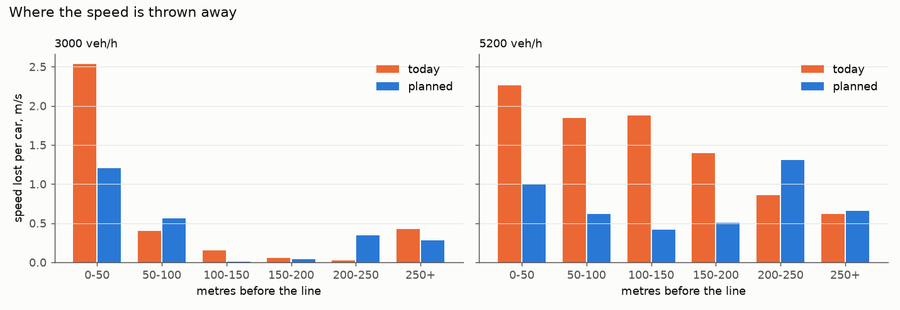

# D9, first step: capacity gate, heavy loss, planning across junctions

Follows [09d](09d-planned-approach.md). `--cj-plan route` is now the design; `off` stays the D8 baseline. Tables come from `scripts/d8/plan_tables.py` and are all in [tables.md](fig/d8/plan/tables.md). The 09d result files moved to `fig/d8/plan/09d/`.

**Device:** every number here is CPU Vulkan: llvmpipe on the PC, lavapipe on the homelab. There is no GPU number in this report. Erik's `plan-gpu-check` is separate.

**Code:** all sweeps ran one binary, built from commit 2c14738. After them I only moved a stats box in the clip overlay (rendering, not simulation). Main brought in one change, to `scripts/report/build.py`. The two machines agree: j2 H and j3 M on the same seeds give the same change against today on both.

## Result

| Item | Asked for | Result |
|---|---|---|
| Capacity gate | j1 H -2.6%, j2 H -4.8%, j3 M -5.0% within 2% | j1 H +1.0% and j3 M -1.4% pass. **j2 H -4.2% still misses**, -1.6% at margin 0.2 on the same 4 seeds but -3.1% on 6 |
| Turning speed | Raise entry speed toward the map's 6.5 to 9.3 m/s | **Not safe.** Corner at map speed peaks at 8.6 to 10.4 m/s². I capped the peak and let cars speed up after the apex instead |
| Margin 0.2 s | Trust it, with position error | As safe as 0.3 s up to 0.3 m position error, worse at 1 m (6 contacts against 2). Default stays 0.3 s |
| Heavy loss | Fall back toward today's horizon, no config read | Done. 70% loss: 4,236 against 4,350 (-2.6%, 4 seeds), was 3,234 against 4,548 |
| Plan across junctions | A plan held along the route, zero contacts on the saturated grid | **Partly built, requirement not met.** One-hop storage credit. 3 contacts in 42 runs against 265 today |
| Stockholm | Re-test on new nets and demand | "Worse than signals" no longer holds for today's control. Route costs time |
| Fact check | Two errors | Fixed in 239c9e3 |

## 1. Capacity gate

Offered well above capacity, 800 s, 4 seeds, today and route on the same arrivals. Gate: no more than 2% below today unless explained.

| Net | Mix | Seeds | Today | Planned | Change | Delay s | Overlaps | Hard brakes per run | Grants dropped per run |
|---|---|---|---|---|---|---|---|---|---|
| j1 | H | 4 | 2966 | 2994 | +1.0% | 295 / 292 | 0 / 0 | 2036 / 89 | 28 / 2 |
| j1 | M | 4 | 3728 | 3754 | +0.7% | 241 / 232 | 0 / 0 | 2457 / 86 | 24 / 2 |
| j1 | T | 4 | 5685 | 5816 | +2.3% | 84 / 80 | 0 / 0 | 2052 / 0 | 2 / 0 |
| j2 | H | 4 | 5451 | 5223 | -4.2% | 255 / 262 | 0 / 0 | 3493 / 140 | 49 / 3 |
| j2 | M | 4 | 6525 | 6632 | +1.6% | 204 / 194 | 0 / 0 | 3835 / 140 | 25 / 1 |
| j2 | T | 4 | 9926 | 10532 | +6.1% | 43 / 21 | 0 / 0 | 3086 / 46 | 0 / 3 |
| j3 | M | 4 | 8998 | 8871 | -1.4% | 199 / 197 | 0 / 0 | 4860 / 164 | 50 / 10 |

### Why the corner speed cannot go to the map limit

My lead in 09d was that the conflict table has turning cars enter at about 5.4 m/s where the map allows 6.5 to 9.3. I measured curvature over a 10 m chord along each link. The table is not simply timid:

| Turn | Radius | Table speed, peak lateral | Map speed, peak lateral |
|---|---|---|---|
| Right | 4.9 m | 4.39 m/s, 3.9 m/s² | 6.51 m/s, 8.6 m/s² |
| Left | 6.6 to 10.3 m | 5.4 to 7.0 m/s, 4.4 to 4.7 m/s² | 8 to 10.4 m/s, 9.8 to 10.4 m/s² |

Our own physics spec ([11](11-vehicle-physics.md), I9) has a hard limit of 4.37 m/s² on dry road and p99.9 at 4.0. Dry grip is about 8.6 m/s². Map speed is therefore beyond grip on most turns. The flow it buys is real and unusable:

| Net | Mix | Today | Old corner speed | Peak 4 m/s2, speed up after the apex | a_lat 3 | a_lat 5.5, the map |
|---|---|---|---|---|---|---|
| j1 | H | 2966 | 2856 (-3.7%), 0 | 2925 (-1.4%), 0 | 3063 (+3.3%), 0 | 3552 (+19.8%), 0 |
| j1 | M | 3728 | 3651 (-2.1%), 0 | 3720 (-0.2%), 0 | 3810 (+2.2%), 0 | 4290 (+15.1%), 0 |
| j1 | T | 5685 | 5817 (+2.3%), 0 | 5817 (+2.3%), 0 | 5817 (+2.3%), 0 | 5817 (+2.3%), 0 |
| j2 | H | 5451 | 5076 (-6.9%), 0 | 5166 (-5.2%), 0 | 5397 (-1.0%), 0 | 6510 (+19.4%), 0 |
| j2 | M | 6525 | 6618 (+1.4%), 0 | 6597 (+1.1%), 0 | 6789 (+4.0%), 0 | 7347 (+12.6%), 0 |
| j2 | T | 9926 | 10380 (+4.6%), 0 | 10380 (+4.6%), 0 | 10380 (+4.6%), 0 | 10380 (+4.6%), 0 |
| j3 | M | 8998 | 8574 (-4.7%), 0 | 8742 (-2.9%), 0 | 8709 (-3.2%), 0 | 10095 (+12.2%), 0 |

The cells are flow, change against today and contacts, on 2 seeds. `a_lat 5.5` gains 12 to 20% with zero contacts, because the simulator has no tyre model and would not notice a car sliding off. `a_lat 3` scales the table by about 1.2 in v², which puts peaks near 4.7 to 5.6 m/s², also over I9.

**What I did instead:** cap peak lateral at 4.0 m/s² (`--cj-plan-peak`), and let a car accelerate after the apex rather than hold the corner speed to the exit. That buys 1.8 to 2.4% on the three cells against the old table at no lateral cost. It is not the braking gain you hoped for: turning cars still lose the most, 8.70 m/s at 3000 veh/h where the gentlest possible is 5.81, level with `full` in 09d at 8.53.

### Margin

Six seeds per cell on the final design. Change against today, paired on the 4 seeds today has:

| Net | Mix | Margin 0.3 | 0.2 | 0.3, position error 0.3 m | 0.2, position error 0.3 m |
|---|---|---|---|---|---|
| j1 | H | +1.0% | +3.1% | +0.3% | +2.4% |
| j1 | M | +0.7% | +4.1% | +1.7% | +5.0% |
| j1 | T | +2.3% | +11.1% | +2.3% | +11.1% |
| j2 | H | -4.2% | -1.6% | -4.2% | -3.8% |
| j2 | M | +1.6% | +5.4% | +2.3% | +5.7% |
| j2 | T | +6.1% | +6.7% | +4.9% | +6.5% |
| j3 | M | -1.4% | -0.6% | -2.0% | -1.3% |

Contacts on single junctions, all cells plus 3000 and 5200 veh/h:

| Position error | Runs per margin | Margin 0.3 | Margin 0.2 |
|---|---|---|---|
| None | 54 | 0 | 0 |
| 0.3 m | 54 | 2 | 2 |
| 1 m (3000 and 5200 veh/h only) | 12 | 2 | 6 |

The grid, 6 seeds per load at 14,000, 16,000 and 24,000 veh/h: margin 0.3 has 1 contact, margin 0.2 has 2. Hard brakes rise 10 to 15% at saturation and roughly double at 3000 and 5200.

**Decision: the default stays 0.3 s.** Margin 0.2 s is as good up to 0.3 m position error, but not at 1 m, and it does not reliably close j2 H: -1.6% on 4 seeds, -3.1% on all 6 (against today's 4, since today has no seeds 4 and 5), -3.8% with 0.3 m error. Take 0.2 s once position error is known to stay under 0.3 m. With 0.3 m error, margin 0.3 also shows contacts, so **no margin here has zero contacts under position error**.

**j2 H remains below the gate at any setting I would accept.** Today's control uses the old corner table and reaches 5,451, so corner speed alone does not explain the gap. Raising the table narrows it (`a_lat 3`: -1.0%) but breaches I9. I have not found the remaining cause. The channel model makes it worse, on 2 seeds:

| Net | Mix | Seeds | Flow today / route | Change | Contacts |
|---|---|---|---|---|---|
| j1 | M | 2 | 3690 / 3600 | -2.4% | 0 / 0 |
| j2 | H | 2 | 5442 / 4989 | -8.3% | 0 / 0 |
| j2 | M | 2 | 6387 / 6279 | -1.7% | 0 / 0 |
| j2 | T | 2 | 9786 / 10206 | +4.3% | 0 / 0 |
| j3 | M | 2 | 8769 / 8334 | -5.0% | 0 / 0 |

## 2. Heavy message loss

Each junction estimates its own loss from what it hears: cars that go quiet count as missed messages (`n_exp`, `n_rx`, a window of 40). Above 30% it falls back to today's scheduler, and returns below 15%. Both sets of tables stay current, so a switch needs no reset. A car that hears nothing for 2.5 s treats its plan as stale. The configured loss rate is private to the channel model, and no decision reads it.

j2, 20% turns, 800 s, 4 seeds:

| veh/h | Loss | Seeds | Flow today / route | Change | Delay s | Contacts | Hard brakes |
|---|---|---|---|---|---|---|---|
| 3000 | 0.3 | 4 | 2998 / 3002 | +0.1% | 1.7 / 2.0 | 0 / 0 | 1556 / 1504 |
| 3000 | 0.5 | 4 | 2990 / 2994 | +0.2% | 2.0 / 2.3 | 0 / 0 | 1624 / 1606 |
| 3000 | 0.6 | 4 | 2994 / 2997 | +0.1% | 2.6 / 3.0 | 0 / 0 | 1852 / 1844 |
| 3000 | 0.7 | 4 | 3000 / 3004 | +0.2% | 5.0 / 5.9 | 0 / 0 | 2707 / 2778 |
| 3000 | 0.8 | 4 | 2976 / 2793 | -6.1% | 35.0 / 58.2 | 0 / 0 | 6189 / 5054 |
| 5000 | 0.3 | 4 | 4814 / 4834 | +0.4% | 3.9 / 5.2 | 0 / 0 | 3318 / 3231 |
| 5000 | 0.5 | 4 | 4842 / 4868 | +0.5% | 6.4 / 7.4 | 0 / 0 | 4445 / 4126 |
| 5000 | 0.6 | 4 | 4874 / 4874 | +0.0% | 11.6 / 16.2 | 0 / 0 | 5865 / 5607 |
| 5000 | 0.7 | 4 | 4350 / 4236 | -2.6% | 63.3 / 75.3 | 0 / 0 | 5012 / 4401 |
| 5000 | 0.8 | 4 | 3279 / 3106 | -5.3% | 191.8 / 198.2 | 0 / 1 | 3928 / 3532 |

- **The gap has closed up to 70%.** 80% is still -5 to -6%, and I would not call it fixed.
- **Above the threshold the braking gain is gone.** 3000 veh/h hard brakes are 1,504 against 1,556 at 30% loss. That is what falling back means.
- **20% loss is the worst place, below the threshold.** At 5200 veh/h, speed lost is 8.55 against 6.94 today, and 54% of cars brake over 3 m/s². That is 2 seeds: [loss table](fig/d8/plan/tables.md). The threshold could come down to about 15%, not tried.
- **One contact**, at 80% loss, 5000 veh/h, on route. Today has none in those seeds.

## 3. Planning across junctions

### What exists

- **Storage credit.** Before a firm slot, a junction checks the car will have room on its exit lane. Room is counted as if every car on that lane stopped: `L - n·unit`. Departures come from the next junction's plan, so a late slot downstream delays this slot and slows the car upstream of this junction. That is downstream shaping upstream, reaching back **one hop**. On lanes under 2 car lengths it is skipped, and the need is capped at 60% of the lane.
- **Boundary gating.** Movements fed from outside the coordinated area wait while the exit is over half full (Daganzo's inflow withholding, below).
- **Car behaviour.** A car well early waits at the line rather than crawling in. Standing starts get 0.5 s more margin.

### What does not exist

**A car does not hold slots along its route.** It holds one junction's slot at a time, and a junction two ahead reaches it only through the junction in between. That is less than you asked for. Chained OSM nodes are **not merged into one coordinator** either. I only compare the netconvert merged net, where 40 junctions stay refused against 45.

### Saturated grid

6 seeds per load, same arrivals. This is the requirement you set.

| Net | veh/h | Seeds | Flow today / route | Change | Delay s | Contacts | Route, per seed | Hard brakes |
|---|---|---|---|---|---|---|---|---|
| grid1 | 4000 | 6 | 3976 / 3989 | +0.3% | 4.2 / 5.9 | 0 / 0 | 0 0 0 0 0 0 | 4431 / 11 |
| grid1 | 9000 | 6 | 8865 / 8864 | -0.0% | 18.9 / 18.5 | 2 / 0 | 0 0 0 0 0 0 | 13952 / 196 |
| grid1 | 14000 | 6 | 9557 / 9793 | +2.5% | 118.9 / 108.8 | 58 / 1 | 0 0 0 1 0 0 | 18100 / 1136 |
| grid2 | 8000 | 6 | 7919 / 7920 | +0.0% | 2.8 / 4.1 | 0 / 0 | 0 0 0 0 0 0 | 6057 / 29 |
| grid2 | 16000 | 6 | 15885 / 15849 | -0.2% | 9.7 / 11.3 | 4 / 0 | 0 0 0 0 0 0 | 17065 / 210 |
| grid2 | 20000 | 6 | 17965 / 18151 | +1.0% | 42.6 / 40.0 | 78 / 2 | 0 0 0 2 0 0 | 29802 / 1215 |
| grid2 | 24000 | 6 | 16203 / 15493 | -4.4% | 107.4 / 111.7 | 123 / 0 | 0 0 0 0 0 0 | 29109 / 1828 |
| all |  |  |  |  |  | 265 / 3 |  |  |

**Zero contacts is not met.** 24,000 veh/h, the case you named, is 0 in 6 seeds against 123 today. But 14,000 has 1 and 20,000 has 2, and margin 0.2 puts 1 back at 24,000. Contacts here are chaotic: the same seed differs with the thread count. In the case I traced, a car yields on its in-box sensing, runs late, and the next firm foe is not warned. Flow at 24,000 is 4.4% below today, with seeds spread from 13,624 to 18,104, so the spread is wider than the difference. Delay is level.

With metering from 09c on top: 0 contacts in 9 runs, against 3 today.

| Net | veh/h | Held at | Flow today / planned | Delay s | Overlaps, 3 seeds | Hard brakes |
|---|---|---|---|---|---|---|
| grid1 | 14000 | 140 | 8765 / 8792 | 138.9 / 138.8 | 0 / 0 | 13241 / 147 |
| grid2 | 24000 | 200 | 14739 / 14491 | 142.0 / 147.1 | 0 / 0 | 15271 / 129 |
| grid2 | 24000 | 240 | 16419 / 16256 | 116.5 / 119.3 | 3 / 0 | 19092 / 227 |

### Faults on the grid

grid2, 16,000 veh/h, 3 seeds, added because the planned design had only been tested on one junction.

| Fault | Seeds | Flow today / route | Delay s | Contacts | Hard brakes |
|---|---|---|---|---|---|
| blackout30 | 3 | 15672 / 15621 | 21.7 / 22.8 | 9 / 0 | 21826 / 2617 |
| channel08 | 3 | 15904 / 15832 | 11.0 / 13.5 | 9 / 0 | 18021 / 302 |
| loss0.1 | 3 | 15952 / 15693 | 11.0 / 16.0 | 3 / 0 | 18205 / 391 |
| loss0.3 | 3 | 15733 / 15728 | 14.4 / 15.7 | 2 / 15 | 20225 / 19300 |
| loss0.5 | 3 | 15477 / 15379 | 22.8 / 25.4 | 12 / 16 | 25681 / 24832 |
| loss0.7 | 3 | 10067 / 10477 | 112.8 / 109.1 | 3 / 4 | 28683 / 29136 |
| stallA | 3 | 7008 / 5048 | 140.7 / 174.2 | 66 / 34 | 13249 / 711 |
| stallB | 3 | 5867 / 4477 | 176.1 / 198.5 | 20 / 1 | 11323 / 726 |

- **Stalled cars cost 24 to 28% of flow against today**, and contacts are lower but not zero. Storage credit holds traffic behind a stalled lane, where today's control pushes on and touches more. Not fixed.
- **Contacts at 30% loss are worse than today**: 15 against 2, 13 of them on one seed. At 50% and 70% the counts are about equal. Above the fallback threshold route is today's scheduler, yet it does not match today's contact count, so some state from the switch may matter. I did not find the cause.
- **Message loss causes contacts on the grid either way.** Today's control has them too. Multi-junction safety under loss is not proven.

A single junction with one stalled car or a blocked exit also costs flow. Exit blocked, exit check on: 2,586 against 3,000 (1 seed). Level B stall at 5000 veh/h: 3,180 against 3,652 (3 seeds).

### Stockholm, on the new net and demand

`factorial/n7_ramps.net.xml`, Sveavägen district box, `v2_c4.rou.gz` trips inside the box 07:00 to 08:00. Scales relative to report 02's fit, where 60% is the learned-route level. Two seeds. `district_j30` merges nodes with netconvert at 30 m. **Signal timing is netconvert's generated plan, not Stockholm's real programmes.**

| Net | Demand, of the fit | Trips | Policy | Seeds | Flow | Time lost s | Teleports | Contacts | Collisions | Hard brakes | Coordinated |
|---|---|---|---|---|---|---|---|---|---|---|---|
| district | 30% | 1818 | krauss_signals | 2 | 1754 | 24.9 | 0 | 0 | 0 | 0 | 0 of 0 |
| district | 30% | 1818 | av_signals | 2 | 1754 | 23.9 | 0 | 0 | 0 | 0 | 0 of 0 |
| district | 30% | 1818 | av_free | 2 | 1748 | 19.8 | 2 | 0 | 0 | 10702 | 50 of 95 |
| district | 30% | 1818 | av_full | 2 | 1749 | 20.5 | 0 | 0 | 0 | 327 | 50 of 95 |
| district | 30% | 1818 | av_route | 2 | 1749 | 21.5 | 2 | 0 | 0 | 281 | 50 of 95 |
| district | 60% | 3591 | krauss_signals | 2 | 3471 | 34.6 | 16 | 0 | 0 | 0 | 0 of 0 |
| district | 60% | 3591 | av_signals | 2 | 3468 | 33.7 | 24 | 0 | 0 | 0 | 0 of 0 |
| district | 60% | 3591 | av_free | 2 | 3457 | 33.8 | 31 | 0 | 101 | 21843 | 50 of 95 |
| district | 60% | 3591 | av_full | 2 | 3458 | 30.5 | 23 | 0 | 0 | 1004 | 50 of 95 |
| district | 60% | 3591 | av_route | 2 | 3461 | 32.9 | 14 | 0 | 22 | 918 | 50 of 95 |
| district | 100% | 5983 | krauss_signals | 2 | 5710 | 64.2 | 100 | 0 | 1 | 0 | 0 of 0 |
| district | 100% | 5983 | av_signals | 2 | 5724 | 56.5 | 106 | 0 | 106 | 0 | 0 of 0 |
| district | 100% | 5983 | av_free | 2 | 5648 | 66.4 | 139 | 1 | 255 | 38980 | 50 of 95 |
| district | 100% | 5983 | av_full | 2 | 5574 | 71.2 | 134 | 2 | 4693 | 3784 | 50 of 95 |
| district | 100% | 5983 | av_route | 2 | 5523 | 79.7 | 135 | 1 | 1024 | 3618 | 50 of 95 |
| district_j30 | 30% | 1818 | krauss_signals | 2 | 1754 | 25.4 | 0 | 0 | 0 | 0 | 0 of 0 |
| district_j30 | 30% | 1818 | av_signals | 2 | 1754 | 24.6 | 0 | 0 | 0 | 0 | 0 of 0 |
| district_j30 | 30% | 1818 | av_free | 2 | 1746 | 20.3 | 0 | 0 | 0 | 10392 | 50 of 90 |
| district_j30 | 30% | 1818 | av_full | 2 | 1747 | 21.9 | 6 | 0 | 0 | 300 | 50 of 90 |
| district_j30 | 30% | 1818 | av_route | 2 | 1749 | 21.5 | 0 | 0 | 0 | 249 | 50 of 90 |
| district_j30 | 60% | 3591 | krauss_signals | 2 | 3472 | 30.7 | 2 | 0 | 0 | 0 | 0 of 0 |
| district_j30 | 60% | 3591 | av_signals | 2 | 3468 | 28.7 | 0 | 0 | 0 | 0 | 0 of 0 |
| district_j30 | 60% | 3591 | av_free | 2 | 3454 | 24.7 | 8 | 0 | 0 | 21111 | 50 of 90 |
| district_j30 | 60% | 3591 | av_full | 2 | 3464 | 26.7 | 6 | 0 | 0 | 918 | 50 of 90 |
| district_j30 | 60% | 3591 | av_route | 2 | 3462 | 30.0 | 4 | 0 | 0 | 852 | 50 of 90 |
| district_j30 | 100% | 5983 | krauss_signals | 2 | 5782 | 47.5 | 68 | 0 | 0 | 0 | 0 of 0 |
| district_j30 | 100% | 5983 | av_signals | 2 | 5778 | 44.9 | 66 | 0 | 0 | 0 | 0 of 0 |
| district_j30 | 100% | 5983 | av_free | 2 | 5748 | 44.1 | 88 | 0 | 0 | 37654 | 50 of 90 |
| district_j30 | 100% | 5983 | av_full | 2 | 5730 | 49.9 | 74 | 6 | 12 | 3466 | 50 of 90 |
| district_j30 | 100% | 5983 | av_route | 2 | 5711 | 53.7 | 74 | 1 | 0 | 3329 | 50 of 90 |

**Does "worse than signals" still hold? Not for today's control, at 30 to 60%.** Time lost, AV on signals against signal-free today:

| Demand | `district` | `district_j30` |
|---|---|---|
| 30% | 23.9 / 19.8, 17% better | 24.6 / 20.3, 17% better |
| 60% | 33.7 / 33.8, level | 28.7 / 24.7, 14% better |
| 100% | 56.5 / 66.4, 18% worse | 44.9 / 44.1, level |

The earlier verdict came from a demand report 02 showed to be wrong. Flow is within 1.3% of signals everywhere for today's control, since the district is mostly undersaturated. These are 2 seeds with spread: `district` 60% free runs 25.6 and 42.1.

**Route costs time.** Against today's signal-free control: 6 to 9% more at 30%, -3 to +21% at 60%, 20 to 22% more at 100%. Against signals at 100% it is 41% worse on `district` and 20% worse on `j30`, with flow 1.2 to 3.5% lower. What it buys is 11 to 42 times fewer hard brakes than signal-free today. Merging nodes helps everyone by more than planning does: signals at 100% fall from 56.5 to 44.9 s.

**So route is not yet a good city policy.** Only 50 of the 199 junctions in the net are coordinated, 45 are refused for short lanes, and median block length is 55 m with 21% under 25 m. Storage credit is capped hard on those lanes, and the car has too little distance to plan.

### Contacts in Stockholm are not comparable across policies

- **`overlap` only audits coordinated boxes.** A signal run has none, so its 0 means nothing. Neither does anything at the other 149 junctions.
- **The generated-signal clip shows it.** In the same 45 s window of `stockholm_60pct.mp4`, the overlay's body check flags 594 frames on the signal panel, near one junction, and none on either signal-free panel. One window, one seed, so it is a warning and not a rate. But AV cars at generated signals may be driving through conflicts, which would flatter that row's time lost. `krauss_signals` is the safer baseline.
- **`collisions` counts lane gaps below zero per step, and is never repaired for AV cars.** A stuck pair counts every step. At 100% on `district`: 106 on AV signals, 255 today, 4,693 `full`, 1,024 route.

I traced a route run at 100% (seed 1, cut off at 2,796 s). Of 1,234 overlap steps, 285 follow a teleport within 30 s: the teleporter puts a car back at speed behind a slow one. 1,126 steps are on one lane, `20153356#0_0`, where two parallel 78 m links merge, and that includes both teleport and non-teleport pairs. A traced rerun does not repeat exactly, so this is one sample.

Two explanations I tried failed:

- **That the 78 m links cause it.** `district_j30` has the same links and almost no collisions (12 steps in 30 runs).
- **That coordinating a junction with a long link causes it.** Refusing junctions with links over 40 m left seed 1 worse (route 976 to 3,778, `full` 3,025 to 9,859). Seed 0 was mixed (route 48 to 97, `full` 1,668 to 40). I reverted it.

**The cause of these overlaps is open.** They are not teleports alone, and not specific to route.

### Published work

- **Zhang, Malikopoulos, Cassandras** ([arXiv 1509.08689](https://arxiv.org/abs/1509.08689)): two intersections, with a minimum speed on the connecting road to avoid congestion and preceding cars speeding up to make room. It notes deadlock. Storage credit does the same job by delaying the slot.
- **Chalaki, Malikopoulos** ([arXiv 2008.02379](https://arxiv.org/abs/2008.02379)): bi-level, with an upper level setting arrival time at each intersection along the route. This is the design you described and what I have not built. I found no finite storage in it.
- **Daganzo 2007, "Urban gridlock"** (Transportation Research B 41(1), 49 to 62): withhold inflow at the boundary. This is the gating and metering here.
- **Varaiya 2013, max pressure**: tried, with point queues in the theory. On the grid at weight 2.0 flow went bimodal, 13,784 to 19,240, with more contacts at low load. It is off. I read about the point-queue assumption through a later paper and did not verify the original.
- Mahbub et al. ([arXiv 2003.05059](https://arxiv.org/abs/2003.05059)) on corridors: not read in depth.

## 4. Fact-check errors

Fixed in 239c9e3. `compare.py` now separates policy, so the "Network held at 0" rows and `metering.png` no longer average signal-free with AV-signal runs. 09c has a corrections section saying its "GPU" column is mostly CPU Vulkan.

## Braking, unchanged at low load

j2, same arrivals. `route` matches `full` here, as a single junction has no next plan to read.

| veh/h | Factor | Flow | Delay s | Overlaps | Hard brakes | Dropped | Speed lost | % over 3 | Slot changes p50 |
|---|---|---|---|---|---|---|---|---|---|
| 3000 | off | 2952 | 1.5 | 0 | 1090 | 5 | 3.08 | 76 | 0 |
| 3000 | profile | 2971 | 2.8 | 8 | 285 | 6 | 5.63 | 45 | 4 |
| 3000 | stable | 2957 | 1.9 | 0 | 1 | 0 | 2.19 | 0 | 0 |
| 3000 | full | 2957 | 1.9 | 0 | 1 | 0 | 2.18 | 0 | 0 |
| 3000 | route | 2957 | 1.9 | 0 | 3 | 0 | 2.18 | 1 | 0 |
| 3000 | cubic | 2957 | 2.0 | 0 | 1 | 0 | 2.38 | 0 | 0 |
| 3000 | dr | 2960 | 2.1 | 0 | 8 | 0 | 2.36 | 1 | 0 |
| 5200 | off | 5131 | 4.4 | 0 | 2688 | 18 | 6.05 | 92 | 4 |
| 5200 | profile | 4283 | 57.2 | 16 | 970 | 38 | 21.86 | 91 | 35 |
| 5200 | stable | 5107 | 4.5 | 0 | 4 | 0 | 3.59 | 0 | 1 |
| 5200 | full | 5112 | 4.3 | 0 | 5 | 0 | 3.43 | 0 | 1 |
| 5200 | route | 5112 | 4.3 | 0 | 8 | 0 | 3.43 | 1 | 1 |
| 5200 | cubic | 5120 | 4.6 | 0 | 4 | 0 | 3.97 | 0 | 1 |
| 5200 | dr | 5112 | 8.9 | 0 | 15 | 0 | 4.63 | 2 | 9 |
| 11000 | off | 6357 | 134.8 | 0 | 2181 | 18 |  |  |  |
| 11000 | profile | 4577 | 186.5 | 13 | 363 | 27 |  |  |  |
| 11000 | stable | 6542 | 127.8 | 0 | 74 | 1 |  |  |  |
| 11000 | full | 6590 | 124.9 | 0 | 84 | 0 |  |  |  |
| 11000 | route | 6566 | 125.1 | 0 | 81 | 1 |  |  |  |
| 11000 | cubic | 6360 | 128.1 | 0 | 80 | 0 |  |  |  |
| 11000 | dr | 5973 | 149.4 | 0 | 0 | 0 |  |  |  |

Faults, on one junction, are in [tables.md](fig/d8/plan/tables.md). The figures in `fig/d8/plan/` are regenerated with `route`.

## Clips

In `/home/erikf/projects/personal/cars-data/videos/gallery/d8/plan/`, rendered on CPU Vulkan. I checked frames of each.

- `grid_24000.mp4`: today against route, 24,000 veh/h, 45 s. 30 s in, route has 132 hard brakes against 1,705, and also fewer trips done, 137 against 154.
- `stockholm_60pct.mp4`: generated signals, today, route, same arrivals, 45 s. Shows the signal panel's overlap marker.
- `versus_3000.mp4`, `versus_5200.mp4`, `close_3000.mp4`, `arrivals_3000.mp4`: as in 09d, with `route`.

## Proven

All on CPU Vulkan.

- **Map corner speeds are not safe.** They peak at 8.6 to 10.4 m/s² on these nets, against a 4.37 limit.
- **j1 H and j3 M pass the capacity gate** on 4 seeds: +1.0% and -1.4%. j3 M is near the line, at -2.0% on 6 seeds against today's 4.
- **Margin 0.2 s has zero contacts with no position error in 54 runs**, and gains flow in every cell.
- **The loss fallback works without reading the configured rate**: within 3% of today up to 70% loss on 4 seeds, against about -29% before.
- **Storage credit removes nearly all grid contacts**: 3 in 42 runs against 265, with flow level up to 20,000 veh/h.
- **Hard brakes on the grid fall 16 to 400 times** on lossless runs, and in Stockholm 11 to 42 times.
- **"Worse than signals" does not hold** for today's control at 30 to 60% on the corrected demand: better or level on 2 seeds, against generated signal timing.
- `off` matches the D8 baseline. `golden.py` is ALL OK, and unit tests pass.

## Failed

- **Zero contacts on the saturated grid.** 3 remain in 42 runs.
- **j2 H stays under the gate.** -4.2%, or -1.6% to -3.8% at margin 0.2 s.
- **A plan held along the route, and one coordinator for chained nodes.** Neither is built. One-hop storage credit is what exists.
- **Route on Stockholm.** It costs 20 to 22% in time against today at 100%, and is 20 to 41% worse than generated signals there.
- **Stalled cars on the grid.** 24 to 28% less flow than today.
- **30% loss on the grid.** 15 contacts against 2 today.
- **Refusing long links.** Overlaps got worse and I reverted it.
- **Ideas measured and dropped:** late-car warning, in-box soft following (52 to 64 contacts), a point-of-no-return count rule, a slower gate, an unranked motion estimate, margin 0.35 to 0.4, immediate first broadcast, slack, max pressure.

## Unmodelled

- **Tyres.** A car at map speed does not slide here, so flow at high lateral acceleration is not a safety result.
- **Contacts outside coordinated boxes**, including on all signal runs. See above.
- **Overlaps at the Stockholm merge**: open.
- **Stockholm's real signal programmes**, and full-city demand. This is one district with generated timing.
- **Teleports.** City runs need 120 s and 20 s teleports, because uncoordinated priority and right-before-left clusters otherwise deadlock (report 02's phenomenon). They affect all policies, and they create overlaps of their own.
- **A real GPU** for these numbers. Chaos between devices matters for rare contacts, since they already differ with thread count.
- Pedestrians, cyclists and mixed traffic: coordinated junctions with crossings are refused.
- Correlated message loss across junctions, and the channel model on the grid beyond one run per seed.
