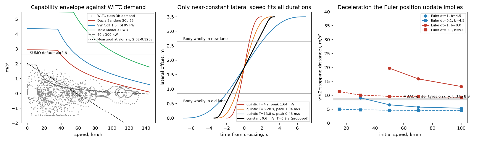

# 11. A physically based vehicle motion layer

Research date: 2026-10-31 to 2026-11-01. First draft by another model, then checked, recomputed and largely rewritten in this review. No GPU runs, no production edits, no commits. Results come from [physics_check.py](scripts/physics_check.py) (output [physics-check.json](physics-check.json)) and [physics_stockholm.py](scripts/physics_stockholm.py) (output [physics-stockholm.json](physics-stockholm.json)). Figure: [11-physics-check.png](fig/11-physics-check.png). To reproduce, put in one scratch directory: `greenncap.txt` (`pdftotext -layout` of [Green NCAP][greenncap]), `wltc_au.html` ([legal text][wltc]) and `tcl25.xlsx` (2025 file from [EPA][epatcl]) for `physics_check.py`; GLO-30 tiles N59 E017 and [E018][glotile] for `physics_stockholm.py`.

**Grades.** **M** measured. **MFR** manufacturer-declared, not independently measured. **R** regulatory requirement, not a fleet capability. **T** textbook or analytic model. **C** calculated here from stated inputs. **D** a design choice, not an empirical claim. **PY** my Python test of the model, single lane, not the GPU kernel. The final section, "Reviewed by Opus", holds the verdict and the build spec.



## 1. What the code does today

Local evidence: [world.rs](/home/erikf/.t3/projects/cars/crates/cars-core/src/world.rs), [step.wgsl](/home/erikf/.t3/projects/cars/crates/cars-core/src/shaders/step.wgsl), [common.wgsl](/home/erikf/.t3/projects/cars/crates/cars-core/src/shaders/common.wgsl), [lc.wgsl](/home/erikf/.t3/projects/cars/crates/cars-core/src/shaders/lc.wgsl), [render.wgsl](/home/erikf/.t3/projects/cars/crates/cars-core/src/shaders/render.wgsl).

- `exec` at `step.wgsl:1198-1201`: `acc=(v_next-speed)/dt`, `pos += v_next*dt`. This is SUMO's Euler update. SUMO's manual describes it as treating speed as constant over the step and offers a ballistic alternative; its own example is 4.5 m/s to 0 in a 1 s step, stopped at x under Euler and at x + 2.25 m under ballistic. [SUMO documentation][sumodoc]
- `lc_commit` at `lc.wgsl:1177` moves the vehicle by setting `lane = dest`. There is no lateral state.
- `step.wgsl:1229-1232` clamps position and sets speed to 0 on a dead end. Teleports remove and reinsert vehicles.
- `render.wgsl` takes heading from the single polyline segment under the vehicle's mid-point, so heading snaps at every vertex and joint.
- Turn speeds are not missing: netconvert's `junctions.limit-turn-speed` defaults to 5.5 m/s² ([NBFrame.cpp:415][nbframe]) and writes the result into the speed of internal lanes. Open-road curves get nothing. The brief's "no turning limits" is true of the kernel but not of the data.
- Grade is absent. `net.rs` parses 2D shapes. The Stockholm net was built without a heightmap.
- Free space exists for this work: `GpuVeh.pad` is 4 bytes, `GpuLane.pad` is 8 bytes, `GpuVType.pad` is 12 bytes and `GpuParams.pad` is 4 bytes.

## 2. Longitudinal model

### 2.1 Force balance and capability

**T.** With m the laden mass, ε the rotating-inertia allowance, G = tan θ:

```
(1+ε)·a = F_drive/m − Crr·g·cosθ − 0.5·ρ·CdA·v²/m − g·sinθ
F_drive/m = min( κ·P/(m·max(v, v_corner)), μ·f_d·g )
```

κ lumps drivetrain loss and the fact that a stepped gearbox rarely sits at peak power. f_d is the driven-axle load share. v_corner sets the force plateau at low speed. No gear table, no torque curve, no shift state. Long 2000 also adds grade as ±G·g on the acceleration. [Long 2000][long]

The first draft proposed 32 to 64 speed bins of force per type, gear state and shift timers. They are cut: §2.2 shows the analytic form reaches the accuracy of the targets it is tested against.

### 2.2 Tested against published figures

**0 to 100 km/h, MFR targets, one κ per drivetrain.** Fit κ_ICE = 0.775, κ_EV = 0.83, v_corner = 10 m/s, Crr 0.011, kerb mass + 100 kg, CdA chosen per car (D, 0.50 to 0.95 m²). Only one κ was fitted across four ICE cars, and the leave-one-out column refits it without the car in question. The Tesla's κ was fitted to that one car, so its 0.2% error is not evidence.

| Car | kg, kW | Declared 0-100, s | Model, s | Error | Leave-one-out, s | dt=1 Heun | dt=1 Euler | Declared / model top km/h |
|---|---:|---:|---:|---:|---:|---:|---:|---|
| [Dacia Sandero SCe 65][sandero] | 1,089, 49 | 16.7 | 17.07 | +2.2% | 17.62 | 17.08 | 16.38 | 158 / 151 |
| [VW Golf 1.5 TSI][golf15] | 1,307, 85 | 9.9 | 10.73 | +8.4% | 10.88 | 10.77 | 10.12 | 203 / 191 |
| [Volvo XC90 3.2 AWD][xc90old] | 2,202, 179 | 9.5 | 8.13 | −14.5% | 7.91 | 8.18 | 7.55 | 210 / 215 |
| [Volvo XC90 T6 AWD][xc90t6] | 2,060, 228 | 6.5 | 5.89 | −9.4% | 5.85 | 5.95 | 5.33 | 230 / 235 |
| [Tesla Model 3 RWD][m3] | 1,836, 208 | 6.1 | 6.11 | fitted | n/a | 6.14 | 5.79 | 201 / 287 |

**Where it is right:** 0-100 within −15% to +9% across a nearly 5:1 range of power with one parameter. **Where it is wrong:** the Tesla's top speed, which is governed (a `max_speed` handles it), and the old XC90, which the model makes too quick. **What it does not show:** I set the CdA values by hand, partly from top-speed arithmetic, so the −6% to +2% top-speed agreement for combustion cars is **not an independent test**. The 0-100 targets are manufacturer claims. Measured magazine values exist but sit behind a login on auto motor und sport, so they were not used.

**Integrator.** One explicit Euler evaluation of `a` at the start of a 1 s step reads 4% to 8% fast on 0-100. A midpoint evaluation stays within 1% of the fine reference at dt = 1 s. Use the midpoint.

**Road load, M-derived.** [EPA test car list, model year 2025][epatcl], 1,076 unique test vehicles, US market: coast-down A/(m·g) median 0.0079 (p5 0.0056, p95 0.0125); CdA from the C term median 0.84 m² (p5 0.55, p95 1.32); force at 100 km/h median 627 N (p5 461), test weight median 2,155 kg (p5 1,531); power-to-mass median 103 W/kg (p5 62, p95 210); correlation of log mass with log power 0.56. The draft's Crr 0.010 and CdA 0.65 give 464 N at 1,600 kg, which matches the light end of that population. Note that these are US new cars, not Stockholm's stock.

**Van, M.** [Altoona test of an ARBOC cutaway][altoona], 3,797 kg seated load, 3.6 L petrol, 6 speed: measured 2.45, 4.39, 6.44, 9.07, 12.63 s to 10-50 mph. Best fit of effective wheel power and plateau gives 136 kW and 2.2 m/s², model 2.25, 4.52, 6.84, 9.30, 12.56 s, RMSE 0.23 s. This is a fit of two parameters to five points, and the report does not state engine power, so κ cannot be checked here.

**Heavy trucks.** Published tables sit inside [Yang et al. 2016][yang] (the ITE values are from a 1970 study, and the authors call them out of date). Model at 36 t, κ = 0.85, CdA 6, Crr 0.006, 10-mph increments in ft/s²:

| lb/hp | 20-30 mph, ITE / model | 30-40 mph | 40-50 mph | 50-60 mph |
|---:|---|---|---|---|
| 100 | 2.1 / 3.53 | 1.5 / 2.45 | 1.0 / 1.80 | 0.6 / 1.36 |
| 200 | 1.3 / 1.66 | 0.8 / 1.10 | 0.5 / 0.75 | 0.4 / 0.49 |
| 300 | 1.0 / 1.03 | 0.6 / 0.64 | 0.3 / 0.39 | n/a / 0.20 |
| 400 | 0.9 / 0.72 | 0.4 / 0.42 | n/a | n/a |

The 300 and 400 lb/hp rows agree within about 30%. The 100 and 200 rows run about 20% to 130% high against the old table. Yang's measured heavy trucks at metered ramps averaged 1.96 ft/s² median over 500 ft (p15 1.56, p85 2.24; n = 71), reaching 31 mph. A 40 t, 300 kW model with a 10 m/s plateau gives 1.65 and 27.7 mph, and 28 t gives 2.24 and 32.3 mph, so the measurement sits between. Truck masses were not measured there.

**Measured drivers use far less than capability, M.** [Long 2000][long] reports 4,820 cars through five signalised streams at a = 2.02 − βv with β = 0.1184 to 0.1326, and left-turning cars with β up to 0.3157. Bosetti et al. (24 drivers) saw forward acceleration under about 2 m/s² in high-curvature scenarios and about 1 m/s² on motorways at the 0.01 percentile, and braking about −2 m/s² at the same percentile, with a tail. [Bosetti et al.][bosetti] SUMO's default accel 2.6 and decel 4.5 ([SUMOVTypeParameter.cpp:908][sumovtype]) are not the operating range of those drivers. So the model needs two limits: `a_cap`, what the vehicle can do, and `a_des`, what the driver asks for.

**Hill climbing, C.** Sustained speed from the same model:

| Vehicle | 0% | 2% | 3% | 5% | 8% |
|---|---:|---:|---:|---:|---:|
| 40 t, 300 kW | 129 | 75 | 59 | 39 | 26 |
| 60 t, 400 kW | 138 | 71 | 54 | 35 | 23 |
| 18 t, 220 kW | 124 | 93 | 80 | 60 | 41 |
| Car 1,588 kg, 90 kW | >140 | >140 | >140 | >140 | 135 |

No published crawl-speed measurement was opened, so this table is unvalidated. Hill climbing only worked once trucks kept low-gear force down to 3 m/s; a 10 m/s plateau left a 60 t truck unable to start on 5%. Trucks therefore use v_corner = 3 m/s for capability and `a_des` for normal launch.

### 2.3 WLTC

The Class 3b trace was read from the [Australian legal text of WLTP][wltc] and compared with the [Green NCAP reproduction][greenncap]: 1,800 shared samples, 0 mismatches. Both print second 538 as "13" without a decimal. Derived: 23.266 km, v_max 131.3 km/h, 13% idle, peak acceleration 1.667 m/s² by forward difference and 1.583 by central difference, peak deceleration −1.50 by forward difference. Replayed as desired speed (**PY**, dt = 0.1 and 1 s give the same picture):

| Vehicle | Max speed error, km/h | Samples at the limit | Peak wheel kW | Positive wheel Wh/km |
|---|---:|---:|---:|---:|
| Sandero, 49 kW | 0.0 | 0% | 37 | 128 |
| Golf, 85 kW | 0.0 | 0% | 40 | 134 |
| Fleet-mean car, 1,663 kg, 90 kW | 0.0 | 0% | 46 | 154 |
| XC90 T6 | 0.0 | 0% | 61 | 205 |
| Model 3 | 0.0 | 0% | 52 | 157 |
| Van 2.8 t, 95 kW | 2.7 | 1.3% | 74 | 300 |
| Truck 18 t, 220 kW | 27 | 17% | 187 | not comparable |
| Truck 40 t, 300 kW | 40 | 35% | 255 | not comparable |

**Result.** Every car follows the trace. The Sandero is the one close call, 37 kW against about 38 kW effective at the wheel, and every other car has a wide margin (left panel of the figure). So WLTC catches a model that is too weak but cannot separate capability models above about 50 W/kg. Trucks fail, as they should: it is a light-duty cycle.

**Energy, C.** With EPA road load for a Model 3 Long Range RWD, WLTC gives 143 Wh/km positive and −55 Wh/km negative at the wheel. With assumed 85% drivetrain efficiency and 60% regenerative capture: 141 Wh/km, against 132 Wh/km declared for a different Model 3 variant ([ADAC][m3], consumption read from the search listing of that page). That is +7%, and both assumptions are mine, so this shows consistency, not validation.

### 2.4 Braking

**Effective deceleration from ADAC, M/C.** [ADAC 2024 winter tyre test, 205/55 R16, VW Golf][adacmethods], best to worst tyre on [the published table][adac], `b=v²/(2d)`:

| Surface | Interval | Distance, m | b, m/s² | μ_eff |
|---|---|---:|---:|---:|
| Dry | 100→0 | 43.3-46.5 | 8.30-8.91 | 0.846-0.908 |
| Wet asphalt | 80→0 | 35.1-40.7 | 6.07-7.03 | 0.618-0.717 |
| Wet concrete | 80→0 | 38.5-46.6 | 5.30-6.41 | 0.540-0.654 |
| Packed snow | 30→0 | 9.9-11.0 | 3.16-3.51 | 0.322-0.357 |
| Polished ice | 20→0 | 18.3-21.6 | 0.714-0.843 | 0.073-0.086 |

**Three limits on these numbers.** These are winter tyres, so dry and wet understate summer tyres; ADAC's summer table was not opened. The page does not state whether distance starts at the pedal or at ABS onset, and a 0.3 s ramp from pedal would change the dry value from 8.9 to 9.9 m/s². "Polished ice" is ADAC's own term and is not the ice on a Stockholm street; no temperature is given.

An auto motor und sport figure of 35.0 m, 11.0 m/s² for a Golf eTSI on 225/45 R17 appeared in a search result. The page's measured fields are login-gated and I did not read them there, so that number is **unverified** and only informs the D upper bound.

**Truck braking, M/R.** All from [74 FR 37122][fr], with the regulation at [49 CFR 571.121][cfr]:

- **The 0.45 s** is a regulatory limit, not a measurement: "reach 60 psi in not more than 0.45 second". NHTSA chose it as the rise time in its formula `S = V·t_r/2 + V²/(2a) − a·t_r²/24`. I confirmed the 1/24 term by integrating a linear ramp numerically (76.251 m against 76.250 m), and reproduced the published table: 144.4, 176.4, 211.7, 250.1 ft against 144, 176, 212, 250.
- **Measured plots.** Sterling 4x2 with a braked van trailer: 186 ft from 60 mph, slightly under 0.8 g reached in about 0.5 s, described as the best obtainable. Volvo 6x4 with an unbraked control trailer: 249 ft, about 0.45 g, reached in about 0.4 s. Peterbilt 6x4, unbraked control trailer: 250 ft, about 0.48 g mid-stop rising to 0.56 g, and about 0.36 g at 0.45 s.
- **Formula against plots.** The formula at each plot's stated deceleration gives 176, 285 and 251 ft. To reproduce the published distances it needs 0.73 g, 0.52 g and 0.52 g. So steady deceleration read from plots is approximate, and only the Peterbilt case agrees.
- **The US rule tests a tractor braking an unbraked trailer axle.** So "truck b = 5.1 m/s²" is the regulatory pass line in that configuration, not what a modern combination can do. Measured range: **4.4 to 7.7 m/s²**. UN R13 (Europe) was not opened and is not used. UN R13-H's car figures (6.43 m/s²) appeared only in search snippets; the [EUR-Lex page][eurlex] came back empty.

**Small vehicle, M.** Altoona's ARBOC high-friction stops of 23.19, 49.40, 82.05, 101.31 ft from 20, 30, 40, 45 mph fit `d = v·t_r/2 + v²/(2b)` with b = 7.72 m/s², t_r = 0.47 s, RMSE 0.17 m. Only four points, and a pedal-to-full lag of 0.47 s on hydraulic brakes argues against the draft's 0.15 s. No published fleet distribution of hydraulic rise times was found. **Car t_r = 0.30 s is D.**

**Hjort heavy-vehicle grip, M.** Verified: peak μ 0.39 to 0.45, 0.29 to 0.36 average over 10-70% slip, −2 to −7 °C, hard-packed snow; drive-axle shares 0.18 (loaded 60 t) and 0.275 (loaded 4x2 tractor); smooth-ice braking friction 0.05 to 0.10 at −4 °C. [Hjort et al.][hjort] The draft's result stands: f_d·μ·g = 0.27 m/s² against 0.294 for 3%, so that case cannot climb.

**Bus passengers, M.** [Krašna et al.][krasna]: only the 1.0 m/s² braking pulse (jerk 0.3) allowed recovery without stepping; 2.5 m/s² (jerk 1.7) did not. The authors propose peak acceleration under 1.5 and deceleration under 1.0 m/s², from young volunteers, and expect lower limits for the wider public.

## 3. The Euler position update breaks stopping physics at dt = 1

**C.** Stopping distance from v0 with the kernel's update, against `v²/(2b)`:

| From | b | Euler dt=1 | Implied deceleration | Euler dt=0.1 | Implied | Ballistic, either dt |
|---|---:|---:|---:|---:|---:|---:|
| 50 km/h | 9.0 | 4.89 m | **19.7 m/s²** | 10.03 m | 9.6 | 10.72 m |
| 50 km/h | 4.5 | 14.67 m | 6.6 | 20.74 m | 4.65 | 21.43 m |
| 30 km/h | 9.0 | 0.00 m | **infinite** | 3.45 m | 10.1 | 3.86 m |
| 30 km/h | 4.5 | 3.83 m | 9.1 | 7.30 m | 4.75 | 7.72 m |
| 100 km/h | 9.0 | 29.33 m | 13.2 | 41.48 m | 9.3 | 42.87 m |

The comparison with ADAC's 8.30 to 8.91 m/s² is the finding. At dt = 1, an emergency stop from 50 km/h covers half the distance tyres allow. This is the single largest physics violation in the current kernel. The draft described this as an "integration discrepancy" of `a·h²/2` and did not evaluate the consequence. The Euler scheme is self-consistent as a traffic rule, and SUMO's safe-speed formula is derived for it, so the problem is physical realism, not an implementation bug.

**Krauss under an adversarial leader, PY.** Follower at its Krauss equilibrium gap, leader braking at 7 or 9 m/s² with follower's assumed leader braking 4.5: dt = 1 gave **252 collisions in 4,000** (6.3%, worst −6.05 m); dt = 0.1 gave 0 in 4,000.

**The draft's 0.1 s substeps are rejected.** It proposed ten global 0.1 s ticks inside every 1 s step. That is 10× the exec cost, for a problem that a ballistic update and a corrected safe speed solve at dt = 1 (§5). The cubic constant-jerk integrator is also cut: a constant-acceleration staircase already matches.

## 4. Cornering and lane changes

### 4.1 Curves

**T.** `a_y = v²κ`. Formulas in the draft for curvilinear motion, `a_t=(1−κd)s̈−κ′d·ṡ²−2κṡḋ` and `a_n=κ(1−κd)ṡ²+d̈`, were checked by finite-differencing a real path: RMS error 6e-5 and 5e-5 m/s². Correct.

**Measured turning.** Xu et al. (cars, Sichuan, table values verified): two-lane mean `a_y(R)=20.5·R^−0.46−0.35`, R² 0.672; medians 0.683, 0.942, 1.638 m/s² on six-, four- and two-lane roads; p85 1.12, 1.68, 3.20. [Xu et al.][xu] Bosetti: about 4 m/s² upper limit at low speed, up to about 4 in roundabouts. [Bosetti et al.][bosetti] The Xu fit gives 6.8 m/s² at R = 10, outside its measured range and above Bosetti's limit. Texas field work found 85th percentile right-turn speeds generally above the radius-equation speed, with no numbers in the abstract. [TRID record][trid]

**Stockholm network, C** (10 m chord curvature on the supplied net):

| Quantity | Value |
|---|---|
| Lanes, km | 82,496 normal, 8,719 km; 220,726 internal, 2,106 km |
| Turns >30° on internal lanes, n | 146,621 |
| Lane speed, radius, median | 6.13 m/s, 7.25 m |
| a_y at lane speed, median, p95 | 4.63, 8.13 m/s² |
| Share above 3, 5.5, 8 m/s² | 55.6%, 38.2%, 9.6% |
| Normal lanes above 3 m/s² at lane speed | 12.9% of lanes, 15.3% of km |
| Tangent jump at connector joints, median | 8.2° (n = 441,452) |
| Joints over 15°, over 30° | 36.5%, 32.3% |

**What this shows.** netconvert limits *average* lateral acceleration, so peaks can exceed 5.5, and 9.6% of turns exceed 8 m/s², about dry tyre grip, if taken at the lane speed. Short lanes are not always driven at lane speed, and OSM polylines exaggerate curvature, so these shares are upper bounds. A single 90° turn of R = 7.25 m at `a_y=3` gives 4.66 m/s against 6.13 m/s today. **PY:** 1,603 to 1,368 veh/h per lane at dt = 0.1, or −15%. Turn speed therefore affects capacity at every junction and is one of the highest-value items here.

**Rendering.** A third of joints have a tangent jump over 30° and the renderer snaps to the local segment. A bus at a junction visibly jumps today. This has no traffic effect, but it is the most visible defect. Off-tracking `R_f − sqrt(R_f²−L²)` is 1.61 m for L = 6, R_f = 12 (the draft is correct), and a chord from rear to front on the path reproduces that without any state.

### 4.2 Lane changes

**The 4.01 s was verified and then misused.** Thiemann et al.: 1,231 lane changes, 1,105 usable, mean 4.01 s, SD 2.31 s, mode about 3 s. [Thiemann et al.][lc] Their window runs from the last moment the body is wholly in the old lane to the first moment it is wholly in the new lane (Eqs. 18-20). The centre moves one **vehicle width**, not one lane. The draft compared this with a quintic moving 3.5 m in 4 s. On a 3.5 m lane with a 1.8 m car, a quintic of duration T straddles for only 0.29·T, so:

| Shape | T, s | Straddles, s | 10-90%, s | Peak v_lat, m/s | Peak a_lat, m/s² |
|---|---:|---:|---:|---:|---:|
| Quintic (draft) | 4.0 | 1.16 | 2.03 | 1.64 | 1.26 |
| Quintic | 6.28 | 1.82 | 3.18 | 1.05 | 0.51 |
| Quintic | 11.0 | 3.19 | 5.57 | 0.60 | 0.17 |
| Quintic | 13.8 | 4.00 | 6.99 | 0.48 | 0.11 |
| **Near-constant speed, 1 s ends** | 8.78 | 4.00 | 6.22 | 0.45 | 0.71 |
| **Near-constant speed, 1 s ends** | 6.83 | 3.00 | 4.67 | 0.60 | 0.94 |

Other evidence: Lee et al. (VTTI, 8,667 lane changes on US commuter routes), single lane changes mean **6.28 s** from start to settling. Table 1.2 of the same report lists prior studies: city streets mean 5.0 s (3.5-6.5), highway 5.8 s (3.5-8.5). [Lee et al.][lee] Local HIGH-SIM screen, n = 18, 10-90% median 5.82 s, 1 s peak lateral speed about 0.6 to 1.1 m/s ([human-lateral-fit.json](human-lateral-fit.json)).

**Result.** A quintic cannot fit all of these. T = 6.28 s straddles 1.82 s against 3 to 4 measured; T = 11 s straddles correctly but runs nearly twice as long as the end-to-end measurement. Near-constant lateral speed of about 0.6 m/s, T ≈ 6.8 s, fits straddle (3.0 s, the mode), end-to-end (6.28 mean) and 10-90 (4.67 against 5.82, weak data). The draft's T = 4 to 6 s quintic understates two-lane occupation by a factor of 2 to 3.

**Quintic algebra, T.** The polynomial itself is correct: endpoints verified, peak velocity 1.875·D/T, acceleration `(10√3/3)·D/T²`, jerk `60·D/T³`, numeric peaks 1.6406 and 1.2638 against 1.6406 and 1.2630. The fault is in using it, not deriving it.

**Caveats.** Definitions differ across these studies, NGSIM width and position noise can inflate straddle time, and data are mainly US freeways. No Stockholm or city-grade straddle measurement was found.

**Geometry at low speed, C.** Lateral speed must scale with forward speed. With T = 4 s at 2 m/s, the quintic needs a 39° heading and R = 3.2 m, tighter than any car's path. At 0.6 m/s lateral, heading ≤ 12° needs v ≥ 2.8 m/s. Below that, progress slows in proportion; at v = 0, it stops.

## 5. Safety with varied brake capability

**Why stop-distance comparison is not enough, T.** If the follower brakes harder than the leader and starts faster, the minimum gap can occur mid-stop, not at the end. SUMO's source says the same at [MSCFModel.cpp:958][mscf]. **The fix:** take `b_c = min(b_F_lo, b_L_hi)`. Then the follower's deceleration never exceeds the leader's assumed deceleration, so relative speed never falls while both move, so the gap has its minimum at the start or at final rest. One endpoint check is then sufficient. This removes the root-finding and search iterations that the draft proposed.

**Derivation, C.** Over the coming tick the follower goes from v to v′ and the leader may begin braking at b_L at any time. From t+dt the follower can do a ramp from its current deceleration to b_c. With a linear ramp from d to b, the extra distance over ideal braking is `v·λ/2` where `λ = t_r·(1−d/b)²` (derived; matches NHTSA's t_r/2 at d = 0; dropping NHTSA's small −b·t_r²/24 is conservative, and also holds when the stop occurs inside the ramp). Then

```
v·dt/2 + v′·dt/2 + v′·λ/2 + v′²/(2·b_c) ≤ gap − g_min + v_L²/(2·b_L)
```

which is a quadratic in v′ with one square root (§ "Reviewed by Opus", update equations). It has the form of Gipps' safe speed.

**Adversarial test, PY.** Random pairs of car, van, bus, full truck and empty truck; grade ±8%; dry, wet, snow, ice; speeds 0 to 36 m/s; random prior acceleration; random gap inside the certified set down to 0.6 m; leader full braking starting at a random time inside the first tick; fine sub-stepped exact minimum gap.

| dt | Trials | Collisions | Minimum gap, m |
|---:|---:|---:|---:|
| 1.0 | 11,977 | **0** | 0.357 |
| 0.1 | 11,979 | **0** | 0.468 |

**The first three versions of this test failed, and the failures are requirements.** They collided up to 11 m through: (1) releasing brakes without a rate limit, which breaks the assumption on braking at t+dt; (2) a sample-and-hold brake ramp running at half rate, solved by using `b/(t_r+dt)` when dt < t_r, which keeps staircase lag at t_r/2; and (3) stretching a stop over the whole tick, solved by letting a stop finish inside the tick. All three rules are in the spec.

**What the guarantee covers.** Same-lane pairs and stop lines, under the declared bounds. It does **not** cover crossing conflicts at junctions (those remain reservations), cut-ins that were not admitted through the same inequality, a sudden unseen μ drop, a leader stopped by a crash, or a surface with no guaranteed braking. Each of these needs a counter, not a silent repair.

**Cost of the guarantee.** Same-type equilibrium headway floor: `dt + t_r/2` = 1.15 s car, 1.225 s truck at dt = 1; 0.25 s, 0.325 s at dt = 0.1. A truck (b_c 4.4) behind a car (b_L 11.3) adds `(v/2)(1/b_c−1/b_L)`: 0.97 s at 14 m/s, 1.74 s at 25 m/s. So 2.06 s at 25 m/s at dt = 0.1. This is intentional. If real truck drivers run closer, and observation will say so, then those trucks are relying on leaders not stopping at full tyre limit, and a strict guarantee will cost some capacity at high truck share. No measured truck headway was opened to settle this.

## 6. What pays off

**PY.** Queue of 30 released from a stop line, single lane, 13.89 m/s limit. HCM's nominal saturation flow is 1,900 veh/h/lane per [Lioris et al.][lioris] (quoted there, HCM itself not opened), who also report 1,272 at one observed site.

| Scenario | dt=1, veh/h | dt=0.1, veh/h | Lost time, s (dt=1, 0.1) |
|---|---:|---:|---|
| A SUMO Krauss, σ = 0 | 2,338 | 2,306 | 2.3, 1.6 |
| A2 SUMO Krauss, σ = 0.5 | 1,975 | 2,276 | 3.3, 2.1 |
| B Ballistic, same constants | 2,338 | 2,301 | 2.8, 2.9 |
| C + power cap only | 2,338 | 2,301 | 2.8, 2.9 |
| D + measured a = 2.02−0.125v (floor 0.7) | 2,313 | 2,278 | 4.6, 4.8 |
| E + certificate | 1,861 | 2,278 | 2.9, 4.8 |
| E2 + driver τ = 1.35 s | **1,861** | **1,855** | 4.5, 4.8 |
| F E + jerk limit 3 m/s³ | 1,861 | 2,278 | 2.9, 5.1 |
| G E on +3% | 1,837 | 2,214 | 3.4, 5.4 |
| H E on +6% | 1,796 | 2,056 | 3.9, 5.6 |
| T1 Turn at 6.13 m/s | 1,619 | 1,603 | 1.9, 2.1 |
| T2 Turn at 4.66 m/s | 1,380 | 1,368 | 1.5, 1.7 |
| I E with 10% 40 t trucks | 1,507 | 1,551 | 1.6, 1.8 |
| J I on +3% | 1,164 | 1,235 | 1.2, 1.4 |
| K SUMO constants, 10% trucks | 1,800 | 2,004 | 1.1, 1.3 |

**Reading this:**

- **dt independence is the surprise result.** SUMO's saturation flow changes 15% between dt = 1 and 0.1 because σ noise is scaled by dt. Ballistic plus certificate plus τ = 1.35 s gives 1,861 and 1,855, a 0.3% difference, both close to 1,900. This one-lane result still has to be proved on the GPU.
- **A power cap does nothing for an average car at a signal.** It matters for weak cars above 50 km/h, trucks and hills.
- **Measured driver acceleration adds 2 s of lost time.** At a 90 s cycle that is about 2% of capacity, and it lengthens queues.
- **Jerk limits change nothing in saturation flow** and at most 0.3 s of lost time. Cut comfort jerk. Keep only the brake ramp, because safety depends on it.
- **Grade on a car lane costs 3% at +3%, 10% at +6% at dt = 0.1, and less at dt = 1, where the certificate already binds.** With trucks, +3% takes another 20%.
- **The truck rows assume every truck is 40 t**, so they are a worst case.

**Open-road grade, PY.** One lane, no overtaking, 2 km of grade, dt = 1, saturated inflow: constants 2,586 veh/h; physics flat with 10% trucks 2,228; +3%, 2,230; +5%, 1,926. Crawl at +3% (58 km/h) is not binding, crawl at +5% (39 km/h) is. A real two-lane road lets cars pass, so this is an upper bound on the effect.

**Stockholm grade screen, C.** Copernicus GLO-30 is a surface model including buildings and vegetation, with relative accuracy stated as under 2 m on slopes up to 20%. [Copernicus][cop] Worst 100 m slope per lane, 63,140 lanes ≥ 30 m:

| Input | Median | km over 3% | Over 5% | Over 8% |
|---|---:|---:|---:|---:|
| Raw DSM | 4.0% | 63% | 40% | 18% |
| DSM with 3-cell minimum filter | 3.2% | 52% | 31% | 13% |

These are **upper bounds**, with surface noise inflating them. They do not give real street grades, but they rule out assuming Stockholm is flat. OSM cannot supply grade: of 63,873 highway ways, 126 have `incline`. It can flag 1,056 bridges and 711 tunnels, which a terrain model will get wrong.

**Decision table:**

| Feature | Decision | Why |
|---|---|---|
| Ballistic update, stop inside tick | **Build** | Removes 19.7 m/s² implied stops; dt independence |
| Certificate with b_lo, b_hi, t_r | **Build** | Collision guarantee across types, 0 in 23,956 trials |
| a_cap with mass, power, grade | **Build** | 40 t trucks and hills: −16% to −38% flow against SUMO constants; visible |
| a_des measured | **Build** | +2 s lost time; measured, cheap |
| Per-vehicle load and power scale | **Build** | Truck empty vs full is 3× in acceleration; 2 bytes |
| Per-lane grade | **Build** | Screen suggests a large share over 3% |
| Per-lane curve speed | **Build** | −15% at turns; up to 9.6% of turns exceed tyre grip today |
| Surface μ, one global value | **Build** | One float; snow scenario is the most-asked question |
| Finite lateral motion and shadow | **Build** | Straddle 3 s measured against 0 today; effect on capacity not yet known |
| Chord heading in renderer | **Build** | Biggest visual defect; no simulation cost |
| Comfort jerk | **Cut** | No capacity effect |
| Gear state, torque tables | **Cut** | ±15% without them; target data are themselves only declared |
| Per-axle load, tyre circle per axle | **Cut** | A global a_y limit and QA check suffice; f_d covers drive traction |
| Brake thermal state, SOC, regen split | **Cut** | Stockholm has no long descent; nobody could observe it |
| Trailer yaw state, swept polygons online | **Cut** | Renderer chord; offline QA only |
| Tyre relaxation, ABS cycles, wind, roll | **Cut** | Unobservable in traffic data |
| 0.1 s substeps inside 1 s | **Cut** | 10× cost for no gain over ballistic |
| Cubic jerk integrator | **Cut** | Same result as piecewise constant |

## Sources opened in this review

[adac]: https://www.adac.de/rund-ums-fahrzeug/ausstattung-technik-zubehoer/reifen/reifentest/winterreifen/205-55-r16/continental-wintercontact-ts-870-id-4908/
[adacmethods]: https://www.adac.de/rund-ums-fahrzeug/ausstattung-technik-zubehoer/reifen/reifentest/winterreifen/205-55-r16/
[fleet]: https://www.trafa.se/globalassets/statistik/vagtrafik/fordon/2024/fordon-2023.pdf
[fr]: https://www.govinfo.gov/content/pkg/FR-2009-07-27/html/E9-17533.htm
[cfr]: https://www.law.cornell.edu/cfr/text/49/571.121
[lc]: https://arxiv.org/html/0804.0108
[lee]: https://rosap.ntl.bts.gov/view/dot/4191/dot_4191_DS1.pdf
[long]: https://www.fdot.gov/docs/default-source/rail/publications/studies/safety/accelerationresearch.pdf
[yang]: https://clasi.edvance360.com/upload/artba/media/scorm/39/Truck%20Acceleration%20Behavior.pdf
[altoona]: https://arbocsv.com/site-content/uploads/2019/11/Altoona-SOI.pdf
[sandero]: https://www.adac.de/rund-ums-fahrzeug/autokatalog/marken-modelle/dacia/sandero/3generation/318325/
[golf15]: https://www.adac.de/rund-ums-fahrzeug/autokatalog/marken-modelle/vw/golf/viii-facelift/332970
[xc90old]: https://www.adac.de/rund-ums-fahrzeug/autokatalog/marken-modelle/volvo/xc90/1generation-facelift-2/223424
[xc90t6]: https://www.adac.de/rund-ums-fahrzeug/autokatalog/marken-modelle/volvo/xc90/2generation/298192
[m3]: https://www.adac.de/rund-ums-fahrzeug/autokatalog/marken-modelle/tesla/model-3/1generation-facelift/345083/
[epatcl]: https://www.epa.gov/compliance-and-fuel-economy-data/data-cars-used-testing-fuel-economy
[wltc]: https://www.legislation.gov.au/F2024L00446/asmade/2024-04-15/text/original/epub/OEBPS/document_1/document_1.html
[greenncap]: https://www.greenncap.com/wp-content/uploads/Green_NCAP_WLTC_Test_Procedure_v3.0.0.pdf
[hjort]: https://hvttforum.org/wp-content/uploads/2019/11/Hjort-The-snow-grip-of-heavy-vehicle-drive-axle-winter-tyres.pdf
[bus]: https://www.volvobuses.com/content/dam/volvo-buses/markets/master/city-and-intercity/complete-buses/volvo-7900-electric/Data%20sheet%207900%20Electric%20EN%202019.pdf
[xu]: https://onlinelibrary.wiley.com/doi/full/10.1155/2015/494130
[bosetti]: https://link.springer.com/article/10.1007/s12544-013-0120-2
[krasna]: https://www.frontiersin.org/journals/bioengineering-and-biotechnology/articles/10.3389/fbioe.2021.680883/full
[trid]: https://trid.trb.org/View/1851798
[lioris]: https://arxiv.org/pdf/1511.00775
[sumodoc]: https://sumo.dlr.de/docs/Simulation/Basic_Definition.html
[lmproducts]: https://www.lantmateriet.se/globalassets/geodata/geodataprodukter/hojddata/pb_markhojdmodell_nedladdning_v1.0_1.7.pdf
[lmnotice]: https://www.lantmateriet.se/sv/geodata/vara-produkter/Produktnyheter/Geografisk-information/markhojdmodell-nedladdning-utokas-med-mer-innehall/
[lmopen]: https://www.lantmateriet.se/en/geodata/our-products/open-data/
[cop]: https://dataspace.copernicus.eu/explore-data/data-collections/copernicus-contributing-missions/collections-description/COP-DEM
[glotile]: https://copernicus-dem-30m.s3.amazonaws.com/Copernicus_DSM_COG_10_N59_00_E018_00_DEM/Copernicus_DSM_COG_10_N59_00_E018_00_DEM.tif
[eurlex]: https://eur-lex.europa.eu/eli/reg/2026/502/oj/eng
[nbframe]: /home/erikf/projects/personal/thesis-src/sumo/src/netbuild/NBFrame.cpp
[nifame]: /home/erikf/projects/personal/thesis-src/sumo/src/netimport/NIFrame.cpp
[mscf]: /home/erikf/projects/personal/thesis-src/sumo/src/microsim/cfmodels/MSCFModel.cpp
[sumovtype]: /home/erikf/projects/personal/thesis-src/sumo/src/utils/vehicle/SUMOVTypeParameter.cpp

## Reviewed by Opus

### What held

- **Ice 0.71-0.84 m/s².** Exact, from 18.3 and 21.6 m at 20 km/h on ADAC's table. The other four surfaces in the table also check.
- **0.45 s air brake.** Real and correctly described as regulatory, not measured. Formula verified numerically and against NHTSA's table. Peterbilt 250 ft and 0.48 to 0.56 g verified.
- **1,588 kg Swedish mean, 11.4 years, fuel shares.** Verified on [Trafikanalys][fleet] p. 3. The 2013 figure was 1,481 kg. It is a stock mean with no distribution, and a definition of service mass was not checked.
- **4.01 ± 2.31 s, mode about 3 s, 1,105 of 1,231.** Verified, including the warning that it is a lower bound.
- **Quintic algebra and curvilinear acceleration.** Correct.
- **All worked arithmetic I rechecked.** Forces at 100 km/h, 40 t at 80 km/h, 9.88 MJ, 436 kW on 5%, weight transfer 2,607 N, off-tracking 1.61 m, Xu regressions, 48.0 m stop. Hjort and the [Volvo sheet][bus] (12.0 × 2.55 m, 6.0 m wheelbase, 19,500 kg, 200 kW, radii 11.0 and 8.9 m) also check.
- **Physics-based direction.** Drivers request, physics limits.

### What was wrong

1. **The lane-change design.** 4.01 s measures the body crossing one vehicle width, not 3.5 m. A T = 4 quintic straddles 1.16 s. Measured data fit near-constant 0.6 m/s, T ≈ 6.8 s, not a quintic.
2. **Truck brake capability.** 5.1 m/s² is the pass line of a US test with an unbraked trailer axle. The measured range is 4.4 to 7.7 m/s².
3. **Hydraulic rise 0.15 s.** One measured small vehicle fits 0.47 s. Default raised to 0.30 s, still D.
4. **"No turning limits".** netconvert already writes turn speeds into internal lanes at 5.5 m/s² average. The defect is that peaks exceed that, and open-road curves have nothing.
5. **Dry μ 0.85 as *the* dry value.** It comes from winter tyres, probably including a ramp. It works as a lower bound only.
6. **0.1 s ticks inside 1 s.** 10× cost, not needed.
7. **Scale of the design.** 32 to 64 bins, gear state, per-axle circles, thermal state, trailer yaw, 16-iteration searches, online swept polygons and 32+ new bytes per vehicle. Most are unobservable or do not change results. The design below adds **0 bytes** per vehicle.
8. **Euler treated as a small integration discrepancy.** It implies 19.7 m/s² from 50 km/h at dt = 1. The draft missed the biggest physical violation.
9. **Sources.** Turri's KTH link returns 404 now. EPA MOVES, EPA VSP, National Academies, HBEFA, UBA, the EEA catalogue, the Transportstyrelsen schema and the VW Golf page were not re-opened, so the claims resting on them were removed or are now graded T.

### What remains unknown

- Real Stockholm grades. The GLO-30 figures are upper bounds, and terrain data has not been fetched.
- Bridge and tunnel elevations on the actual net.
- Joint mass and power distribution for the Swedish fleet. EEA's Discodata endpoint returned 403. The EPA list is US new cars. **All P_ref and load ranges below are D.**
- Hydraulic rise-time distribution; whether ADAC's distance starts at the pedal; summer tyre values for this size; UN R13 limits; bus capability in Europe (only US and one small vehicle verified); measured truck crawl speed; measured truck following headway.
- Stockholm or European city lane-change kinematics. Whether shadow occupancy changes capacity much.
- All GPU cost and all network-level effects. Everything graded PY is one lane in Python. The certificate has not run on the kernel, and the shadow mechanism has not been prototyped.
- Whether real drivers' lower-level behaviour (a_des, τ = 1.35 s) stays valid outside these single sites.
- No measured 12 m bus acceleration. Altoona's bus pages had no report link, and the measured vehicle here is a 3.8 t cutaway. The NCHRP 505 truck tables were not reachable (the link returned a landing page). NHTSA's original link returned 403 to scripts, so the Federal Register copy of the same rule was used.

### Build spec

**Mode.** `P.pad` becomes `P.mu`. `mu == 0` keeps today's kernel, bit-identical, so golden tests stay valid. `mu > 0` is physical mode. No function-local arrays. Same code at both timesteps.

| Surface | mu | μ_hi = 1.35·mu | Basis |
|---|---:|---:|---|
| Dry | 0.85 | 1.15 | M low from ADAC; high D |
| Wet | 0.54 | 0.73 | M |
| Packed snow | 0.32 | 0.43 | M |
| Polished ice | 0.073 | 0.099 | M at 20 km/h only; do not extrapolate |

**Per-vehicle: 0 bytes added.** `GpuVeh` stays 160 bytes. `pad: u32` becomes `phys`:

| Bits | Field | Meaning |
|---|---|---|
| 0-7 | `load_q` | m/m_ref = 0.25 + q/146 (0.25 to 2.0) |
| 8-15 | `power_q` | P/P_ref = 0.5 + q/127.5 (0.5 to 2.5) |
| 16-29 | `lat_u` | Lateral phase 0 to 1 in 1/16383 |
| 30-31 | `lat_dir` | 0 none, 1 left, 2 right |

`acc` already holds a_prev. `load_q` and `power_q` are drawn at demand build and carried in `GpuTrip.pad`, so a given trip's vehicle is reproducible. Shadow entries reuse the 160-byte record and consume capacity (below).

**Per-type: `GpuVType` from 112 to 156 bytes** (14 new f32, 3 from `pad`). Small table, no per-vehicle cost. All D unless noted, and they must be fitted once there is fleet data:

| Field | Car | Van | Bus | Rigid truck | Artic |
|---|---:|---:|---:|---:|---:|
| m_ref, kg | 1,650 | 2,800 | 16,000 | 18,000 | 40,000 |
| P_ref, kW | 90 | 95 | 170 | 220 | 300 |
| κ | 0.775 (fit) | 0.775 | 0.85 | 0.85 | 0.85 |
| CdA, m² | 0.68 | 1.6 | 5.0 | 5.0 | 6.0 |
| Crr_eff | 0.0105 | 0.012 | 0.007 | 0.006 | 0.006 |
| v_corner, m/s | 10 | 10 | 3 | 3 | 3 |
| f_d | 0.55 | 0.55 | 0.30 | 0.40 | 0.275 (M config) |
| ε | 0.05 | 0.05 | 0.08 | 0.08 | 0.08 |
| b_lo, m/s² | 7.0 | 6.0 | 4.5 | 4.4 (M) | 4.4 (M) |
| b_hi, m/s² | 11.3 | 8.5 | 7.5 | 7.7 (M) | 7.7 (M) |
| t_r, s | 0.30 | 0.47 (M, one) | 0.45 (R) | 0.45 (R) | 0.45 (R) |
| a_des: a0, a1, floor | 2.02, 0.125, 0.7 (M; floor D) | same | 1.0, 0, 1.0 (D, under Krašna's 1.5) | 0.76, 0, 0.76 (M) | 0.6, 0, 0.6 (M) |
| v_lat, m/s | 0.6 | 0.6 | 0.6 | 0.6 | 0.6 |
| width, m | 1.8 | 2.0 | 2.55 | 2.55 | 2.55 |

Stored form: `pw_kg=κ·P_ref/m_ref`, `road_a=Crr·g`, `road_c=0.5·ρ·CdA/m_ref`, `i_inv=1/(1+ε)`, `trac=f_d·g`, and the rest as listed. Driver τ = 1.35 s (PY-calibrated to 1,900, so calibrate again on the network).

**Per-lane: 0 bytes added.** `GpuLane.pad: [u32;2]` becomes:

| Field | Type | Meaning | Source |
|---|---|---|---|
| `grade` | i16, 1e-4 | Mean lane tan θ, uphill positive | Terrain z, below |
| `curve_v` | u16, 0.01 m/s | `sqrt(a_des(R)·R)`, a_des = min(3.0, 20.5·R^−0.46−0.35); 0 straight | 10 m chord on net shape |
| `sqrt_R` | u16, 1/128 | √R of tightest point | Same |
| `s_curve` | u16, 0.25 m | Position of tightest point | Same |

**Stockholm grade source.** Preferred: Lantmäteriet Markhöjdmodell, 1 m grid, SWEREF 99 TM, RH 2000 ([product description][lmproducts], v1.7), 10 × 10 km files from June 2026, access by order through Geotorget ([notice][lmnotice]). Lantmäteriet's open data is CC0 ([open data][lmopen]); I could not confirm from that page that this product is in the open list. Netconvert already accepts it: `--heightmap.geotiff` ([NIFrame.cpp:136][nifame]). Then: extend `parse_shape` to keep z; take the 100 m smoothed slope per lane; for OSM `bridge` and `tunnel` edges (1,056 and 711 ways), interpolate z linearly between the portals. Fallback with no account: [GLO-30 tiles][glotile] with a 3-cell minimum filter, flagged low quality, as they were in this report.

**Update equations for dt = 1 and dt = 0.1.** In `exec`, after every existing speed constraint including `lc_patch_speed` and `max(v_next, v_safe_min)` at `step.wgsl:1195`, which must not override the certificate.

```text
// Inputs
g = 9.81;  dt = P.dt;  μ = P.mu
G = lane.grade;  gz = g·G·(1 − G²/2)          // sinθ
L = 0.25 + load_q/146;  W = 0.5 + power_q/127.5

// Capability: driven force, road load, grade. dt-independent midpoint.
cap(u) = i_inv·( min(pw_kg·W/(L·max(u, v_corner)), μ·trac) − road_a − road_c·u²/L ) − gz
a_cap  = cap(v + 0.5·max(cap(v), 0)·dt)

// Driver
a_drv  = min(max(a0 − a1·v, floor) − gz, a_cap)

// Driver safe speed: SUMO maximumSafeStopSpeedBallistic, MSCFModel.cpp:888
gt = gap + v_L²/(2·max(b_plan, b_app_leader))       // gap includes min_gap, stop lines use v_L = 0
if gt ≤ v·τ/2:  v_k = v − v²/(2·gt)·dt              // gt = 0: stop
else:           v1 = −b_plan·τ/2 + sqrt((b_plan·τ/2)² + b_plan·(2·gt − τ·v))
                v_k = v + (v1 − v)/τ·dt

// Curve, tyre, posted limits
ay_lim = 0.5·μ·g
v_lim  = min(lane_vmax, curve_v, sqrt_R·sqrt(ay_lim))   // preview via free_speed at s_curve
v_des  = min(v_k, v_lim, v + a_drv·dt) − dawdle

// Certificate
b_F = min(b_lo, μ·g) + gz;  if on a curved lane: b_F ×= 0.866
b_L = min(b_hi_leader, 1.35·μ·g) + max(gz, gz_leader)   // stop line: v_L = 0, b_L = b_F
if b_F ≤ 0.05 or b_L ≤ 0.05: count NO_BRAKE, refuse lane entry
b_c = min(b_F, b_L)
j   = b_c/t_r            if dt ≥ t_r
      b_c/(t_r + dt)     if dt <  t_r
d_lo = max(0, −a_prev − j·dt)
λ   = t_r·max(0, 1 − d_lo/b_c)²
h   = (λ + dt)/2
Q   = gap_bumper − 0.5 + v_L²/(2·b_L) − v·dt/2
v_c = b_c·( −h + sqrt(h² + 2·max(Q, 0)/b_c) )

// Release limit
v_up = v + (a_prev + j·dt)·dt   if a_prev < 0
       ∞                        otherwise

// Fastest possible braking, b_F with its own j_F, d = max(0, −a_prev)
if dt ≥ t_r:  t1 = max(b_F − d, 0)·t_r/b_F
              v_fl = v − (d·t1 + 0.5·(b_F/t_r)·t1² + b_F·(dt − t1))
else:         v_fl = v − min(b_F, d + b_F·dt/(t_r + dt))·dt

// Choose. v_c = 0 means stop now: hardest braking, and v_fl below 0 is a stop inside the tick.
v' = min(v_des, v_c, v_up)
v' = (v_c ≤ 0) ? v_fl : max(v', v_fl)
a  = (v' − v)/dt

// Integrate
if v + a·dt > 0:  pos += v·dt + 0.5·a·dt²;  speed = v + a·dt;  acc = a
else:             pos += v²/(2·|a|);        speed = 0;         acc = 0
```

Differences by timestep:

| | dt = 1 s | dt = 0.1 s |
|---|---|---|
| Brake rate j | b/t_r, ramp ends inside the tick | b/(t_r + 0.1), staircase over 3 to 6 ticks |
| Release limit | Inert except on low μ | Active |
| Headway floor, same type | 1 + t_r/2 | 0.1 + t_r/2 |
| Binding gap | Often the certificate | The driver (τ) |
| Passes in test | 11,977, min gap 0.357 m | 11,979, min gap 0.468 m |

Every replacement for existing calls: `min_next_speed`, `max_next_speed`, `brake_gap = v²/(2b)`, `safe_stop`, `follow_speed` and `insertion_*` all take the physical branch. Insertion and `secure_gap_lc` use the same inequality with v′ = v:

```text
g_req = 0.5 + v²/(2·b_c) + h·v + v·dt/2 − v_L²/(2·b_L)
```

**Lane change.** Keep today's decision and `lc_commit`. Add phase:

```text
D = lane width; T = D/v_lat + 1;  require T·v ≤ remaining lane, else raise v_lat to 1.1 m/s at most, else refuse
k = min(1, v·tan(12°)/v_lat)
t = lat_u·T + k·dt
d(t) = v_lat·(t/2 − sin(π·t)/(2π))              t < 1
       v_lat·(t − 0.5)                          1 ≤ t ≤ T − 1
       D − d(T − t)                             t > T − 1
offset = ±(D − d(t))  // from new lane centre toward old
```

Keep a **shadow** of the vehicle in the old lane from commit until `d ≥ (D + width)/2`: a 160-byte clone with `F_SHADOW`, appended after `lc_commit` and sorted in. Followers see it as a normal leader. Exec skips it apart from computing its gap to its own leader and sending that speed to the owner through the existing `lc_advice` buffer (`lc.wgsl:531`), computed one extra tick ahead because it arrives a tick late. Metrics skip it. Capacity reserve 5%, with an overflow counter that refuses new lane changes. **This shadow part has not been prototyped.** At dt = 1 and 13.9 m/s a T of 6.8 s spans 95 m against a 106 m mean lane, so offsets must survive lane boundaries; if the source lane has ended, the shadow ends and only the rendered offset continues.

**Renderer.** Heading from a chord of two path points: `pos` and `pos − length`, using `prev_lane` when the rear is behind the lane start. Add the lateral offset along the normal. No state. Tangent jumps disappear and rear-wheel cut-in appears for free.

**Compute cost, C, unmeasured.** No GPU was used for this report.

| Item | Per vehicle-step |
|---|---|
| Capability (2 evaluations) | About 24 float ops, 2 divides |
| Driver and certificate | About 20 float ops, 2 divides, 2 sqrt |
| Floor, release, integrate | About 10 float ops |
| Lateral (in a lane change only) | About 12 float ops, 1 sine |
| Vehicle memory | **+0 bytes** |
| Lane memory | **+0 bytes** |
| Type table | +44 bytes per type |
| Shadow | 160 bytes per straddling vehicle, reserve 5% of capacity |

Existing `exec` already computes a sqrt per drive item (up to 8) and a floor per `brake_gap`, and the ballistic forms drop the floors. Expect a low single-digit percent cost per step, to be measured on a 100k-vehicle scene first. That expectation is an estimate, not a result. The 10× of the draft's substeps is avoided, so the project's recorded Berlin run (149 s per simulated 24 h, per the shared session log) should stay in the same range.

**Invariants, with bounds.** These apply in `mu > 0`. `ε_num = 3e-3 m` and `5e-4 m/s²` allow for FCD rounding and f32.

| # | Invariant | Bound |
|---|---|---|
| I1 | State finite, speed | no NaN/Inf; v ≥ 0 |
| I2 | Same-lane bumper gap, including shadow | ≥ 0 hard; ≥ 0.25 m flagged |
| I3 | Position against speed | `|Δx − (v·dt + a·dt²/2)|` ≤ ε_num; on a stop tick (`speed = 0`, `acc = 0`) 0 ≤ Δx ≤ v·dt/2 + ε_num |
| I4 | Forward acceleration | a ≤ a_cap(v, G, L, W) + 0.02 |
| I5 | Absolute forward ceiling (f_d·g, μ = 1) | car 5.4, van 5.4, bus 2.9, rigid 3.9, artic 2.7 m/s² |
| I6 | Braking | −a − gz ≤ min(b_hi, 1.35·μ·g) + 0.05 |
| I7 | Stop distance implied | any v→0 from v ≥ 3 m/s: `v²/(2d)` ≤ min(b_hi, 1.35·μ·g) + gz + 0.5 |
| I8 | Brake jerk | dt = 0.1: Δa ≥ −0.1·b_hi/(t_r+0.1) − 0.05; dt = 1: no bound beyond I6 |
| I9 | Lateral acceleration | v²κ ≤ 0.5·μ·g + 0.2 hard (dry 4.37); p99.9 ≤ 4.0 |
| I10 | Combined | (a_tyre/(μ_hi·g))² + (v²κ/(μ_hi·g))² ≤ 1.02 |
| I11 | Lateral motion | |v_lat| ≤ 1.2 m/s; |a_lat| ≤ 2.0; heading ≤ 13°; phase monotonic; no progress at v = 0; nominal T in 4 to 14 s |
| I12 | Lane-change occupancy | Shadow present while body overlaps old lane; 0 unshadowed overlap ticks |
| I13 | Administrative | Teleport, dead-end clamp and removal without arrival: 0 in validation scenarios, counted always |
| I14 | Certificate feasibility | v′ < v_fl with v_c binding: counted as CERT_FLOOR, ≠ 0 allowed only in emergencies, 0 collisions |
| I15 | Body continuity (render) | |Δheading| per tick ≤ max(2°, v·dt/5 m rad); |Δxy − Δs| ≤ 0.5 m |
| I16 | Energy per trip | ΔKE + ΔPE + road work + brake work matches wheel work within 1%; car positive wheel energy ≤ 500 Wh/km |
| I17 | Scenario limits | No state inside a NO_BRAKE lane; declared μ constant in a run |

**Required checks for `scripts/physics_qa.py`.** It reads `--fcd` CSV as written at `run.rs:254`: `t,id,lane,pos,speed,acc,wait,lc_own,n_items,best_off`, plus a JSON of type parameters and net lanes (length, speed, grade, shape). It should also accept optional new columns `vtype,phys,offset`, which the kernel must add. Sample every tick (`--fcd-interval = dt`). Run I1 to I17 where the inputs exist, and report for each `checked, failed, max_excess, first (t,id,lane)`, per vehicle-step and per vehicle-km, and exit nonzero on hard failures.

| Check | Method | Expected today in mode 0 |
|---|---|---|
| **Q1 Euler or ballistic** | Per tick, compare Δx (joined across lanes via lengths) with both `v'·dt` and `(v+v')·dt/2`; report which fits, residual | Euler, residual ≈ 0 |
| **Q2 Implied stops (I7)** | For each stop event, `v0²/(2d)` by v0 band: 10-30, 30-50, 50-80, 80+ km/h | **Fails at dt = 1**, up to 19.7 m/s² and "infinite" at low speed |
| **Q3 Accel and brake bounds (I4 to I6, I8)** | By type; print histogram tail and p99, p99.9 | Fails I4 for weak cars, trucks on grades |
| **Q4 Gaps (I2)** | Sort per lane by pos at each tick; bumper gap using length | Should pass except known cases |
| **Q5 Curves (I9, I10)** | v²κ from net shape at pos (10 m chord) | Fails on 9.6% of turn lanes at lane speed |
| **Q6 Lane-change events (I11, I12)** | Detect lane index change; offset trace if available; with no offset, count events and assign zero duration; record speed at change and whether a follower in old lane closes within the width-crossing time, using 3 s | Zero-duration everywhere; report rate per veh-km to size the shadow reserve |
| **Q7 Administrative (I13)** | Disappear/reappear, speed to zero in a tick above the b_hi bound | Counted |
| **Q8 Body (I15)** | x,y from shape, chord heading, per-tick change | Fails: 32% of joints jump >30° |
| **Q9 Energy (I16)** | Reconstruct wheel, road, grade, brake work per trip | Fails with Q1 Euler by construction |
| **Q10 Driver realism, not a pass/fail** | Compare |a| percentiles and a(v) with `2.02−0.125v`; |a| > 2 and a_y > 4 rates against Bosetti; saturation headway at signals against 1.9 s | Report only |
| **Q11 dt consistency** | Same scene at dt = 1 and 0.1: per-link flow difference | Target ≤ 3% in `mu > 0` |
| **Q12 Unit golden (no GPU)** | Evaluate the WGSL formulas in Python: table below | Must pass before any kernel work |

Golden values for Q12, all from `physics-check.json`:

| Test | Pass band |
|---|---|
| κ-fit 0-100 for the five cars, at μ = 1 and each car's f_d | Within ±15% of declared |
| Top speed, Sandero, Golf, XC90 ×2 (regression only) | Within ±8% |
| Midpoint at dt = 1 against fine reference | Within 1.5% |
| NHTSA formula, 45 to 60 mph, 16.8 ft/s², 0.45 s | Within 1 ft of 144, 176, 212, 250 |
| ADAC band inside [b_hi + lag, b_lo + lag] for car, dry | 43.3-46.5 m inside 38.3 to 59.3 m |
| WLTC, each car at dt = 0.1 and 1 | Max error ≤ 0.1 km/h; van ≤ 3 km/h |
| Crawl, 40 t, 300 kW, at 3%, 5% | 58.5, 39.3 km/h ± 1 (unvalidated, regression only) |
| Certificate adversary, as in §5, at least 10,000 trials per dt | 0 collisions, min gap > 0.25 m |
| Queue E2, both dt | Saturation flow within 1% of each other, 1,800 to 2,000 veh/h |

**Build order.** (1) Renderer chord, no simulation risk. (2) Q12, then QA run on the current kernel for the baseline. (3) Ballistic plus certificate plus a_cap on flat networks with `mu > 0`, tested from 1k to 100k vehicles, keeping 3 GB of VRAM spare. (4) Curve and grade fields. (5) Lane-change phase and shadow, compared against instantaneous on one link. Each step keeps `mu == 0` bit-identical.

**What only Erik can do.** Order access to Markhöjdmodell through Geotorget, which needs an account. Or accept GLO-30 as low-quality grade. The rest can be built without Erik.
