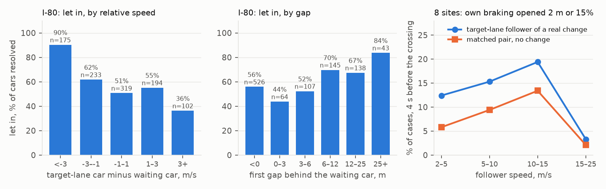
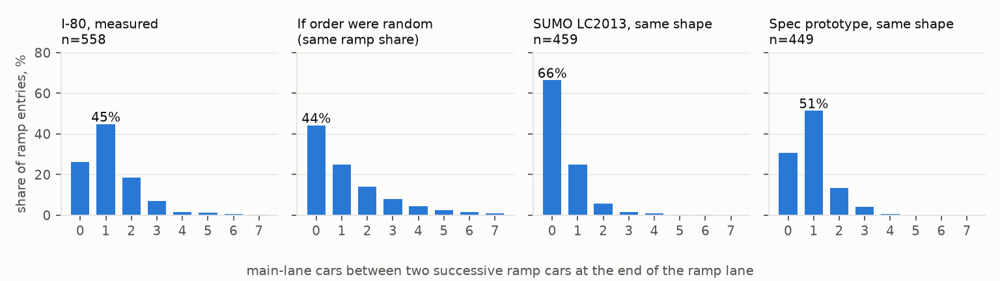

# Human courtesy: do drivers let you in, and how to build that in WGSL

Research date: 2026-11-01. No GPU was used. The spec in section 4 was tested in a small CPU prototype only and is not implemented in `cars`.

**Answer to Erik's question.** Yes, on the data I could measure. All 610 cars that had to leave the I-80 on-ramp lane got in, with a median wait of 22.6 s and a longest wait of 79 s. No more than 5 vehicles passed any of them, and 57% were passed by none. Each target-lane vehicle that came alongside let the car in 59% of the time. Letting in falls with relative speed, from 90% when the car is slower than the waiting one by over 3 m/s to 36% when it is faster by over 3 m/s, as Erik guessed. At the end of the ramp lane drivers take turns: the most common sequence is one main-lane car between two ramp cars.

**Three things that differ from the intuition.**

1. Most of the courtesy is not braking. Only about 6 points more followers visibly open a gap than matched cars with no one cutting in, and the average extra hold-back is about 1.2 m. Mostly drivers tolerate a tight gap and don't close it.
2. Urgency follows distance to the lane end, not the clock. At I-80 the effect of waiting time on starting the change is zero once distance is known.
3. SUMO LC2013 does not get stuck at a plain lane end. Its fault there is turn taking: ramp cars win two entries in three. Wrong-lane stalls need a target lane that is itself queued, and in this prototype a side-by-side counter-wish deadlock. Courtesy cannot create road space, so **do not expect all 9,930 to vanish** until it is measured. The Berlin evening cluster and the 11-fold gap to published SUMO ([03-berlin-forensics.md](03-berlin-forensics.md)) may account for part of them.

## Evidence grades

- **Field:** measured on real traffic, by the cited authors.
- **This study, field data:** my calculation on real trajectories. Scripts are in `research/truth/scripts/courtesy_*.py`.
- **Simulator:** driving simulator or lab video.
- **Survey:** self-report.
- **Modelled:** model, simulation or code reading.
- **Opinion:** my engineering choice.

Every link below was opened in this session unless section 6 says otherwise. PDFs were read as extracted text.

## 1. What is published

### Lane change types and merging in congestion

| Claim | Grade, sample | Source |
|---|---|---|
| Queued ramp and freeway cars enter a congested merge in a nearly fixed ratio, independent of the outflow and of how severe the downstream restriction is. | Field, 4 merges in California and Toronto. Abstract only: the ratio values were not available. | [Cassidy & Ahn](https://its.berkeley.edu/node/4110) |
| In US-101's congested weave, the follower's gap to the leader grew over 15% through its own braking in 86 of 398 merges (22%). The leader accelerated to open space in 67 (17%). Of about 3,000 through cars in the target lane, 51 moved left and only 9 of those were judged to be yielding. | Field, NGSIM, 398 mergers of 11,779 vehicles | [Wan et al., TRB 14-3695](https://files.topslab.wisc.edu/publications/2014/Modeling%20Vehicle%20Interactions%20during%20Freeway%20Ramp%20Merging%20in%20Congested%20Weaving%20Section%20(14-3695).pdf) |
| 38.65% of those mergers did not take the first gap they met. 151 took a gap further forward and only 5 a gap behind. | Field, same data | [TRB 14-5685](https://files.topslab.wisc.edu/publications/2014/How%20Merging%20Vehicles%20Choose%20and%20Approach%20Their%20Desired%20Merge%20Position%20in%20Congested%20Merge%20Area%20(14-5685).pdf) |
| Forced merging depends on relative speeds, distance to the mandatory point and the lag car's acceleration. Aggressive drivers who start a forced merge persist. | Modelled on trajectory data, abstract only | [Rao 2006](https://dspace.mit.edu/handle/1721.1/34602) |
| A repeated game model predicts about 86% of NGSIM lane change outcomes, with a forced-merge payoff that grows as remaining distance shrinks. | Modelled | [Kang & Rakha](https://arxiv.org/pdf/2002.02529) |
| Merging drivers in NGSIM were estimated to be more competitive than non-merging drivers. I could not extract a percentage split from the text. | Modelled on field data | [Schwarting et al. 2019](https://sites.bu.edu/pierson/files/2021/05/schwarting2019pnas.pdf) |

### Blinkers

**No field study I opened measures how often the follower yields with and without a blinker.** That is the main hole in the evidence. What exists:

| Finding | Grade, sample | Source |
|---|---|---|
| Signal before the change in about 60% of cases, after it starts in 33%, never in 7%. | Field, Gothenburg, 103 drivers | [Jokhio et al.](https://arxiv.org/pdf/2305.16401) |
| Median time from blinker to start of the change is 0.7 s. About 90% start within 2 s, 8% at 2–4 s, 2% after 4 s. A lag vehicle lowers the hazard of starting by 26%, and each unit of lag gap raises it by about 16%. So the driver usually signals as they go, without waiting for a response. | Field, same 103 drivers, some of them company test drivers | [Jokhio et al., TITS](https://research.chalmers.se/publication/538666/file/538666_Fulltext.pdf) |
| The lag car's behaviour moves the lane change decision far more than its gap size does: decelerate against hold or accelerate gives F(2,224)=243.63, while gap of 24, 36 or 48 m gives F=2.21, p=0.11. | Lab video, n=29 German licence holders | [Jokhio et al., TRF](https://research.chalmers.se/publication/541857/file/541857_Fulltext.pdf) |
| Text displays on a cutting-in car raised yield rates over brake lights and blinker alone. Polite wording did best, with a reported difference of −0.655 (CI −0.984, −0.327). The baseline rate is only in a figure I could not read. | Simulator, 32 drivers, 512 events | [Li et al. 2025](https://personal.hkust-gz.edu.cn/hedengbo/assets/publicationPDFs/Li-AutoUI_2025a.pdf) |
| A head-up display, and blinker semantics that separate planning from starting, both promoted permissive behaviour. | Simulator, n=52 | [Haar et al. 2022](https://research.utwente.nl/en/publications/improving-clarity-cooperation-and-driver-experience-in-lane-chang/) |
| Blinker-only communication fails in some situations, and pressuring or unnatural behaviour lowers acceptance. | Simulator, abstract read | [Kitahara et al. 2025](https://www.its-jp.org/wp-content/uploads/2025/12/2025-3-A-07_paper.pdf) |

The law expects both: StVO § 7(4) requires that a car whose lane ends be let in, alternating, immediately before the narrowing, and § 7(5) requires timely signalling with no danger to others. [StVO § 7](https://www.gesetze-im-internet.de/stvo_2013/__7.html). That is a rule, not a measurement.

### Gap acceptance and waiting time

| Finding | Grade, sample | Source |
|---|---|---|
| At roundabouts the utility of accepting a gap is −10.34 + 0.03742·wait + 2.509·gap. A 3 s gap is accepted 7% of the time after 5 s of waiting, 13% after 25 s and 24% after 45 s. 6.7 s of waiting buys 0.1 s of gap. Gaps under 2 s are not taken and over 5 s are taken regardless. The authors warn this does not extrapolate past observed waits. | Field, 7 Israeli roundabouts, 743 drivers, one gap each | [Polus et al. 2005](https://journals.open.tudelft.nl/ejtir/article/download/4329/4227) |
| Minor-road cars at stop signs have a 50% chance of accepting 6.5 s and 85% of accepting 8.25 s. Trucks have 50% at 8.5 s. Cited there: the HCM of that time gave 6.5–8.0 s for left turns and 6.0–7.5 s for crossing, and the Swedish manual 6.0–7.5 s and 5.8–7.0 s. | Field, 6 intersections | [Fitzpatrick 1991](https://onlinepubs.trb.org/Onlinepubs/trr/1991/1303/1303-011.pdf) |
| Mean critical gap falls to 5.32 s once stopped over 60 s, with larger gaps below 25 s of delay and smaller above 30 s. The short-delay figure is garbled in the text I extracted, so I don't quote it. | Field in Nigeria, second hand through Fitzpatrick | [Fitzpatrick 1991](https://onlinepubs.trb.org/Onlinepubs/trr/1991/1303/1303-011.pdf) |
| Left-turning drivers react most reliably to distance to the oncoming car, less to speed and time to arrival. | Field, 74 drivers | [Davis & Swenson 2004](https://experts.umn.edu/en/publications/field-study-of-gap-acceptance-by-left-turning-drivers/) |
| Wisconsin recommends critical headways of 4.2 s for one circulating lane and 4.0 s for two or more. Queue length had minimal effect (0.1 s or less between zero and 1–4 queued). | Field, 17 roundabouts | [WisDOT](https://wisconsindot.gov/dtsdManuals/traffic-ops/programs/analysis/roundabout-analysis.pdf) |
| Swiss roundabouts: critical gap median 2.95 s (CI 2.89–3.00), sites 2.65–3.25 s, follow-up 3.04 s. Most drivers rejected nothing, which biases this low. Accepted gap median 6.7 s at F1. | This study's repository, 7,131 entries | [Zenodo](https://zenodo.org/records/15077435), [roundabout.json](human-v2/roundabout.json) |

I re-sliced the Swiss entries by wait. Waits are short there (median 1.4 s, p99 11.4 s), and accepted gaps do not fall: median 6.84, 7.30 and 8.19 s at 0–5, 5–10 and 10–20 s. Among drivers who rejected at least one gap, median critical gap rises with rejections (3.5, 4.3, 4.7 s). That is selection, because careful drivers wait longer. It means a within-driver decline cannot be read from anonymous tracks, and over the first 20 s it is small compared with differences between drivers. [merge_summary.json](courtesy/merge_summary.json).

**Critical gaps checked:** the HCM two-way-stop table and the German HBS values could not be opened. I only give the older HCM range quoted by Fitzpatrick.

### Zipper merges

| Finding | Grade | Source |
|---|---|---|
| Field work in Michigan and Missouri: closed-lane use rises 0.25–0.83% per 100 veh/h. At 940 veh/h use stayed under 15% with no harm. Only 25% of surveyed drivers think zipper is safer than early merge, 32% more effective. | Field and survey | [SWZDI 2024](https://swzdi.intrans.iastate.edu/wp-content/uploads/2025/01/improving_effectiveness_zipper_merge_w_cvr.pdf) |
| Late merge had capacity up to 15% (PennDOT) or nearly 20% (UNL) higher than conventional, about 75% fewer forced merges at high density and 30% fewer lane straddles. | Field, agency summary of the studies | [CDOT summary](https://www.codot.gov/safety/traffic-safety/assets/work-zones/work-zone-traffic-operations-strategies/travel-demand-management/late-merge-work-zone-traffic-control-strategy/LateMergeWorkZoneTrafficControlStrategyOverview.pdf) |

### National differences

Only self-report opened. Greek drivers report the most aggressive violations, British, Dutch and Finnish the fewest, across six countries with samples such as 1,120 Finnish and 840 British. [Özkan et al. 2006](https://lahers.hmu.gr/wp-content/uploads/sites/67/2016/01/Cross-cultural-differences-in-driving-behaviours-A-comparison-of-six-countries.pdf). Five more countries, 743 people, were compared on positive behaviours. [Ersan et al. 2020](https://avesis.metu.edu.tr/yayin/e84704ec-8e23-4f2c-ac3e-338e30d41163/cross-cultural-differences-in-driver-aggression-aberrant-and-positive-driver-behaviors). **No measured cross-country yield rate was found.** My US and German figures below differ, but the A39 is free flowing, so country and traffic state cannot be separated.

### What causes refusal

- **Physics.** Stronger closing speed and small gaps lower let-in in my data (section 2).
- **Cost to the yielding driver.** Sources found by search say cost and criticality shape willingness, but I could not open them. See section 6.
- **Pressuring behaviour** lowers acceptance. [Kitahara et al.](https://www.its-jp.org/wp-content/uploads/2025/12/2025-3-A-07_paper.pdf)
- **Unclear signal.** Blinkers are missing or late in 40% of cases. [Jokhio et al.](https://arxiv.org/pdf/2305.16401)

### When a driver truly can't get in

- **Missing the exit is cheap.** For Twin Cities trips a miss costs about 2 minutes on average, and 2.4–3.4 km on average in the GPS tables. The authors argue exit lane changes "may not be strictly required" and propose an expedient class. [Wei et al. 2024](https://transportlab.sydney.edu.au/wp-content/uploads/2024/07/JW-MR-DL-TRB-2024.pdf). Field GPS plus model.
- **Forcing in.** Heavy truck mandatory changes are more aggressive and about 4.5 times more likely to have a critical gap than discretionary ones, from 640 mandatory and 2,035 discretionary events. [arXiv 1707.09411](https://arxiv.org/pdf/1707.09411). Field, trucks only.
- **Stopping.** At I-80, 36% of ramp cars dropped below 1 m/s before changing (section 2). This study, field data.
- **Not found:** a measured rate of how often drivers miss a turn or exit because of traffic, or of stopping in a live lane on city streets. Vissim is no closer to real behaviour here: a car that waits past its diffusion time at the emergency stop position is removed from the network. [Vissim help](https://cgi.ptvgroup.com/vision-help/VISSIM_2025_ENG/Content/4_BasisdatenSim/FahrverhaltensparameterFahrstreifenwechsel_bearb.htm).

## 2. Measurements on open trajectories

### Data

| Set | What I used | Notes and source |
|---|---|---|
| NGSIM I-80 | 4.57 M rows, new download. Ramp lane to lane 6, 610 cars. | 500 m, 4:00–4:15 and 5:00–5:30 pm. [Fact sheet](https://www.fhwa.dot.gov/publications/research/operations/06137/06137.pdf), [API](https://data.transportation.gov/resource/8ect-6jqj.csv). Licence per asset not verified. |
| NGSIM US-101 | 4.80 M rows, new download. Ramp cars through the aux lane, 349 cars. | About 640 m, 7:50–8:35 am. [Fact sheet](https://www.fhwa.dot.gov/publications/research/operations/07030/07030.pdf). |
| NGSIM Lankershim, Peachtree | Turners who change toward their turn, 148 and 66 cars. Follower analysis is thin: 72 changes. | Existing download. Urban, but light on queued blocking. |
| TGSIM I-395, I-90 (2), I-294 (L1) | Follower event study, 3,022 changes usable. Automated vehicles removed. | [Provider](https://data.transportation.gov/d/97n2-kuqi). Bumper lengths at I-90 look too long: standstill gap medians −0.04 and −0.59 m, so absolute gaps there are not trusted. |
| DLR HT, A39 Germany | 14 blocks of 20 min, 23,054 changes, 1,798 on-ramp merges. | CC BY-NC-SA 4.0. [Zenodo](https://zenodo.org/records/18540070). Mostly free flow, cars at 25 m/s. |
| Swiss roundabouts | 7,131 entries, re-sliced by wait. | [Zenodo](https://zenodo.org/records/15077435). |

DRaT's lane drop has only 45 usable mergers within a 140 m window, so I left it out. [drat_lc.json](human-v2/drat_lc.json).

NGSIM needs care. A manual audit found 236 vehicles (11%) missed by the original tracking in one camera's view. [Coifman & Li 2017](https://ceg.osu.edu/sites/default/files/2022-06/Coifman_and_Li_2017.pdf) (local copy read, the URL returned a block page today). Missing cars inflate gaps and undercount passes, so the I-80 passes are a lower bound. Its accelerations are noisy too, so braking numbers below come from TGSIM.

### A. Must-change cohorts: a clean denominator

Blinkers are not recorded, so intent is unknown for most cars. But cars on a lane that ends must change, whatever they signal. Every target-lane car that comes alongside is one chance: it passes ahead, or it ends up behind. I count that per vehicle with [courtesy_merge.py](scripts/courtesy_merge.py).

| | I-80, queue at the lane end | US-101, flowing weave | A39 Germany, free flow | Lankershim and Peachtree, urban turners |
|---|---:|---:|---:|---:|
| Cars | 610 | 349 | 1,798 | 214 |
| Failed to change in view | **0** | 0 | 36 ended in the lane, see limits | not observable |
| Wait median / p90 / p99 / max, s | **22.6 / 43.7 / 72.7 / 79.0** | 4.5 / 12.5 / 18.8 / 22.2 | 3.4 / 5.4 / 10.0 / 17.0 | about 4–5 / 9 / 27 / 33 |
| Vehicles passing per car | 0: 57%, 1: 24%, 2: 15%, 3: 2.6%, 4–5: 1.5%, max 5 | 0: 98.6%, max 1 | 0: 99.6%, max 2 | 0: 98%, max 1 |
| Let in, per resolved vehicle | **59.4%** (CI 56.9–62.3, n=1,023) | 98.6% | 97.9% | 93–97% (few) |
| Speed at crossing, median m/s | 4.6 | 12.2 | 25.6 | about 10 |
| Distance left at crossing, median m | 0.9 | 154 | 211 | n/a |
| Stopped below 1 m/s first | 36% | 0.3% | none | not computed |

I-80 wait quantile CIs: median 21.1–24.2, p90 41.5–45.6, p99 62.4–76.8. Grade for all: **this study, field data.**

**Reading it.** How many pass before one yields depends on the state. At a queue-end merge it is under one on average, and 5 at most. Where the aux lane is long and traffic flows, almost nobody passes, since the car finds a gap early. The urban turners barely wait, and the sample is too small to represent heavy queues.



**Speed, relative speed, gap, wait.** I-80, per resolved vehicle:

| Target-lane car speed, m/s | 0–2 | 2–5 | 5–10 | 10–15 | 15–20 |
|---|---:|---:|---:|---:|---:|
| Let in | 53% (214) | 59% (492) | 59% (240) | 82% (66) | 100% (11) |

| Wait so far, s | 0–5 | 5–10 | 10–20 | 20–40 | 40+ |
|---|---:|---:|---:|---:|---:|
| Let in | 44% (406) | 67% (238) | 70% (208) | 73% (138) | 70% (33) |

The rise with wait disappears once distance to the lane end is included. Logit for "let in" at I-80, CIs by resampling cars, n=1,023:

| Term | Coefficient (95% CI) |
|---|---|
| Constant | 2.14 (1.45, 2.99) |
| Own speed per 10 m/s | +1.73 (1.11, 2.53) |
| Closing on the waiting car, per 3 m/s | −1.44 (−1.82, −1.16) |
| Gap per 10 m | +1.24 (0.93, 1.72) |
| Wait per 10 s | −0.04 (−0.22, 0.16), no effect |
| Distance left per 50 m | −2.08 (−2.59, −1.77) |

US-101 and A39 let in almost everyone, so their coefficients can't be estimated. This fit is therefore **one site**.

**Starting the change.** Per-second logit at I-80 on 13,509 states, 604 changes:

| Term | Coefficient (95% CI) |
|---|---|
| Distance left per 50 m | **−6.19** (−7.09, −5.38) |
| Wait per 10 s | **−0.02** (−0.08, 0.03) |
| Speed per 10 m/s | +4.84 (4.02, 5.58) |
| Closing on the leader, per 3 m/s | −1.04 (−1.29, −0.83) |
| Lag closing, per 3 m/s | −0.37 (−0.65, −0.20) |
| Lag gap per 10 m | +0.28 (0.18, 0.42) |
| Lead gap per 10 m | +0.24 (0.12, 0.37) |

Hazard per second rises from 0.02 in the first 5 s to 0.085 after 30 s, and that is the car reaching the end, not impatience. US-101 gives the same direction for distance (−0.79) with a wait coefficient too uncertain to read.

**Gaps.** 3 s before the crossing at I-80, accepted lag gap has median 3.6 m and lead 2.7 m, against rejected 1.9 and 1.5 m. The lower quartiles are 1.1 and 0.6 m. About 5% are negative, partly tracking noise and partly cars nosing in before a hole exists. By wait, median accepted lag falls 12.8, 4.1, 3.2, 2.8 m while speed falls 12.5, 6.0, 4.0, 3.0 m/s: **a time gap of roughly 0.7–1 s throughout**, so gaps scale with speed, not patience.

At the crossing, all sites, by changer speed: median lag time gap is 1.50, 1.28, 1.15, 1.44 s at 2–5, 5–10, 10–15, 15–25 m/s, and median lead time gap 0.80, 0.74, 0.81, 1.02 s.

**Size of the hole at low speed.** At I-80 with both cars under 3 m/s (n=116), lag + lead + car length has median 11.8 m, lower quartile 9.5 m, and 28% are under 10 m. LC2013's standstill minimum is about 10 m (length plus two 2.5 m minGaps, from `check_blocked`). Measured standstill bumper gap in I-80 queues is 2.7 m median. So real holes reach below LC2013's limit about a quarter of the time. That is not a huge gap, and it is a crossing-time value, so the car is partly in already.

### B. What the follower does: event study against controls

For each lane change I take the target-lane follower 4 s before the crossing. I compare how much it falls behind its own speed with matched follower-leader pairs that have no cut-in, at the same site, in the same cell of speed, gap to leader, relative speed and what that leader does next. [courtesy_events.py](scripts/courtesy_events.py), [events_summary.json](courtesy/events_summary.json).

Yield flag: own braking opened at least 2 m or 15% of the gap to the leader (the 15% is [Wan et al.'s rule](https://files.topslab.wisc.edu/publications/2014/Modeling%20Vehicle%20Interactions%20during%20Freeway%20Ramp%20Merging%20in%20Congested%20Weaving%20Section%20(14-3695).pdf)). "Free, cooperative, forced" are my versions of the classes Hidas named: no flag, flag before the crossing, flag only after. They are not his thresholds, which I could not open.

| Site | n | Free / coop / forced | Opens gap before: rate vs control, excess (CI) | Extra hold-back, m (CI) |
|---|---:|---|---|---|
| I-395 | 1,952 | 83 / 14 / 3 | 14.3% vs 6.6%, +7.6 (6.3, 9.0) | 1.36 (1.23, 1.48) |
| I-90 moving | 203 | 67 / 16 / 17 | 21.5% vs 8.6%, +12.9 (5.5, 19.4) | 1.56 (0.92, 2.07) |
| I-90 stationary | 671 | 57 / 17 / 26 | 22.9% vs 14.2%, +8.7 (5.6, 11.7) | 1.06 (0.80, 1.30) |
| I-294 | 196 | 91 / 4 / 5 | 4.7% vs 4.0%, +0.8 (−2.0, 4.2) | −0.03 (−0.86, 0.93) |
| US-101 | 1,112 | 75 / 9 / 16 | 10.6% vs 8.4%, +2.2 (0.5, 3.8) | 1.33 (1.09, 1.56) |
| I-80 | 1,759 | 62 / 17 / 21 | 18.5% vs 12.7%, +5.8 (4.1, 7.3) | 1.05 (0.87, 1.20) |
| **I-80, ramp merges only** | 450 | 68 / 20 / 12 | 21.7% vs 13.4%, +8.3 (5.4, 11.6) | 1.32 (1.05, 1.61) |
| US-101, ramp merges only | 149 | 64 / 16 / 20 | 18.1% vs 12.5%, +5.6 (0.4, 10.8) | 1.45 (0.93, 2.00) |
| A39 Germany | 13,968 | 99.5 / 0.2 / 0.3 | 0.1% vs 1.2%, −1.1 | −0.20 (−0.26, −0.16) |
| Urban | 72 | 78 / 13 / 10 | 9.8% vs 14.0%, no effect found, too few | −0.85 (−2.23, 0.59) |

| Follower speed, m/s | n | Opens gap before: rate vs control, excess (CI) | Extra hold-back, m (CI) |
|---|---:|---|---|
| 0–2 | 231 | 4.0% vs 1.6%, +2.4 (−0.1, 5.1) | 0.94 (0.53, 1.40) |
| 2–5 | 1,063 | 12.4% vs 5.8%, +6.5 (4.5, 8.4) | 1.20 (1.02, 1.37) |
| 5–10 | 2,778 | 15.3% vs 9.4%, +6.0 (4.9, 7.0) | 1.22 (1.12, 1.33) |
| 10–15 | 1,331 | 19.4% vs 13.4%, +5.9 (3.8, 8.1) | 1.23 (1.00, 1.44) |
| 15–25 | 1,829 | 3.3% vs 2.1%, +1.2 (0.6, 1.9) | 1.08 (0.94, 1.23) |
| 25+ | 12,690 | 0.1% vs 1.3%, −1.2 | −0.34 (−0.40, −0.28) |

Logit for opening a gap, n=6,503 events: speed per 10 m/s +0.71, closing on the changer per 3 m/s **+1.59**, lag gap per 10 m **−0.93**, gap to its own leader per 10 m −0.47, leader pulling away per 5 m −0.90. All CIs exclude zero. So the yield is a response to being close and closing, which fits a real reaction more than a preference.

**Findings.**

1. About **one follower in 16 does an active yield it would not otherwise do**, at 2–15 m/s, and the average is 1.2 m over 4 s. Most lane changes need nothing visible.
2. Above 25 m/s on the A39 there is none, because gaps are over 40 m and nothing is needed.
3. Followers that do yield brake moderately, not hard. TGSIM median peak −1.27 m/s² (p25 −1.83, p5 −4.83, n=705) against −0.64 for all control pairs. Median speed drop is 2.6 m/s.
4. Timing: of the 1.22 m, only about 0.30 m is added in the last 2 s, so followers start 2–4 s before the crossing. Median 10–90% lateral time is 5.1 s ([lane_change.json](human-v2/lane_change.json)), so this fits a reaction to the blinker or the start of lateral drift. **The data can't separate the two.**
5. 9.4% of followers overlap the changer's rear 4 s before the crossing. Someone gets out of the way, and that's either the changer accelerating or the follower holding back.

### C. Turn taking at I-80



Order through the end of the ramp lane, 1,278 cars, 560 from the ramp, [courtesy_zipper.py](scripts/courtesy_zipper.py):

| Main-lane cars between two ramp cars | 0 | 1 | 2 | 3 | 4 | 5+ |
|---|---:|---:|---:|---:|---:|---:|
| Measured | 145 | **249** | 103 | 38 | 9 | 14 |
| If order were random | 244 | 137 | 77 | 43 | 24 | 33 |

Over nine 5-minute windows at 4–8 m/s and 1,500–1,840 veh/h, 1.03 to 1.78 main-lane cars passed per ramp car. This is the fixed-ratio turn taking of [Cassidy & Ahn](https://its.berkeley.edu/node/4110), seen directly per car. **This study, field data, one site.**

### What the data cannot show

- **Blinkers.** None of these sets records them, so nothing here separates a reaction to a blinker from a reaction to lateral motion.
- **A trait per driver.** Track ids are anonymous and most followers appear once, so the spread across drivers is not measured. Section 4 splits the noise by assumption.
- **Refusal versus never asked.** A passing car may not have been asked. Outside must-change cohorts, intent is unknown.
- **Waits are window-limited.** I-80 sees 204 m of ramp lane. A longer wait upstream is not seen. No missed turns or exits are observable: a car that never changed would leave the view. At I-80 none did. The 36 on the A39 are unresolved: they may be lane label drift or a track ending.
- **Crossing time at I-80 is a location, not a manoeuvre.** Median 0.9 m from the end, so the lane label changes at the nose. The −4 s reference may be off from lateral onset there.
- **Passive let-in is mixed with active.** "Let in" counts cars that got in ahead of a follower, however that happened.
- **Heavy urban queues.** Lankershim and Peachtree don't have enough. This is the biggest gap for Berlin.
- **Signal state** is not in these files.

## 3. What LC2013 does, and why cars get stuck

Read from [lc.wgsl](../../crates/cars-core/src/shaders/lc.wgsl), [step.wgsl](../../crates/cars-core/src/shaders/step.wgsl) and SUMO's `MSLCM_LC2013.cpp`. Modelled.

- **Cooperation is deterministic.** `inform_follower` (`lc.wgsl:642`, SUMO `:674`) picks a speed from kinematics. No draw, no driver difference. `lcCooperative` gates whether a car makes cooperative changes (`lc.wgsl:958`). In SUMO, `lcCooperativeSpeed` scales help between 0 and 1 (`MSLCM_LC2013.cpp:283`), which is a fixed weight per type, and the port applies help at full weight (`step.wgsl:1005`).
- **The gap has no time term.** `check_blocked` (`lc.wgsl:1042`) divides by a fixed `lcAssertive`. Distance only affects how hard others are asked. Nothing shrinks the gap.
- **`lcImpatience` is not in LC2013.** Docs list it for SL2015 only, default no effect. [SUMO docs](https://sumo.dlr.de/docs/Definition_of_Vehicles,_Vehicle_Types,_and_Routes.html). A grep of `MSLCM_LC2013.cpp` finds only an unrelated constant. The junction `impatience` is separate: it grows with waiting time, default 180 s in code though the option text says 300 (`MSFrame.cpp:543–544`), and reaches lane changes only in the check at entry links (`MSLaneChanger.cpp:1127`).
- **Help is narrow.** `hold_follower_for_blocked` (`lc.wgsl:1030`) needs the follower already behind the car's rear and under `decel`, 4.5 m/s by default. A follower alongside is told to speed up and go past. If that lane is standing, nothing changes until it moves.
- **Counter-wishes deadlock.** SUMO's own page names it: "two vehicles try to get to the other lane, and each vehicle is blocking the other one". [SUMO docs](https://sumo.dlr.de/docs/Simulation/Why_Vehicles_are_teleporting.html).
- **The clock is short.** A lane head waiting 120 s teleports (`step.wgsl:1286`), and red time counts.

### Tests on CPU: SUMO 1.28 and the prototype

Real LC2013 in SUMO at 1 s steps, [courtesy_sumo.py](scripts/courtesy_sumo.py), [courtesy_sumo_signal.py](scripts/courtesy_sumo_signal.py). Prototype: Krauss following with the spec's rules, [courtesy_proto.py](scripts/courtesy_proto.py). Modelled. Prototype parameters were not fitted to these scenarios beyond what section 4 lists.

**Lane end shaped like I-80** (204 m, downstream bottleneck, 44% ramp share in SUMO, 43% in the prototype). Three prototype seeds, one SUMO seed:

| | I-80 measured | SUMO LC2013 | Spec prototype |
|---|---:|---:|---:|
| Wait median, s | 22.6 (21.1–24.2) | 24 | 39, 35, 32.5, **too long** |
| p90 | 43.7 (41.5–45.6) | 52.8, too long | 65, 45, 43 |
| p99 | 72.7 (62.4–76.8) | 72.7 | 72, 53.5, 53 |
| Max | 79 | 85 | 83, 57, 59 |
| Share with 0 / 1 / 2 main-lane cars between ramp cars | 26 / 45 / 18% | **66 / 25 / 6%** | 31–33 / 50–52 / 13–14% |
| Speed at crossing, median | 4.6 | 0.0 | not computed |
| Stopped first | 36% | 92% | not computed |
| Teleports, collisions | n/a | 0, 0 | 0, 0 |

LC2013 gets waits about right and turn taking wrong: at heavy demand it lets ramp cars win about two entries in three, and it stops far too often. At 1,300 + 1,300 veh/h, SUMO inserted only 787 of 1,302 cars. The prototype gets turn taking close and waits somewhat long. Its waits are not fitted. Neither wins outright.

**Short signalised approach** (3 lanes, 40 s green, 50 s red, cars start in a random lane, a through edge that may spill back, 1,200 or 2,000 veh/h):

| Case | SUMO: time in wrong lane p50 / p90 / max s, stopped in wrong lane max s, share who stopped | Prototype, seed 7 |
|---|---|---|
| 150 m, 1,200, no spill | 2 / 8 / 9, 1 s, 0.2% | 1 / 25 / 73, 45 s, 5.3% |
| 60 m, 2,000, no spill | 14 / 42 / 54, 44 s, 9% | 147 / 246 / 322, 178 s, 56% |
| 60 m, 1,200, spill | 20 / 50 / 61, 49 s, 4% | 1 / 19 / 70, 48 s, 5.5% |
| 30 m, 2,000, spill | 15 / 50 / 62, 59 s, 4% | 112 / 185 / 267, 143 s, 56% |
| 150 m, 2,000, spill | **43 / 92 / 164, 138 s, 51%** | 9.5 / 224 / 345, 183 s, 31% |

Wrong-lane teleports with a real red: **zero in SUMO** in all five. Before I forced 50 s of red, netconvert's lone-approach program had only 5 s of it, and one run gave 2 wrong-lane teleports out of 869 cars. The prototype had 0 teleports, 0 unfinished, 0 collisions. Its waits are often **worse than SUMO**, because it has no strategic look-ahead: its cars change late. The GPU build keeps LC2013's strategic stage, so this comparison says nothing about final waits. It tests the guarantee only.

What the prototype does show:

| Variant | 60 m, 1,200, spill | 150 m, 2,000, spill |
|---|---|---|
| No courtesy, fixed gap, removal after 120 s | 50 removals, 84 unfinished | 63 removals, 113 unfinished |
| Courtesy, **no swap rule** | 59 missed turns, 84 unfinished | 62 missed turns, 117 unfinished |
| Courtesy and swap | **all 600 finish**, 24 swaps, 0 misses | **all 1,000 finish**, 132 swaps, 0 misses |

Without the swap the lane heads sat side by side, each wanting the other's lane, with waits past 600 s (seen in a debug trace). Standing target lane test: nothing commits while the target stands packed for 300 s, no collisions, then the car enters at 307 s.

One bug was instructive. A follower stopped just behind the car's rear, too close to fit, held forever and blocked the whole lane. So a hold must stop far enough back, and a car too close must be released. That rule is in the spec.

### Why it sticks at scale

Established by code and these tests:

- Cars do not get stuck at a single lane end at moderate load.
- Long wrong-lane stops arise when the **target lane is itself queued**. In SUMO's worst case half the cars stop in a wrong lane, up to 138 s, against a 120 s clock.
- The clock counts red time.

Not established, because no GPU run was allowed:

- **How the 9,930 split** between this, counter-wish deadlock, port differences and plain gridlock. I took the count from the brief. The counter is `tele_kind 15` in `step.wgsl:1294`, which fires for "no link ahead", and I saw no saved log of it.
- **How much is the port.** Published SUMO has 2,090 teleports in total against 23,715 in `cars`, and the worst teleporting is one growing cluster from 17:00. [03-berlin-forensics.md](03-berlin-forensics.md). Any fix here should be measured against that.

## 4. Spec for WGSL

Scope: adds to LC2013, does not replace its strategic stage. Applies to `LCA_STRATEGIC | LCA_URGENT` wishes only, to keep discretionary changes as they are. Runs in `lc_evaluate` after `check_blocked`. No function-local arrays.

### State

| Item | Size | When |
|---|---|---|
| `lc_wait: f32` in `Veh` and its `#[repr(C)]` twin | 4 bytes, up to 16 with padding | Seconds of continuous urgent wish. Reset on commit. Doubles as the signal's age. |
| `f_own` in `LcNeighbors` | none stored | Read follower's `lc_own`, as `leader_own` already is. |
| Courtesy trait, pair draw, signal style, gap style | 0 bytes | Hashes of `trip` and the pair. Fixed for the trip, drawn at no cost. |

Pair hashing replaces per-step draws. A follower is asked by a given car many times, and a fresh draw each step would make everyone yield within seconds. As urgency rises the threshold moves past the fixed draw, so decisions are sticky without memory.

### Trait, signal, decision

```wgsl
fn h01(a: u32, b: u32) -> f32 { /* PCG of a and b, returns (x + 0.5) / 2^32 */ }
fn logit01(u: f32) -> f32 { return log(u / (1.0 - u)); }

// Signal: 93% blink and the follower may react after sig_react. 7% never do, and get a penalty.
let style = h01(e.trip, 3u);
let blinks = style < P_SIG_ANY;                       // 0.93
if (blinks && lc_wait < SIG_REACT) { return; }        // 1.0 s

// Requester's side, for its target-lane follower F. lag = n.f_gap measured to F's front.
if (lag <= S_MIN + 0.2) { return; }                   // alongside or too close: F must pass, never hold it
let rem = min(left_space / f32(max(1, abs(best_offset))), 200.0);
var eta = B0 + B_V * vF / 10.0 + B_C * (vF - e.speed) / 3.0 + B_L * lag / 10.0 + B_R * rem / 50.0;
if (!blinks) { eta += ETA_NOSIGNAL; }
eta += 6.0 * max(0.0, (lc_wait - 60.0) / 30.0);       // backstop, past the observed waits
let z = S_D * logit01(h01(f_trip, 1u)) + S_P * logit01(h01(f_trip, e.trip + 1u));
let forced = lc_wait >= T_FORCE;                      // 90 s
if (!forced && z > eta) { return; }

// Effect: F treats us as a leader, bounded so it is a yield and not a stop.
let u = urgency;
let by = select(mix(B_YIELD, B_YIELD_MAX, u), ft.decel, forced);
let tgt = follow_speed(vF, lag - S_MIN - 0.5, e.speed, self_decel, false, limit, limit);
lc_advice(f_trip, max(tgt, vF - by * dt));
atomicOr(&adv_flags[f_trip], dir | LCA_AM_FOLLOWER);
```

Replace the speed test in `hold_follower_for_blocked` (`lc.wgsl:1034`) with this. Keep the existing `vhelp` advice for a follower alongside. The 0.5 m margin in `lag - S_MIN - 0.5` is what prevents the "held too close" deadlock.

### Gap acceptance

```wgsl
let u = max(1.0 - rem / R_URG, clamp((lc_wait - T_U0) / (T_U1 - T_U0), 0.0, 1.0));
fn gap_need(vb, va, u, k) -> f32 {
    let tau_e = mix(ty.tau * k, TAU_MIN, u);          // k = 0.7 + 0.6 * h01(trip, 7u)
    let b_e = mix(ty.decel, B_EM, u);
    return mix(ty.min_gap, S_MIN, u) + max(0.0, vb * tau_e + (vb * vb - va * va) / (2.0 * b_e));
}
```

Both lag and lead must pass. This replaces `need * safety` when the wish is urgent. Note that `f_gap` and `gap` already subtract `min_gap`, so compare against raw bumper gaps here. The first term falls to `S_MIN` as urgency rises.

**Never into a collision.** `S_MIN` plus a stopping distance at `B_EM` with reaction `TAU_MIN` is the floor. Set `B_EM` no higher than the type's `emergency`, and `TAU_MIN` to `max(0.3, dt)`, because a car in a stepped simulation can't react inside one step. The prototype kept 0.3 s at 1 s steps and counted 1–2 decelerations over its limit per merge run, so **this needs checking on the GPU**.

### Swap

If the follower or leader in the target lane wants this car's lane, is within one car length, both have `lc_wait >= T_SWAP`, and neither's new position overlaps anyone else, both commit in the same step and each ignores the other in `check_blocked`. Both evaluate the same `cur` state, so they agree without messaging. A true shuffle needs a little room, so this is a simplification of real driving. Rendering may want to show it.

### Lane end and missed turn

1. **Lane has no onward link at all.** The car stops at the end, as now, and requests. Only forced holds can open space. It does not teleport.
2. **Lane has a link, but not the route's.** After `T_MISS` of real standstill (`e.wait`) at the stop line with green, the car takes its lane's link and sets `F_MISSED`. The Rust side reroutes it at the next `Sim::run` chunk. **`cars` has no rerouting today**, so this needs new code. Until then, fall back to tier 1 and count.
3. **Teleporting** stays available for comparison only. Testing should run with it off.

### The guarantee

For a car that wants a lane, **no wait is unbounded unless no safe move exists**:

- If the target lane moves at all, then within `T_FORCE` every follower behind the car's rear with room must hold back. Its leader moves on, so the hole grows until `gap_need` at `u = 1` passes, in finite time set by the target lane's speed.
- If the blocker is a car wanting to swap, the swap rule resolves it within `T_SWAP`.
- If the car's own lane continues, a missed turn resolves it within `T_MISS`.
- **If the target lane stands still forever and the car's lane has no link, no safe move exists.** It waits, and that is reported as gridlock with a location, as [AV-REQUIREMENTS.md](AV-REQUIREMENTS.md) requires, not as courtesy failure.

Sketch only: it assumes followers obey advice. Advice is dropped if below `min_next_speed` (`step.wgsl:1009`), and `B_YIELD_MAX` must stay within that.

### Parameters

| Name | Value | Basis | Grade |
|---|---|---|---|
| `B0, B_V, B_C, B_L, B_R` | 2.14, 1.73, −1.44, 1.24, −2.08 | I-80 logit, section 2. **One site**, and it mixes passive with active let-in. For streets use `rem` as defined, unvalidated. | This study, field data |
| `S_D, S_P` | 0.7, 0.7 | Sums to about unit logistic spread, so totals match the fit. **The split is assumed.** Between-driver spread was not measurable. | Opinion |
| `SIG_REACT` | 1.0 s | Median blinker to start is 0.7 s, and followers respond 2–4 s before the crossing. [TITS](https://research.chalmers.se/publication/538666/file/538666_Fulltext.pdf) | Opinion, informed by field |
| `P_SIG_ANY` | 0.93 | 60% + 33%. [Jokhio](https://arxiv.org/pdf/2305.16401). Sweden, 103 drivers. | Field |
| `ETA_NOSIGNAL` | −1.0 | **No field data exists.** Simulator direction only. Keep as a switch. | Opinion |
| `R_URG` | 100 m | Start hazard turns on over the last 50–100 m at I-80. | Opinion, informed by field |
| `T_U0, T_U1` | 30, 90 s | Shrink starts past most real waits (p90 43.7 s) and is full past the max (79 s). [Polus](https://journals.open.tudelft.nl/ejtir/article/download/4329/4227) gives only 0.1 s per 6.7 s, so this is a backstop. | Opinion |
| Time term in `eta` | 60 s start, +6 per 30 s | No effect measured below 40 s, so it starts past the observed range. | Opinion |
| `T_FORCE` | 90 s | Above I-80's max of 79 s. Not measured, since no one needed it. | Opinion |
| `T_MISS` | 120 s | Replaces the teleport clock. | Opinion |
| `T_SWAP` | 5 s | Fixed the prototype's deadlock. | Opinion |
| `S_MIN` | 0.5 m | Vissim's default minimum clearance. [Vissim](https://cgi.ptvgroup.com/vision-help/VISSIM_2025_ENG/Content/4_BasisdatenSim/FahrverhaltensparameterFahrstreifenwechsel_bearb.htm). Fits the low tail of I-80 gaps, within tracking noise. | Vendor default, field check |
| `TAU_MIN` | max(0.3 s, dt) | Lower tail of accepted time gaps (about 0.3 s at the 25th percentile at I-80). | Opinion, informed by field |
| `B_EM` | 7.5 m/s², capped at type's `emergency` | SUMO's default emergency is 9 m/s². [05-real-human-driving.md](05-real-human-driving.md) | Opinion |
| `B_YIELD`, `B_YIELD_MAX` | 1.5, 3.0 m/s² | TGSIM median peak braking −1.27, lower quartile −1.83 m/s². Vissim default is −3 m/s². | This study, vendor default |
| `k` | 0.7 to 1.3 by hash | Opinion. Gaps were not identified per driver. | Opinion |

### Self-driving cars

The request stage is the same; only its inputs change:

- **Automated requester, automated follower.** Skip `SIG_REACT`. The message is the signal, and the follower's draw is replaced by a yes unless physically infeasible. It carries the same `lag`, `rem` and `by` rules.
- **Automated requester, human follower.** Keep the human draw. An external display adds a bonus to `eta` as a separate switch. [Li et al.](https://personal.hkust-gz.edu.cn/hedengbo/assets/publicationPDFs/Li-AutoUI_2025a.pdf) shows the direction in a simulator, and the size isn't usable yet.
- **Human requester, automated follower.** The car sees the blinker or drift and applies the rule with a fixed policy, not a hash.
- **Messages can fail.** A lost message falls back to the human rule, since safety must never rely on a message ([AV-REQUIREMENTS.md](AV-REQUIREMENTS.md)). `gap_need` at `u = 1` is the check whichever way the request arrives.

Each of these is one factor on the on/off list in that file.

## 5. The test

Scale small to big, with teleporting off, per [AGENTS.md](../../AGENTS.md). Use `cars run --fcd` output, read by adapting the scripts here: `courtesy_merge.py`, `courtesy_events.py`, `courtesy_zipper.py`. Each step has a baseline (LC2013 on), an ablation (one component off at a time) and at least three seeds.

**A. Lane end shaped like I-80** (`courtesy_sumo.py`'s network). Pass against I-80 with its CIs:

| Measure | Target |
|---|---|
| Wait median / p90 / p99 / max | 21–24.5 / 41–46 / 62–77 / under 100 s |
| KS distance to the 610 I-80 waits | at most 0.15 |
| Main-lane cars between ramp cars | Mode 1, share at 0 under 35%, share at 1 over 35%, mean within 1.25 ± 0.3 |
| Passes per car | 0 for 50–65%, max at most 8 |
| Let in per resolved vehicle | 0.59 ± 0.08, falling with closing speed: 0.9 to 0.35 |
| Stopped first | 25–50% |
| Failed to get in | 0 |

**B. Same event study on simulated traces** on a congested multi-lane road: excess opening at 2–15 m/s within 3–10 points, hold-back 0.8–1.6 m, follower peak braking median −1 to −1.6 m/s², none above 25 m/s. Hold-out: fit I-80 only, so check against I-395, I-90 and US-101, none of which were used for the coefficients. When exiD arrives, check there.

**C. Free flow on A39 shape.** Median wait 3.4 s, 99% no passes.

**D. Stuck cases.** The five signal approaches above, plus deadlock unit cases: counter-wish side by side, three-lane chain, held-too-close, packed standing target.

| Measure | Pass |
|---|---|
| Wrong-lane or gap-never-came teleports | 0 (teleporting off, car never removed) |
| Unfinished cars after demand ends and the queue clears | 0 |
| `lc_wait` above `T_FORCE + 30` | 0 outside true gridlock, and those listed with location |
| Collisions, including lane change kind | 0 |
| Packed standing target | no commit until it moves |
| Decel over `emergency` | 0 |
| Time in wrong lane against LC2013 | no worse at p50 and p90 |

**E. City.** Stockholm and Berlin slices, then full days, one at a time, with VRAM kept spare. Report wrong-lane count on and off, the split by jam, yield, wrong lane, plus missed turns, swaps and forced holds per hour, travel time and detector fit. **Pass is not "23,715 goes to 0".** Pass is: the wrong-lane class falls by the share where target lanes were moving, nothing else gets worse, and what remains is listed by location. Then compare with full-day SUMO, still owed from [03-berlin-forensics.md](03-berlin-forensics.md).

## 6. What I could not verify

**Could not open, so no numbers from them:**

- **Hidas 2002, 2005.** Numbers such as how many of each type he observed. ScienceDirect blocked. His 2005 WIT paper opened but it tests simulators. So the free/forced/cooperative split is known here only from citing work. [WIT paper](https://www.witpress.com/elibrary/wit-transactions-on-the-built-environment/77/14655).
- **Marczak, Daamen, Buisson 2013; Daamen, Loot, Hoogendoorn 2010.** Bot checks and 403. Search snippets mention 7% cooperative lane changes, 3,459 trajectories, a shortest accepted gap of 0.75–1 s, and gaps shrinking toward the lane end. I did not read the sources, so **I don't rely on these**. My I-80 result points the same way on distance.
- **Cassidy & Ahn's ratios**: abstract only.
- **Ahmed 1999, Choudhury 2007 and 2009, Kondyli & Elefteriadou, Zheng et al. 2013, Keyvan-Ekbatani et al., Kauffmann et al. 2018, Stoll et al., Sun & Elefteriadou's full text** (abstract of the Transportation Science paper seen only). Lee et al. 2004 (NHTSA, access denied). Ponziani 2012 (no numbers on the page). Kittelson & Vandehey, Mahmassani & Sheffi, Adebisi & Sama directly. Louisiana DOTD Vissim table (403). Aimsun's manual.
- **HCM two-way-stop table and German HBS critical gaps.** Search tools offered recalled values, which I did not use.

**Not measured or not knowable from this data:** see the list at the end of section 2.

**Caveats on my own work:**

- The yield logit is one US site in 45 minutes of data from 2005.
- The prototype is a mechanism test and doesn't show that the GPU model will behave the same way.
- Prototype waits are too long at the I-80 shape, and its signal waits are often worse than SUMO's.
- The share of the 9,930 this removes is unknown.

**For whoever owns [05-real-human-driving.md](05-real-human-driving.md) and `opus_ht.py`:** the script calls four files an "hour", and each file is 5 minutes, so its `hour` is 20 minutes. `ht.json`'s `hours: 24` looks like 8 hours of data. I didn't change it. Check any flow rates derived from it.

**Repository state:** an earlier commit, `69cf836`, by another session already included my early files under `research/truth/courtesy/`. I made no commits, so later files show as modified. All new data is under `/home/erikf/projects/personal/cars-data/truth/courtesy/`: about 1.04 GB, under the 5 GB cap. Some entries in `papers-20261101/` are saved block pages rather than papers.

## 7. Reproduce

From the repository root. Heavier steps take under a minute each on this machine.

```sh
nix develop --command python3 -I research/truth/scripts/courtesy_ht.py 3 4 5 6 7 8 9 10 11 12 13 14 16 17
nix develop --command python3 -I research/truth/scripts/courtesy_events.py us-101 i-80 lankershim peachtree I294L1 I395 I90mov I90stat ht
nix develop --command python3 -I research/truth/scripts/courtesy_events_summary.py events_summary lankershim peachtree us-101 i-80 I294L1 I395 I90mov I90stat ht
nix develop --command python3 -I research/truth/scripts/courtesy_merge.py us-101 i-80 lankershim peachtree ht
nix develop --command python3 -I research/truth/scripts/courtesy_merge_summary.py
nix develop --command python3 -I research/truth/scripts/courtesy_zipper.py
nix develop --command python3 -I research/truth/scripts/courtesy_final_stats.py
nix develop --command python3 -I research/truth/scripts/courtesy_sumo.py s5 1180 920 5
nix develop --command python3 -I research/truth/scripts/courtesy_sumo_signal.py t6 150 2000 1
nix develop --command python3 -I research/truth/scripts/courtesy_proto.py merge m6_s7 1200 900 5 7
nix develop --command python3 -I research/truth/scripts/courtesy_proto.py signal p6 150 2000 1
nix develop --command python3 -I research/truth/scripts/courtesy_figs.py
```

NGSIM was fetched with `curl` from the [DOT API](https://data.transportation.gov/resource/8ect-6jqj.csv) filtered by `location`. SHA-256: I-80 `f28f81e8…`, US-101 `52a904fb…`, full hashes in `ngsim-20261101/manifest.sha256`.

## 8. What only Erik can do

- **exiD (German motorway ramps):** apply at [levelXdata](https://levelxdata.com/exid-dataset/). It is free for non-commercial use, and each request is checked by hand. This is the best available test of the yield model on German merges: about 69,430 road users, seven sites, including jams and merging, with maps and lane ids. It would give the fit a second site. No form was submitted.
- **SHRP2 or UDRIVE:** permissions needed for the one thing no open set has, blinker state with the follower's response, and per-driver repeats for the courtesy trait. Access routes are in [05-real-human-driving.md](05-real-human-driving.md).
- **The papers I could not open:** Hidas 2005 and Marczak 2013 in particular, through library access. They should be checked against section 2.
- **Decide whether to run the GPU test** (section 5) and whether to build rerouting for missed turns. Rerouting is new Rust code and the only route for "wrong lane" cars whose lane continues.
