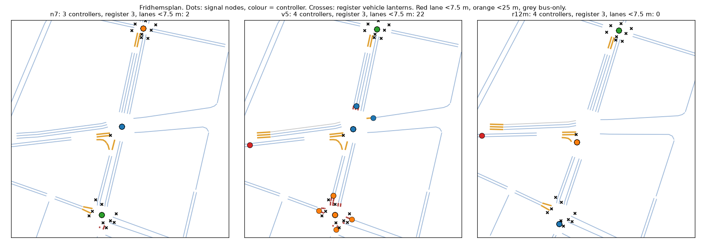

# 10. How the map becomes a network

Prototype for central Stockholm (lon 18.018 to 18.085, lat 59.322 to 59.350, about 3.8 × 3.1 km). Scripts in `scripts/net10/` on the branch named at the end, nets and runs in `/home/erikf/projects/personal/cars-data/truth/maps/net10/`.

Grades: MEASURED (I ran it here), READ (I opened the source and it says so), SNIPPET (only a search result, not opened), UNVERIFIED.

## The answer

**Yes, in this area. A net with almost every real signal runs as well as the recipe net that deletes a third of them, and it takes no new tool.** Start from the city's register, not from OSM's signal nodes, contract links by the lane length `netconvert` actually builds, give each junction its own program, and open the few bus lanes that wall car lanes apart.

**At half the file's demand, three seeds, `r12pb` has 0 teleports and 53 s of time lost per trip. `n7_ramps` has 14 to 20 teleports and 52 s, with 40 fewer controllers. `v5_inventory` has 350 to 375 teleports and 152 to 162 s.** SUMO agrees on the same net and routes: 1 teleport, 53.6 s.

**This changes a conclusion in report 02.** It says real signal positions lose capacity until real plans arrive. Here most of that loss was in how the net was built. Real plans are still needed for realism, but not to stop this area locking up. This is one 3.8 × 3.1 km box and not yet the city.

In the box, against 164 register installations with vehicle lanterns:

| MEASURED | `n7_ramps` | `v5_inventory` | **Prototype, 12 m join** |
|---|---:|---:|---:|
| Installations with no controller | **58** | 19 | **9** |
| Installations split over 3+ controllers | 0 | 3 | **0** (`r12m`; 9 counted as separate programs in `r12pb`) |
| Passenger lanes under a car (7.5 m) | 318 | 673 | **47** |
| Signal-to-signal links under 7.5 m | 2 | **163** | 2 |
| Longest generated cycle | 256 s | 90 s | **90 s** |
| Junctions the coordinator refuses, box | 369 | 502 | **191** (53 at a 25 m join) |
| Refused, Sveavägen district | 45 | 64 | **28** (8 at a 25 m join) |

`n7_ramps` reproduces the 45 refusals from the brief exactly, which supports the count. The district box is the same four corners, but `r12m` is built in UTM zone 34 and the reference nets in zone 33, so its area is slightly rotated: 86 junctions against 94.

**Not achieved:**
- "No stubs under a car" is 47 lanes, not zero.
- 9 installations still have no controller.
- The best-behaved net, `r12pb`, has 158 installations but 229 separate programs, one per junction. They share a register id and a 90 s cycle, but as actuated programs they are not locked together. The literal one-program-per-installation net, `r12mb`, also has 0 teleports but about twice the delay (103 s), because my fold into one program loses actuation.
- Opening the bus lanes is a stand-in. See below.

**No off-the-shelf converter does this.** I found no tool that takes signal installations as an input. osm2streets, OSMnx, neatnet and MATSim all merge geometry and none of them keeps both lane-level connections and signal identity, which is what `cars` needs. The commercial packages leave it to a person editing nodes, as far as their manuals show.

**Generated programs remain the weak link.** All timing here is invented by `netconvert`, so this says nothing about real capacity. The prototype makes the signals real in position and count, not in timing.

## What was wrong, in one paragraph each

**A signal in OSM is usually a stop line, not a junction.** In the box OSM has 602 `highway=traffic_signals` nodes and 372 stage 1 signal nodes after `netconvert`. 139 of those are on a stretch of road within 40 m of the crossing they serve. Making each a controller or a node creates the chains of stubs. MEASURED.

**`--tls.discard-simple` is the wrong fix for that.** It removes any signal on a node that is "geometry-like": one way in and out, or two pairs that only continue straight (`NBNodeCont::discardTrafficLights`, `NBNode::geometryLike`, SUMO source, READ). It cannot tell a stop line from a real mid-block signal. In the box this leaves `n7_ramps` with 58 of 164 installations uncontrolled, 35%. MEASURED.

**`netconvert`'s multi-node program spends green on nodes that do not conflict.** On the 5 controllers spanning 4 or more nodes, straight links get 25% of the cycle. One program per node, folded into one controller, gives 62%, with the same installation count and a 90 s cycle. Smaller controllers change little: 64% to 66% at 2 nodes. So the green loss sits at a few big junctions, but they matter: at file demand, with bus lanes open, teleports are 526 with `netconvert`'s program (`r12b`) and 122 with one program per junction (`r12pb`). SUMO's own manual says it: "Automatically generated traffic light plans work much better at a single intersection" ([PlainXML](https://sumo.dlr.de/docs/Networks/PlainXML.html), READ). MEASURED.

**Junction shapes eat road.** What counts is the length left once both junction shapes are cut out, and that can be 0.2 m: 11 such links remain in `r12m`. So the check must read lanes in the built net, then join, then rebuild, then check again. The prototype needs 4 passes: 239, 15, 6, then 0 joins. Thresholds on OSM distance, as in OSMnx or `--junctions.join-dist`, cannot see this. MEASURED.

**A bus lane between two car lanes is a wall, and it was the largest single cause here.** On Fleminggatan `179695931#0` and Valhallavägen `1337695401#1`, lane 0 is for cars turning right, lane 1 is bus and taxi only, lane 2 is for cars going straight. Traffic enters only on the left side, and a car may not change across lane 1. `duarouter` checks edges and not lanes, so it hands out the right turn anyway. **231 of 7,295 routes (3.2%) use a turn no car can reach.** Those cars wait at the end of the wrong lane and teleport, and the queue behind them blocks everyone else. SUMO labels 92 of its 279 teleports on `r12m` "wrong lane". Opening just 3 lanes on 3 edges takes `r12m` from 210 to 0 teleports. The whole `v5_inventory` net has 24 such lanes. Report 02 measured `--osm.lane-access` as a modest cost (1,721 to 2,692 teleports) and I would look at this again there. On `v5_inventory` the opening alone is not enough, 350 to 142, because the stubs and multi-node programs remain. MEASURED.

## Ranked table of what I found

The brief's dataset fields do not fit tools, so this table has what applies. Nothing here measures traffic, so "share of vehicles" and "sampling" are empty for all of them, and all but the register are global, not Sweden-specific. All of them serve need 4 (maps); only the register and NVDB serve need 5, and only for positions.

| # | Option | What it does | Keeps lanes? | Keeps signal identity? | Access, licence | Tried? | Verdict |
|---|---|---|---|---|---|---|---|
| 1 | **`netconvert` plain files + register + explicit `<join>`** (this prototype) | Contraction by built lane length; one controller per installation | Yes, including turn lanes and bus lanes | **Yes** | SUMO EPL-2.0 (UNVERIFIED); [register open WFS](../07-maps-and-intersections.md) | **Yes**, MEASURED | **Use this** |
| 2 | **OSMnx `consolidate_intersections`** 2.1.1 | Buffers nodes, merges overlaps, splits by connectivity ([source](https://raw.githubusercontent.com/gboeing/osmnx/main/osmnx/simplification.py), READ) | No lane connections | No | MIT (UNVERIFIED) | **Yes**, on the box, MEASURED below | A check, not a builder |
| 3 | **osm2streets / A/B Street** | Road polygons with a lane list; merges dog-legs and short roads ([README](https://github.com/a-b-street/osm2streets), READ) | Lane list yes; **movements only road to road**: `type Movement = (RoadID, RoadID)` ([intersection.rs](https://raw.githubusercontent.com/a-b-street/osm2streets/main/osm2streets/src/intersection.rs), READ) | Only a `Signalled` label, no program | Apache-2.0. API "isn't stable yet" | No: the brief forbids running downloads. Read source | Good ideas; would need a lane-connection and SUMO writer from us |
| 4 | **neatnet** | Rebuilds "face artifacts" with a skeleton. Beats OSMnx, parenx and cityseer against manual simplification over seven urban areas ([arXiv 2504.16198](https://arxiv.org/html/2504.16198v2), READ) | No. Paper says it targets morphology, not routing | No | Open (package licence not stated in paper) | No | Wrong purpose |
| 5 | **MATSim `IntersectionSimplifier`, `NetworkSimplifier`, `NetworkCleaner`** | Density clusters of nodes, then merges and cleans ([example](https://www.matsim.org/doxygen/classorg_1_1matsim_1_1core_1_1network_1_1algorithms_1_1intersection_simplifier_1_1_run_intersection_simplifier.html), READ; called with 30.0, 2, parameter meaning not stated there) | No, MATSim links are macroscopic | No | GPL (UNVERIFIED) | No | Wrong level |
| 6 | **Active-transport network, Jafari et al. 2021** | Merges neighbouring nodes under 20 m, then cleans loops and parallel links ([arXiv 2104.03063](https://arxiv.org/pdf/2104.03063), READ) | No | No | Open paper | No | Confirms the 20 m range is common |
| 7 | **CommonRoad Scenario Designer** | OSM, Lanelet2, OpenDRIVE, SUMO converters. OSM lanes are "estimated" and manual editing is often advised. BETA ([README](https://github.com/CommonRoad/commonroad-scenario-designer), READ) | Estimated | Not described | GPL-3.0 | No | Adds a format, not information |
| 8 | **Aimsun Next** | OSM import gives "a draft network" ([importer](https://docs.aimsun.com/next/26.0.0/UsersManual/OSMImporter.html), READ). A node is a point or area defined by its turns, signal groups live in the node ([nodes](https://docs.aimsun.com/next/26.0.0/UsersManual/NodeEditing.html), READ) | Yes | Yes, by hand | Paid, price not found | No | Same data model as our target. No automatic cleanup documented |
| 9 | **PTV Visum/Vissim** | Controllers attach to nodes or main nodes; lane turns must sit at them ([Visum signals](https://cgi.ptvgroup.com/vision-help/VISUM_2022_ENG/Content/1_Netzmodell/1_2_Signalisierung.htm), READ). OSM reaches Vissim through Visum (SNIPPET) | Yes | Yes, by hand | Paid, price not found | No | "Main node" is the idea this prototype copies |
| 10 | **TransModeler** | Imports from Synchro, CORSIM, HCS ([features](https://caliper.com/transmodeler/additionalfeatures.htm), SNIPPET). OSM import not found | Yes | From Synchro | Paid | No | No evidence for OSM |
| 11 | **CityFlow, LibSignal, RESCO** | One intersection, one `trafficLight` plan ([CityFlow](https://cityflow.readthedocs.io/en/latest/roadnet.html), READ). Its converter starts from a SUMO net, so it inherits the problem. LibSignal and RESCO: SNIPPET only | Lane links, yes | Inherited | Open | No | Downstream of this work |
| 12 | **SUMO's city scenarios** | [TAPAS Cologne](https://sumo.dlr.de/docs/Data/Scenarios/TAPASCologne.html) says "Lots of complex junctions which should be simplified (automatic joining failed)" and "only hardly usable" (READ) | Yes | Unsynchronised | Open | No | Nobody has solved this; the good scenarios are hand-fixed |

### OSMnx, measured on the box

Tolerance is a per-node radius, so 15 means nodes up to about 30 m apart merge. "1" counts register installations with exactly one intersection within 40 m of their vehicle lanterns. This is not the same metric as controllers in the first table, so compare only down the column. Edge lengths are centroid to centroid, so they say nothing about buildable lanes.

| Tolerance, m | Intersections | Installations with 0 / 1 / 2 / 3+ | Intersections touching 2+ installations |
|---:|---:|---:|---:|
| 5 | 947 | 24 / 64 / 33 / 43 | 8 |
| 10 | 776 | 24 / 85 / 31 / 24 | 7 |
| 15 | 685 | 24 / 99 / 28 / 13 | 6 |
| 20 | 621 | 26 / 112 / 19 / 7 | 5 |
| 25 | 549 | 30 / 121 / 10 / 3 | 5 |
| 30 | 453 | 48 / 109 / 5 / 2 | 3 |

**No single radius works.** The best match is at 25 m and still leaves 43 of 164 wrong, and larger radii start losing crossings entirely. The register has to decide per place, which is what the prototype does. MEASURED.

### osm2streets on Stockholm

Its road collapse acts on roads flagged from `junction=intersection`: the code comment reads "Collapse all roads marked with `junction=intersection`" ([source](https://raw.githubusercontent.com/a-b-street/osm2streets/main/osm2streets/src/transform/collapse_short_road.rs), READ). **Central Stockholm has 0 such tags** (MEASURED, `grep` on the clip). Issue [#62](https://github.com/a-b-street/osm2streets/issues/62) describes dog-leg merging and hard cases near dual carriageways; I read no numeric threshold. I did not run it, so what its other transforms would do here is UNVERIFIED.

Worth stealing from it: its intersection kinds (`Connection`, `Fork`, `Intersection`, each decided from movements), which is a cleaner test for "is this a real conflict" than my neighbour count.

## The prototype

```sh
source /home/erikf/projects/personal/cars-data/dev-env.sh
W=/home/erikf/projects/personal/cars-data/truth/maps/net10
scripts/net10/stage1.sh $W/central.osm.xml $W/s1     # OSM to plain files, with turn lanes and bus lanes
scripts/net10/rebuild_all.sh                          # all variants
scripts/net10/routes.sh                                # one demand, routed the same way on every net
scripts/net10/local_cell.sh r12pb 0.5                 # about 30 s to 2 min on llvmpipe, depending on load
scripts/net10/sumo_check.sh r12pb 0.5                 # the same run in SUMO
python3 scripts/net10/walls.py NET.xml ROUTES.xml     # the lane-level route check
```

What `scripts/net10/build.py` does, in order:

1. **Assign.** Each OSM signal node goes to the nearest register point within 45 m, as in report 07. NVDB only: its own group. Neither: removed (9 nodes).
2. **Move stop lines.** A signal not on a crossing walks along the road up to 40 m. If it finds a crossing of the same installation, or a free one within 30 m of the installation's register points, it moves there (139). Otherwise it is a real mid-block signal and stays (71).
3. **Promote.** An installation with vehicle lanterns and no OSM signal gets the nearest free crossing (12), for example Gustav Adolfs torg 4413 and 4414, where report 07 found OSM has give-way signs.
4. **Contract.** Build, read lanes shorter than the limit, join their end nodes with `<join>`, build again, until nothing changes. Exceptions: roads over 70 km/h, roundabouts, clusters over 70 m across, and two installations joined by a link that still holds a car.
5. **One program per node, one controller.** `merge_tls.py` lays each node's generated program side by side in one `tlLogic`, same 90 s, renumbered link indices. Each node's states stay valid because each was built for that node.

6. **Open walled bus lanes.** `open_islands.py` opens a bus-only lane only where it sits between two car lanes on one edge. Here that is 3 of 67.

| Variant | Join | Program | Walled bus lanes |
|---|---:|---|---|
| `r12` | 12 m | `netconvert`, multi-node, actuated | closed |
| `r12b` | 12 m | same | open |
| `r12p` | 12 m | one per junction, actuated | closed |
| `r12pb` | 12 m | same | open |
| `r12m` | 12 m | one per installation, folded, static | closed |
| `r12mb` | 12 m | same | open |
| `r25m`, `r25mb` | 25 m | folded, static | closed, open |

### Lane-level sanity, MEASURED

| | `n7_ramps` | `v5_inventory` | `r12m` | `r25m` |
|---|---:|---:|---:|---:|
| Junctions | 1,509 | 1,871 | 1,313 | 1,185 |
| Controllers (register 164 with vehicle lanterns) | 118 | 159 | 158 | 158 |
| Signal nodes | 129 | 475 | 229 | 217 |
| Installations with 0 / 1 / 2 / 3+ controllers | 58 / 99 / 7 / 0 | 19 / 140 / 2 / 3 | **9 / 151 / 4 / 0** | 9 / 151 / 4 / 0 |
| Controllers with no register point within 40 m | 5 | 6 | 1 | 1 |
| Lanes under 7.5 m | 318 | 673 | **47** | 48 |
| Lanes under 25 m | 670 | 1,254 | 319 | **113** |
| Signal approaches under 7.5 m | 27 | 240 | 11 | 10 |
| Signal approaches under 25 m | 72 | 398 | 72 | **30** |
| Signal-to-signal links under 7.5 m | 2 | 163 | 2 | 3 |
| Signal-to-signal links under 25 m | 11 | 260 | 27 | 11 |
| Longest cycle | 256 s | 90 s | 90 s | 90 s |
| Stranded passenger lanes | 55 | 39 | **32** | 29 |
| Lanes whose only exit is a U-turn | 181 | 176 | 171 | 169 |
| Bus-only lanes closed to cars | 0 | 83 | 67 | 64 |
| Lane-km | 281.9 | 268.9 | 267.3 | 263.1 |
| Largest strongly connected share | 92.67% | 92.57% | 92.73% | 92.74% |
| **Junctions over 60 m across** | 7 | 5 | **26** | **53** |
| **Internal lanes over 60 m** | 6 | 12 | **41** | **107** |

**The bottom two rows are the cost.** Contraction makes big junctions, and at 25 m it makes too many. A car on a 60 m internal lane crosses with no stop line for the whole length, which may overstate or understate conflict. Nothing here tests that. The strongly connected share is low on all nets because cutting a box leaves ends that cannot return, so it compares nets, not quality.

`n7_ramps` has zero bus-only lanes because that recipe leaves them open to cars, as report 02 says.

### What is still wrong

- **47 lanes under a car**, on 35 edges: 21 on roundabout rings, 3 where the road type gives over 70 km/h (Slottsbacken has two such links of 0.1 and 0.2 m; that speed needs checking), and 11 others (8 with a signal at one end, 3 with none). The build logged those as skipped for touching a roundabout node or by the 70 m cluster limit; I did not check which applies to each. I excluded roundabouts on purpose, since a roundabout's short arcs are not a chain of junctions, but arms cut to 0.2 m are real stubs.
- **9 installations have no controller:** 109 Skeppsbron, 4408 and 4488 Jakobsgatan, 4461 Olof Palmes gata, 5517 Norrbackagatan, 5526 and 5528 at the box's north edge, 5534 Karlbergsrampen, 5546 S:t Eriksgatan. Most have a car lane within 15 m and no crossing near, so they are likely mid-block or ramp signals needing a new node in the middle of an edge. 5517 did get a signal: its junction, the only one in the box holding two sources (5517 and an NVDB-only group), is 69.7 m from the centre of its lanterns, so the metric misses it.
- **4 installations touch 2 controllers.** Some may be neighbours within 40 m, since this metric is a radius.
- **Demand parity:** the same origin and destination list routes to 7,595 of 7,676 trips on `n7_ramps`, 7,219 of 7,439 on `v5_inventory`, and 7,295 of 7,438 on `r12m`. About 3% are lost on the last two before routing because an end snaps badly or both ends land on one edge. Comparisons below are per run, so read them with that in mind.

## Traffic test

**Half of the file's demand, three seeds, MEASURED.** Teleports and time lost are per seed, 600 s after demand ends.

| Net | Teleports | Cars left | Time lost per trip, s | Trip time, s | Trips routed |
|---|---:|---:|---:|---:|---:|
| `n7_ramps` | 14, 20, 16 | 2, 0, 1 | 52 | 258 | 7,595 |
| `v5_inventory` | 350, 371, 375 | 454, 441, 425 | 156 | 351 | 7,219 |
| `r12m` | 210, 242, 231 | 286, 279, 296 | 136 | 331 | 7,295 |
| `r12mb` | **0, 0, 0** | 18, 18, 20 | 103 | 302 | 7,295 |
| **`r12pb`** | **0, 0, 0** | **1, 1, 1** | **53** | **253** | 7,295 |

One seed at the same demand: `r12` 219 teleports, 107 s. `r12b` 16, 73 s. `r12p` 211, 86 s. `r25m` 180, 131 s. `r25mb` 0, 109 s, with 30 cars left. `v5_inventory` with its 6 walled lanes open 142, 128 s.

**The file's full demand, one seed, MEASURED.**

| Net | Teleports | Cars left | Time lost, s | Inserted | Arrived |
|---|---:|---:|---:|---:|---:|
| `n7_ramps` | 236 | 199 | 79 | 15,287 | 15,088 |
| `v5_inventory` | 1,640 | 2,353 | 268 | 13,673 | 11,323 |
| `v5_inventory`, walls open | 1,292 | 2,210 | 236 | 13,847 | 11,636 |
| `r12m` | 725 | 1,744 | 198 | 14,546 | 12,803 |
| `r12p` | 619 | 1,321 | 137 | 14,633 | 13,313 |
| `r12b` | 526 | 590 | 118 | 14,559 | 13,969 |
| `r12mb` | 179 | 685 | 148 | 14,645 | 13,960 |
| **`r12pb`** | **122** | 262 | **86** | 14,740 | 14,478 |
| **`r12pb`, demand × 1.07** | **155** | 351 | 90 | 15,784 | 15,433 |

The last row is there because `r12pb` routes fewer trips than `n7_ramps`. At × 1.07 it carries the same vehicle-km (35,398 against 35,570). On that equal footing it has fewer teleports than `n7_ramps`, 155 against 236, but 14% more delay and more cars left, 351 against 199. That is about what 40 extra signals should cost.

**Past capacity, × 1.67, one seed, at 3,600 s:** `n7_ramps` 1,395 teleports, 5,024 cars on the net. `r12pb` 764, 4,718. Both are overloaded, so this shows no lock-up advantage for deleting signals. The `r12pb` run was cut off at 3,960 s by my time limit, so I compare at 3,600 s.

**SUMO cross-check, half demand, one seed, MEASURED.** It loads the folded and per-junction nets without error.

| Net | | Teleports | Time lost, s | Trip time, s |
|---|---|---:|---:|---:|
| `r12m` | SUMO | 279 (92 wrong lane, 112 jam, 75 yield) | 135.8 | 330.4 |
| | `cars` | 210 | 137.1 | 331.4 |
| `r12pb` | SUMO | 1 | 53.6 | 252.0 |
| | `cars` | 0 | 53.2 | 252.4 |

**What this does not show:**
- **Reality.** Time lost is not checked against any measurement. All signal timing is generated.
- **The city.** The box's edges drain freely, so queues that would spill in from outside are missing.
- **Fitted demand.** Routes are one-shot shortest paths with noise, not fitted to counts.
- **Street truth for the bus lanes.** I did not check whether cars may cross at those three places.
- **Internal safety.** I did not compare collisions, and contraction makes bigger junctions.

**Demand.** The part of each `v2_c4` trip inside the box in 07:00 to 08:00: 15,443 trips. Each end is a coordinate and bearing, snapped to each net, routed with `duarouter --weights.random-factor 1.5`. One rule on every net. These are not the fitted routes, so `n7_ramps` loses the benefit of being the net the demand was fitted on. Scale 1.0 is the file, which report 02 calls 60% of the count-fitted demand. Scale 0.5 is half of that. Cold start, no background traffic, one seed. The box's edges drain freely, so queues that would spill in from outside are missing.

**Same run settings as report 02:** `--time-to-teleport 120 --ignore-junction-blocker 20`, 3,600 s of demand and 600 s to drain, `cars` at this branch's head on llvmpipe.



*Fridhemsplan. The register has 3 installations here. `v5_inventory` has 22 lanes under a car around its signals, the prototype none. The figures are in `research/truth/fig/net10/`; `r12m` has the same layout as `r12pb`.*

## Top 3 recommendations

1. **Build the whole municipality the `r12pb` way and rerun report 02's pipeline on it.** This is the test that decides whether the city's lock-up shrinks as the box's did. Next step: remove the box from `stage1.sh`, keep the 12 m limit, run `rebuild_all.sh` with `heavy`, then report 02's route feedback and full day. Outside the municipality there is no register, so keep the current rules there.
2. **Make lane-level route checking part of every net build.** `walls.py` found the largest single cause here in seconds. Next step: make it follow chains of split edges, because its one-step check reports 0 on `v5_inventory`, whose walls span two edges. Replace blanket opening with a short open stretch before the junction, which is closer to the real street. Add the checks to `maps_sanity.py`.
3. **Make one real controller per installation without losing actuation.** The fold gets 0 teleports at twice the delay of the per-junction programs. Next step: make `merge_tls.py` keep `minDur` and `maxDur` per stage, or have `cars` advance grouped programs together. Then place the last 9 installations with `<split>`, and cap junction growth near 60 m. When real plans arrive they go in this same place.

## What only Erik can do

- **Signal plans** remain the top ask, as reports 02 and 07 say. This prototype makes them usable: each register id now maps to one `tlLogic`, so a plan has one place to go. I wrote no new draft, since report 07's request stands.
- **A street check** at Fleminggatan by S:t Eriksgatan, Valhallavägen `1337695401#1` and `1337586672`: is the bus lane between the car lanes real, and where can a car cross it to turn right? This decides what replaces my blanket opening. OSM is the only source I have for it.

## Dead ends

- **`--junctions.join-dist` alone.** Report 02 used 15 m. It works on OSM distance, so it misses stubs made by junction shapes.
- **OSMnx or neatnet as a builder.** They lose lane connections.
- **Lanelet2 or OpenDRIVE as an intermediate.** They are formats. OSM still supplies the data, and report 07's verdict stands.
- **Aimsun, Visum and TransModeler manuals for an automatic method.** I found none. Their OSM import is a draft to edit by hand.
- **`--tls.discard-simple` for stubs.** It removes real signals.
- **Running `nix develop` repeatedly on the PC:** it stalled under load. Use `dev-env.sh`.
- **`--tls.join` as the route to one controller per installation.** Its multi-node programs are what `r12b` against `r12pb` measures.

## New directions I could not cover

- **The register's lantern positions give stop lines.** I only used them to assign controllers. They could set `stopOffset` and the real storage length between two stop lines.
- **The register's `F` numbers per lantern** could set approach-to-group mapping, which gets close to real phase structure without the city's plans.
- **`--junctions.minimal-shape`** might save road length without joining. Not tried.
- **Turn-lane and bus-lane tags at short edges** cause some lane drops; `--geometry.remove.min-length` might remove these. Not tried.
- **Other cities.** The bus-lane wall may exist wherever OSM tags a bus lane in the middle of an edge. `walls.py` works on any SUMO net, including Berlin's.
