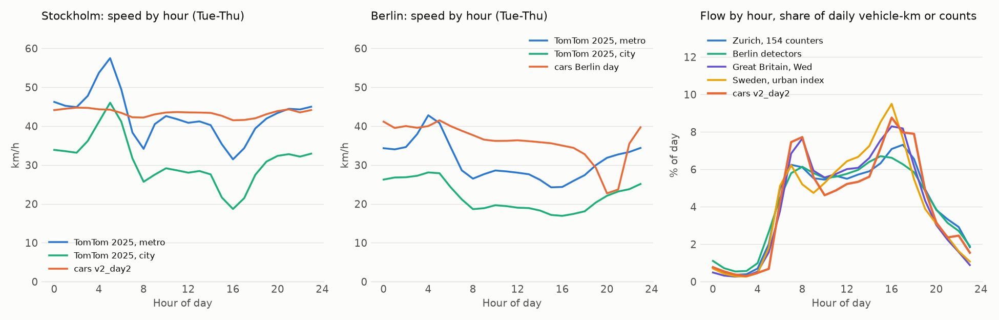

# 14: What a normal day looks like, in numbers

Checked 2026-11-02. Nobody was contacted. No GPU was used. Grades: **MEASURED**, **PROVIDER CLAIM**, **MODELLED**, **UNVERIFIED**. "DERIVED" below means my own arithmetic on graded inputs, and it takes the weaker grade of those inputs.

## The answer

**Our best Stockholm day, `v2_day2`, is not a real city: it fails 9 of 20 sanity checks outright and is out of the plausible range on 3 more. It has the right average speed for the wrong reason.** 42.8 km/h is inside the real range, close to TomTom's 40.7 km/h for greater Stockholm. But a real city drops to about 60% of its night speed at rush hour, and `v2_day2` only drops to 93%. It also carries about a third of the distance real traffic would drive (3.6 vehicle-km per person against 8 to 15). The network is simply nearly empty: main roads peak at 13% of the critical density real networks approach.

**So the flat speed is a symptom, and the volume is the disease.** Real networks carry about three times the traffic and slow down without locking up. Ours carries a third with no slowdown, and report 02 found it heading for lock-up as demand rises towards 100%. Lowering demand removed the failure from view without fixing it.

**One suspicion turned out wrong.** The hourly flow shape is close to real. After I corrected an output bug (see [Mismatches](#mismatches)), the morning and evening peak shares pass, and only midday is too low. The Berlin day passes 10 of 20 checks and fails 7, with 39% of the real distance and its worst jam at 20:00, after the real rush hour has ended.

## Reference table: the gate's sanity checks

"Plausible" is what a real European city of 0.5 to 4 million does on a normal weekday. "Hard" is the limit past which a simulated day is not a real city. Outside plausible is a warning; outside hard is a failure. All bands are coded in [`normal_day_gate.py`](../../../scripts/datahunt/normal_day_gate.py), and the speed bands are the measured 5th to 95th percentiles over 64 cities.

The bands are my judgement from the evidence listed, not published limits. They are for catching a wrong simulation, and they don't replace the gate's tests against a real measured day.

| Check | Plausible | Hard | Main evidence | Grade |
|---|---|---|---|---|
| **Day shape, network, share of daily km** | | | | |
| AM peak hour | 5–8.5% | 4.5–10% | Zurich 6.2, Berlin 6.1, GB 7.6, Paris 5.7, Sweden urban 6.2 | MEASURED |
| PM peak hour | 5.5–9.5% | 5–11% | Zurich 7.3, Berlin 6.7, GB 8.3, Paris 5.6, Sweden urban 9.5 | MEASURED |
| AM peak ÷ midday hour | 1.0–1.4 | 0.9–1.7 | Zurich 1.11, Berlin 1.05, GB 1.27, Paris 1.04 | MEASURED |
| PM peak ÷ midday hour | 1.0–1.55 | 0.95–1.9 | Zurich 1.30, Berlin 1.14, GB 1.38, Paris 1.02, Sweden 1.51 | MEASURED |
| Night, 22:00–06:00 | 5.5–12.5% | 4–17% | GB 6.0, Sweden 6.7, Zurich 9.5, Berlin 11.2, Paris 16.3 | MEASURED |
| 07:00–19:00 | 70–82% | 65–85% | Berlin 72.5, Zurich 73.4, GB 80.7 | MEASURED |
| Quietest hour ÷ midday | 0.04–0.16 | 0.02–0.20 | GB 0.045, Zurich 0.066, Berlin 0.093, Paris 0.16 | MEASURED |
| **Speed, whole network, Tue–Thu** | | | | |
| Mean speed, km/h (greater-city area) | 28–46 | 20–55 | TomTom 64 cities, median 36.4; Stockholm 40.7, Berlin 29.4 | MEASURED probe, provider-processed |
| Worst hour ÷ night speed | 0.51–0.745 | 0.42–0.84 | Same, median 0.61; Stockholm 0.64, Berlin 0.63 | same |
| Worst hour ÷ midday speed | 0.735–0.90 | 0.67–0.95 | Same, median 0.81; Stockholm 0.76, Berlin 0.87 | same |
| Hour of worst speed | 08–18 | 07–19 | Same; median 16:00 | same |
| Hours a day over 30% extra travel time | 6–15 | 2–17 | Same, median 12; Stockholm 9, Berlin 13 | same |
| Main-road daily speed, km/h | 19–36 | 15–40 | TomTom non-highway, all-day and rush hour | same |
| **Volume** | | | | |
| Vehicle-km per person per weekday | 8–15 | 6–20 | Stockholm city about 11, Berlin 11.0, London 9.8, Birmingham 14.7 | DERIVED from MODELLED official totals |
| Vehicles on the road at peak, share of cars | 5–11% | 3.5–15% | RAC 3.5–4.4% in motion on average, scaled to peak; Berlin about 9% | DERIVED |
| **Network curve, main roads** | | | | |
| Peak flow ÷ capacity (521 veh/h/lane) | 50–105% | 40–120% | Loder 107 networks; Berlin about 80% | DERIVED, MODELLED |
| Peak density ÷ critical (27.8 veh/km/lane) | 40–105% | 30–140% | Loder; Berlin about 60%; Paris at the plateau | DERIVED, MODELLED |
| **Trips** | | | | |
| Mean car trip length, km | 7–13 | 5–19 | Berlin 7.8–9.7, Germany median about 6.7, mean 18.5 with long trips | MEASURED survey |
| Mean car trip duration, min | 16–30 | 13–35 | Berlin driver 25 | MEASURED survey, door to door, self-reported |
| Mean trip speed, km/h | 20–35 | 16–40 | Berlin driver 23 | DERIVED from survey |

Not yet in the coded gate, because our runs don't cover them or the real figure is one city only:

| Check | Plausible | Evidence | Grade |
|---|---|---|---|
| Highway speed, all-day km/h | 67–102 | TomTom 64 cities, median 81. Stockholm 70.1, Berlin 70.3 | same as above |
| Highway speed at rush hour ÷ free-flow | 0.57–0.92 | TomTom, median 0.70. Stockholm 0.67 | same |
| Non-highway speed, all-day km/h | 23–36 | TomTom, median 28.5. Stockholm 30.1, Berlin 24.8 | same |
| Non-highway at rush hour ÷ free-flow | 0.54–0.70 | TomTom, median 0.62. Stockholm 0.63 | same |
| City-centre mean speed, km/h | 18–31 | TomTom centre, median 24.4. Stockholm 28.8, Berlin 20.7 | same |
| Share of km on motorways | Very local: 5–54% | TomTom metro, median 37%, probe-biased. Stockholm 46%; official share on state roads in Stockholm city 46%; Berlin 17–18% official | MEASURED/MODELLED |
| Saturday ÷ Tue–Thu flow | 0.80–1.03 | Zurich 0.94, GB urban 0.87, Sweden 0.79, Paris 1.03 | MEASURED |
| Sunday ÷ Tue–Thu flow | 0.70–0.95 | Zurich 0.76, GB urban 0.73, Sweden 0.79, Paris 0.95 | MEASURED |
| Network total, one day against another | 2–6% | Zurich: median deviation 2.3%, standard deviation 6.4% with holidays left in; 4.2% week to week | MEASURED |
| One site's daily total, day to day | 3–8% | Zurich: median deviation 3.3%, standard deviation 8.0% | MEASURED |
| One site's single hour, day to day | 6–9% | Zurich 5.6%; Berlin 8.7% per lane, 6.3% per site (report 04) | MEASURED |
| Signal saturation flow, through lane | 1,800–2,100 veh/h | Report 04: Split 1,967, Prague 2,093, Swedish handbook 1,900 | MEASURED, handbook |
| Share of street-hours saturated or blocked | 8–13% by day, 5.5% over 24 h | Paris only: November 2025, its own classification | MEASURED, one city |
| Time above the network's critical point | About 0–3% | Ambühl: Zurich 2.78, London 2.96, Madrid 1.73, Bern 0. Preliminary, unit not stated, read as % | MODELLED |

**What the numbers don't support.** There's no universal peak. Real roads differ widely: 12% of the daily flow in the peak hour at E18 Bålsta, against 6–7% on Essingeleden (report 02). Dense cities such as Paris have almost no flow peak at all, because their streets are full all day. Their rush hour shows up in speed, not flow. So a day can have a flat flow profile and be real, but a flat speed profile on a loaded network is not something I found in any city group.

## Europe like Stockholm and Berlin, against everywhere else

TomTom 2025, Tue–Thu, 5th / 50th / 95th percentile. I extracted it myself from 213 city pages. All values are greater-city ("metro") unless marked.

| | Europe 0.5–4 M (64) | Europe under 0.5 M (35) | Rest of world (112) | Stockholm | Berlin |
|---|---:|---:|---:|---:|---:|
| Mean speed, km/h | 28 / 36 / 46 | 31 / 42 / 55 | 20 / 30 / 46 | 40.7 | 29.4 |
| Night speed, km/h | 37 / 48 / 59 | 35 / 51 / 65 | 29 / 42 / 58 | 48.8 | 38.5 |
| Midday speed, km/h | 28 / 36 / 46 | 31 / 41 / 54 | 19 / 29 / 47 | 41.4 | 27.8 |
| Rush-hour speed, km/h | 23 / 31 / 39 | 25 / 36 / 48 | 17 / 26 / 42 | 33.7 | 25.7 |
| Worst hour ÷ night | 0.51 / 0.61 / 0.75 | 0.55 / 0.68 / 0.84 | 0.45 / 0.57 / 0.82 | 0.64 | 0.63 |
| Worst hour ÷ midday | 0.74 / 0.81 / 0.90 | 0.75 / 0.84 / 0.93 | 0.73 / 0.83 / 0.93 | 0.76 | 0.87 |
| Hours over 30% extra time | 6 / 12 / 15 | 0 / 9 / 13 | 4 / 14 / 16 | 9 | 13 |
| City-centre mean speed, km/h | 19 / 24 / 31 | 21 / 30 / 40 | 18 / 24 / 36 | 28.8 | 20.7 |

The dip is remarkably stable. Across these groups the median worst hour is 57 to 68% of night speed. In the Stockholm and Berlin group the 95th percentile is 0.745, and even in the small-city group it is only 0.84. "Europe" here excludes Turkey, Russia, Ukraine and Belarus, which sit in "rest of world" along with everything outside Europe.

Close peers, for a quick look:

| City | Mean | Night | Worst AM | Worst PM | Worst ÷ night | Highway | Non-highway |
|---|---:|---:|---:|---:|---:|---:|---:|
| Stockholm | 40.7 | 48.8 | 34.2 | 31.5 | 0.64 | 70.1 | 30.1 |
| Gothenburg | 45.6 | 50.4 | 42.1 | 36.4 | 0.72 | 73.8 | 37.3 |
| Oslo | 39.2 | 42.6 | 33.3 | 29.4 | 0.69 | 69.8 | 36.0 |
| Copenhagen | 43.4 | 48.8 | 36.7 | 36.0 | 0.74 | 86.6 | 28.1 |
| Helsinki | 30.6 | 37.8 | 27.4 | 26.8 | 0.71 | 74.9 | 25.6 |
| Berlin | 29.4 | 38.5 | 26.5 | 24.3 | 0.63 | 70.3 | 24.8 |
| Hamburg | 36.4 | 48.6 | 31.7 | 30.6 | 0.63 | 75.8 | 28.4 |
| Munich | 46.3 | 56.5 | 39.5 | 36.7 | 0.65 | 92.4 | 30.6 |
| Vienna | 33.8 | 41.1 | 30.1 | 27.7 | 0.67 | 68.5 | 24.7 |
| Zurich | 45.0 | 54.3 | 39.8 | 33.8 | 0.62 | 82.4 | 31.2 |
| Prague | 39.7 | 54.2 | 31.2 | 31.8 | 0.58 | 85.4 | 35.5 |
| London (other group) | 26.2 | 37.0 | 21.7 | 21.5 | 0.58 | 77.7 | 24.2 |
| Paris (other group) | 31.7 | 42.0 | 25.9 | 24.7 | 0.59 | 63.8 | 24.6 |

**Official Stockholm check, MEASURED via probe data, 2018 main network:** inner city 26.2 km/h morning and 24.6 evening; outer city 41.4 and 40.6. The same report says 2017 gave 19.3 / 17.2 and 36 / 36.9 with a different data supplier, and that the supplier change probably explains most of that jump. So a real speed figure can move this much with the supplier alone. Treat bands as bands. [Stockholms trafikutveckling 2018](https://start.stockholm/globalassets/start/om-stockholms-stad/utredningar-statistik-och-fakta/utredningar-och-rapporter/trafik-och-stadsmiljo/motortrafik/stockholms-trafikutveckling-2019-motorfordorn.pdf)

**Stockholm volumes, MEASURED counts, October 2018, vehicles per weekday:** regional centre cordon 974,200; inner-city cordon 412,100; Saltsjö-Mälar cut 310,200; city cut 227,500; Essingeleden 170,500. Same source.

## Our runs against reality

From [`gate_results.txt`](14-data/gate_results.txt), produced by the script, not typed by hand. Berlin uses 3,748,148 residents and 1,244,061 cars. Stockholm uses the 1,809,390 people SCB counts inside the clip's bounding box, and about 720,000 cars, which assumes the county's 398 cars per 1,000 people.

| Check | `v2_day2` | | Berlin day | |
|---|---:|---|---:|---|
| AM peak hour share | 7.7% | pass | 6.1% | pass |
| PM peak hour share | 8.8% | pass | 7.3% | pass |
| AM peak ÷ midday | 1.51 | warn | 0.94 | warn |
| PM peak ÷ midday | 1.71 | warn | 1.13 | pass |
| Night share | 7.2% | pass | 4.8% | warn |
| 07:00–19:00 share | 78.2% | pass | 77.8% | pass |
| Quietest hour ÷ midday | 0.059 | pass | 0.006 | **FAIL** |
| Vehicle-km per person | 3.56 | **FAIL** | 4.27 | **FAIL** |
| On the road at peak, share of cars | 2.3% | **FAIL** | 3.1% | **FAIL** |
| Mean speed | 42.8 | pass | 34.3 | pass |
| Worst hour ÷ night speed | 0.93 | **FAIL** | 0.57 | pass |
| Worst hour ÷ midday speed | 0.95 | **FAIL** | 0.63 | **FAIL** |
| Hour of worst speed | 16:00 | pass | 20:00 | **FAIL** |
| Hours over 1.3 travel-time index | 0 | **FAIL** | 14 | pass |
| Mean trip length | 8.8 km | pass | 7.9 km | pass |
| Mean trip duration | 12.6 min | **FAIL** | 14.0 min | warn |
| Mean trip speed | 41.8 km/h | **FAIL** | 33.7 km/h | pass |
| Main-road peak flow ÷ capacity | 27% | **FAIL** | 36% | **FAIL** |
| Main-road peak density ÷ critical | 13% | **FAIL** | 21% | **FAIL** |
| Main-road daily speed | 39.4 | warn | 33.0 | pass |
| **Total** | **8 pass, 3 warn, 9 fail** | | **10 pass, 3 warn, 7 fail** | |

**A pass here is weak evidence.** Most of these runs' passes are in shape or average speed, and those can pass on a network with a third of its real traffic. Passing the Berlin dip is the clearest example: it reaches 0.57 only because of a jam at 20:00.

The other full-day Stockholm runs, from `metrics.jsonl`. They fail in both directions, and none has both real volume and a real dip:

| Run | Scheduled trips | Vehicle-km | Mean km/h | Worst ÷ best hour | Teleports |
|---|---:|---:|---:|---:|---:|
| Real, greater Stockholm | n/a | about 16–20 M (DERIVED) | 40.7 | 0.55 | n/a |
| `v2_day2` | 790,967 | 6.44 M | 42.8 | 0.93 | 2,449 |
| `n9_day` | 789,076 | 6.44 M | 41.7 | 0.89 | 8,411 |
| `d_c_due3` | 789,331 | 6.42 M | 40.3 | 0.78 | 5,687 |
| `v2_day` | 790,967 | 6.42 M | 38.2 | 0.58, at a 19:00 jam | 9,558 |
| `base60` | 1,751,306 | 3.90 M | 8.9 | 0.10 | 290,352 |
| `v5_day` | 840,417 | 5.49 M | 4.6 | 0.04 | 631,888 |
| `v8_day` | 804,697 | 5.25 M | 4.4 | 0.04 | 693,103 |

Worst ÷ best for these runs is from `speed_by_hour`, so it isn't quite the same as the worst ÷ night figures above. The real row's 0.55 is the Europe 0.5–4 M median; Stockholm's own figure is about the same.

## Mismatches

Ranked by how much each one matters.

| # | Mismatch | Real | Ours | My reading |
|---|---|---|---|---|
| 1 | **Too little traffic, both cities** | 8–15 vehicle-km per person; Stockholm about 16–20 M km in the clip, Berlin 41.3 M | 3.6 per person, 6.44 M (32–40%); 4.3 per person, 15.99 M (39%) | Largest error. Report 03 already traced Berlin's; `stockholm-final.json` gives a 0.40 ratio on matched Stockholm edges, which agrees. Report 02 scaled demand to stop lock-up. |
| 2 | **No rush-hour dip in Stockholm** | Worst hour 0.51–0.75 of night; own 0.64 | 0.93 | Follows mostly from 1. Also: `v2_day` had a dip until a final routing round removed it. |
| 3 | **Main roads almost empty** | About 80% of capacity at peak in Berlin, plateau in Paris | 27% and 36% of capacity, 13% and 21% of critical density | Same cause. The run never reaches the part of the network curve where real cities spend their peaks, so the curve is untested. |
| 4 | **Motorways don't slow down** | Stockholm 70 km/h falling to 55–58, with rush hour 0.67 of free flow | Motorway 67.5 km/h falling to 65–66 | Motorway km 32% of target in report 02. |
| 5 | **Non-highway roads too fast** | Stockholm 30.1, rush hour 25.6; Berlin 24.8, rush hour 21.7 | 35.0 in Stockholm; 31.4 in Berlin | Too little signal and junction delay. Likely also missing parked cars, bus stops, pedestrians. Inference, not tested. |
| 6 | **Trips too quick** | Survey: 25 min, 23 km/h for Berlin drivers | 12.6 min at 41.8 km/h; 14.0 min at 33.7 km/h | Part of this is real delay, and part is method: surveys are door to door and self-reported. Length is fine, which points at speed, not trip distance. |
| 7 | **Too few cars on the road** | 5–11% of cars | 2.3%, 3.1% | Follows from 1. |
| 8 | **Berlin's jam comes at the wrong time** | Worst 15:00–17:00, about 24 km/h, recovering by 19:00 | Worst 20:00, 22.7 km/h, motorway down to 16 km/h | Known issue (report 03). A real evening never does this. |
| 9 | **Berlin too fast through the day** | 26–29 km/h at 08:00–14:00 | 36–38 km/h | Follows from 1, plus 5. |
| 10 | **Berlin's night is missing** | 11.2% of detector counts, quietest hour 0.09 of midday | 4.8%, 0.006 | Demand file has almost no trips from 00:00 to 04:00. Report 03 puts 16% of the gap in hours 22–04. |
| 11 | **Stockholm's midday too low** | Peak ÷ midday 1.0–1.55 | 1.51, 1.71 | The hourly profile is invented, as report 02 said. Close to the real shape, but it isn't evidence. |
| 12 | **Same profile on every road class** | Differ: 12% peak hour on E18 Bålsta against 6–7% on Essingeleden | All classes within 0.1 points of 7.7% and 8.8% | Same cause as 11. Real commuter roads peak and city streets spread. |
| 13 | **Speed barely varies by hour within any class** | Non-highway rush hour is 0.54–0.70 of free flow | Tertiary 0.91, local 0.95 (peak ÷ night) | Same cause as 1 and 5. |

Passes that aren't mismatches: mean network speed in both cities, trip length in both, peak hour timing in Stockholm, Stockholm's motorway share of 39% against a real figure around 46%.

**Bug found on the way, in how `--diagnose-at` output is written.** In `v2_day2` the edge output has no bins starting at 06:45, 07:45, 15:45 and 16:45, and the bins at 07:00, 08:00, 16:00 and 17:00 hold twice the traffic. So each diagnosed time merges the quarter before it into its own bin. If you sum `edges.csv` by hour, the peaks look sharper than they were: uncorrected, I got 1.90 and 1.99 for peak ÷ midday instead of 1.51 and 1.71, and failed the run for it. The script now splits those bins evenly, which assumes the two quarters were equal. Check anything else that read `v2_day2/edges.csv` by hour. Totals aren't affected. I didn't touch the simulator.

## Ranked sources

"Share observed" is the share of all vehicles. Nothing below observes route choice, so "routes" is not served by any of it.

| # | Source | Measures, how | Where, when | Share observed, and how known | Sampling | Validation | Access, licence | Sweden | Downloaded | Serves | Enables | Work |
|---|---|---|---:|---|---|---|---|---|---|---|---|---|
| 1 | [TomTom Traffic Index](https://www.tomtom.com/traffic-index/city/stockholm/) | Probe speed, free-flow speed, congestion; hour of week; highway split; metro and centre | 393 cities, 2025 | Unknown, undisclosed | Hour of week over a year | None published on the pages. Report 06 cites Stockholm radar agreement, no numbers | Public pages. **Terms for re-use not checked** | Yes, Stockholm, Gothenburg and more | 213 pages, summary only | 3 | Speed-by-hour gate for 64 peers | Done |
| 2 | [Zurich counters](https://data.stadt-zuerich.ch/dataset/sid_dav_verkehrszaehlung_miv_od2031) | Hourly motor-vehicle counts at permanent sites | 2025; 154 sites in network totals | About 100% at each site, none between | Hourly | Status flag per row; I used only "Gemessen" (measured) | Open, CC0 | No | 2025, 505 MB | 3 | Day shape, day-to-day noise, weekend | Done |
| 3 | [Paris comptages](https://opendata.paris.fr/explore/dataset/comptages-routiers-permanents/) | Hourly flow, occupancy and traffic state per link | 13 rolling months | About 100% at each link | Hourly | Own quality flags | Open API; check licence before redistributing | No | Aggregates only | 3 | Network curve from real occupancy, state shares | Done |
| 4 | [DfT TRA tables](https://www.gov.uk/government/statistical-data-sets/tra03-motor-vehicle-flow) | Traffic by hour, day, road class, local authority | GB, 1993–2025 | Automatic counters plus model, national | Annual | Accredited official statistics | Open | No | Yes | 1, 3 | National shape, weekend, per-person km | Done |
| 5 | [Trafikverket effektsamband](https://bransch.trafikverket.se/contentassets/6172806b6959485d895374173243047f/2026/effektsamband-trafikvariation-och-fordonsandelar.pdf) | Hour, day and month indices by road type, from VTI | Sweden, updated 2024 | Unknown | Annual average index | VTI PM 2024:22 not opened | Open | **Yes** | Yes | 1, 3 | Swedish shape | Done. All-day index, so its morning is understated |
| 6 | [Stockholm trafikutveckling 2018](https://start.stockholm/globalassets/start/om-stockholms-stad/utredningar-statistik-och-fakta/utredningar-och-rapporter/trafik-och-stadsmiljo/motortrafik/stockholms-trafikutveckling-2019-motorfordorn.pdf) | Cordon counts, modelled km, probe speeds | Stockholm, Oct 2018 | Cordons about 100%; km modelled | Annual | Supplier change warning in text | Public | **Yes** | Yes | 1, 3 | Stockholm's own volumes and speeds | Find the newest edition |
| 7 | [Loder et al. 2019](https://pmc.ncbi.nlm.nih.gov/articles/PMC6841661) | MFD from detectors, calibrated with Google speeds | 107 networks, 41 cities | Detector share only; main roads | Typically 5 min | R² 0.88–0.91 on the model. Report 01's warning about the Google calibration stands | Open paper | No Stockholm | Paper | 3 | Critical density and capacity | Done |
| 8 | [Ambühl et al. 2017](https://strc.ch/2017/Ambuehl_EtAl.pdf) | MFD and congestion measures | Bern, London, Madrid, Zurich | As above | Mostly 3–5 min | Says itself "preliminary" | Open paper | No | Paper | 3 | Time above critical | Done |
| 9 | [SrV 2018 Berlin](https://www.berlin.de/sen/uvk/_assets/verkehr/verkehrsdaten/zahlen-und-fakten/mobilitaet-in-staedten-srv-2018/berlin_tabellen_berlin_gesamt.pdf), [MiD 2023](https://www.mobilitaet-in-deutschland.de/pdf/MiD2023_ZusammenfassungKurzbericht.pdf), [Hamburg](https://www.hamburg.de/resource/blob/1132384/df391ad7f5773fe715e834e4926039e6/mid2023-kurzbericht-hamburg-data.pdf), [RVU 2024](https://prod.trafa.se/globalassets/statistik/resvanor/2025/resvanor-i-sverige-2024.pdf) | Travel diaries | Berlin, Germany, Hamburg, Sweden | Weighted sample of residents; no freight, no visitors | Survey day | Official weighting | Public tables | RVU yes | Yes | 1 | Trip length, duration, occupancy | Done |
| 10 | [RAC Foundation, Standing Still 2021](https://www.racfoundation.org/wp-content/uploads/standing-still-Nagler-June-2021.pdf) | Time cars are parked, from travel diaries | England | Sample | Survey | Author method described | Open | No | Yes | 1 | Cars in motion | Done |
| 11 | [FHWA Urban Congestion Trends 2024](https://ops.fhwa.dot.gov/publications/fhwahop25195/fhwahop25195.pdf) | Freeway congested hours, TTI, PTI | 52 US metros | Probe, undisclosed | Annual | Official | Open | No | Yes | 3 | Non-European contrast only: 3:23 h, TTI 1.27, PTI 1.94 | Done |

**Direct measurements behind the table**, with the method, so anyone can recheck them:

- **Great Britain, Wednesday 2025, MEASURED:** TRA0307. AM 7.6%, PM 8.3%, night 6.0%, 07–19 80.7%, AM ÷ midday 1.27, PM ÷ midday 1.38. It is every road, including rural. Urban roads from TRA0306, 2025: Saturday 0.87 and Sunday 0.73 of Tue–Thu. Flows per road: motorway 84,600 vehicles a day, urban A 18,200, urban minor 2,100.
- **Sweden, MEASURED index:** hour index for "närtrafik" (urban commuter). 07–08 149.4, 16–17 228.0, sum 2,400, so 6.2% and 9.5%. It's an all-days index, so the morning is understated against a weekday. Top 261 urban hours of the year are 10.7% of annual daily traffic.
- **Zurich, MEASURED:** Tue–Thu in March–May and September–November 2025. 203 sites for per-site statistics, 154 for network totals over 67 days. Site percentiles, 10th to 90th: AM 4.7–9.1%, PM 5.9–10.2%, night 5.3–12.5%. Big sites (over 15,000 a day) are flatter than small ones: PM ÷ midday 1.18 against 1.41. I did not remove public holidays, which is why the network's lowest "normal" day is 0.68 of the mean; the median deviation is the cleaner figure.
- **Berlin, MEASURED:** the 170 detector sites built by report 03 (median 18 days each); 140 have full speed data. Spot speeds fall from about 50 km/h at night to 41 at 08:00 and 15:00, flow-weighted. The median site's worst hour is 0.82 of night, and the 10th percentile 0.52. Detectors sit on main roads and measure at a point, so these are not comparable to TomTom's trip speeds.
- **Paris, MEASURED:** 11 Tue–Thu in November 2025; about 1,200 links reporting per hour. Flow per link is about 950 veh/h for 12 hours; occupancy 12–15%. By occupancy, mean flow rises to 865 at 8–10%, then 912, 938 and 919 at 10–12, 12–14 and 14–16%. That plateau is the network sitting near capacity. Timestamps may be an hour off local time; that doesn't change the shares.
- **Volumes, DERIVED:** Stockholm city 10.50 M vehicle-km per weekday in 2018, modelled by the city, including state roads, over about 0.96 M people (population figure from memory, **not verified**), about 11. Berlin 41.3 M from report 03 over 3.75 M, 11.0. London 31,623 M km a year, TRA8904, 2025, over 8.8 M, 9.8 per calendar day. Birmingham 6,016 M km over 1.12 M, 14.7. Populations for those two are as listed by TomTom.
- **Stockholm clip estimate, DERIVED:** 1.81 M people × 9–11 gives 16–20 M km. Independent check: the km ratio of 0.40 in `stockholm-final.json` implies 15.9 M on matched edges. The bounding box has water and may include areas the clip cuts, so 16–20 M is a rough figure. Even at this bound `v2_day2` is under half.
- **Cars on the road, DERIVED:** RAC gives 3.5–4.4% of a car's time in motion. Its 2018–19 sentence literally says parked 4.4% and driven 95.6%, which is plainly reversed; the rest of that report says driven about 4%. 4% × 24 hours × 8–9.5% of daily vehicle-hours in the peak hour gives about 8–9%. Berlin check: 41.3 M km × 6.7% ÷ 24.3 km/h is about 114,000 vehicles, or 9% of its 1.24 M cars, though that count includes trucks and cars from elsewhere.
- **Network curve, DERIVED:** Loder's mean critical accumulation 653 veh/km², capacity 12,236 veh-km/h/km² and road density 23.46 lane-km/km² give 27.8 veh/km/lane and 521 veh/h/lane, at 18.8 km/h. These come from dividing means, and their spread is large (±47% and ±45%). Berlin: 28.72 M km on its count network ÷ 4,570 main-road lane-km (from the BeST map, an approximate match) × 6.7% gives about 420 veh/h/lane. That is 80% of 521. At 24–27 km/h, density is about 60% of critical.
- **Trips:** Germany 2.9 trips per person per day; 40% as car driver and 13% as passenger; car occupancy about 1.5. Hamburg 3.0 trips, 32 km a day. Munich region 2.9 trips (search excerpt only; not opened). Berlin: occupancy 1.3, driver 9.7 km and 25.0 minutes per trip, 0.59 driver trips per person per day inside Berlin (report 03). Sweden: 54 minutes and about 41 km per person per day, about 25 km by car. Stockholm: 0.4 car person trips per weekday for city residents and 0.7 for the county (report 02, RVU 2024, which I could not re-open: 404).

## Top 3 recommendations

1. **Run `normal_day_gate.py` on every human-only day, and don't publish a scenario that fails it.** It takes one JSON from `normal_day_runs.py`, and it's cheap. Next step: add it to the gate's checklist, and wire in TomTom's by-class speed and the weekend ratio once a run produces them.
2. **Fix volume first, and judge speed only after that.** Calibrating speeds on a network at a third of its real traffic would produce the wrong model. Next step: a run at real volume, with counts as target, then read where it breaks. If it locks up there, the map or signals are too weak, which is what report 02 points at. Report the failure rather than scaling demand down.
3. **Compare like with like.** A simulated clip is neither TomTom's "metro" nor its "city": the two differ by 12 km/h in Stockholm. Report 15 quotes the city figures (about 26 and 20 km/h), and against the metro figure `v2_day2`'s mean looks right. Next step: compute our speeds over the same two areas. I did not do this: it needs TomTom's area outlines, which I don't have, and a spatial split of the edges. A rough inner-city box against Stockholm's own 26.2 and 24.6 km/h is the cheap first version.

## What only Erik can do

- **Decide on TomTom re-use.** I read the public pages at one request every second or so, and kept only summaries, in `14-data/tomtom_rows_part*.jsonl`. Report 06 found strict terms on TomTom's APIs. I didn't check the terms for the public site. These numbers are fine as internal sanity checks in my view, but don't publish the extract until you've looked. Those files are untracked: decide before committing them.
- **Sign up for [UTD19](https://utd19.ethz.ch/).** It needs a form and an agreement, so I didn't. Going by the search result for its ETH record and site, which I couldn't open myself this time, it's about 6.5 GB of flow and occupancy from 23,541 detectors in 40 cities, CC BY-NC-SA. With it, the network curve could be measured directly rather than taken from means in a paper. It's a form, not a message, so there's no draft.

## Dead ends

- **Yokohama (Geroliminis and Daganzo):** the eScholarship PDF returned 403 and its page had no text, so I have no numbers from it. See report 04 for what was read earlier.
- **ETH Research Collection record for UTD19:** returned HTTP 500.
- **INRIX Scorecard:** the page has placeholder values ("City 1", "$nnn"), and the numbers are in a download I didn't pursue.
- **Uber Movement:** I couldn't confirm its current status. My one search found nothing after 2019, and I did not open movement.uber.com. It isn't in the table.
- **MeTS-10:** I read only the paper already on disk. It has no usable published speeds by class and hour, so I used no numbers from it. The data itself wasn't downloaded.
- **Akbar et al., "Fast and slow cities":** not opened. Search gave only the abstract-level result that richer cities are both faster and more congested.
- **Stockholm RVU 2024 PDF:** 404 from the direct link, same as report 02.
- **TomTom night speeds are mixed.** Free-flow speed varies by hour because different trips are on the road: Stockholm metro reads 45 km/h at 02:00 and 58 at 05:00, the second probably airport and motorway trips. So I averaged 02:00–05:00. Ratios to night are less exact than ratios to midday.

## Limits of this report

- TomTom's speeds are probe-weighted and provider-processed. Probes over-represent long and motorway trips, and the hour-of-week values cover the whole year, including summer. Our figure is distance over time on edges, without junction-internal time, which makes ours about 2% fast. Both are distance-based, so they're comparable, but not identical.
- Stockholm's car count uses the county's density, and its population uses a bounding box. Either could move the 2.3% somewhat, but not across the 5% line.
- The Berlin detectors, Paris and Zurich are all main-road-heavy. Their shapes say little about residential streets.
- The bands were set after I'd seen our runs. Most come straight from percentiles, but where I judged them (flow shape, trips, network curve), a different reader could shift them. The failures listed are far enough out that I don't expect that to change the conclusions, other than for trip duration and speed, where the survey method matters most.
- The palette validator for the figure couldn't run because `node` isn't on this machine's path. I used the reference palette as is and checked the figure by eye.
- Scale of the job: the PC was overloaded, so the TomTom fetch moved to the homelab, where one connection dropped. I stopped at 213 of 393 cities. All larger European cities and the Nordics are in; the rest are smaller European cities.

## New directions I noticed but didn't cover

- **Stockholm's cordon counts by hour.** Transportstyrelsen's passages might give a real Stockholm day shape by half hour. That would replace the Swedish index above.
- **Berlin, measured against itself.** Berlin's detector speeds could give a same-city test of the speed dip by road type, independent of TomTom.
- **Zurich as a test case.** Open counts for every hour since 2012, plus TomTom's numbers, make it a strong candidate for a gate scenario. It needs a map and signals, which I didn't check.
- **`--diagnose-at` output.** A small fix would stop it merging bins, and it's worth doing before anyone else trips over it.

## Reproduce

Scripts are in `scripts/datahunt/`: `normal_day_runs.py`, `normal_day_gate.py`, `normal_day_zurich.py`, `normal_day_paris_fetch.sh`, `normal_day_paris.py`, `normal_day_berlin_detectors.py`, `normal_day_dft.py`, `normal_day_figure.py`, `tomtom_fetch.sh`, `tomtom_index_extract.py` and `tomtom_aggregate.py`. Results are in `research/truth/data-hunt/14-data/`. Raw downloads are in `cars-data/datasets/dft-tra/` and `normal-day-zurich/`.
