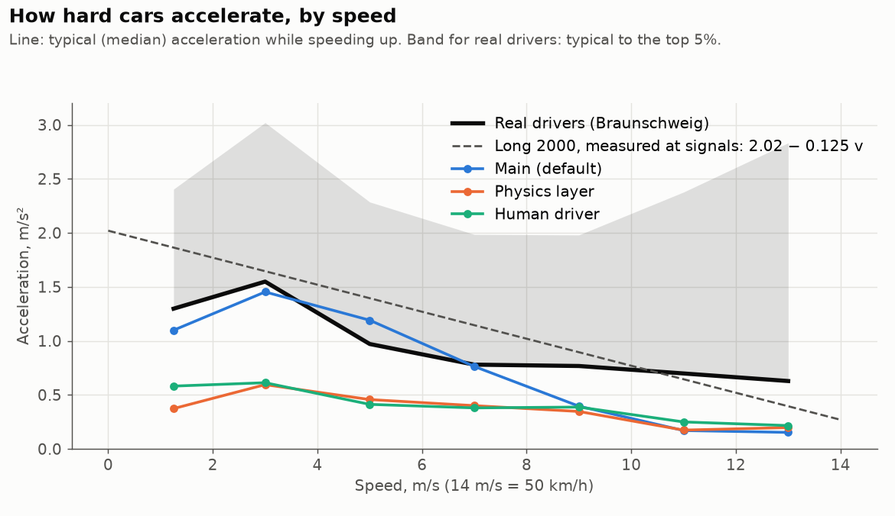
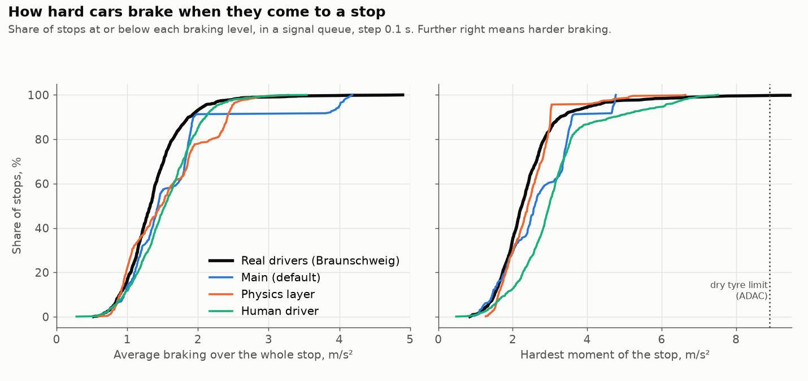
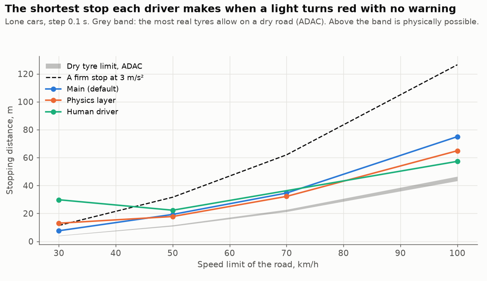
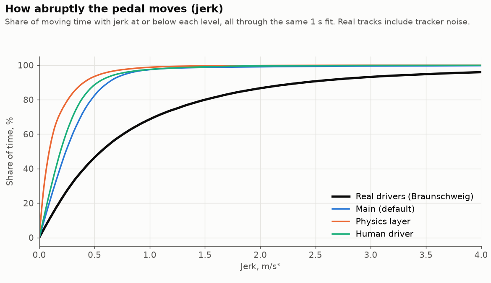
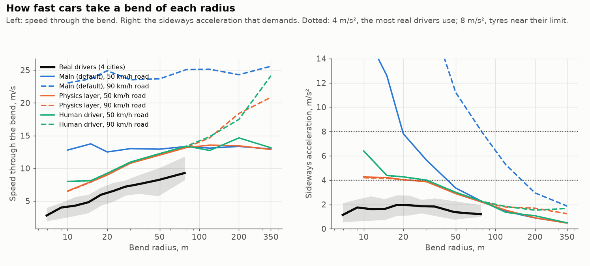
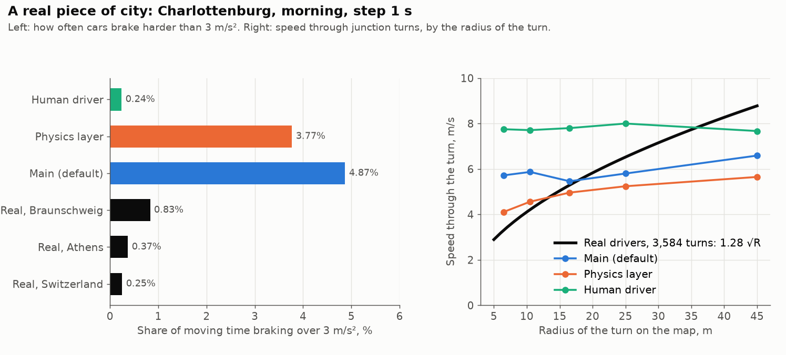
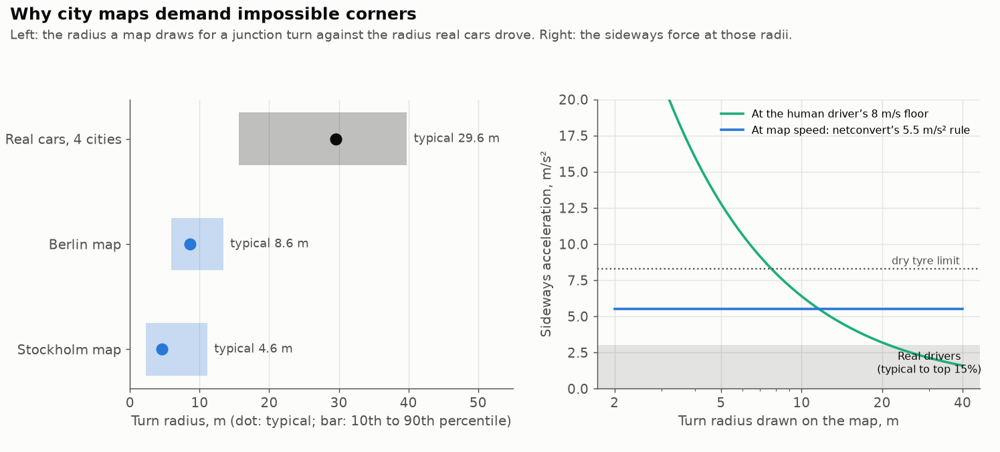
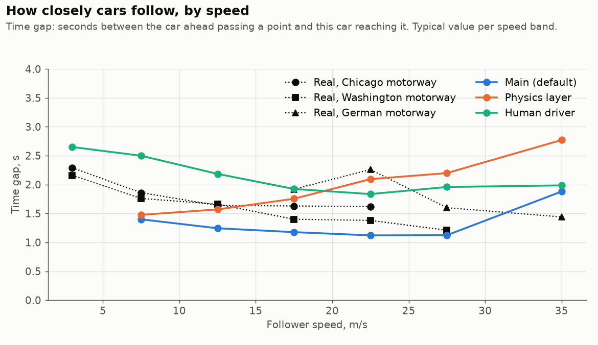
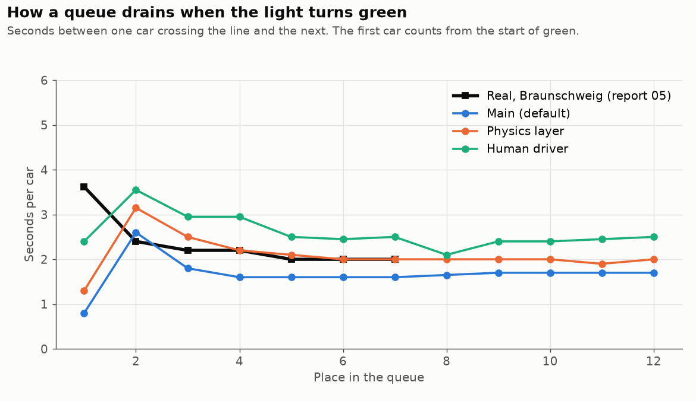
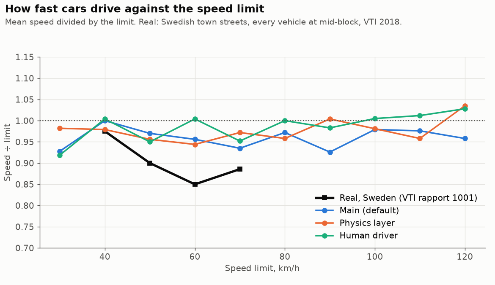

# 19. Physical realism: what cars in the simulator actually do, against real cars

Audit, 2026-11-02. Everything simulated was measured from speed and position in the simulator's own output, not read from a config. Nothing here takes any other agent's word: real numbers were recomputed from raw tracks where the tracks exist.

## The answer

**No driver passes yet. The main default fails badly, the other two are close on some things and clearly wrong on others.**

- **Nothing breaks the tyre limit in a straight line.** Hardest stop in any scene: −9.0 m/s² on main, −8.3 on the physics layer and the human driver. Real dry tyres give 8.3 to 8.9 (ADAC, winter tyres). Stopping distances are physically possible everywhere.
- **Corners are the worst problem.** Real drivers hold about **1.8 m/s²** sideways, whatever the radius (3,584 turns, 4 cities). Main has no cornering rule at all: 54 m/s² in a 10 m bend on a 90 km/h road, six times what tyres can give. The human driver's 8 m/s corner floor asks 6.1 m/s² there and, in a real city piece, over 8 m/s² on 10.5% of turning samples. The physics layer caps at 4.2 to 4.6, which is possible but 2.5 times the real average.
- **Maps make it worse.** A typical junction turn is drawn with a radius of 4.6 m in Stockholm and 8.6 m in Berlin. Real cars drove 29.6 m. So both the speed and the geometry are wrong, in different places.
- **Everyday braking is about twice too hard at dt 1, the step cities run at.** Per stop, the hardest moment is −4.5 on main and −4.8 on the physics layer in a real city piece, against a real −1.5 to −2.4. Braking over 3 m/s² takes 4.9% and 3.8% of moving time, against a real 0.4 to 1.1%. The human driver is close on that share (0.24%) but has its own tail.
- **Yellow lights.** Main stops 100% of the time from 1 to 4 s before the line, and the physics layer 93 to 100% at dt 0.1. Real drivers stop 0 to 3.5% of the time there.
- **Cities contain one vehicle.** Every simulated vehicle in the Stockholm and Berlin demand is a 5 m car. Swedish roads are 81% cars, 12% vans, 5% heavy trucks, 1% buses, 1% motorcycles by distance.

The ranked fix list is at the end.

## How this was measured

**Real column.** I recomputed from raw positions, using a Savitzky-Golay fit (order 3) over 1 s and 2 s, and did not use any provider's velocity or acceleration. **Acceleration, braking and jerk below use the 1 s fit**, because simulated speeds go through the same 1 s fit at dt 0.1 and a dt 1 step is itself a one-second average. A 2 s fit lowers real peaks by about 15%. Cornering uses the 2 s fit, which barely moves it, and the 1 s values are given beside it.

| Source | What | Kept here | Grade |
|---|---|---|---|
| [DLR Urban Traffic](https://zenodo.org/records/20919480), Braunschweig, Sunday 24 Sep 2023, 20 Hz | Every 8th 15 min batch across the day | 1,098 stops, 1,724 launches, 170,000 half-second samples, 3,231 cars | MEASURED |
| pNEUMA, Athens, 24 Oct 2018 | One 30 min file, cars and taxis | 382 stops, 550 launches, 658 turns | MEASURED |
| Swiss roundabouts, Aargau, Oct 2023 | 4 files, 3 sites | 195 stops, 272 launches, 1,749 turns | MEASURED |
| TGSIM Foggy Bottom, Washington, May 2023 | First 1.5 M rows | 747 stops, 1,014 launches, 911 turns | MEASURED, with its Kalman smoother |
| Cached following pairs of report 05 (I-90, I-395, A39) | Time gaps, sampled once a second | About 1.8 M samples | MEASURED |
| Report 05's DLR signal work | Yellow decisions, queues, first-car launch | Reused, since the method is sound | MEASURED |

**Noise.** On cars standing still, the 1 s fit reads acceleration SD 0.04 m/s² and p99 0.21, and jerk p99 1.5 m/s³ (2 s fit: 0.19 and 1.0). So acceleration is trustworthy to about 0.2 m/s². Jerk under about 1.5 m/s³ is near the floor. **Tails are not trustworthy:** at Braunschweig above 15 m/s, p99 braking reads 8 to 10 m/s², and in Athens the hardest 1% of stops read 10.7, both tracker error. I use p95 and treat p99 as an upper bound. TGSIM reads 3.5% of time over 3 m/s², far above the three other cities, and report 05 already found problems in that dataset, so I show it but do not lean on it.

**Sites.** Braunschweig is a Sunday. Athens is congested. Swiss data is small roundabouts. None of it is Stockholm. This is the best open measured driving found, not a Swedish sample.

**Simulated column.** Own scenes (`scripts/physical_audit/scenes.py`), with no vehicle parameters other than vClass, so each driver shows its own defaults. CPU Vulkan (`CARS_ADAPTER=llvmpipe`), no GPU, one job at a time, every run under `timeout`. The I-80 hang was never hit.

| Driver | Binary | Flags |
|---|---|---|
| Main | `target/release/cars`, f628c6c..d4a92cb has no crate changes | `run` |
| Physics layer | `physics/bin/cars-x`, built for 883f923 | `run` |
| Human driver | Built here from 3b35015, the branch head. Its worktree binary was older | `run --humans` |

Scenes: signal queue (`signal`), same with mixed classes (`mix`), falling and rising limits with light then near-capacity flow (`speeds`), free flow (`free`), lane drop, motorway merge, signalled and priority crossroads (`junction`, `priority`), bends of known radius (`curves`), a light that turns red with no warning in a queue and for lone cars (`wall`, `wall2`), and Charlottenburg 07:00 to 07:20 with the last 10 min traced (`city`). Small scenes ran at dt 1 and dt 0.1, the city at dt 1. First 5 s of each trip are dropped, since a car inserted at full speed behind a slower one brakes hard for reasons that say nothing about drivers. Raw output: `cars-data/truth/physical_audit/local/out/`, summaries in `show_1.txt`, `show_0.1.txt`, `real_summary.json`.

**Reading the tables.** Each driver cell is dt 0.1 / dt 1, and "city" is Charlottenburg at dt 1. **FLAG** means outside physical limits or more than about 1.5 times from the real average. At dt 1, times come in whole seconds, so a saturation headway of exactly 2.0 s is weak evidence.

## Acceleration



Real drivers (black band) accelerate harder in a queue than the physics layer and the human driver at low speed, while main is close.

| Quantity | Real | Main | Physics layer | Human | Gap |
|---|---|---|---|---|---|
| First car, peak, m/s² | **1.80** (1.30–2.45), n=3,050 ([report 05](../05-real-human-driving.md)). Long 2000: 2.02 at 0 m/s. J.S. Held drones, 45 mph roads: 0.26 g over 1–3 s | 2.59 / 2.46 | 1.92 / 1.55 | 1.87 / 1.67 | **Main 1.4×**, others within 15% |
| First car, time to 5 m/s after green | 4.0 s (2.8–6.4) | 2.4 / 3.5 | 3.9 / 5.0 | 3.8 / 4.5 | Main 0.6× at dt 0.1 |
| First car, time to 10 m/s after green | 8.0 s (5.2–9.8) | 4.9 / 6.0 | 9.9 / 11.0 | 6.9 / 8.0 | **Main 0.6×**. Physics 1.2–1.4× |
| Any launch from a stand, peak | 2.66 Braunschweig, 2.80 Athens, 1.98 Washington, 1.40 Swiss | 1.99 / 2.39, city 1.45 | **1.00** / 1.56, city 1.19 | **1.09** / 1.20, city 1.72 | **Physics and human 0.4× at dt 0.1**, deep in a queue. Real queues here are shorter, so part of this is scene |
| Typical acceleration at 0.5–5 m/s, p50 / p95 | 1.34 / 2.71 | 1.27 / 2.00 (dt 0.1), 1.57 / 2.44 (dt 1) | 0.48 / 1.03, 1.20 / 1.70 | **0.55 / 1.20**, 0.65 / 1.36 | **Physics and human 0.4× at dt 0.1** |
| At 5–10 m/s | 0.79 / 2.02 | 0.55 / 1.94, 1.24 / 2.38 | 0.39 / 0.81, 0.70 / 1.15 | 0.38 / 0.95, 0.41 / 0.99 | **Physics and human 0.5×** |
| At 10–15 m/s | 0.67 / 2.55 | 0.16 / 0.63, 0.54 / 1.58 | 0.18 / 0.56, 0.21 / 0.58 | 0.23 / 0.72, 0.23 / 0.65 | **All 0.3× at dt 0.1**. The real p95 here is partly noise |
| Top: share of moving time over 2 m/s² | 0.4–4.1% | 0.3%, 2.8% | 0.0%, 0.0% | 0.04%, 0.04% | **Physics and human have almost no hard acceleration** |
| Highest value seen, m/s² | Real p99 3.1–5.3, partly noise | 2.6 (cap), city 1.5 | 2.06, city 1.5 | 3.2 | Inside limits |

Capability against manufacturer 0–100 km/h was checked in report 11: within −15% to +9%, one fitted κ, on declared not measured times. Not repeated.

**City cap.** The city demand files set `accel="1.50"`, and physics takes `r.a0.min(t.accel)` (`world.rs:601`), so nobody on main or physics ever exceeds 1.5 in a city, against 2.1–9.2% of real moving time above that (three cleaner sites). That number came with the demand files and has no source.

## Braking



The physics line jumps at 3 m/s² because that is its configured braking, and main's at 4.5 for the same reason; real drivers show a smooth spread with a median just over 2.

| Quantity | Real | Main | Physics layer | Human | Gap |
|---|---|---|---|---|---|
| Normal stop, average over the stop, m/s² | **1.32** Braunschweig, 1.32 Athens, 1.15 Washington, 0.99 Swiss. Faster US roads run higher: J.S. Held, 45 mph, 0.19 g (1.9) over the first 6 s | 1.43 / 1.69, **city 2.17** | 1.48 / 1.88, **city 2.16** | 1.54 / 1.28, city 0.73 | **Main, physics 1.6× in the city**. Human 0.6× |
| Normal stop, hardest moment | **2.23**, 2.44, 1.91, 1.45 | 2.60 / **4.15**, city **4.46** | 2.41 / **4.76**, city **4.84** | 2.98 / **3.17**, city 1.68 | **Physics 2.2×, main 2.0× at dt 1 and in the city; both within 1.2× at dt 0.1. Human 1.3–1.4× in scenes, 0.75× in the city** |
| Firm stop: hardest 5% of stops | 4.10, 5.41, 3.60, 2.92 | 4.70 / 4.50, city 4.50 | 3.04 / 5.56, city 5.82 | **6.08** / 3.99, city 4.10 | **Human 1.5× at dt 0.1, physics 1.4× at dt 1** |
| Hardest 1% of stops | 6.87, 10.7, 4.70, 4.04 (noisy) | 4.76 / 4.50 | 5.11 / 5.73, city 6.80 | 6.93 / 4.62, city 6.11 | Similar, given tail noise |
| Share of moving time over 2 m/s² | 5.0%, 2.5%, 7.7%, 1.6% | 0.9% / 3.9%, city 6.2% | 1.8% / 3.8%, city 6.8% | 2.0% / 2.2%, city 1.0% | Main, physics 1.2–4× in the city |
| Over 3 m/s² | 1.1%, 0.66%, 3.5%, 0.39% | 0.25% / 1.7%, **city 4.9%** | 0.06% / 2.3%, **city 3.8%** | 0.55% / 0.89%, city 0.24% | **Main 4–13×, physics 3–10× in the city** against the three cleaner sites |
| Over 4.5 m/s² | 0.33%, 0.22%, 0.59%, 0.22% | 0.04% / 0.04%, city 0.01% | 0.01% / 0.93%, city 1.4% | 0.07% / 0.02%, city 0.01% | **Physics 3–4× at dt 1, city 4–6×** |
| Emergency, hardest seen | No trustworthy tail in tracks. ADAC dry 8.3–8.9. [AAA LongROAD](https://aaafoundation.org/predictors-of-rapid-deceleration-events-among-older-drivers-aaa-longroad-study): "very few" events at 0.75 g, 2,774 drivers | −9.0 | −8.3 | −8.3 | Inside limits |

**dt matters as much as the model.** The physics layer brakes twice as hard at dt 1 as at dt 0.1 (−4.76 against −2.41) and so does main (−4.15 against −2.60). Cities run at dt 1.

**By speed (hardest moment of a stop, signal scene):**

| Speed at start of braking, m/s | Real (n) | Main | Physics | Human |
|---|---|---|---|---|
| 3–6 | 1.86 (167) | – / 3.43 | 1.41 / – | 2.09 / 2.29 |
| 6–9 | 1.98 (247) | – / 3.91 | 1.89 / – | 3.03 / 3.33 |
| 9–12 | 2.23 (284) | 2.39 / 4.04 | 2.66 / 4.72 | 3.51 / 3.65 |
| 12–15 | 2.45 (297) | 2.75 / 4.40 | 2.84 / 4.90 | 3.70 / 3.58 |
| 15–20 | 2.92 (47) | few | few | few |

Real braking grows slowly with speed, as Gates et al. found. The human driver is **1.1–1.6× too hard**, and it brakes hardest when behind someone.

**By situation (hardest moment, median):**

| Situation | Real | Main | Physics | Human |
|---|---|---|---|---|
| First at the line, at a signal | 2.35 (no leader within 25 m) | **4.66** / 4.34 | **3.99** / 4.76 | 1.57 / 1.83 |
| Behind a leader, in a queue | 2.13 | 2.46 / 4.10 | 2.34 / 4.76 | **2.99** / 3.18 |
| Stopping for yellow | Braunschweig: 0.6% stop if it needs 2–3 m/s², none above 3 (report 05). [Gates et al.](https://files.topslab.wisc.edu/publications/2006/Gates%20-%20dilemma%20zones.pdf) first-to-stop, US, 31–51 mph approaches: 2.2 / 3.0 / 3.9 at p15/50/85. Chang and Messer: 1.7 / 2.8 / 4.1 (as cited there) | 3.67 / 3.35, p95 4.5 | 2.26 / 3.88, p95 5.1 | 2.35 / 1.97, p95 4.4 | Main and physics 1.2–1.9× against either |
| Slowing for a lower limit | Comfort, no field number here | p95 under 1 at dt 0.1 | About −2 for 4 s from 110 to 70 km/h, one car checked | p95 under 1.2 | Reasonable |

Braunschweig and Gates disagree on yellow stops. Gates' sites are faster US roads, where stopping needs more. Both are real. For a 50 km/h city road the Braunschweig value is closer.

**Stop decisions at yellow, share that stop:**

| Time to line at yellow | Real, Braunschweig (n) | Main | Physics | Human |
|---|---|---|---|---|
| 1–2 s | 0.3% (386) | **100% / 100%** | **93% / 0%** | 0% / 0% |
| 2–3 s | 0% (326) | **100% / 100%** | **100% / 13%** | 0% / 0% |
| 3–4 s | 3.5% (202) | **100% / 100%** | **100% / 88%** | 0% / 14% |
| 4–5 s | 36% (69) | **100% / 100%** | **100% / 100%** | 42% / 71% |
| 5–6 s | 74% (35) | 100% | 100% | 100% / 100% |

Sim cells hold 3 to 14 decisions each, so read the pattern, not one cell. **Main and physics stop for yellow far too eagerly. The human driver matches at dt 0.1 and drifts at dt 1.**

## Stopping distance



Every driver stays above the grey tyre limit, so none of these stops is impossible.

| From | Real tyre limit, dry | Real firm stop at 3 m/s² | Main | Physics | Human |
|---|---|---|---|---|---|
| 30 km/h | 3.9–4.2 m | 11.6 m | 7.6 / 11.5 | 13.0 / 12.3 | 29.8 (n=5) / 8.6 |
| 50 km/h | 10.8–11.6 m | 32 m | 19.3 / 20.5 | 17.8 / 27.6 | 22.3 / 39.3 |
| 70 km/h | 21.2–22.7 m | 63 m | 34.6 / 44.8 | 32.2 / 53.7 | few |
| 100 km/h | **43.3–46.5 m** (ADAC, winter tyres). [Continental](https://www.tyretrade.ie/index.php/continental-warns-on-wet-weather-braking/20151): 36 m, manufacturer claim. Magazine tests 35–41 m (search result) | 128 m | 75 / 69 | 65 / 80 | 57 / 77 |

**Not a violation.** Report 11's Euler concern, an emergency stop at half what tyres allow at dt 1, did not show on main: the shortest from 50 km/h at dt 1 was 20.5 m in the lone-car scene and 16.8 m in a queue, against a limit of about 11 m. Drivers run the red rather than stop in that distance.

**One thing to watch.** The human driver, from 100 km/h, brakes at a median −8.4 when a light goes red unannounced (n=7). A real driver would more often run it or brake softer. The scene has no yellow, so this is a stress test, not normal behaviour.

## Jerk



All three are smoother than real tracks at dt 0.1, though much of the real line is tracker noise, whose floor is near 1.5 m/s³.

| | Real p50 / p95 | Main | Physics | Human |
|---|---|---|---|---|
| Jerk, m/s³, 1 s fit | 0.26–0.73 / 1.37–3.65. 2 s fit: 0.24–0.47 / 0.9–2.2 | 0.24 / 0.79 at dt 0.1, **0.90 / 3.08** at dt 1, city 0.41 / 2.36 | **0.09** / 0.56, 0.23 / 1.23, city 0.20 / 2.60 | 0.19 / 0.72, 0.17 / 0.94, city 0.21 / 1.24 |
| Gap | | Main high at dt 1 against the 2 s fit | **Physics and human 0.2–0.5× at dt 0.1**, but real values here are mostly tracker noise, so this is weak | |

## Cornering



Real drivers (black) keep sideways acceleration nearly flat at 1.8 m/s² by slowing with tightness. Every driver here goes faster, and main ignores the bend completely.

**Real result, 3,584 turns in 4 cities, cars, turning over 40°.** Measured across the core of each turn, where curvature is at least 60% of its peak:

| Radius, m | n | Speed, m/s, median (p15–p85) | Sideways, median (p85) | Peak in the turn, median (p95, p99) |
|---|---:|---|---|---|
| 5–8 | 230 | 2.8 (2.0–3.8) | 1.16 (2.13) | 1.72 (2.84, 3.36) |
| 8–10 | 343 | 4.1 (2.3–4.8) | 1.78 (2.44) | 2.10 (3.21, 4.18) |
| 10–13 | 469 | 4.3 (2.7–5.6) | 1.63 (2.69) | 2.03 (3.62, 4.24) |
| 13–16 | 469 | 4.9 (3.2–6.0) | 1.63 (2.46) | 2.03 (3.37, 3.94) |
| 16–20 | 615 | 6.0 (4.3–7.1) | 2.02 (2.81) | 2.37 (3.73, 4.59) |
| 20–25 | 492 | 6.6 (5.0–7.8) | 1.95 (2.77) | 2.36 (3.74, 4.51) |
| 25–30 | 375 | 7.2 (5.9–8.2) | 1.87 (2.39) | 2.34 (3.30, 3.82) |
| 30–40 | 380 | 7.6 (6.3–9.0) | 1.87 (2.52) | 2.29 (3.32, 4.00) |
| 40–60 | 84 | 8.4 (5.8–10.0) | 1.45 (2.30) | 1.71 (3.13, 3.32) |
| 60–100 | 18 | 9.3 (6.5–11.8) | 1.29 (2.00) | 1.70 (2.66, 3.29) |

**Fit: v = 1.28 · R^0.505 m/s.** Sideways acceleration barely depends on radius. Overall: median 1.81, p85 2.58, p95 3.09. Peak: median 2.19, p95 3.53, p99 4.26, one in a thousand 5.46. With the 1 s fit: v = 1.25 · R^0.525, median 1.91, p95 3.24, peak median 2.40, p95 3.93, p99 4.80. Bosetti's 4 m/s² upper bound (report 11) fits this as a nearly-never limit, not a typical one. Xu's formula (6.8 at R=10) does not fit it.

**Simulated (curves scene, 50 km/h road, then 90 km/h where it differs):**

| Radius | Real speed | Main speed, sideways | Physics speed, sideways | Human speed, sideways | Gap |
|---|---|---|---|---|---|
| 10 m | 4.1 m/s, 1.7 | 13.5, **18.2**. On 90 km/h: 23.2, **53.9** | 6.8, 4.6 | **7.8, 6.1** | **Main 3–6× past tyres. Human 1.9× speed, 3.6× sideways. Physics 1.6×, 2.7×** |
| 15 m | 4.9, 1.6 | 14.0, **13.1**. On 90: 25.9, **44.6** | 8.1, 4.4 | 8.0, 4.3 | **Main past tyres. Others 1.6×, 2.7×** |
| 20 m | 6.0, 2.0 | 13.1, **8.6**. On 90: 25.5, **32.5** | 9.2, 4.2 | 9.2, 4.2 | **Main past tyres. Others 1.5×, 2.1×** |
| 30 m | 7.2, 1.9 | 13.0, 5.7. On 90: 24.0, **19.2** | 10.9, 4.0 | 10.9, 4.0 | **Others 1.5×, 2.1×** |
| 50 m | 8.4, 1.5 | 13.5, 3.6. On 90: **11.2** | 12.2, 3.0 | 12.2, 3.0 | **Others 1.4×, 2×** |

Where the real sample ends (R over about 100 m, speeds over about 12 m/s) I have no real number to compare.

**Real piece of city.** Junction turns over 60° in Charlottenburg, sideways acceleration from the map's whole-lane radius:



Left: main and physics brake hard far more often than real drivers. Right: the human driver takes every turn at its 8 m/s floor whatever the radius, while real speed rises with radius.

| | Real | Main | Physics | Human |
|---|---|---|---|---|
| Sideways, median | 1.81 | 2.29 | **1.70** | **3.59** |
| p95 | 3.09 | 6.25 | **2.76** | **9.19** |
| Share over 4 m/s² | 0.6% (1.7% at a turn's peak) | 29% | **0.6%** | **43%** |
| Share over 8 m/s² | none in 3,584 turns, highest 7.4 | 0.6% | **0%** | **10.5%** |
| Speed in turn, R 8–13 m | 4.2 | 5.9 | **4.6** | **7.7** |
| R 20–30 m | 6.5 | 5.8 | 5.2 | 8.0 |

Real values come from the smoothed real path, simulated ones from the map's radius, so the two are not quite the same measure. **The physics layer is the best here** at city speed, with its curve limit binding well on real nets. Its 4.0 cap matters on longer open bends, as above.

## Why maps ask for impossible corners



Map junction turns are drawn 3 to 6 times tighter than real cars drive, so a fixed corner speed (green) goes past the tyre limit on most of them.

Earlier numbers: Stockholm traces with 3,864 samples over 8 m/s², Berlin up to 16.1, and map corners peaking at 8.6 to 10.4 m/s² ([09e](../09e-d9-first-step.md)). All are explained by three separate causes.

**Cause 1, junction turns: both geometry and speed (79% of Stockholm's samples, 3,062 of 3,864).**

| Junction lanes turning over 60° | Stockholm v5 | Berlin BeST | Real cars, 4 cities |
|---|---|---|---|
| n | 120,022 | 75,240 | 3,018 turns |
| Radius of whole turn, p10 / p50 / p90 | **2.3 / 4.6 / 11.1 m** | 5.9 / 8.6 / 13.4 m | **15.6 / 29.6 / 39.8 m** |
| Tightest radius, p50 (maps: over 5 m; real: on the smoothed path) | 2.1 m | 4.2 m | 13.9 m (p10 6.9) |
| Lane limit, p50 | 13.4 km/h (3.7 m/s) | 25.6 km/h (7.1 m/s) | |
| Sideways at the map's limit, p50 / p95 | 5.77 / 6.19 | 5.90 / 6.29 | 1.81 / 3.09 |
| Over 4 m/s² at the map's limit | 93% | 98% | |
| Over 8 m/s² at a floor of 8 m/s | **73%** | **47%** | |
| Under 5 m long | **48%** | 5% | |
| Biggest kink between polyline points, p50 | 52° | 28° | |

- **Geometry is wrong.** A typical Stockholm turn has a smaller radius than a car can drive: a modern car's turning circle is roughly 11 m across, wall to wall (general knowledge, not opened here), so about 5 m is the floor. Half of them are shorter than a car. These are junction polygons built from OSM with small corners. Berlin is much better but still 3.4 times too tight against the same real sample. Real sites differ, and Braunschweig is a large junction, so read this as a factor, not a precise one.
- **netconvert's speed rule is too fast for drivers.** `--junctions.limit-turn-speed` defaults to 5.5 m/s² on the average radius, so map limits sit at about 5.8. That is 3 times the real median and the same as the top one in a thousand. And since it uses the average radius, the tightest point goes higher, which is the 8.6 to 10.4 in report 09e.
- **The human floor drives the big numbers.** `turn_min` 8 m/s (`world.rs:458`, used in `step.wgsl:127`, `683`, `811`) overrides both the lane limit (up to twice it) and the curve limit. The Stockholm samples were traced with the floor evidently at 6 m/s (speed median 21.6 km/h, 1.64× the lane's limit), before commit 2a8b319 raised it to 8. At 8 the same geometry asks (8/6)² = 1.8 times as much.
- **The worst lanes.** Berlin's 16.1 is `:412209130_0_1`, a junction lane with a limit of 70 km/h and a 17 m radius, driven at 15.2 m/s. Stockholm's top values, up to 68.6, are off-ramp stubs such as `:4197523-AddedOffRampNode_0_0`, driven at 83 km/h on a whole-lane radius of 10 m.

**Cause 2, kinks in road polylines: geometry (21%, 802 of 3,864).** On ordinary lanes:

- 662 of those 802 are on lanes whose whole-lane curve is gentle, under 4 m/s².
- Median lane: 155 m long, whole-lane radius 106 m, but tightest radius over 5 m only **2.7 m**, with a 46° kink at one OSM point, and driven at 38 km/h under a 50 km/h limit.
- Measuring curvature over 30 m instead of 5 m, which is closer to what a car can steer through, removes 51% of those samples; 20 m removes 23%. A real road has no 46° corner in it. The car just follows a drawn line.
- So the QA's 5 m window overstates these, and a car drawn following them swings its nose. The speed is fine; the geometry isn't.

**Cause 3, the measure itself.** 5 m windows on a polyline turn every vertex into a tight corner. That inflates samples, but the first two causes remain after correcting for it: at 30 m, 1,871 of 4,820 flagged Stockholm junction lanes and 174 of 1,802 ordinary lanes still exceed 8 at the speed driven.

## Lane changes

| | Real | Main | Physics | Human | Gap |
|---|---|---|---|---|---|
| Whole manoeuvre, s | 8–10 s by fit (quintic median 9.6 s, report 05) | **0: a jump** | 7 (4–8) | 10–11 (5–22) | **Main fails.** Physics 0.7× |
| 10–90%, s | 5.2–5.6 (p5–p95 about 3–10), about 36,000 events | 0 | About 4.7, from its shape (report 11) | About 5.1 (report 16) | Physics 0.85× |
| Peak lateral speed, m/s | 0.71–0.83 (p5–p95 0.48–1.26) | infinite | 0.6, **1.1 at a lane end** | 0.61, **p95 3.2 at a lane drop**, 1.5 at a merge | **Human 2.5× past real p95** at a lane end. Physics 1.4× |

## Following and standing



Main follows tighter than real drivers in town and physics much looser at motorway speed, while real values fall with speed.

| Speed, m/s | Real p5 / p50 / p95 | Main | Physics | Human | Gap on the median |
|---|---|---|---|---|---|
| 5–10 | 0.57–0.87 / **1.76–1.86** / 4.0–4.4 | 1.34 / 1.40 / 1.80 | 1.43 / 1.48 / 1.75 | 1.23 / **2.50** / 5.06 | Main 0.8×, Human **1.4×** |
| 10–15 | 0.52–0.71 / 1.64–1.66 / 4.0–4.1 | 1.19 / 1.24 / 2.57 | 1.51 / 1.57 / 2.30 | 1.12 / 2.19 / 5.53 | Human 1.3× |
| 15–20 | 0.43–0.71 / 1.40–1.92 / 3.5–4.6 | 1.15 / 1.18 / 2.27 | 1.69 / 1.76 / 2.81 | 1.07 / 1.92 / 4.36 | Fine |
| 25–30 | 0.50–0.61 / 1.21–1.60 / 2.9–3.4 | 1.06 / 1.12 / 2.87 | **2.08 / 2.20** / 2.66 | 1.25 / 1.96 / 3.10 | **Physics 1.4–1.8×** |
| 30–40 | 0.60 / 1.44 / 2.75 | 1.20 / 1.88 / 2.88 | 1.69 / **2.77** / 3.17 | 1.41 / 1.99 / 2.96 | **Physics 1.9×**, Human 1.4×, Main 1.3× |

**The missing short gaps matter.** Real p5 is 0.4 to 0.9 s. Every simulated driver stays above 1.0 s, and physics above 1.4 s, so nobody tailgates as real drivers do: **p5 is 1.6 to 4× too long on physics.** And main and physics have almost no spread. Main's p5 and p50 at 5–10 m/s differ by 0.06 s, because all its drivers are the same driver.

Real sites here are congested motorways, with a German autobahn for the top speeds; the sim scene is a single lane. In the city, Human's 5–10 m/s median is **4.23 s** against main's 1.83 and physics' 1.90. Real urban following was not computed on the same basis, so this is a warning, not a measured gap.

| Standing gap | Real | Main | Physics | Human | Gap |
|---|---|---|---|---|---|
| Front to front, m | 7.0 Braunschweig (6.2–8.1), 6.8–7.4 Lankershim, **8.1** I-90 (p5–p95 5.9–14.8), 8.2 I-294 | 7.5 exact, **no spread**. City 7.0 | 7.5 exact, **no spread**. City 7.0 | 8.5 (5.5–13.1), at dt 0.1. City 9.2 (6.4–16.4) | **Human has the right spread.** Main, physics zero spread |
| Bumper gap | Not trusted in any tracker: boxes wrong by metres (3.2 m cars at DLR, 6.2 m default at TGSIM) | 2.5 | 2.5 | 3.5 (0.5–8.1) | |

### Queue discharge



Physics matches real saturation flow, while main drains too fast and the human driver too slowly.

| | Real | Main | Physics | Human | Gap |
|---|---|---|---|---|---|
| Per car, deep in queue, s | **2.0** (1.8–2.1). 1.9 Lankershim, 2.2 Peachtree. FHWA 1.9–2.0 | **1.65** / 2.0 | 2.0 / 2.0 | **2.4** / 2.0 (report 16: 2.33 at dt 1) | Main 0.8×, Human 1.2× |
| Lost time, first 4, s | 2.74 (2.44–3.58) | **0.2** / 2.0 | 1.15 / 5.5 | 2.25 / 5.0 | **Main 0.07×, physics 0.4×** at dt 0.1. Noisy at dt 1 |
| First car crosses after green, s | 3.62 | **0.8** | **1.3** | 2.4 | **Main 0.2×, physics 0.4×.** All three reach the line too soon. Sim cars stand 1 m or less from it, real ones further |

## Reaction

| | Real | Main | Physics | Human | Gap |
|---|---|---|---|---|---|
| First car moves after green | **1.62 s** (0.82–2.83), report 05, counted from green, after about 1 s of red-yellow there | **0.6** / 2.0 | **0.8** / 2.0 | 1.6 / 2.0 | **Main 0.4×, physics 0.5×** at dt 0.1 |
| Next car moves after the one ahead | 1.0–1.6 s (Lankershim 1.0, I-90 1.5–1.6, I-294 1.4). J.S. Held: 1.1 (SD 0.69) | **0.7** / 1.0 | 0.9 / 1.0 | 1.3 / 1.0 | Main 0.6× at dt 0.1 |
| Brake response at yellow | 0.7 / 1.0 / 1.6 s at p15/50/85 (Gates). 0.7 / 1.1 / 1.9 (Chang and Messer, as cited) | not measured | not measured | not measured | |
| Literature, perception-reaction | [Green 2000](https://www.informahealthcare.com/doi/abs/10.1207/STHF0203_1): 0.7 expected, 1.25 common unexpected, 1.5 surprise (from a secondary source, UNVERIFIED). Critique: 1.0–1.3 unalerted, urgent | Rule at step | t_r 0.30, τ 0.65 | τ_a 1.0, t_start 0.6 | |

## Free speed



All three drive at about the limit on town streets, where Swedish traffic averages 10 to 15% below it.

| Limit | Real Sweden: mean speed, all vehicles, municipal main streets, Sept 2018 ([VTI rapport 1001](https://www.diva-portal.org/smash/get/diva2:1307051/FULLTEXT02.pdf)) | Main ratio | Physics ratio | Human ratio | Gap |
|---|---|---|---|---|---|
| 40 km/h | 39, ratio 0.98 | 1.00 | 0.98 | 1.00 | Fine |
| 50 km/h | 45, ratio **0.90** | 0.97 | 0.96 | 0.95 | 1.06× |
| 60 km/h | 51, ratio **0.85** | 0.96 | 0.94 | 1.00 | 1.1–1.2× |
| 70 km/h | 62, ratio **0.89** | 0.94 | 0.97 | 0.95 | 1.1× |
| 110–120 km/h | 120-limit points: about 121 km/h, 40–43% within the limit. 110-limit: 38–46% within. Trafikverket appendix, read only through a search snippet, **UNVERIFIED**, its PDF returned 404 | 0.96–0.98 | 0.96–1.04 | 1.01–1.03 | Fine |

Each sim value rests on 30 cars, so ±3%. VTI's is a harmonic mean at mid-block, all traffic, not strictly free flow. Under the 1.5× bar, but it's systematic, and small speed errors add up across a network. Spread (p5 to p95 over median) is 0.20 to 0.40, all from `speedDev` 0.1. No real figure for spread was opened.

## Vehicles

| | Real | Main | Physics | Human | Gap |
|---|---|---|---|---|---|
| **Mix in city demand** | Sweden by distance, 2025: **81% cars, 12% light trucks, 5% heavy trucks, 1% buses, 1% motorcycles** ([Trafikanalys](https://www.trafa.se/globalassets/statistik/vagtrafik/korstrackor/2025/korstrackor-2025---2026-04-17.pdf)). DLR tracks, Sunday: 94 / 2 / 4 | **100% one car** | **100% one car** | **100% one car** | **FLAG. No vans, trucks or buses.** One vType in `charlottenburg.rou.gz` and `morning.no-uturn.rou.xml.gz` |
| Fleet numbers | In traffic in Sweden, end 2025: 5.04 M cars, 628 k light trucks, 86 k heavy, 15 k buses ([Trafikanalys](https://www.trafa.se/globalassets/statistik/vagtrafik/fordon/2026/fordon-2025.pdf)). Cars average 12.1 years | | | | |
| Car mass | **1,600 kg** in traffic in Sweden, electric 2,000 kg (Trafikanalys 2025). 1,514 kg in 2017. New cars 2023: 1,836 kg Sweden, 1,540 kg EU ([ICCT](https://theicct.org/wp-content/uploads/2024/12/241206_Pocketbook_2024_25_Web.pdf)) | none | 1,650 kg, ±load | Same as physics | **Good, 1.03×** |
| Car power | New cars 2023: 166 kW Sweden, 115 kW EU, 93 kW Italy (ICCT). **No figure found for cars in traffic** | none | 90 kW, lognormal SD 0.35. Fleet is older than new cars, so plausibly low | Same | Unverified, not flagged |
| Car width | 1.803 m new cars, Europe H1 2023 (T&E, search result). 1.57 DLR box, biased | 1.8 | 1.8 | 1.8 | Good |
| Car length | **No fleet figure found.** Trackers useless: 3.2 m at DLR, 5.7–6.2 at TGSIM. Golf 4.28, XC60 4.7 (general knowledge, not opened) | 5.0 | 5.0 | 5.0 | Probably 1.1× long. Length + gap (7.5) matches, so harmless to queues |
| Vans | No fleet figures found. DLR box 4.4 m | 6.5 m, **acc 2.6, same as a car** | 2,800 kg, 95 kW, 6.5 m | Car's persona | 6.5 m is long for most, a guess |
| Trucks | Yang 2016, ramps: 0.6 m/s² over 150 m. Hills in report 11. Swedish combinations reach 25.25 m and 60–74 t (general knowledge, not opened) | 7.1 m, acc 1.3. Artic 16.5 m, 1.1 | 18 t 220 kW, a0 0.76. 40 t 300 kW, a0 0.6 | **Same launch as a car** | **Main 2× too strong. Human: FLAG, below** |
| Buses | Krašna: ≤1.5 accel, ≤1.0 braking for standing passengers, young volunteers | 12 m, acc 1.2, decel 4 | 16 t, a0 1.0 | Same as car | Main 4× past Krašna's braking |

**The human driver ignores vehicle type when pulling away.** In the mixed queue at dt 0.1, launch peak and time to 10 m/s:

| | Car | Van | Truck | Artic | Bus |
|---|---|---|---|---|---|
| Main | 1.21, 11.2 s | 1.22, 11.6 | 1.17, 10.8 | 1.00, 12.1 | 1.02, 12.2 |
| Physics | 0.77, 19.7 | 0.81, 12.2 | 0.62, 17.5 | 0.54, 22.2 | 0.64, 23.1 |
| **Human** | **1.13, 12.5** | 1.14, 12.7 | **1.14, 12.9** | **1.12, 14.5** | 1.12, 12.3 |

The persona draws `hu_amax` from 1 to 3 m/s² for every vehicle (`common.wgsl:624`), and the guard only caps it at capability.

## Every magic constant

Grades: **measured** (a real recording says so), **adapted** (from a real source, changed), **invented** (no source, or a fit to a design value).

### Main (`crates/cars-core/src/demand.rs:72-95`)

| Constant | Value | Measured against | Grade | Verdict |
|---|---|---|---|---|
| Car accel | 2.6 (`:95`) | First-car peak 1.80 | Inherited from SUMO, no real source | **1.4× too high** |
| Car decel | 4.5 | Real stop peak 2.2 | Inherited | **2× too high in a city** |
| Emergency | 9.0 | Tyres 8.3–8.9, summer more | Inherited | Fine |
| Length, minGap | 5, 2.5 | Spacing 7–8 | Inherited | Fine in total |
| τ, σ | 1, 0.5 | | Inherited | |
| Truck, artic, bus | 7.1 / 16.5 / 12 m, accel 1.3 / 1.1 / 1.2, decel 4, emergency 7 (`:77-79`) | Yang, Krašna | Inherited | **2× too strong** |
| Van | 6.5, 2.6, 4.5, 9 (`:87`) | | Inherited | Car's accel, **invented** in effect |
| Corner speed | None. Only lane limit | Real 1.28 √R | No rule | **Fails** |
| Lane change | Instant (`lc_commit`, `lc.wgsl`) | 5.2–5.6 s | | **Fails** |
| Yellow | Stops if ≤ max(min(3, emergency), decel) = 4.5 | Real ≤ 2 | Inherited | **Fails** |
| City vType | accel 1.5, decel 4.5, σ 0.5, τ 1, minGap 2, length 5, maxSpeed 50 m/s | | **Invented**, from the demand files | Accel 1.45× low against launches |

### Physics layer (`world.rs` at 883f923)

| Constant | Value, line | Grade by its own provenance | My measurement | Verdict |
|---|---|---|---|---|
| Car mass, power | 1,650 kg, 90 kW, `:568` | Adapted | Trafikanalys 1,600 | Fine |
| a = 2.02 − 0.125 v, floor 0.7 | `:568` | Adapted, Long 2000 | First car 1.92 | Fine, but capped by city vType (`:601`) |
| Driver braking b | **3.0**, `:611` | Adapted: "fitted to TRVMB's 1,900 and 1,700" | Real 2.2 peak, 1.3 mean | **Fit to design flow, not to braking. 2.1× at dt 1** |
| Assumed leader braking | 4.5, `:613` for Krauss, else b | Adapted | | Inherited |
| τ | 0.65, `:606` | Adapted, same fit | | |
| b_lo, b_hi | 8.3, 11.3, `:568` | Adapted, ADAC; high bound a design value | Tyres 8.3–8.9. 36 m gives 10.7 | b_hi drives time gaps below |
| t_r | 0.30, `:568` | **Design** value, 0.47 for van measured | | Unverified |
| Lateral cap, Xu formula | 20.5 R^−0.46 − 0.35, capped **4.0**, `physics.rs:65`, `world.rs:685` | Adapted. Cap raised from 3 because 3 "cost turning capacity" | Real median 1.8, peak p95 3.5 | **Over real, 2.3×. Chosen for flow, not for drivers** |
| Curvature chord | 10 m, `physics.rs` `CHORD` | | Kinks at 10 m still bind | Too short on non-internal lanes |
| Grip limit | 0.5 μ g, `ph_curve_limit`, `step.wgsl` | Adapted | Fine as a limit | Fine |
| v_lat | 0.6, 1.1 short of road, `:604` | Established | Real 0.71–0.83 | Fine, a touch low |
| Critical gaps | TRVMB 4.8–5.3 | Design values | Roundabouts 2.95 measured | Not audited here |
| Yellow | No yellow rule in its provenance; behaves like SUMO's | Inherited | Stops 93–100% at 1–4 s to line | **Stops far too readily** |

### Human driver (`world.rs:458`, `common.wgsl:593-624` at 3b35015)

| Constant | Value | Grade by HUMAN.md | My measurement | Verdict |
|---|---|---|---|---|
| **turn_min** | **8 m/s** | **Invented**, fitted to TRVMB turning flow and Swiss roundabout gaps | Real 2.8–4.3 m/s at R under 13 | **Past tyres on 47–73% of map turns. Worst single number. Remove** |
| `lane × 2` allowance | Up to 2× lane limit, `step.wgsl:127` | Invented | | Remove with it |
| amax | Median 1.8 (1–3) | Adapted, report 05 | First car 1.87 | Fine, but for every vehicle class |
| k1, k2, T | 0.011, 0.52, 1.30 | Adapted | Launch deep in a queue 0.4×, sat 2.4 s | Too sluggish at low speed |
| **gipps_b, gipps_tau** | **4.5, 0.4** | Adapted, numbers "chosen" | Stops p5 −6.1 against a real −4.1, p1 −6.9 | **Source of its hard stops** |
| b_approach | 1.2 | **Invented** | Real mean 1.0–1.3 | Good |
| comfort | 1.5 | **Invented** | Real p95 of braking 2.5 | Good, a little low |
| b_em | 7.5 | Uncited | Raw −8.3 seen, from the certificate | Check |
| t_start | 0.6 s | Adapted | First car 1.6 | Fine |
| Yellow logistic | 5.1 s, 0.54 | Adapted | Matches at dt 0.1 | **Good** |
| s0 × 1.2 | | Adapted | Spread right | Good |
| Lane change | Quintic, faster at lane end | Adapted | p95 3.2 m/s | **Cap it** |
| Region sweden | T × 0.55, s0 × 0.47 | Adapted, to TRVMB design flow | T 0.7 s, against 1.6–1.9 real | Should be measured, not fitted |
| Others in HUMAN.md | gap_junction 0.65, stub 7, t_miss 120, etc. | Invented | Not physical quantities | Not audited here |

## Ranked fix list

Pass bands below come from this report. Apply to physics and human, and leave main as the compatibility mode: **main fails physically and should never be used for a physical claim.** I have not tested any of these fixes, and capacity will move. If it does, the answer is geometry (fix 2), not a faster corner.

| # | Fix | Exact values | Source | Test |
|---|---|---|---|---|
| **1** | **Replace corner speed rule.** Remove `turn_min` and `lane × 2` from human (`world.rs:458`, `step.wgsl:127, 683, 811`). In `physics.rs:65` replace Xu and the 4.0 cap | Per driver, on the tightest radius: a_y lognormal, **median 2.2, σ 0.30, hard cap 4.3**. v = min(limit, √(a_y R)). Same for all drivers | This report, 3,584 turns: peak median 2.19, p95 3.53, p99 4.26 | `curves`: v at R=10 about 4.7, R=20 about 6.6, R=50 about 10.5, against real 4.1, 6.0, 8.4 (p85 10). City: under 5% of turning samples over 4, none over 8 |
| **2** | **Rebuild junction geometry** | In netconvert, on a district first: `--default.junctions.radius 10 --junctions.small-radius 8 --junctions.corner-detail 5 --junctions.limit-turn-speed 2.5 --default.lanewidth 3.2`. All these flags exist in SUMO 1.28, checked with `--help`; **the values are my proposal, untested**. Stockholm lanes of 1.6 m (physics provenance) shrink corners | Real turns: radius p50 29.6, p10 15.6 | `maps.py` on the new net: whole-turn radius p50 ≥ 15 m. Under 5% of turns shorter than 5 m |
| **3** | **Smooth road polylines** | `--geometry.min-radius 12 --geometry.min-radius.fix --geometry.max-angle 30 --geometry.max-angle.fix`. Measure curvature on non-internal lanes over **30 m** (`CHORD`, `physics.rs`). Report QA at 20 m | Kinks: 662 of 802 samples on gently curving lanes | Over-8 samples on ordinary lanes fall by over half |
| **4** | **Stop braking at b = 3 and at the last step (physics)** | For a stationary target: b = **1.3** with a bell profile peaking at **2.2**, jerk ≤ 1.5. Keep Gipps' 3.0 only behind moving leaders. Fix the dt 1 stop, which doubles peak: at dt 1 a stop must take its braking over the whole approach | Real mean 1.32, peak 2.23, p95 4.10 | `signal`, dt 1 and 0.1: peak p50 1.5–2.5, p95 2.9–4.2. City: over 3 m/s² under 1.1% of moving time |
| **5** | **Soften queue stops (human)** | `gipps_b` 4.5 → **3.0**, `gipps_tau` 0.4 → **0.7**. HUMAN.md says 0.7 costs 9% on A39 replay. Weigh that against p5 −6.1 | Real p95 4.10 | `signal` dt 0.1: peak p50 under 2.5, p5 above −4.4 |
| **6** | **Vehicle mix in demand** | Share by trip, on a Swedish scene: **81% car, 12% van, 5% truck, 1% bus, 1% motorcycle**. Split heavy trucks by Trafikanalys or Trafikverket counts, not yet found. For Berlin, find German figures | Trafikanalys 2025 | Distribution in `report.json` |
| **7** | **Human launches by class** | `hu_amax = min(persona, class a0)`, using physics' table: truck 0.76, artic 0.6, bus 1.0 | Yang 2016, Krašna | `mix`: truck under 0.8, artic under 0.65 |
| **8** | **Strip city vType values** | Physical mode ignores `accel`, `decel`, `sigma`, `tau`, `minGap` from demand files, or remove them. Delete `r.a0.min(t.accel)` (`world.rs:601`) | Thesis-era numbers with no source | City launch peak 1.8–2.6 |
| **9** | **Yellow rule for physics** | Copy human's: stop if time to line ≥ a driver's threshold, logistic **5.1 s, scale 0.54**. Required decel over 2 → go, 2–3 occasionally | Report 05, 1,357 decisions. Gates for higher-speed roads | Stops under 5% at 1–4 s to line, 35% at 4–5 s, 75% at 5–6 s, at both dts |
| **10** | **Stronger low-speed start in queues (human)** | Launch below 5 m/s: use `hu_amax`, not the gap feedback, once the gap to the leader is opening. Peak 1.4–2.6, keeping replay in band. Lost time then improves too | Real launch peak 1.4–2.8, sat 2.0 | `signal`: launch peak over 1.4. Sat 1.8–2.2 |
| **11** | **Driver spread in time gap (physics), human guard** | Use a per-driver T like human's. Take human's guard: leader brakes no harder than the driver can, not b_hi 11.3 | Real p5 0.4–0.9 s, p50 1.4 at 30–40 m/s | `speeds`: p5 under 1.0, p50 under 1.8 at 30–40 m/s |
| **12** | **Free speed by limit** | Mean `speedFactor`: **40: 0.98, 50: 0.90, 60: 0.85, 70: 0.89**. Over 70 keep about 1.0 until checked. Sweden only | VTI rapport 1001 | `free` within 0.03 |
| **13** | **Lane change lateral cap** | Human: quintic peak capped at **1.3 m/s**, also when short of road. Physics 1.1 → 1.0 | Real p95 1.26 | `lanedrop`: p95 under 1.3 |
| **14** | **Start delay (physics)** | First car at green: per-driver delay, median **1.6 s**, range 0.8–2.8. The real figure counts from green, after a red-yellow warning | Report 05 | `signal`: first start 1.3–2.0 s at dt 0.1 |
| **15** | **Gate at dt ≤ 0.5, or fix dt 1** | Until fix 4 is in, physical claims from dt 1 cities carry a known 2× in braking and whole-second times | This report | Same bands at each dt |
| **16** | **Vehicle sizes** | Car 4.5 m, minGap 3.0 (spacing unchanged). Van 5.5 m. **Design values, not measured**: find registry data | Spacing 7–8.2 | Spacing unchanged |

## What this audit did not do

- **Heavy trucks, vans:** no measured launch or braking data of my own. 133 trucks and 74 vans in DLR were not analysed separately in time for this report, and tracker classes are not reliable.
- **Motorway curves and high-speed lateral:** no real number over about 12 m/s.
- **Emergency braking by real drivers:** no trustworthy measurement in open tracks. SHRP2 and 100-Car are behind application; their summaries gave thresholds only, not distributions. UDRIVE: seen, not opened.
- **Lanes at Stockholm:** real turning radii measured elsewhere, not in Stockholm.
- **Fixes:** proposed, not tested. Fix 2 needs a real rebuild.
- **City runs:** 20 min from an empty network, one seed, so queues are not yet full. On Charlottenburg, physics counted 58 collision incidents and 21 stuck, human 22 and 67 stuck. Main had 1 collision. Those cut-net stuck vehicles are near the cut (`25185003_*`) and not investigated.
- **One sample of main at +14.6 m/s² in a second** in the city is a car appearing on insertion, 1 in 588,016, not driving.
- **Charts** use the skill's reference palette; its validator needs node, which this shell lacks, so it was not rerun.

## Dead ends

- **Homelab:** queue ran over an hour for a big job, and CPU Vulkan here takes 10 s to 3 min per scene once the PC's load is under about 10. Under a load of 50 a 20-car scene ran at a third of real time.
- **Bosetti full text** did not download (Springer returned a redirect, ETRR a page). Its 4 m/s² stands on report 11's reading.
- **Trafikverket's speed appendix** returned 404, so its numbers are from a snippet. VTI 966 and 1112 came back empty.
- **Provider acceleration** is unusable, as report 05 said: rebuild from position.

## To reproduce

Scripts in `scripts/physical_audit/`:

```sh
source cars-data/dev-env.sh
python3 -I real_dlrut.py --zip …/DLR-Urban-Traffic-dataset_v1-3-1.zip --out ut --every 8 --windows 1,2
python3 -I real_others.py pneuma|swiss|foggy FILES --out realout --windows 2
python3 -I real_gaps.py pairs_I90stat.npz pairs_I395.npz pairs_HT.npz --out realout/gaps.json
python3 -I real_summary.py DATA
python3 scenes.py --out scenes
python3 maps.py --net NET --lanes lanes_over_lateral.csv --out maps_x.json
CARS_ADAPTER=llvmpipe: run each scene at --dt 1 and 0.1, with --fcd at that interval; city with --trace
python3 sim_metrics.py --root local
python3 city_lateral.py --net NET --trace f.trace --out city_x.json
python3 show.py local 0.1
python3 charts.py --data DATA --out research/truth/fig/physical
```

## Sources opened

Report 05 and 11 and their sources; [Gates et al.](https://files.topslab.wisc.edu/publications/2006/Gates%20-%20dilemma%20zones.pdf), PDF read; [J.S. Held drone study](https://jsheld.com/insights/articles/a-naturalistic-study-of-vehicle-acceleration-and-deceleration-at-an-intersection), page read, in g, no percentiles; [ICCT Pocketbook 2024/25](https://theicct.org/wp-content/uploads/2024/12/241206_Pocketbook_2024_25_Web.pdf), PDF read; [Trafikanalys Fordon 2025](https://www.trafa.se/globalassets/statistik/vagtrafik/fordon/2026/fordon-2025.pdf) and [Körsträckor 2025](https://www.trafa.se/globalassets/statistik/vagtrafik/korstrackor/2025/korstrackor-2025---2026-04-17.pdf), PDFs read; [Fordon på väg 2017](https://www.trafa.se/globalassets/rapporter/2018/rapport-2018_13-fordon-pa-vag-2017.pdf), PDF read; [VTI rapport 1001](https://www.diva-portal.org/smash/get/diva2:1307051/FULLTEXT02.pdf), PDF read. Search result only, **UNVERIFIED**: T&E on width, Green's figures, Continental, magazine brake tests, Trafikverket's motorway points. Copies in `cars-data/datasets/physical-audit-sources/`.
